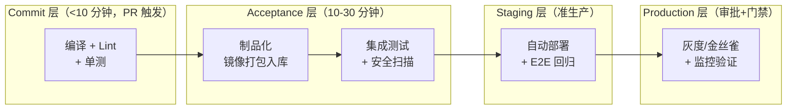
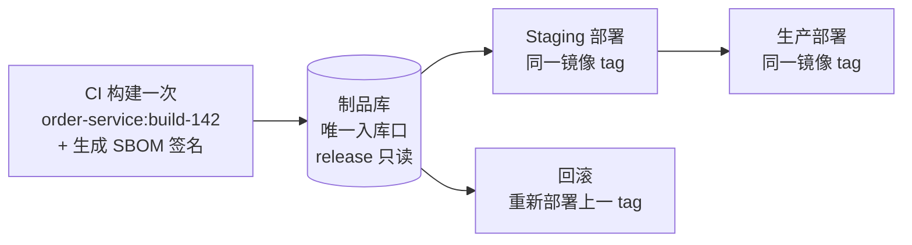

# CI-CD-流水线设计模式

> [!abstract] 摘要
> 语法只是"怎么写"，设计模式回答"为什么这样排"。本文讲解流水线的四层结构（commit/acceptance/staging/production）、DORA 五指标如何反向约束流水线设计、build once deploy many 产物晋升模式、制品库版本命名、并行/矩阵构建、fail-fast 排序与配置分离，并给出单体/微服务/前端三种经典模板对比。学完你能独立设计一条结构合理的四阶段流水线。

## 一、概念与原理

### 四层流水线结构

流水线的本质是**用层层过滤逼近"随时可发布"**：每层回答一个问题、每层耗时严格控制，越往后的层越接近生产、越需要审批与真实环境。



| 层 | 触发 | 回答的问题 | 失败代价控制 |
| --- | --- | --- | --- |
| Commit | 每次 push/PR | "代码能编译、逻辑对吗？" | 最快，数分钟内反馈 |
| Acceptance | Commit 层通过 | "组件协作与安全达标吗？" | 产出**唯一制品** |
| Staging | Acceptance 通过 | "在准生产环境跑得起来吗？" | 部署的是同一制品 |
| Production | 人工/门禁 | "敢不敢上生产？" | 灰度 + 一键回滚 |

### DORA 指标如何落地到流水线设计

DORA 五指标（部署频率、变更前置时间、变更失败率、失败恢复时间、返工率）不是等上线后再统计的报表，而是**设计约束**：

| 指标 | 对流水线的设计要求 |
| --- | --- |
| 部署频率 | Production 层的审批要自动化/轻量化（改到"点一下"而不是"开三会"） |
| 变更前置时间 | Commit 层 < 10 分钟是硬指标；流水线总长决定 lead time 下限 |
| 变更失败率 | Staging 必须跑 E2E 回归；Production 走金丝雀而不是全量 |
| 恢复时间 | 必须内建"回滚=重新部署上一个制品"能力，回滚不重编译 |
| 返工率 | 质量门禁前移到 Commit 层，减少下游返工 |

> [!tip]
> 度量做法：Jenkins + Prometheus 自算，或 GitLab 内置 DORA；流水线各 stage 的时间戳与结果事件是指标数据源——**流水线设计时就要埋好"可度量"的点**。详见 [[CI-CD现代实践与趋势]] 第三节。

## 二、核心模式详解

### 2.1 构建产物晋升：build once, deploy many

核心规则：**同一版本只构建一次**，staging 与生产部署的是同一个不可变制品，环境差异全部走配置注入。重编译意味着"你测试的不是你发布的"，会直接抬高变更失败率与前置时间。



### 2.2 制品库管理与版本命名

```text
Nexus / Artifactory / Harbor 统一存放：
  maven-releases/  ← 只读、不可覆盖（版本不可变）
  maven-snapshots/ ← 允许覆盖，仅开发期
  docker/v2/prod/  ← 按环境分仓库 + 权限隔离

版本命名建议：
  镜像： <应用名>:<语义化版本>-<短SHA>   例：order-service:2.3.1-9f4a2c1
  便捷： 追加 <应用名>:build-<BUILD_NUMBER> 便于 Jenkins 回溯
  禁止： latest 作为生产可引用版本（latest 不可追溯、不可回滚）
保留策略： releases 长期保留，snapshots 滚动清理，扫描失败版本打 quarantine 标签
```

### 2.3 失败快速反馈（fast fail 排序）

排序原则：**便宜的、最可能失败的检查放最前面**。每一步的耗时都要问一句"能不能更早失败"。

| 顺序 | 步骤 | 理由 |
| --- | --- | --- |
| 1 | 编译/Lint（秒级-分钟级） | 最便宜、失败率高，先拦 |
| 2 | 单测（分钟级） | 逻辑错误主要来源 |
| 3 | 打包制品（分钟级） | 通过前两层才值得花 |
| 4 | 集成/E2E/安全扫描（十分钟级） | 贵且慢，最后跑 |
| 5 | 部署与灰度 | 全绿才执行 |

### 2.4 并行与矩阵构建

```groovy
// Jenkins 声明式并行 + 矩阵（matrix 是声明式内置，替代老 plugin matrix job）
pipeline {
    agent none
    stages {
        stage('跨平台矩阵测试') {
            matrix {
                agent { label "${MATRIX_OS}" }          // 每个组合分配对应节点
                axes {
                    axis { name 'MATRIX_OS'; values 'linux', 'windows' }
                    axis { name 'JDK_VER';    values '21', '25' }
                }
                excludes { exclude { axis { name 'JDK_VER'; values '25' }
                                    axis { name 'MATRIX_OS'; values 'windows' } } }
                stages { stage('Test') { steps { sh/bat "mvn -B test" } } }
            }
        }
        stage('静态检查三件套') {
            parallel {
                stage('Lint')      { steps { sh 'npm run lint' } }
                stage('License')   { steps { sh 'npm run license-check' } }
                stage('SBOM')      { steps { sh 'syft packages dir:. -o cyclonedx-json > sbom.json' } }
            }
        }
    }
}
```

> [!note]
> 矩阵轴不宜超过 3 个、组合数控制在两位数内；`parallel` 分支间必须无顺序依赖（详见 [[Jenkins-Jenkinsfile语法详解]] 2.5 节）。

### 2.5 多环境配置管理（配置与代码分离）

| 内容 | 放哪里 | 原则 |
| --- | --- | --- |
| 代码与默认值 | Git（应用仓库） | 配置结构入库 |
| 环境差异值 | 环境配置仓库 / 制品库外置 | dev/staging/prod 各一份，走 PR 变更 |
| 密钥 | Vault + Jenkins 凭据库，**绝不进 Git** | 见 [[Jenkins-凭据与安全]] |
| 注入方式 | 环境变量 / ConfigMap / 启动参数 | 镜像内不含环境差异 |

## 三、实战案例：三种经典流水线模板对比

| 维度 | 单体应用（Spring Boot） | 微服务 | 前端 |
| --- | --- | --- | --- |
| Commit 层 | 编译+单测+JaCoCo | 编译+单测+契约测试 | Lint+单测+构建产物 |
| Acceptance 层 | 镜像化+Trivy 扫描+SBOM | 镜像化+扫描+**联调环境冒烟** | Lighthouse+bundle 分析 |
| Staging 层 | 自动部署+E2E 回归 | 按服务部署+依赖方契约回归 | 自动部署+UI 自动化 |
| Production 层 | input 审批+蓝绿 | 金丝雀+服务网格熔断验证 | CDN 切换+灰度域名 |
| 关键差异 | 一次全量回归 | **服务独立流水线**，避免"一个 monorepo 阻塞所有服务" | 产物直接可预览，审批最轻 |
| 反模式 | 流水线里远程编译生产包 | 微服务还共享一条巨型流水线 | 绕过 staging 直传 CDN |

模板示例——四阶段单体应用流水线（Jenkins LTS 2.580.2 可运行骨架）：

```groovy
@Library('platform-pipeline-libs@v2.3') _
pipeline {
    agent { kubernetes { yaml '''Pod 定义见 [[Jenkins-分布式构建与K8s动态Agent]] 2.3 节''' } }
    options { buildDiscarder(logRotator(numToKeepStr: '20')); timestamps() }
    environment {
        IMAGE = "registry.example.com/${env.JOB_BASE_NAME}:${env.BUILD_NUMBER}"
    }
    stages {
        stage('Commit: 编译+单测') {
            parallel {
                stage('构建') { steps { container('maven') { sh 'mvn -B verify' } } }
                stage('Lint') { steps { container('maven') { sh 'mvn -B checkstyle:check' } } }
            }
            post { always { junit '**/surefire-reports/*.xml' } }
        }
        stage('Acceptance: 制品化+扫描') {
            steps {
                container('maven') { sh "docker build -t ${IMAGE} ." }
                sh 'trivy image --exit-code 1 --severity HIGH,CRITICAL $IMAGE'
                sh 'syft packages dir:. -o cyclonedx-json > sbom.json'
                sh "docker push ${IMAGE}"                      // 唯一制品入库
            }
        }
        stage('Staging: 自动部署+回归') {
            steps {
                deployK8s(env: 'staging', namespace: 'demo',
                          app: 'order-service', image: "${IMAGE}")
                sh 'e2e-runner --suite staging-regression'     // 自动回归
            }
        }
        stage('Production: 审批+金丝雀') {
            input { message '发布生产?'; submitter 'release-managers' }
            steps { sh "./canary.sh prod ${IMAGE}" }           // 灰度+监控验证
        }
    }
}
```

## 四、动手练习

1. **给现有流水线分层**：把你项目当前的 Jenkinsfile stage 逐个贴上 Commit/Acceptance/Staging/Production 标签，找出"混层"（如 Commit 层里做镜像构建）并归位。
2. **fail-fast 审计**：按"便宜且易失败的在前"原则重排 stage，记录重排前后的**平均失败反馈时间**（从触发到红）。
3. **落地 build once**：检查你是否存在"staging 重打包"——把生产/staging 部署改为引用同一镜像 tag，禁止二次构建。
4. **版本命名**：为你的制品库设计版本命名规范（含短 SHA 与构建号），并把 `latest` 从生产部署脚本中移除。
5. **综合：设计四阶段流水线**：为自己的项目从零设计一条 Commit→Acceptance→Staging→Production 流水线，画出 mermaid 图并标注每层触发条件、时长目标、DORA 指标落点。

> [!success]- 第 5 题参考答案要点
> - mermaid 图应体现四层过滤结构，每层标注触发器（PR push / 前层通过 / 门禁审批）与时长目标（如 Commit < 10 min）。
> - Acceptance 层必须出现"制品入库"节点且后续层只引用该制品（build once）。
> - Staging/Production 都部署**同一 tag**，Production 层有审批 + 灰度/回滚说明。
> - 至少标注两个 DORA 落点：如"自动审批提高部署频率"、"金丝雀降低变更失败率"、"回滚脚本降低恢复时间"。
> - 配置注入与密钥来源有明确说明（配置仓库/Vault），镜像内无环境差异。

## 五、常见坑与 FAQ

> [!warning] 流水线越修越长是设计病
> 常见根因：①把所有检查塞进 Commit 层（lead time 爆炸）；②E2E 全量回归每次跑（应分层：PR 只跑受影响用例，Staging 跑全量）；③并行度浪费（串行跑了本可并行的独立检查）。定期用 DORA 前置时间做体检，超过目标值就重构分层。

> [!warning] "测试环境重编译"悄悄回潮
> 应急 hotfix 时最容易破坏 build once：开发顺手在部署机上重新打包。对策：流水线强制从制品库取版本、部署脚本只接受制品引用参数、制品库 release 仓库设只读权限。

> [!tip] 审批不是万能门禁
> 把 input 审批当唯一防线，失败率不会降——审批前必须有自动化验证（staging 回归 + 扫描全绿）。审批的价值在"业务时点"（营销窗口、合规留痕），不在"替机器看测试结果"。

> [!tip] 缓存与矩阵的组合优化
> 矩阵构建先算组合数：2 OS × 2 JDK = 4 个并发任务，Agent 池要够用（见 [[Jenkins-分布式构建与K8s动态Agent]]）；同时共享依赖缓存（Maven/npm PVC），否则 4 个任务重复下载依赖拖慢 3-10 分钟。

## 六、自检清单

- [ ] 流水线明确划分四层，每层有触发条件与时长目标
- [ ] Commit 层 < 10 分钟，失败反馈由近及远排序
- [ ] 同一版本只构建一次，各环境部署同一制品
- [ ] 制品库 release 仓库只读、版本不可覆盖，禁用 latest
- [ ] 配置与代码分离，密钥走 Vault/凭据库不入 Git
- [ ] 并行/矩阵分支无顺序依赖，组合数可控
- [ ] Production 有审批 + 灰度 + 一键回滚（回滚不重编译）
- [ ] 流水线埋了 DORA 指标采集点（stage 时间/结果事件）

## 七、关联笔记与参考

**关联**：[[CI-CD现代实践与趋势]]（全景与 DORA 定义）、[[Jenkins-Jenkinsfile语法详解]]（语法载体）、[[Jenkins-共享库实战]]（模板沉淀）、[[K8s-GitOps与ArgoCD实战]]（交付侧衔接）、[[SpringBoot最佳实践]]。

**参考资料**：

1. DORA 官方 - Software Delivery Performance Metrics（五指标定义）：https://dora.dev/guides/dora-metrics/
2. DORA 官方 - Continuous Delivery 能力（产物受版本控制、随时可发布）：https://dora.dev/capabilities/continuous-delivery
3. Jenkins 官方 - Pipeline（流水线即代码与 stage 设计基础）：https://www.jenkins.io/doc/book/pipeline/
4. Medium - Build Once, Deploy Many: The Core CI/CD Principle You're Probably Missing：https://medium.com/@aslam.develop912/build-once-deploy-many-the-core-ci-cd-principle-youre-probably-missing-d9fcdc34a854
