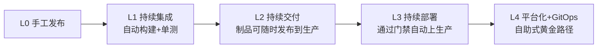
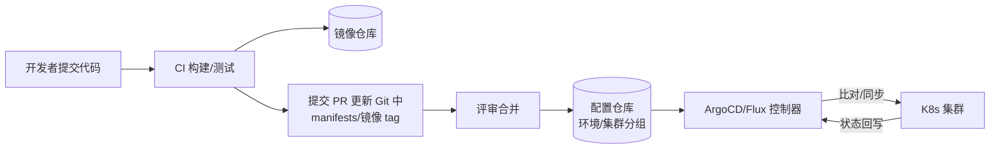
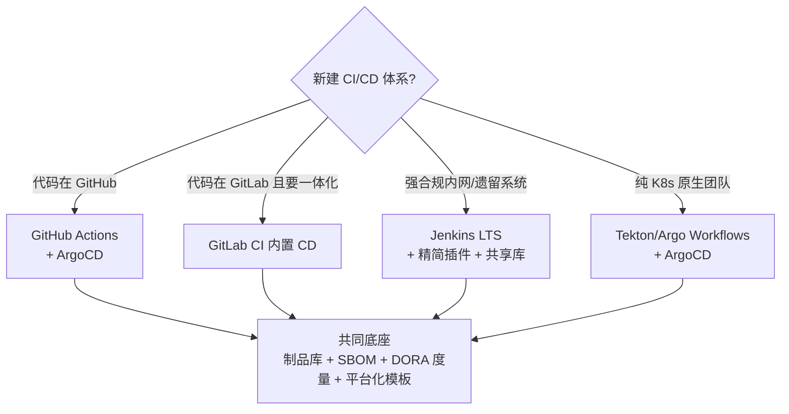

# CI-CD现代实践与趋势

## 一、概述

CI/CD（持续集成/持续交付/持续部署）是现代软件交付的主干道：**CI** 保证每次提交都被验证（编译→单测→质量门禁→制品化），**CD** 保证制品以可重复、可回滚的方式到达生产。本文梳理 CI/CD 的概念与成熟度、DORA 度量、分支策略、主流平台格局、GitOps 工作流、供应链安全与 2025-2026 趋势，作为 [[Jenkins流水线配置]] 与 [[Jenkins核心要点与最佳实践]] 的全景视角补充。

## 二、CI/CD 基础概念与成熟度模型



| 成熟度 | 特征 | 关键能力 |
| --- | --- | --- |
| L1 持续集成 | 每次提交自动构建测试，合并冲突早暴露 | 快速构建（<10 分钟）、质量门禁 |
| L2 持续交付 | 每个版本都是"随时可发"的制品 | 制品库管理、环境晋级（dev→staging→prod）、自动化回归 |
| L3 持续部署 | 通过验证即自动上线 | 自动化部署、蓝绿/金丝雀、快速回滚 |
| L4 平台化 | 开发者自助，平台团队提供"黄金路径" | 内部开发者平台（IDP）、模板化流水线、度量闭环 |

核心原则：构建产物**不可变**（一次构建、到处部署，不重复编译）；流水线即代码；失败早、失败快；一切变更走版本控制。

## 三、DORA 四指标

DORA（DevOps Research & Assessment，Google Cloud 团队）的四大关键指标是度量交付效能的行业标尺，2024 年后演化为**吞吐（throughput）+ 稳定（stability）**两组，并新增第五个指标"返工率（Rework Rate）"：

| 指标 | 定义 | 精英表现（参考） | 所属组 |
| --- | --- | --- | --- |
| **部署频率**（Deployment Frequency） | 发布到生产的频次 | 按需发布、每天多次 | 吞吐 |
| **变更前置时间**（Change Lead Time） | 从代码提交到生产运行 | 少于一天 | 吞吐 |
| **变更失败率**（Change Failure Rate） | 需要回滚/热修的部署占比 | 约 5% 以内 | 稳定 |
| **失败部署恢复时间**（Failed Deployment Recovery Time，原 MTTR 改名） | 从故障到恢复 | 少于一小时 | 吞吐 |
| **返工率**（Rework Rate，2024 新增） | 交付工作被返工的比例 | 越低越好 | 稳定 |

> [!tip]
> 落地建议：指标用工具自动采集（如 GitLab 内置 DORA、Jenkins + Prometheus 自算、开源 Four Keys 方案），**不要手工月报**。指标是团队的仪表盘而非 KPI 考核，否则会催生"刷指标"（如拆小 commit 伪装高频率）。2025 年 DORA 报告同时指出：AI 编码工具让代码产量上升，流水线需求随之放大，度量必须覆盖 AI 辅助产生的变更。

## 四、分支策略对比

| 策略 | 结构 | 适用 | CI/CD 代价 |
| --- | --- | --- | --- |
| **Git Flow** | `feature → develop → release → hotfix → main` 长命分支体系 | 有明确版本交付节奏的传统软件（客户端、固件） | 分支多、合并慢，CI 需维护多套流水线 |
| **GitHub Flow** | `feature → PR → main → deploy` | Web 服务，小团队快速迭代 | 轻量，主干即发布物 |
| **Trunk-Based Development（TBD）** | 短命分支（<2 天）直合主干，未完成功能用**特性开关**隔离 | 高频部署、SaaS/微服务团队 | 要求强自动化测试 + 特性开关治理，是高频部署的前提 |

> [!info]
> DORA 与行业共识（2025 年讨论）：追求高部署频率的团队基本收敛到 TBD——分支长命与"持续集成"天然矛盾；而强调版本隔离的领域（车载、大版本交付）保留 Git Flow 变体。特性开关（Feature Flags）是 TBD 的安全带，没有开关治理不要盲目收分支。

## 五、主流平台对比（2025-2026 格局）

| 维度 | Jenkins | GitLab CI | GitHub Actions | ArgoCD + Tekton/Argo Workflows |
| --- | --- | --- | --- | --- |
| 形态 | 自托管 CI 服务器 + 插件生态 | DevSecOps 一体平台（仓库+CI+扫描+CD） | GitHub 原生 CI，Marketplace 生态 | K8s 原生 CD/流水线，GitOps 引擎 |
| 配置语言 | Jenkinsfile（Groovy DSL） | `.gitlab-ci.yml` | workflow YAML | ArgoCD Application / Tekton Task CR |
| 托管 | 完全自管（含 Agent） | SAAS + 自托管 Runner | SAAS + 自托管 Runner | 自托管（K8s 必备） |
| 插件/扩展 | 1800+ 插件，最强自由度 | 内置集成多 | Marketplace 数万 Action | K8s 生态原生整合 |
| 优势 | 自托管合规、遗留系统、深度定制、成本可控 | 端到端体验，安全扫描内置 | 门槛最低，AI 集成最深 | 声明式发布、漂移自愈、多集群 |
| 劣势 | 插件维护与升级负担重 | 深度绑定 GitLab 平台 | 计费随用量增长，大矩阵任务贵 | 只管部署侧，需配 CI |
| 2025-2026 定位 | 合规与遗留场景的"不可替代者"，逐渐"小众但坚挺" | 企业一体化平台首选之一 | GitHub 用户的事实标准 | 企业 GitOps 部署事实标准（ArgoCD 出现在约 60% 受访 K8s 集群） |

社区共识（2025-2026 迁移实践）：**代码在哪个平台，优先用哪个平台的原生 CI**；新项目一般不再新建 Jenkins，但金融、政务等强合规内网环境 Jenkins 仍是首选；常见终局是"**CI 用 GitLab CI/GitHub Actions，CD 用 ArgoCD**"的组合。

## 六、GitOps 工作流详解

GitOps 把"部署状态"也纳入版本控制：Git 是唯一事实源，控制器持续比对期望态与集群实际态并自动收敛。



实践要点（以 ArgoCD 为例）：

1. **仓库结构**：按环境分组（`apps/staging/`、`apps/prod/`），App of Apps 模式用一个根 Application 管理集群所有子应用，新服务=提交一个子 Application 清单。
2. **同步编排**：资源打 `argocd.argoproj.io/sync-wave` 注解控制顺序——CRD/命名空间/密钥负数波次先行，工作负载最后；上线顺序依赖用 Sync Phases（pre-sync/sync/post-sync）挂钩。
3. **部署触发**：合并到环境分支（PR 即审批），ArgoCD 自动同步或 `--sync-wave` + 自动化策略；镜像 tag 更新由 CI 写回（无手工改集群）。
4. **密钥管理**：密钥**明文绝不进 Git**，三选一——Sealed Secrets（Git 原生、最简）、SOPS+age/KMS（加密落 Git）、External Secrets Operator + Vault（Git 不落密钥，企业推荐）。
5. **漂移治理**：手动 `kubectl edit` 会被控制器纠正；变更必须走 PR，保留审计轨迹与一键回滚（回滚 = Git revert）。

> [!warning]
> GitOps 常见坑：把**所有**配置都塞进单一巨型仓库导致评审拥堵（按团队/环境拆分）；ArgoCD "OutOfSync" 抖动多半是 HPA/状态字段被控制器改写，需配置 `ignoreDifferences`；自动同步 + 缺少评审门禁=配置变更绕过审计。

## 七、制品库与供应链安全

### 7.1 制品库管理

- **Nexus / Artifactory / Harbor** 承担 Maven/npm/PyPI/镜像的统一存储：唯一入库口、版本不可覆盖（release 仓库只读）、保留策略与漏洞扫描。
- 流水线规范：**同一版本只构建一次**，后续环境晋级直接复用制品（不可变的产物），杜绝"测试环境重编译、生产又编译"导致的不一致。
- Jenkins 中通常以 `nexusArtifactUploader` / `withCredentials` 推送制品；K8s 场景由 Harbor + 机器人凭据拉取。

### 7.2 SBOM 与供应链安全（2025-2026 重点）

```groovy
// CI 中嵌入 SBOM 与签名的典型步骤（容器场景）
stage('供应链安全') {
    steps {
        // 生成 SBOM（CycloneDX 格式）
        sh 'syft packages dir:. -o cyclonedx-json > sbom.json'
        // 镜像漏洞扫描
        sh 'trivy image --exit-code 1 --severity HIGH,CRITICAL ${IMAGE}'
        // 签名镜像（cosign，防篡改/来源可证）
        sh 'cosign sign --key cosign.key ${IMAGE}'
        sh 'cosign attest --predicate sbom.json --type cyclonedx ${IMAGE}'
    }
}
```

要点：

1. **SBOM**（软件物料清单）在**构建时**自动生成（Syft/CycloneDX/SPDX 格式），随镜像签名并归档到制品库。
2. 新 CVE 公布时对**存量 SBOM 持续比对**（Grype/Trivy 定期重扫），而不是只在构建时扫一次。
3. CI/CD 系统自身是供应链攻击面：插件/Action 依赖锁定版本（`actions/checkout@v5` 而非 `@master`）、最小权限 token、签名验证（Jenkins 2025-12 起更换仓库签名密钥、2026-09 默认禁止 Object 反序列化都属于这类加固）。
4. 重大事件驱动合规收紧（Log4Shell 之后 SBOM 成为政企采购硬指标，欧美监管要求逐步落地）。

## 八、2025-2026 趋势

| 趋势 | 说明 | 时间点 |
| --- | --- | --- |
| **平台工程规模化** | 约 55% 组织已建立平台工程职能（2025）；CI/CD 从"每个团队自己搭"转为平台团队提供**黄金路径**（模板流水线、安全默认值、自助门户） | 2025-2026 |
| **AI 辅助 CI/CD** | DORA 2025 报告：AI 生成代码量增加，流水线负载与修复需求同步放大；平台开始内置 AI 修复失败流水线、生成测试、分析构建日志（GitHub Actions AI 集成最深） | 2025 起加速 |
| **GitOps 成为交付默认** | ArgoCD 稳居企业首选（约 60% 受访 K8s 集群在用），Flux 以轻量模块化增长；渐进式交付（Argo Rollouts/Flagger 金丝雀）与 GitOps 深度绑定 | 2025-06 CNCF |
| **K8s 原生流水线崛起** | Tekton/Argo Workflows 把流水线本身变成 CRD，与 ArgoCD 组成纯声明式交付链 | 持续 |
| **供应链安全合规化** | SBOM、签名（cosign）、SLSA 分级成为企业准入要求；CI 平台默认行为收紧（如 Jenkins 2.580.1） | 2025-2026 |
| **成本与效率** | 构建缓存（远程 cache）、spot 实例 Runner、分层镜像、按需动态 Agent 成为平台标配优化项 | 持续 |

## 九、选型建议



> [!tip]
> 实操建议：①存量 Jenkins 团队不要盲目"上云原生重构"，先把 Jenkinsfile 收敛进共享库、配好 DORA 度量，再评估迁移成本；②新团队从平台原生 CI 起步，省下维护 CI 服务器的精力；③无论哪条路线，**部署侧统一交给 GitOps（ArgoCD）** 已是 2026 年最省心的组合。

## 十、参考资料

1. DORA 官方 - Metrics Guide（四指标与 2024-2025 演进）：https://dora.dev/guides/dora-metrics/
2. CNCF Blog - GitOps in 2025: from old school updates to the modern way：https://www.cncf.io/blog/2025/06/09/gitops-in-2025-from-old-school-updates-to-the-modern-way/
3. Akuity - Argo CD vs Flux（ArgoCD 约 60% 集群采用率）：https://akuity.io/blog/argo-cd-flux-comparison
4. Argo CD 官方文档 - Sync Phases and Waves / Secret Management：https://argo-cd.readthedocs.io/en/stable/user-guide/sync-waves/
5. Medium - Jenkins vs GitHub Actions vs GitLab CI in 2026: What We Learned Migrating 200 Pipelines：https://medium.com/@surbhi19/jenkins-vs-github-actions-vs-gitlab-ci-in-2026-what-we-learned-migrating-200-pipelines-fb529fbd966b
6. Bytebase - GitLab CI vs. GitHub Actions: Complete Comparison 2025：https://www.bytebase.com/blog/gitlab-ci-vs-github-actions
7. CircleCI Blog - Trunk-Based vs Feature-Based Development：https://circleci.com/blog/trunk-vs-feature-based-dev
8. safeguard.sh - SBOM in CI/CD Pipeline: Generation to Continuous Use：https://safeguard.sh/resources/blog/sbom-in-ci-cd-pipeline
9. Medium - A Practical Approach to SBOM in CI/CD（CycloneDX 实践）：https://medium.com/@theowni/a-practical-approach-to-sbom-in-ci-cd-f3ce8071c0fa
