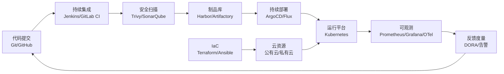
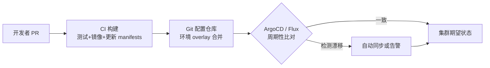

# DevOps最佳实践与发展趋势

## 概述

DevOps 是一套"文化 + 实践 + 工具链"的工程方法论，目标是用可持续的方式缩短交付周期并提升交付质量。本笔记覆盖：核心实践（CI/CD、IaC、可观测性）、工具链全景、DORA 度量体系、平台工程与 GitOps、OpenTelemetry 统一可观测，以及 2025-2026 的趋势判断（AI 辅助运维、FinOps）。K8s 落地细节见 [[Kubernetes部署实践]] 与 [[Kubernetes核心要点与生产实践]]，流水线实现参考 [[Jenkins流水线配置]]。

## 核心文化与实践

DevOps 的本质是打破"开发交付快"与"运维求稳定"的对立，向 CI/CD 一体化演进。支撑它落地的四大实践：

| 实践 | 内涵 | 关键工具 | 落地要点 |
| --- | --- | --- | --- |
| CI（持续集成） | 每次提交自动构建+测试+镜像化 | Jenkins、GitLab CI、GitHub Actions | 分支生命周期 <3 天；流水线分层（PR 快测 + 合并全测） |
| CD（持续交付/部署） | 制品可随时发布到生产 | ArgoCD、Flux、Spinnaker | 发布与部署解耦：先做"随时可发布"，再谈自动部署 |
| IaC（基础设施即代码） | 环境=代码，可评审可回滚 | Terraform/OpenTofu、Ansible、Pulumi | 状态文件入远端存储（S3/OSS+锁）；变更走 PR 评审 |
| 可观测性 | Metrics/Logs/Traces 三支柱 | Prometheus、Loki、OpenTelemetry | 告警面向 SLO 而不是面向单点阈值 |

> [!tip] 先有自动化测试，才有真 CD
> 没有"可信的自动化测试与发布门禁"，CD 只会加速把坏版本推上生产。推行顺序建议：构建自动化 → 测试自动化 → 环境标准化（IaC）→ 部署自动化 → 度量与优化。

## 工具链全景图



| 层 | 2025-2026 主流选择 | 备注 |
| --- | --- | --- |
| 版本控制 | Git（GitHub/GitLab/Gitea） | 一切工作流的事实源 |
| CI | Jenkins（存量）/GitHub Actions/GitLab CI（增量） | Jenkins 轻量化改造见 [[Jenkins流水线配置]] |
| 制品与镜像 | Harbor、Artifactory | 镜像签名（cosign）逐步成为门禁 |
| 配置管理 | Ansible（过程式） | 大规模节点变更、裸金属初始化 |
| 基础设施 | Terraform/OpenTofu、Crossplane | OpenTofu 作为 Terraform 开源分支持续演进 |
| 部署 | ArgoCD/Flux（GitOps） | 均为 CNCF Graduated 项目 |
| 监控告警 | Prometheus + Grafana + Alertmanager | 原理与部署见 [[Prometheus监控入门]] |
| 日志链路 | Loki/Elasticsearch、OpenTelemetry Collector | 统一采集趋势见下文 OTel 章节 |

## DORA 四指标

DORA（DevOps Research & Assessment）用四个指标同时衡量"吞吐"与"稳定性"：

| 指标 | 方向 | 含义 | 优化抓手 |
| --- | --- | --- | --- |
| 部署频率（Deployment Frequency） | 越高越好 | 生产发布频次 | 小批量、自动化门禁 |
| 变更前置时间（Lead Time for Changes） | 越短越好 | 提交到上生产的时间 | 流水线提速、并行测试 |
| 变更失败率（Change Failure Rate） | 越低越好 | 导致降级/回滚的发布占比 | 发布前检查、金丝雀 |
| 故障恢复时间（Failed Deployment Recovery Time，原 MTTR） | 越短越好 | 故障到恢复的时间 | 快速回滚、可观测、演练 |

从 2024 年起 DORA 增加了第五个维度 **可靠性（Reliability，以返工率 Rework Rate 等度量）**；2025 年报告《State of AI-assisted Software Development》进一步用 **7 种团队画像** 取代传统的"精英/高/中/低"四档分层，核心结论是 **AI 是放大器**：放大高绩效团队的优势，也会放大低绩效团队的缺陷——工具不能替代工程实践本身。

> [!info] 用指标驱动改进，而不是考核个人
> DORA 指标的价值在团队级趋势对比（季度环比）。若用于个人 KPI，会出现"刷部署频率"等指标欺骗行为，违背 DORA 研究初衷。

## 平台工程与内部开发者门户

平台工程（Platform Engineering）是 DevOps 的规模化演进形态：**由平台团队把上述散装能力沉淀为自服务的内部平台（IDP，Internal Developer Platform）**，业务开发者通过门户/CLI/API 自助完成"建环境-部署-观测"。

- Gartner 预测：到 2026 年，约 **80% 的软件工程组织** 将建立平台工程团队，提供内部工具、组件与交付服务（Red Hat、Gartner 相关解读见参考资料）。
- 平台工程不取代 DevOps：DevOps 是文化与方法（"you build it, you run it"），平台工程是承载它的产品化基础设施。
- **黄金路径（Golden Path）**：为最常见的场景（新建服务、部署 K8s 应用、加监控）提供预设模板，走模板=零配置直接可用，偏离模板仍然可行但自行负责。
- 常见实现：Backstage（CNCF 项目，开发者门户框架）+ ScoreSpec/Harbor + ArgoCD + Crossplane 组合。
- 成功关键：像做产品一样做平台——有用户调研、有 roadmap、有采纳率（adoption rate）指标，而不是"被要求使用"。

## GitOps 工作流

GitOps 四原则（OpenGitOps）：**声明式、版本化且不可变、自动拉取、持续调谐**。Git 仓库是期望状态的唯一事实源，集群内控制器把实际状态收敛到 Git 声明的状态。



ArgoCD 与 Flux 对比（均为 CNCF Graduated，2022 年毕业）：

| 维度 | ArgoCD | Flux |
| --- | --- | --- |
| 界面 | 内置 Web UI，应用级视图，上手快 | CLI 优先，轻量 |
| 架构 | Application/Project 模型 + ApplicationSets 多集群 | GitOps Toolkit 模块化控制器组合 |
| 适合 | 团队需要 UI、多租户应用视图 | 自动化优先、与镜像自动更新集成 |

```yaml
# ArgoCD Application：跟踪 Git 仓库中 prod overlay，自动同步
apiVersion: argoproj.io/v1alpha1
kind: Application
metadata:
  name: web-prod
  namespace: argocd
spec:
  project: default
  source:
    repoURL: https://git.example.com/platform/deploy.git
    targetRevision: main
    path: apps/web/overlays/prod        # Kustomize overlay
  destination:
    server: https://kubernetes.default.svc
    namespace: prod
  syncPolicy:
    automated: { prune: true, selfHeal: true }   # 漂移自愈+清理已删资源
    syncOptions: [CreateNamespace=true]
```

> [!warning] 手改生产 = GitOps 自愈把它改回去
> 开启 `selfHeal` 后，任何绕过 Git 的手工变更都会被控制器"修复"。这既是防漂移优点，也是事故放大器：紧急止血可以用 `argocd app set --sync-policy none` 暂停自动同步，事后必须把变更补回 Git，否则下次同步即回退。

## OpenTelemetry 统一可观测

三大信号（Metrics/Logs/Traces）长期由不同系统采集，OTel 的目标是**一次埋点、统一协议（OTLP）、自由后端**（Prometheus/Jaeger/ES/商业 APM 皆可接收）。

- 2025-2026 成熟度：Grafana 观测性调查显示 **57% 的组织用 OTel 采集 metrics、约 50% 采集 traces、48% 采集 logs**，OTel 已从"新标准"变成"默认起点"；OTTL（转换语言）在 2026 年宣布 stable。
- K8s 中的典型形态：OTel Operator 部署 Collector（DaemonSet 采集节点/应用 + Deployment 做网关聚合），自动注入（instrumentation CRD）为 Pod 挂 SDK。
- 与 K8s 组件融合：apiserver/scheduler/kubelet 自身 tracing 自 **v1.34 GA**，控制面慢请求可基于 OTLP 直接分析。
- 落地顺序建议：先 traces（定位跨服务延迟收益最大）→ 再 logs 走 Collector 统一 → 最后 profiles（持续性能剖析）。

## IaC 要点（Terraform / Ansible）

两者分工：**Terraform 管云资源生命周期**（VPC、K8s 集群、中间件实例，声明式+状态管理），**Ansible 管主机内配置**（系统参数、软件安装，过程式、无状态依赖）。

```hcl
# Terraform：创建一个生产级云数据库（远端状态 + 锁）
terraform {
  backend "s3" {
    bucket = "tf-state-prod"
    key    = "prod/rds.tfstate"
    # DynamoDB 表做状态锁，防止并发 apply 破坏状态
  }
}
resource "aws_db_instance" "main" {
  identifier        = "prod-mysql"
  engine            = "mysql"
  instance_class    = "db.r6g.large"
  allocated_storage = 100
  multi_az          = true          # 生产必须多可用区
  backup_retention_period = 14
  lifecycle { prevent_destroy = true }   # 防误删关键资源
}
```

```bash
# Ansible：批量初始化 K8s 节点内核参数（幂等）
ansible k8s_nodes -m ansible.builtin.lineinfile \
  -a "path=/etc/sysctl.d/99-k8s.conf line='net.ipv4.ip_forward=1' create=yes" --become
ansible k8s_nodes -m ansible.builtin.command \
  -a "sysctl --system" --become
```

IaC 实践红线：状态文件**绝不入 Git 明文**（可能含密钥，用远端后端+加密）；`plan` 结果作为 PR 评审材料；模块化（variables/outputs）避免复制粘贴；敏感值用 Vault/SSM 注入而不是写进变量文件。

## 常见坑与最佳实践

> [!warning] Jenkins 并发与凭证管理是流水线事故两大来源
> 高峰期并发构建打爆 Controller（引出 [[Jenkins资源高效利用方案]] 的思路：agent 池化、按需拉起 Pod agent）；流水线明文写密码会永久留在构建日志。凭证一律走 Credentials Binding，日志输出默认脱敏。

> [!tip] 用"环境矩阵"而不是多份手工配置
> dev/staging/prod 三环境用同一份基线（Kustomize base 或 Terraform module）+ 最小差异 overlay，任何环境差异都要"能在一屏 diff 内看清"，否则配置漂移会随环境数量指数增长。

> [!tip] 发布能力按渐进式清单推进
> 蓝绿/金丝雀 → 特性开关（Feature Flag）→ 自动回滚（基于 SLO 指标触发）。先在无状态服务上演练金丝雀，K8s 层面可由 Argo Rollouts 基于 Prometheus 指标自动切换，原理参见 [[微服务架构设计]] 中的灰度设计。

## 2025-2026 趋势

| 趋势 | 现状与判断 |
| --- | --- |
| **平台工程规模化** | Gartner 2026 预测落地年：80% 组织将设平台团队；IDP/黄金路径从概念进入标配，Backstage 生态成熟 |
| **AI for DevOps（AIOps/辅助研发）** | DORA 2025 报告核心结论"AI 是放大器"：AI 提升编码吞吐的同时，交付稳定性反而依赖评审与测试等基础实践；AIOps 用于告警降噪、根因初判、故障复盘生成 |
| **GitOps 成为交付默认** | ArgoCD/Flux 双雄并立（均 CNCF Graduated）；讨论焦点从"要不要 GitOps"转向与 IDP、意图导向（intent-based）及 AI 工作流的融合 |
| **OpenTelemetry 统一可观测** | 采集侧事实标准（metrics 57% 采用）；供应商中立成为选型硬指标；profiles 与 GenAI 可观测是新增量 |
| **FinOps 融入 DevOps** | 云成本从财务报表变成工程指标：K8s 场景用 OpenCost/Kubecost 按命名空间/团队分账，配额与 HPA 策略直接影响账单 |
| **供应链安全加强** | SBOM、镜像签名（cosign）、准入控制（Kyverno/Gatekeeper 校验签名）逐步进入合规要求 |
| **K8s 运维简化** | In-place pod resize（v1.35 GA）降低调参成本、DRA 统一 GPU 管理、更长发布周期（v1.36 起）降低升级频率 |

> [!info] 对个人能力的启示
> 2026 年运维/DevOps 岗位形成 AIOps、DevOps、SRE、MLOps 四大方向。共同基础是：Linux 与网络功底（[[Linux常用命令集]]）、K8s、IaC、可观测性；差异化竞争力在"用代码和 AI 工具把重复劳动自动化"的能力，而非记忆具体命令。

## 参考资料

1. [DORA — Software delivery performance metrics](https://dora.dev/research/)（四指标+可靠性第五维度的官方定义）
2. [DORA 2025: Faster, But Are We Any Better? — DevOps.com](https://devops.com/dora-2025-faster-but-are-we-any-better)（2025 年报告《State of AI-assisted Software Development》要点：AI 放大器、7 种团队画像）
3. [State of DevOps 2025: Review of the DORA Report — Splunk Blog](https://www.splunk.com/en_us/blog/learn/state-of-devops.html)（2025 DORA 报告解读）
4. [平台工程与 DevOps — Red Hat](https://www.redhat.com/zh-cn/topics/platform-engineering/platform-engineering-vs-devops)（平台工程定位与 Gartner 80% 预测）
5. [GitOps in 2025: From old-school updates to the modern way — CNCF Blog](https://www.cncf.io/blog/2025/06/09/gitops-in-2025-from-old-school-updates-to-the-modern-way)（ArgoCD 与 Flux 对比、GitOps 现状）
6. [Grafana Observability Survey 2026](https://grafana.com/observability-survey/2026)（OTel 采集占比：metrics 57%/traces ~50%/logs 48%）
7. [OpenTelemetry 2026 年度博客 — opentelemetry.io](https://opentelemetry.io/blog/2026)（OTTL stable 等项目里程碑）
8. [KEDA — Kubernetes Event-driven Autoscaling](https://keda.sh)（事件驱动弹性与缩容到零）
9. [Kubernetes v1.35 release — Kubernetes Blog](https://kubernetes.io/blog/2025/12/17/kubernetes-v1-35-release/)（In-place resize GA 等影响运维体验的特性）
10. [Ingress NGINX Retirement — KGateway Blog](https://kgateway.dev/blog/nginx-ingress-retirement-what-you-need-to-know)（2026-03 退役，GitOps/平台团队需要纳入升级计划）
