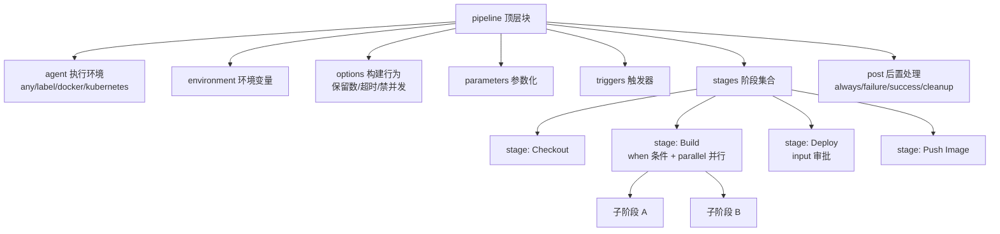

# Jenkins-Jenkinsfile语法详解

> [!abstract] 摘要
> Jenkinsfile 是声明式流水线（Declarative Pipeline）的载体文件，与业务代码同库存放、同版本演进。本文系统拆解 `pipeline/agent/stages/steps` 骨架与 `environment/parameters/options/triggers/when/post/input/parallel` 各指令，给出声明式 vs 脚本式对比、两个完整可运行案例与排错清单。学完你能从零为一个项目写出规范、可维护的 Jenkinsfile。

## 一、概念与原理

声明式流水线把"构建-测试-部署"描述为一棵**结构固定的树**：顶层 `pipeline` 块内只允许 Sections（agent/stages/post）、Directives（environment/parameters/options/triggers/when/tools）和 Steps。整体结构如下：



> [!info]
> 本笔记基于 Jenkins LTS 2.580.x（2026-10-28 发布 2.580.2）验证语法。声明式与脚本式底层同为 Pipeline 子系统，声明式是"更简化、更有主见"的官方推荐写法；`script {}` 步骤是逃生舱，大段脚本逻辑应下沉到 [[Jenkins-共享库实战]]。

### 声明式 vs 脚本式对比

| 维度 | 声明式（推荐） | 脚本式（Scripted） |
| --- | --- | --- |
| 顶层结构 | 必须包裹在 `pipeline { }` 块 | `node { }` 起步，无固定结构 |
| 编程模型 | 声明式、结构预定义 | 命令式，任意 Groovy |
| 可读性 | 强约束、一目了然 | 灵活但易失控 |
| 适用 | 绝大多数 CD 流水线 | 复杂控制流（通常下沉共享库） |
| 学习成本 | 低，语法可查表 | 需熟悉 Groovy 与 CPS 限制 |
| 逃生舱 | `script { }` 步骤 | 直接写 |

## 二、核心语法详解

### 2.1 agent 指令（必填）

```groovy
pipeline {
    agent any                                  // 任意可用节点
    // agent none                              // 不分配全局 agent，每个 stage 自带
    // agent { label 'linux && maven' }        // 标签匹配，支持 && || 组合
    // agent { node { label 'build'; customWorkspace '/data/ws' } }
    // agent {
    //     docker {
    //         image 'maven:3.9-eclipse-temurin-21'
    //         args '-v /tmp:/tmp'
    //         registryUrl 'https://registry.example.com/'
    //         registryCredentialsId 'regcred'
    //         reuseNode true                    // stage 级专用：复用顶层节点
    //     }
    // }
    // agent { kubernetes { defaultContainer 'jnlp'; yaml '''...Pod YAML...''' } }
    stages { stage('Build') { steps { echo 'hello' } } }
}
```

| 参数 | 说明 |
| --- | --- |
| `label` | 标签/标签表达式；node 形式下必填 |
| `customWorkspace` | 自定义工作空间（相对或绝对路径） |
| `reuseNode` | 仅 stage 级 docker/dockerfile 有效，默认 false，true 时复用顶层节点 |
| `alwaysPull` | docker 形式可选，每次强制拉取镜像 |

### 2.2 directives 逐个拆解

```groovy
environment {                          // 顶层或 stage 级，KV 形式注入环境变量
    APP_NAME = 'demo-service'
    REG_CRED = credentials('docker-registry-cred')   // 自动生成 REG_CRED_USR / REG_CRED_PSW
}
parameters {                           // 仅顶层、仅出现一次，读取用 params.XXX
    string(name: 'GIT_TAG', defaultValue: 'v1.0.0')
    choice(name: 'DEPLOY_ENV', choices: ['dev', 'staging', 'prod'])
    booleanParam(name: 'SKIP_TEST', defaultValue: false)
    password(name: 'API_KEY', defaultValue: '')
}
options {                              // 构建行为开关
    buildDiscarder(logRotator(numToKeepStr: '20'))
    timeout(time: 30, unit: 'MINUTES')
    timestamps()
    disableConcurrentBuilds(abortPrevious: true)   // 新提交中止旧构建
    parallelsAlwaysFailFast()                      // parallel 分支默认 fail-fast
}
triggers {                             // 仅顶层；生产首选 Webhook，以下为兜底
    cron('H 2 * * 1-5')                // H=按任务名哈希错峰
    pollSCM('H/10 * * * *')
    upstream(upstreamProjects: 'lib-build', threshold: hudson.model.Result.SUCCESS)
}
```

> [!tip]
> `expression { return params.SKIP_TEST }` 有经典陷阱：Groovy 中非空字符串（包括 `"false"`、`"0"`）都为真。booleanParam 请直接用 `when { expression { return params.SKIP_TEST == false } }` 这类显式比较。

### 2.3 when 条件（stage 级）

```groovy
stage('Deploy') {
    when {
        // 常用内置条件：
        branch 'main'                                   // 仅 multibranch 任务生效
        branch pattern: 'release-\\d+', comparator: 'REGEXP'
        tag 'release-*'                                 // 空模式等同 buildingTag()
        environment name: 'DEPLOY_TO', value: 'production'
        equals expected: 'prod', actual: params.DEPLOY_ENV
        changeRequest target: 'main'                    // 是 PR/MR 且目标是 main
        changeset '**/*.java'                           // 变更文件匹配（GLOB）
        expression { return params.DEPLOY_ENV == 'prod' }
        // 组合器：
        allOf { branch 'main'; tag 'v*' }               // 全真
        anyOf { branch 'main'; branch 'staging' }       // 任一真（命中即停）
        not { changeRequest() }
    }
    steps { sh './deploy.sh' }
}
```

求值时机默认在**进入 agent 之后**；加 `beforeAgent true` 可先判条件再占用节点，`beforeInput true`、`beforeOptions true` 同理，优先级 beforeOptions > beforeInput > beforeAgent。

### 2.4 post 与阶段结果

post 条件按官方固定顺序执行：`always → changed → fixed → regression → aborted → failure → success → unstable → unsuccessful → cleanup`。可在顶层和每个 stage 内各写一份；`cleanup` 专门放清理动作，保证在其他 post 逻辑之后运行。

```groovy
post {
    success { echo '成功' }
    failure { emailext subject: "失败: ${env.JOB_NAME} #${env.BUILD_NUMBER}", to: 'team@example.com' }
    unstable { echo '测试失败（黄色）' }
    fixed   { echo '上次失败这次好了' }
    always  { junit allowEmptyResults: true, testResults: '**/target/surefire-reports/*.xml' }
    cleanup { cleanWs() }
}
```

### 2.5 input 人工审批 与 parallel 并行

```groovy
stage('生产审批') {
    input {
        message '确认发布到生产环境?'
        ok '确认发布'
        submitter 'alice,bob,release-managers'
        submitterParameter 'APPROVER'
        parameters { string(name: 'TICKET', defaultValue: '', description: '变更单号') }
    }
    steps { echo "审批人: ${APPROVER}，单号: ${TICKET}" }
}

stage('并行验证') {
    parallel {
        stage('单测')  { steps { sh 'mvn -B test' } }
        stage('Lint')  { steps { sh 'npm run lint' } }
        stage('静态扫描') { steps { sh 'trivy fs --exit-code 0 .' } }
    }
}
```

> [!note]
> input 在进入 agent 与 when 判断之前暂停（可用 beforeInput 调整）；`parallelsAlwaysFailFast()` 让任一并行分支失败后立即中止其余分支，是 CI 提速利器。

## 三、实战案例

### 案例一：Spring Boot 构建 + Docker 镜像推送（Jenkins LTS 2.580.2）

```groovy
// Jenkinsfile —— Spring Boot 单体服务，构建→测试→镜像→推送
pipeline {
    agent { label 'docker' }
    options {
        buildDiscarder(logRotator(numToKeepStr: '20'))
        timeout(time: 30, unit: 'MINUTES')
        timestamps()
        disableConcurrentBuilds()
    }
    environment {
        APP_NAME = 'order-service'
        DOCKER_REG = 'registry.example.com'
        IMAGE = "${DOCKER_REG}/${APP_NAME}:${env.BUILD_NUMBER}"
        REG_CRED = credentials('docker-registry-cred')     // 生成 _USR/_PSW
    }
    stages {
        stage('拉取代码') { steps { checkout scm } }
        stage('单测') {
            steps { sh 'mvn -B test' }
            post { always { junit allowEmptyResults: true, testResults: '**/surefire-reports/*.xml' } }
        }
        stage('打包镜像') {
            steps { sh "docker build -t ${IMAGE} ." }
        }
        stage('推送镜像') {
            steps {
                sh "docker login ${DOCKER_REG} -u ${REG_CRED_USR} -p ${REG_CRED_PSW}"
                sh "docker push ${IMAGE}"
            }
        }
    }
    post {
        failure { echo "失败: ${env.BUILD_URL}" }
        cleanup { cleanWs() }
    }
}
```

### 案例二：前端构建 + 多环境部署（Jenkins LTS 2.580.2）

```groovy
pipeline {
    agent any
    options { parallelsAlwaysFailFast(); timestamps() }
    parameters {
        choice(name: 'DEPLOY_ENV', choices: ['dev', 'staging', 'prod'], description: '目标环境')
    }
    stages {
        stage('Checkout') { steps { checkout scm } }
        stage('安装依赖') { steps { sh 'npm ci --cache ~/.npm --prefer-offline' } }
        stage('质量验证') {
            parallel {
                stage('Lint')  { steps { sh 'npm run lint' } }
                stage('单测')  { steps { sh 'npm run test:ci' } }
            }
        }
        stage('构建产物') { steps { sh 'npm run build' } }
        stage('部署 dev/staging') {
            when { expression { params.DEPLOY_ENV != 'prod' } }
            steps { sh "./deploy.sh ${params.DEPLOY_ENV}" }
        }
        stage('部署生产') {
            when { equals expected: 'prod', actual: params.DEPLOY_ENV }
            input { message '发布生产需主管审批'; ok '同意'; submitter 'alice,release-managers' }
            steps { sh './deploy.sh prod' }
        }
    }
    post {
        always { archiveArtifacts artifacts: 'dist/**', allowEmptyArchive: true }
        cleanup { cleanWs() }
    }
}
```

## 四、动手练习

1. **改写骨架**：给案例一加 `parameters`，支持 `choice` 选择 Maven Profile（dev/uat），并在构建命令中引用 `params.MAVEN_PROFILE`。提示：`-P${params.MAVEN_PROFILE}`。
2. **条件部署**：要求只有 `main` 分支且非 PR 时才执行"推送镜像" stage，用 `when { allOf { branch 'main'; not { changeRequest() } } }` 实现。
3. **并行提速**：把"单测"和"静态代码扫描"合并为 parallel，并开启 fail-fast。
4. **审批门禁**：为生产部署加 `input`，限制只有 `release-managers` 组可审批，且把审批人记入环境变量。
5. **综合：从零写 Jenkinsfile**：为你自己的一个项目（任意语言）从零编写完整 Jenkinsfile，要求包含：agent 标签、buildDiscarder、至少 4 个 stage、1 个 parallel、1 个 when 条件、post 中 junit/cleanWs。

> [!success]- 第 5 题参考答案要点
> - 结构完整：`pipeline { agent / options / stages / post }` 四大块齐全，无遗漏必填项。
> - agent 用 `label` 而非 `any`（体现场景化），或用 docker 形式声明工具链镜像。
> - stages 划分"一个 stage 一个关注点"：Checkout → Build → Test(parallel) → Package → Deploy(when 门禁)。
> - options 至少含 `buildDiscarder` + `timeout`；post 中 `always` 收测试报告、`cleanup` 清工作空间。
> - 变量引用规范：Groovy 层用双引号 `"${VAR}"`，shell 内部变量用单引号 `'$VAR'`，避免转义事故。

## 五、常见坑与 FAQ

> [!warning] `when { branch }` 不生效
> `branch` 条件**只在多分支流水线（Multibranch）里有效**；普通 Pipeline 任务中恒为真。普通任务请改用 `expression { return env.BRANCH_NAME == 'main' }` 或换 Multibranch 任务类型。

> [!warning] stage 级 docker agent 的 reuseNode 陷阱
> stage 级 `agent { docker ... }` 默认 `reuseNode false`：会在**新节点**上重新拉镜像并重新 checkout，前序 stage 的产物直接丢失。需要复用顶层节点时必须显式写 `reuseNode true`，或改用顶层 docker agent。

> [!tip] parameters 首次生效问题
> `parameters` 指令写进 Jenkinsfile 后，第一次构建**不会**带新参数（Jenkins 只在读取到定义后才注册）。跑一次空构建让参数注册，之后 `params.XXX` 才有值。

> [!tip] 调试三板斧
> ① Pipeline Syntax 片段生成器（页面右下角"Pipeline Syntax"）生成正确步骤签名；② Replay 功能不改库直接重跑当前构建验证修改；③ `sh 'set +x'` 配合最小复现脚本定位变量转义问题。

> [!warning] cron 的 DOM 陷阱
> 五段式 cron 中 `H/3`、`*/3` 这类**日期字段短周期**在月末表现不一致（哈希限制在 1-28），跨月调度会出现"漏跑"。需要每日必跑用 `H * * * *` 类小时级或 `@midnight`。

## 六、自检清单

- [ ] Jenkinsfile 与业务代码同库同版本，提交即走评审
- [ ] agent 明确化（label/docker/kubernetes），未用裸 `any`
- [ ] options 配置了 buildDiscarder 与 timeout
- [ ] 每个失败 stage 能通过 stage 名一眼定位关注点
- [ ] when 条件用对了求值时机（beforeAgent/beforeInput）
- [ ] post 至少有 always（收报告）+ cleanup（清工作空间）
- [ ] parallel 开启 fail-fast，分支间无顺序依赖
- [ ] 生产部署前有 input 审批且限制 submitter
- [ ] `script {}` 块不超过 5 行，复杂逻辑考虑共享库

## 七、关联笔记与参考

**关联**：[[Jenkins流水线配置]]（主线速查）、[[Jenkins-共享库实战]]（逻辑下沉）、[[Jenkins-凭据与安全]]（credentials 绑定）、[[Jenkins-分布式构建与K8s动态Agent]]（agent 指令落点）、[[SpringBoot最佳实践]]、[[CI-CD-流水线设计模式]]。

**参考资料**：

1. Jenkins 官方 - Pipeline Syntax（agent/when/post/options 全量定义）：https://www.jenkins.io/doc/book/pipeline/syntax/
2. Jenkins 官方 - Using a Jenkinsfile：https://www.jenkins.io/doc/book/pipeline/jenkinsfile/
3. Jenkins 官方 - Pipeline Syntax（Declarative Pipeline）GitHub 示例集：https://github.com/jenkinsci/pipeline-examples
4. Jenkins 官方 - Declarative Pipeline 迁移与 script 步骤说明：https://www.jenkins.io/doc/book/pipeline/#declarative-versus-scripted-pipeline
