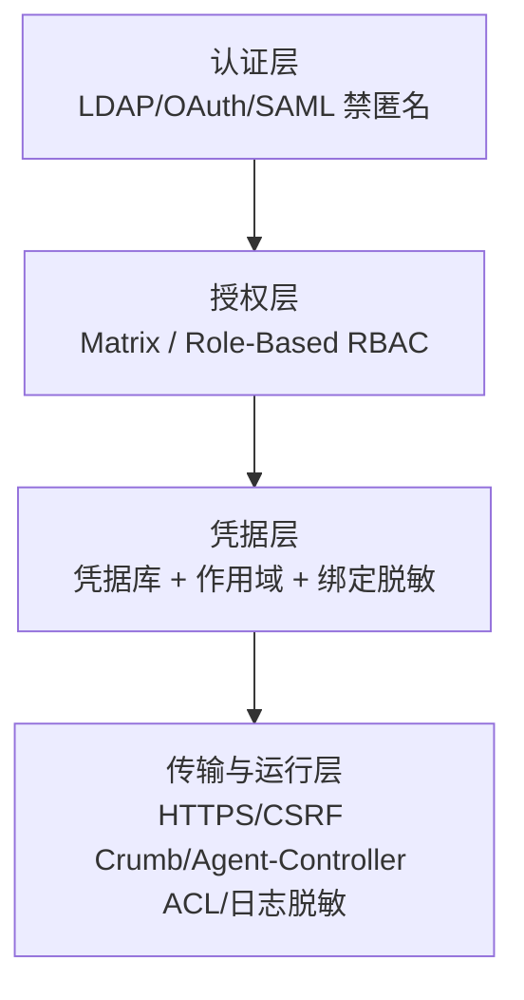

# Jenkins-凭据与安全

> [!abstract] 摘要
> 凭据与权限是 Jenkins 生产化的分水岭：凭据库集中管理密钥并自动脱敏，授权体系决定"谁能看/谁能跑"。本文覆盖 6 种凭据类型、Scope、`credentials()` 与 `withCredentials` 两种绑定方式、Groovy 插值禁令（官方安全红线）、RBAC 权限体系、安全基线清单，并给出流水线接入 Docker Registry 与 Git 私仓的完整案例。

## 一、概念与原理

Jenkins 凭据存储在 Controller 的 `JENKINS_HOME/credentials/` 中（以控制器 ID 加密），流水线只通过**凭据 ID** 引用，不落明文。安全体系分四层：



### 凭据类型（官方 6 种）

| 类型 | 用途 | 典型场景 |
| --- | --- | --- |
| Secret text | API Token / PAT | 企微机器人 key、云厂商 token、Vault token |
| Username with password | 账密 | 制品库 Nexus、Docker Registry、Git HTTPS |
| Secret file | 密钥文件 | kubeconfig、.npmrc、证书文件 |
| SSH Username with private key | SSH 私钥对（可带 passphrase） | Git SSH 拉代码、SSH 部署 |
| Certificate | PKCS#12 证书 | 客户端证书认证 |
| Docker Host Certificate Authentication | Client Key/Cert/CA | Docker TLS 远程守护进程 |

### Scope：全局 vs 系统

| Scope | 作用范围 | 用途 |
| --- | --- | --- |
| Global | 该对象**及其所有子对象**（流水线/Job 可用） | 业务流水线的凭据，默认选这个 |
| System | 仅单个对象，供控制器自身功能使用 | 邮件认证、Agent 连接等系统级凭据 |

> [!info]
> 凭据 ID 一经创建**不可修改**，建议全站命名规范（如 `docker-registry-cred`、`git-ssh-deploy`）。可放在全局、System、或 Folder 级——Folder 级凭据只有该文件夹内 Job 可见，是多项目隔离的首选。

## 二、核心语法详解

### 2.1 credentials() 环境变量绑定

```groovy
// 1) Username with password：生成 3 个变量 —— 原名(usr:psw 合体) + _USR + _PSW
environment {
    REG_CRED = credentials('docker-registry-cred')
}
// 可用：$REG_CRED、$REG_CRED_USR、$REG_CRED_PSW（_USR/_PSW 固定追加）

// 2) Secret text：只生成原变量名本身，无后缀
environment {
    AWS_ACCESS_KEY_ID = credentials('jenkins-aws-secret-key-id')
}

// 3) Secret file：变量 = 临时文件路径（自动落盘与回收）
environment {
    MY_KUBECONFIG = credentials('my-kubeconfig')
}
steps { sh 'kubectl --kubeconfig $MY_KUBECONFIG get pods' }
```

### 2.2 withCredentials 步骤级绑定（作用域更小，推荐）

```groovy
// SSH 私钥
withCredentials(bindings: [sshUserPrivateKey(
        credentialsId: 'git-ssh-deploy',
        keyFileVariable: 'SSH_KEY',
        usernameVariable: 'SSH_USER')]) {
    sh 'git ls-remote git@github.com:org/repo.git'      // ssh 会自动用 $SSH_KEY
}

// Secret text（string 绑定）
withCredentials([string(credentialsId: 'vault-token', variable: 'VAULT_TOKEN')]) {
    sh 'vault write -address=$VAULT_ADDR auth/jenkins/login ...'
}

// 用户名密码
withCredentials([usernamePassword(credentialsId: 'nexus-cred',
        usernameVariable: 'NEXUS_USR', passwordVariable: 'NEXUS_PSW')]) {
    sh 'mvn deploy -Drepo.user=$NEXUS_USR -Drepo.pass=$NEXUS_PSW'
}
```

> [!warning] 官方安全红线：绝不 Groovy 插值凭据
> 双引号 `sh "curl -H 'Token: ${TOKEN}' ..."` 会把密钥先在 Groovy 层展开进命令字符串：密钥出现在**进程参数**里（`ps` 可见）、shell 元字符被提前执行、特殊字符变形（如 `sec%ret` 变 `secret`）后**脱敏失效**。正确写法一律单引号，让 shell 自己读环境变量：
> ```groovy
> sh '''set +x
>       curl -H "Token: $TOKEN" https://some.api/'''
> ```
> 构建参数同理：`sh "echo ${params.COMMENT}"` 等于命令注入，请用单引号 + `"$COMMENT"`。

### 2.3 权限体系（Matrix / Role-Based）

```groovy
// Role-based Authorization Strategy 插件的角色矩阵示例（Manage Roles）
//   admin          : 全部权限
//   developer      : Job 读写 + Build + Read，不含 Manage/Configure 系统
//   viewer         : 仅 Overall/Read
// Project Roles 按 Folder 正则隔离：
//   role "team-order" → pattern "order-.*"（只能动 order- 前缀任务）
```

- **Matrix Authorization**：按用户/组逐项勾权限，适合小团队精确控制。
- **Role-Based Authorization Strategy**：Global Roles + Project Roles（Folder 正则匹配），团队多时必选。
- 凭据相关权限单独管控：`Credentials > Create/Update/Delete/View` 决定谁能碰凭据库。

### 2.4 安全基线清单

| 层面 | 措施 |
| --- | --- |
| 匿名访问 | 关闭 "Anyone can do anything"，接 LDAP/OAuth，禁用自助注册 |
| CSRF | 保持 CSRF Protection（Crumb）启用，API 调用带 `Jenkins-Crumb` 头 |
| Agent→Controller | 开启 Agent→Controller Access Control，限制 Agent 可调用端点 |
| 插件 | 订阅安全公告，高危补丁及时装（LTS 2.580.1 起默认禁止 Object 字段反序列化） |
| 网络 | Controller 走 HTTPS（反代终止 TLS），Webhook 加白名单 |
| 构建 | PR 构建禁用凭据透传，不可信代码放一次性容器 |

> [!tip] 日志脱敏
> 通过 `credentials()`/`withCredentials` 绑定的变量，`echo` 时输出 `****`——但这只是降低意外暴露风险，**防不住**刻意绕过（如拼接变形）。配合：`set +x` 关闭命令回显、凭据只经环境变量进 shell、定期轮换密钥。

### 2.5 云厂商/企业密钥管理方向

企业级方案是把 Jenkins 凭据库下沉到 HashiCorp Vault：安装 **HashiCorp Vault 插件**后，凭据可在 Vault 侧集中管理、动态生成（短 TTL 数据库凭据）、自动轮换，Jenkins 只持有 Vault AppRole/Token 引用。K8s 环境也可用 External Secrets Operator 把 Vault 同步为 K8s Secret，配合 [[K8s-GitOps与ArgoCD实战]] 的密钥治理。

## 三、实战案例：安全接入 Docker Registry 与 Git 私仓（Jenkins LTS 2.580.2）

前置操作（Manage Jenkins → Credentials → Global → Add Credentials）：

```text
1. Docker Registry   → Kind: Username with password
                       ID: docker-registry-cred      Scope: Global
2. Git 私仓 SSH Key  → Kind: SSH Username with private key
                       ID: git-ssh-deploy            Scope: Global
                       （Enter directly 粘贴私钥，Passphrase 可选）
```

```groovy
// Jenkinsfile —— 拉私仓代码 + 推镜像，全程无明文
pipeline {
    agent { label 'docker' }
    options { timestamps() }
    environment {
        DOCKER_REG = 'registry.example.com'
        IMAGE      = "${DOCKER_REG}/order-service:${env.BUILD_NUMBER}"
        GIT_CREDS  = credentials('git-ssh-deploy')          // 生成 _USR 与 key 路径
    }
    stages {
        stage('拉取私仓代码') {
            steps {
                checkout scmGit(
                    branches: [[name: '*/main']],
                    userRemoteConfigs: [[
                        credentialsId: 'git-ssh-deploy',
                        url: 'git@github.com:our-org/order-service.git']])
            }
        }
        stage('构建镜像') {
            steps {
                withCredentials([usernamePassword(credentialsId: 'docker-registry-cred',
                        usernameVariable: 'REG_USR', passwordVariable: 'REG_PSW')]) {
                    sh '''set +x
                          docker build -t $IMAGE .
                          echo "$REG_PSW" | docker login $DOCKER_REG -u "$REG_USR" --password-stdin
                          docker push $IMAGE
                          docker logout $DOCKER_REG'''
                }
            }
        }
    }
    post { failure { echo "失败请检查凭据与网络: ${env.BUILD_URL}" } }
}
```

> [!note]
> `docker login --password-stdin` 从 stdin 读密码，避免密码进入进程参数；`docker.withRegistry("https://${DOCKER_REG}", 'docker-registry-cred')` 是等价的插件封装（见 [[Jenkins-共享库实战]] 案例）。

## 四、动手练习

1. **创建与引用**：新建 Secret text 凭据 `wecom-webhook-key`，在流水线里用 `environment` 绑定并 curl 企微机器人发送测试消息（注意单引号）。
2. **派生变量观察**：用 Username with password 绑定，`sh 'env | grep CRED'` 观察 `_USR/_PSW/原名` 三个变量，再 `echo $CRED` 确认脱敏为 `****`。
3. **作用域隔离**：在两个 Folder 下分别创建同名 ID 的凭据，验证互相不可见。
4. **SSH 拉私仓**：生成专用部署密钥对，配到 Git 仓库 Deploy Keys，用 `sshUserPrivateKey` 绑定完成 checkout。
5. **综合**：改造第 3 节案例，增加"仅 main 分支执行推送"的 when 门禁 + `withCredentials` 内 `set +x`，并验证控制台无任何明文密码。

> [!success]- 第 5 题参考答案要点
> - 推送 stage 加 `when { branch 'main' }`（或 multibranch 场景 `when { branch 'main'; not { changeRequest() } }`）。
> - `withCredentials` 块首行 `sh 'set +x'` 关闭命令回显；docker login 走 `--password-stdin`。
> - 验证点：控制台搜索 `REG_PSW`/密码原文无命中；故意写错密码确认报错信息里也不含密钥。
> - 加分项：凭据放 Folder 级 + 记录轮换周期。

## 五、常见坑与 FAQ

> [!warning] 双引号让脱敏失效
> `bat "echo ${EXAMPLE_KEY}"`（Groovy 先展开）在 Windows 上会把 `sec%ret` 变成 `secret`——变形后的值与掩码列表对不上，**明文直接进日志**。所有凭据引用一律单引号交给 shell 展开。

> [!warning] PR 构建泄露凭据
> fork 仓库的 PR 代码是不可信的：若给 PR 构建透传生产凭据，攻击者可在 PR 里写 `curl $SECRET` 外传。对策：PR 构建使用降级凭据集或不绑凭据，敏感 stage 加 `when { not { changeRequest() } }`。

> [!tip] 凭据 ID 拼写错误的报错不直观
> `credentials('id')` 找不到凭据时报 "Credential 'xxx' could not be found"——先查拼写与大小写，再查凭据位置（全局 vs Folder）与 Job 所在 Folder 是否匹配，最后查 Job 有没有 Credentials/View 权限。

> [!tip] 轮换凭据后任务仍失败
> 凭据轮换常见遗漏：①只改了凭据库没改目标系统侧（如 Registry 密码反向）；②多个 Job 引用同一 ID，忘了重跑；③SSH key 更换但远端 `known_hosts` 未更新。轮换 SOP 应包含"改目标 → 改 Jenkins → 手动触发验证"三步。

## 六、自检清单

- [ ] 匿名访问已关闭，认证接入 LDAP/OAuth/SAML
- [ ] RBAC 三级角色（admin/developer/viewer）落地，凭据权限单独管控
- [ ] 所有凭据入凭据库并统一命名规范，Jenkinsfile 无任何明文
- [ ] 凭据引用一律单引号 shell 展开，无 Groovy 插值
- [ ] `sh` 前有 `set +x`，控制台抽查无明文泄露
- [ ] Folder 级凭据用于项目隔离，PR 构建不透传生产凭据
- [ ] CSRF Crumb 与 Agent→Controller Access Control 保持启用
- [ ] 凭据有轮换周期与轮换 SOP

## 七、关联笔记与参考

**关联**：[[Jenkins核心要点与最佳实践]]（安全加固总表）、[[Jenkins-Jenkinsfile语法详解]]（credentials() 环境）、[[Jenkins-共享库实战]]（凭据封装进共享步骤）、[[K8s-GitOps与ArgoCD实战]]（Vault/ESO 衔接）、[[Dockerfile编写指南]]。

**参考资料**：

1. Jenkins 官方 - Using Credentials（凭据类型/Scope）：https://www.jenkins.io/doc/book/using/using-credentials/
2. Jenkins 官方 - Using a Jenkinsfile: Handling credentials（credentials() 派生变量与插值禁令）：https://www.jenkins.io/doc/book/pipeline/jenkinsfile/#handling-credentials
3. Jenkins 官方 - Securing Jenkins（CSRF/ACL/匿名访问）：https://www.jenkins.io/doc/book/security/securing-jenkins/
4. HashiCorp Vault 插件（Vault 集成）：https://plugins.jenkins.io/hashicorp-vault-plugin/
5. Role-based Authorization Strategy 插件（RBAC）：https://plugins.jenkins.io/role-authorization-strategy/
