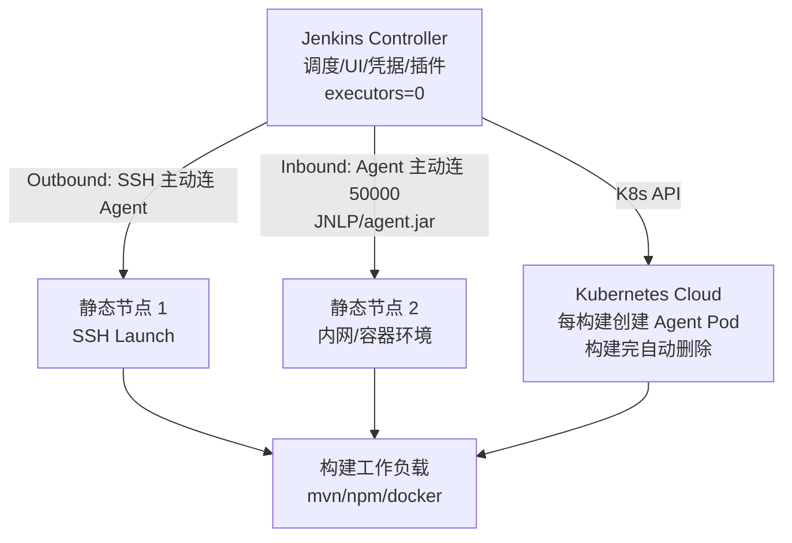

# Jenkins-分布式构建与K8s动态Agent

> [!abstract] 摘要
> 单机 Jenkins 扛不住并发构建与异构工具链：把构建下放到 Agent，再进一步用 Kubernetes 插件让**每个构建一个 Pod**、用完即销毁，实现弹性与隔离。本文覆盖 Controller-Agent 架构与连接协议、静态节点添加、标签策略、Docker 插件 vs Kubernetes 插件对比、podTemplate 完整配置与自定 agent 镜像，并给出"配一个 K8s 动态 Agent 跑构建并验证 Pod 生灭"的完整案例。

## 一、概念与原理

### Controller-Agent 分工

Controller（原 Master）负责调度、UI、存储与插件；Agent 只提供 executor 执行构建步骤。原则是"**Controller 越小越好**"：构建负载全下放，Controller 的 executors 建议设为 0。



### 连接协议：Inbound vs Outbound

| 方向 | 机制 | 适用场景 |
| --- | --- | --- |
| Inbound（Agent 发起） | Agent 主动连 Controller 的 inbound TCP 端口（JNLP 协议，`agent.jar -jnlpUrl … -secret … -workDir …`），Agent 无需可被反向访问 | 容器/内网 NAT 后的节点；K8s 插件即此模式 |
| Outbound（Controller 发起） | Controller 通过 SSH 连接 Agent（`Launch agents via SSH`，配 Host/Port/Credentials/Host Key 校验） | 有固定 IP、可控 SSH 的物理机/VM |
| WebSocket | Agent 复用 Controller 的 HTTP(S) 端点，无需单独开 TCP 端口 | 反代/TLS 已就绪、想收敛端口时 |

> [!info]
> "JNLP 现状"：协议本身仍是 inbound agent 的标准传输，但官方实现已从 Web Start 方式收敛为 **inbound-agent 镜像 + agent.jar**；受限网络可整体切换 WebSocket 模式（复用 8080/443）。

### 云弹性方案对比

| 维度 | Docker 插件 | Kubernetes 插件 |
| --- | --- | --- |
| 动态 Agent 形态 | 单容器（宿主机 Docker daemon 起 container） | 整个 Pod（可多容器协作） |
| 多工具链 | 一容器一工具，难组合 | maven + docker + kaniko 等同 Pod 并存 |
| 资源限额 | 容器级 | Pod/容器级（K8s 原生 resources） |
| 隔离与回收 | 容器级隔离 | Pod 级隔离 + 命名空间级网络/配额策略 |
| 依赖 | 一个有 Docker 的宿主机 | 一套 K8s 集群（可跨云、可 spot 节点） |
| 适合 | 小规模、已有 Docker 主机 | 团队级/企业级弹性，云原生标配 |

### 每构建独立 Pod 的收益与开销

- **收益**：环境绝对干净（无 workspace 串脏）；弹性并发（高峰自动扩、闲时归零）；故障域隔离；与 K8s 配额/亲和/spot 实例天然整合。
- **开销**：每次冷启动（镜像拉取 + Pod 调度 1-3 分钟）；Maven/npm 缓存需 PVC 或宿主缓存解决；排查链路变长（要看 Pod Events/容器日志）；Controller 与集群网络策略必须放通。

## 二、核心配置详解

### 2.1 静态节点（SSH 方式）添加步骤

```text
Manage Jenkins → Nodes → New Node
  Node name: build-agent-01        类型: Permanent Agent
  Remote root directory: /home/jenkins/agent
  Number of executors: 2-4
  Labels: linux && maven（标签表达式能力分组）
  Usage: "Only build jobs with label expressions matching this node"
  Launch method: Launch agents via SSH
    Host: 10.0.0.11   Port: 22
    Credentials: SSH username with private key（私钥只进凭据库）
    Host Key Verification Strategy: Manually provided key
保存后查看节点 Log 出现 "Agent successfully connected and online" 即成功
```

### 2.2 Kubernetes Cloud 关键参数

```yaml
# Manage Jenkins → Clouds → Kubernetes 配置页关键项
jenkinsUrl: http://jenkins.jenkins.svc:8080
podRetention: onFailure        # never()/onFailure()/always()/evicted()/default()
connectTimeout: 300
containerCap: 8                # 单 Pod 容器上限
podLabels:
  jenkins/agent: true
```

### 2.3 podTemplate 完整配置（官方推荐写法：YAML 格式）

```groovy
// 声明式 agent { kubernetes { yaml '''...''' } }（脚本式用 podTemplate { node(POD_LABEL) {...} }）
pipeline {
    agent {
        kubernetes {
            inheritFrom 'base-agent'        // 继承全局/上级模板；默认不继承
            yamlMergeStrategy override()    // merge() 或 override()
            idleMinutes 5                   // 空闲 Pod 保留 5 分钟复用
            retries 2                       // 基础设施故障重试
            yaml '''
apiVersion: v1
kind: Pod
spec:
  containers:
  - name: maven                              # 容器模板：command 覆盖 entrypoint
    image: maven:3.9-eclipse-temurin-21
    command: ["cat"]                         # 常驻占位，等待步骤执行
    tty: true
    resources:                               # 资源限额写进 YAML
      requests: { cpu: "500m", memory: "1Gi" }
      limits:   { cpu: "2",   memory: "4Gi" }
    volumeMounts:
    - name: maven-cache
      mountPath: /root/.m2                   # 缓存 PVC，消灭冷启动拖累
  volumes:
  - name: maven-cache
    persistentVolumeClaim: { claimName: maven-cache-pvc }
  imagePullSecrets:
  - name: regcred                            # 私有镜像仓库拉取凭据
'''
        }
    }
    stages {
        stage('构建') { steps { container('maven') { sh 'mvn -B clean package' } } }
    }
}
```

要点：Pod 中**必须有一个容器跑 Jenkins agent**，未指定时插件自动注入名为 `jnlp` 的容器（`jenkins/inbound-agent` 镜像，自动带 `JENKINS_URL/JENKINS_SECRET/JENKINS_AGENT_NAME` 环境变量连回 Controller）。要定制就覆盖同名 `jnlp` 容器或用 `agentInjection: true` 注入到业务容器（需镜像含匹配 Controller Java 版本的 JRE）。

### 2.4 多容器协作（同 Pod 内不同工具链）

```groovy
podTemplate(
    containers: [
        containerTemplate(name: 'maven',  image: 'maven:3.9-eclipse-temurin-21', ttyEnabled: true, command: 'cat'),
        containerTemplate(name: 'docker', image: 'docker:27-cli', ttyEnabled: true, command: 'cat')
    ],
    volumes: [persistentVolumeClaim(claimName: 'maven-cache', mountPath: '/root/.m2')]
) {
    node(POD_LABEL) {
        stage('Build') { container('maven')  { sh 'mvn -B clean package' } }
        stage('Push')  { container('docker') { sh 'docker build -t demo:latest .' } }
    }
}
```

> [!tip]
> `POD_LABEL`/`POD_CONTAINER` 由插件自动注入；`container('name')` 块内命令跑在指定容器。**同 Pod 容器必须用相同 uid**（不同 uid 会互相没权限访问 workspace，`sh` 步骤假死），必要时 `securityContext.runAsUser: 1000` 统一。

## 三、实战案例：K8s 动态 Agent 跑构建并验证 Pod 生灭（Jenkins LTS 2.580.2 + Kubernetes 插件）

```groovy
// Jenkinsfile —— 每次构建在 K8s 中动态创建 Pod，结束自动销毁
pipeline {
    agent {
        kubernetes {
            yaml '''
apiVersion: v1
kind: Pod
spec:
  containers:
  - name: maven
    image: maven:3.9-eclipse-temurin-21
    command: ["cat"]
    tty: true
  - name: kubectl
    image: bitnami/kubectl:1.31
    command: ["cat"]
    tty: true
'''
        }
    }
    stages {
        stage('构建') {
            steps { container('maven') { sh 'mvn -B clean package -DskipTests' } }
        }
        stage('验证动态 Pod') {
            steps {
                container('kubectl') {
                    sh '''set -x
                          kubectl get pods -l jenkins/label=$(hostname | cut -d'-' -f1) -o wide
                          hostname   # Pod 名即本次构建的 agent 主机名'''
                }
            }
        }
    }
    post { cleanup { echo "构建结束，Agent Pod 将被插件回收" } }
}
```

验证清单（`kubectl` 侧观察）：

```bash
# 构建进行中：能看到带 jenkins 标签的 Pod 处于 Running
kubectl get pods -o wide -w
# 构建结束后：Pod 自动 Deleted（podRetention=never/default 时）
kubectl get pods | grep jenkins
# 排障：Pod 卡 Pending / 构建连不上
kubectl describe pod <agent-pod>        # 看 Events：镜像拉取、配额、网络策略
kubectl logs <agent-pod> -c jnlp        # 看 inbound agent 连接日志
```

> [!warning]
> Controller 不在集群内也完全可用（只要网络可达 API Server 与 Pod）。注意**不要给 Agent Pod 挂有自身命名空间权限的 ServiceAccount**，不可信构建用户也不该有 agent 命名空间的只读权限。

## 四、动手练习

1. **静态节点**：用一台 VM/本机 Docker 起 `jenkins/ssh-agent` 容器，按 SSH Launch 方式接入 Controller，打标签 `linux && docker`，并让一个流水线 `agent { label 'linux && docker' }` 跑通。
2. **Inbound 验证**：在另一个网络受限容器里跑 `java -jar agent.jar -jnlpUrl <URL> -secret <KEY> -workDir /agent`，确认 inbound 连接成立。
3. **首个动态 Pod**：装 Kubernetes 插件配 Cloud，用官方 `maven:3.9.9-eclipse-temurin-17` + busybox 双容器模板跑 `mvn -version`，同时另开终端 `kubectl get pods -w` 观察创建与删除。
4. **缓存优化**：为 Maven 容器挂 PVC 缓存 `/root/.m2`，对比挂载前后同项目构建时长。
5. **综合**：构建自定义 Agent 镜像（基于 `jenkins/inbound-agent` 叠加 mvn/kubectl），在 podTemplate 中覆盖 `jnlp` 容器使用它，并验证 `kubectl logs <pod> -c jnlp` 中 agent 正常注册。

> [!success]- 第 5 题参考答案要点
> - Dockerfile：`FROM jenkins/inbound-agent`（JRE 版本须匹配 Controller 2.580.x 要求的 Java 21/25），`USER root` 装工具链后回到固定 uid 用户。
> - podTemplate 里写同名容器 `- name: jnlp / image: <自定义镜像>` 覆盖默认注入；不装 agent.jar 进镜像，让插件注入。
> - 验证三点：jnlp 容器日志出现 "Successfully connected"；`mvn`/`kubectl` 在对应容器可用；构建结束 Pod 被回收。
> - 注意同 Pod 内 uid 一致，避免 workspace 权限互斥。

## 五、常见坑与 FAQ

> [!warning] 构建慢：冷启动镜像拉取
> 动态 Pod 每次构建都可能重新拉镜像（几十 MB 到 GB 级）。对策：固定镜像 tag + `imagePullPolicy: IfNotPresent` + 节点预热；依赖缓存（M2/npm）挂 PVC；插件层用 `idleMinutes` 复用空闲 Pod。

> [!warning] Pod 建了但 agent 连不上 Controller
> 常见原因：Controller 的 inbound TCP 端口（默认 50000）被网络策略/防火墙挡住；Jenkins URL 配置错误（Agent 连不回）；自签名 HTTPS 导致 agent 校验失败（换 WebSocket 模式或在镜像中导入 CA）。排查顺序：`kubectl describe pod` Events → `logs -c jnlp` → Controller 系统日志。

> [!tip] sh 步骤"卡死"多半是 uid 不一致
> 多容器 Pod 中两个容器 uid 不同，workspace 文件属主混乱导致 durable-task 的 sh 永远等不到输出。统一 `runAsUser`，或加 `-Dorg.jenkinsci.plugins.durabletask.BourneShellScript.LAUNCH_DIAGNOSTICS=true` 打开诊断。

> [!tip] podRetention 的取舍
> 默认从不保留有助于省资源，但失败 Pod 立即销毁无从排查。生产建议 `onFailure` + 配合 `activeDeadlineSeconds` 兜底，避免 always() 留下一堆脏 Pod 吃资源。

## 六、自检清单

- [ ] Controller executors 为 0，构建全部在 Agent
- [ ] 静态节点按标签分池（OS/工具链/内存），Usage 限定为 label 匹配
- [ ] inbound 端口或 WebSocket 通道经网络验证可达
- [ ] Kubernetes Cloud 设置 podRetention: onFailure + connectTimeout
- [ ] podTemplate 用 yaml 写法声明资源 limits/requests
- [ ] Maven/npm 缓存经 PVC/宿主挂载，冷启动 < 2 分钟
- [ ] 同 Pod 容器 uid 一致，sh 无假死
- [ ] Agent Pod 未绑定带命名空间权限的 ServiceAccount

## 七、关联笔记与参考

**关联**：[[Jenkins核心要点与最佳实践]]（架构与 Agent 弹性）、[[Jenkins-Jenkinsfile语法详解]]（agent 指令详解）、[[K8s-Pod与工作负载对象]]（Pod/Volume 基础）、[[Dockerfile编写指南]]（自定 agent 镜像）、[[Jenkins-凭据与安全]]（imagePullSecrets/SSH 凭据）。

**参考资料**：

1. Jenkins 官方 - Using Jenkins agents（节点添加/连接方向/标签）：https://www.jenkins.io/doc/book/using/using-agents/
2. Jenkins 官方插件页 - Kubernetes（podTemplate/podRetention/agent 注入全量说明）：https://plugins.jenkins.io/kubernetes/
3. Jenkins 官方文档 - Scaling Jenkins on Kubernetes（插件原理与部署指引）：https://www.jenkins.io/doc/book/scaling/scaling-jenkins-on-kubernetes/
4. DevOpsCube - Jenkins Build Agents on Kubernetes Pods：https://devopscube.com/jenkins-build-agents-kubernetes
