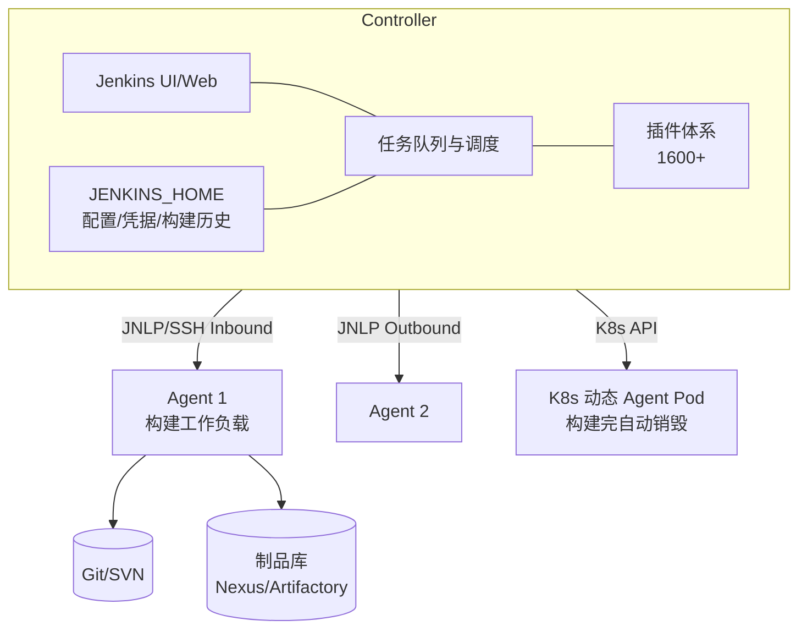
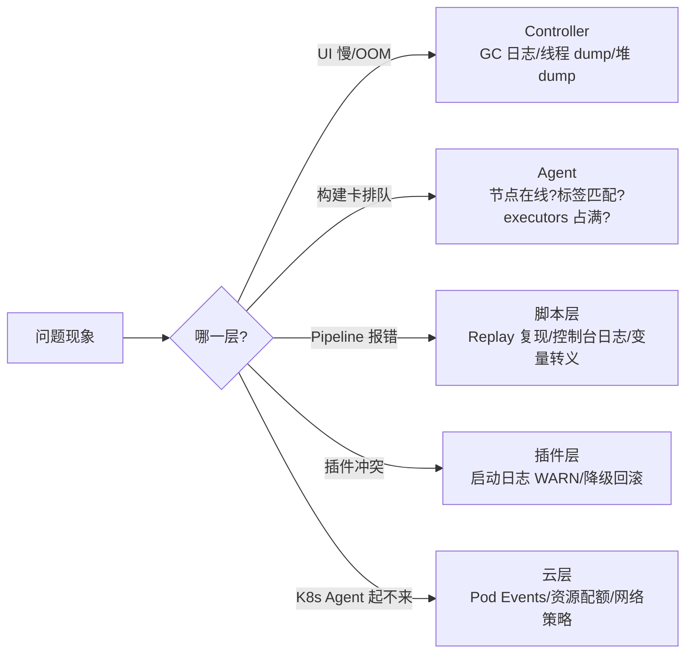

# Jenkins核心要点与最佳实践

## 一、概述

本文是 Jenkins 的**核心要点速查与运维实践手册**，覆盖架构组件、Shared Library、插件管理、备份升级、性能优化、安全加固、故障排查与监控。流水线语法与实战示例见 [[Jenkins流水线配置]]，CI/CD 全景与选型见 [[CI-CD现代实践与趋势]]。

## 二、架构与组件



| 组件 | 职责 | 运维要点 |
| --- | --- | --- |
| **Controller**（原 Master） | 调度、UI、存储、插件管理 | 不跑构建；OOM 即全站不可用，是备份与调优重点 |
| **Agent** | 执行构建步骤 | 通过 JNLP（Inbound，如容器/内网）或 SSH 接入；按标签分配任务 |
| **JENKINS_HOME** | 全部持久化状态 | 包含 `config.xml`、`jobs/`、`credentials/`、`plugins/`、`workspace/`（workspace 可不备份） |
| **插件体系** | 功能扩展核心 | 每个插件是独立 JVM 依赖，冲突/旧插件是故障头号来源 |

> [!info]
> 原则："**Controller 越小越好**"。构建、测试、镜像编译全部下放到 Agent；Controller 只保留调度与少量系统 Job。

## 三、Shared Library 结构与编写示例

官方目录结构（`vars` 文件名即全局变量名，必须 camelCase）：

```
jenkins-shared-library/
├── src/                          # Java 风格 Groovy 类（进 classpath）
│   └── org/demo/PipelineUtils.groovy
├── vars/                         # 全局函数/步骤（对外暴露的 DSL）
│   ├── javaBuild.groovy          # vars/javaBuild.groovy → 可调用 javaBuild()
│   ├── javaBuild.txt             # 可选：全局变量文档页说明
│   └── deployK8s.groovy
└── resources/                    # 静态资源，libraryResource() 读取
    └── templates/deploy.yaml
```

```groovy
// vars/javaBuild.groovy —— 封装标准 Java 构建流程
def call(Map cfg = [:]) {
    // cfg 默认值
    def jdkImage  = cfg.get('jdkImage', 'maven:3.9-eclipse-temurin-21')
    def skipTests = cfg.get('skipTests', false)

    pipeline {
        agent { docker { image jdkImage; args '-v /var/cache/m2:/root/.m2' } }
        options { timestamps(); buildDiscarder(logRotator(numToKeepStr: '15')) }
        stages {
            stage('单测') {
                when { not { expression { skipTests } } }
                steps { sh 'mvn -B verify' }
            }
            stage('打包') { steps { sh 'mvn -B clean package -DskipTests' } }
        }
        post {
            always {
                junit allowEmptyResults: true, testResults: '**/target/surefire-reports/*.xml'
            }
        }
    }
}
```

```groovy
// vars/deployK8s.groovy —— resources 模板渲染 + kubectl 应用
def call(Map cfg = [:]) {
    def envName   = cfg.env
    def ns        = cfg.namespace
    def image     = cfg.image
    def manifest  = libraryResource('templates/deploy.yaml')   // 读共享库资源

    writeFile file: "deploy-${envName}.yaml", text: manifest
    sh "kubectl -n ${ns} apply -f deploy-${envName}.yaml"
}
```

业务侧 Jenkinsfile 退化为编排层：

```groovy
@Library('my-shared-library@v2.3') _     // 固定版本，禁止裸 master
javaBuild(skipTests: false)
deployK8s(env: 'prod', namespace: 'demo', image: "registry.example.com/demo:${env.BUILD_NUMBER}")
```

> [!tip]
> 1. `vars/` 保持"薄"，复杂逻辑下沉到 `src/` 的可测试类（需 `Serializable`，步骤对象通过 `steps`/`this` 传入）。
> 2. 用 `@Library('lib@分支/标签')` 固定版本；`library "lib@${BRANCH_NAME}"` 步骤可动态加载（插件 2.7+）。
> 3. **可信库（Trusted）** 有完整 Groovy 权限，仓库提交权限等同于 Jenkins 管理员——把提交权限锁紧；Folder 级库默认跑在沙箱（untrusted）。

## 四、插件管理清单

推荐插件速查（按用途分组）：

| 用途 | 插件 | 说明 |
| --- | --- | --- |
| 版本控制 | Git / GitHub / GitLab / Bitbucket | Webhook 触发与 MR/PR 支持 |
| 流水线 | Pipeline / Pipeline: Stage View / Blue Ocean | 声明式流水线与可视化 |
| 多分支 | Pipeline: Multibranch / Organization Folder / Basic Branch Build Strategies | 分支自动建删与构建策略过滤 |
| 云原生 | Kubernetes / Docker Pipeline / Docker Commons | K8s 动态 Agent、容器构建 |
| 凭据 | Credentials / Credentials Binding | 统一凭据库与绑定 |
| 构建 | Maven / Gradle / NodeJS / JDK Parameter | 语言工具链 |
| 测试与质量 | JUnit / JaCoCo / Checkstyle / HTML Publisher | 报告归档 |
| 制品 | Artifact Manager S3 / Nexus Artifact Uploader / JFrog | 制品归档推送 |
| 通知 | Email Extension / DingTalk / 企业微信插件 | 失败告警 |
| 运维 | Prometheus Metrics / Monitoring / Configuration as Code (JCasC) | 监控与配置即代码 |
| 安全 | Role-based Authorization Strategy / Matrix Authorization | RBAC 权限 |

管理要点：

```bash
# JCasC 插件清单管理（plugins.yaml）—— 配置即代码，避免手工点选漂移
plugins:
  - id: git
  - id: kubernetes
  - id: workflow-aggregator
  - id: blueocean
  - id: configuration-as-code
```

> [!warning]
> 2026-09 的 LTS **2.580.1** 已把 JUnit、Mailer、Matrix Authorization 等捆绑插件**解绑出 jenkins.war**（减重 20+ MB）：从旧版本升级后这些插件可能消失，需在插件管理器显式安装。插件更新前先看 `Jenkinsfile` 兼容性公告，一次只升一批并留回滚备份。

## 五、备份与升级

### 5.1 备份

```bash
#!/usr/bin/env bash
# 每日备份 JENKINS_HOME：排除 workspace（可重建）与构建产物日志增量
rsync -a --delete \
  --exclude 'workspace/' \
  --exclude 'jobs/*/builds/*/archive' \
  /var/jenkins_home/ /backup/jenkins/$(date +%F)/
# 数据库化方案： ThinBackup 插件定时备份 / 云盘快照
```

- **必须备份**：`config.xml`、`jobs/*/config.xml`、`credentials/`（密钥文件 `secrets/` 一并带走，否则凭据无法解密）、`plugins/` 清单。
- **不必备份**：`workspace/`、`caches/`。
- 恢复演练每季度做一次，备份没验证过等于没有备份。

### 5.2 版本升级策略

| 策略 | 做法 | 适用 |
| --- | --- | --- |
| LTS 常规升级 | 每 12 周跟大版本，每 4 周跟安全补丁（如 2.580.1 → 2.580.2） | 所有环境默认 |
| 跳版升级 | 一次跨多个 LTS 线（如 2.516 → 2.555）时，先在隔离环境核对 JDK/插件矩阵 | 长期未升级的存量实例 |
| 蓝绿升级 | 新 Controller 平行部署，切流量（Nginx/K8s Service 切换） | 要求停机 <10 分钟的生产 |
| 容器化升级 | 改镜像 tag（`jenkins/jenkins:2.580.2-lts-jdk21`），PVC 挂 `JENKINS_HOME` | K8s 部署 |

关键升级检查点（来自 LTS Changelog 实测）：JDK 版本要求（2.555.1 起**必须 Java 21/25**，Java 17 移除）、打包签名密钥更换（2025-12 起 RPM/DEB 需导入新 GPG key）、Windows 2019 controller 镜像移除（2.568.x）、解绑插件补装（2.580.1）。

## 六、性能与资源优化

### 6.1 JVM 调优（Controller）

```bash
# Docker 环境通过 JAVA_OPTS 注入
JAVA_OPTS="-Xms4g -Xmx8g \
  -XX:+UseG1GC \
  -XX:MaxGCPauseMillis=200 \
  -XX:+ParallelRefProcEnabled \
  -XX:+HeapDumpOnOutOfMemoryError -XX:HeapDumpPath=/var/jenkins_home/dump.hprof \
  -Djava.awt.headless=true"
```

- **堆大小**：经验值约 **1GB 堆 / 100 个 Job**，从保守值起步，看监控再调；`-Xms` ≥ `-Xmx` 的一半，避免堆频繁扩张收缩。
- **GC**：G1GC 是现代 JVM 默认，适合 Jenkins 多线程、对象繁杂的负载；关注 `MaxGCPauseMillis` 控制停顿。
- **OOM 证据**：开启 `HeapDumpOnOutOfMemoryError`，配合 `jstat -gcutil <pid>` 与 GC 日志定位（参见官方博客《Tuning Jenkins Java Settings》2026-02）。

### 6.2 Agent 弹性

| 手段 | 配置 | 效果 |
| --- | --- | --- |
| K8s 动态 Agent | Kubernetes 插件，Pod 级并发上限、`podRetention: onFailure` | 高峰自动扩、闲时归零 |
| 静态 Agent 限额 | 节点 `# executors` 2-4 个，按标签分池（如 `maven`/`node`） | 避免资源争抢 |
| 构建缓存 | Maven/npm 缓存挂 PVC；Kaniko `--cache=true` 层缓存 | 冷启动提速 3-10 分钟 |
| 构建保留策略 | `buildDiscarder` 保留 10-20 次构建 | 控制磁盘与索引膨胀 |

更系统的资源优化思路（JVM、存储、网络）见 [[Jenkins资源高效利用方案]]，Agent 依赖的容器镜像构建见 [[Dockerfile编写指南]]。

## 七、安全加固

| 层面 | 措施 |
| --- | --- |
| 认证 | 接入 LDAP/OAuth/SAML，禁用匿名注册；管理账号最小化 |
| 授权（RBAC） | Role-based Authorization 插件：`admin` / `developer`（只读+触发）/ `viewer` 三级起步，按 Folder 隔离项目 |
| 凭据 | 全部入凭据库，生产用 HashiCorp Vault + Vault 插件或 ESO 同步；定期轮换；日志屏蔽开启 |
| CSRF | 保持 Crumb（CSRF Protection）启用，API 调用带 `Jenkins-Crumb` 头 |
| Agent→Controller | 开启 Agent→Controller Access Control，限制 Agent 可调用的 Controller 端点 |
| 网络 | Controller 走 HTTPS（反代终止 TLS）；Webhook URL 加白名单与 token |
| 插件 | 只装必需插件；订阅 Jenkins 安全公告（security advisories），高危（如 Object 反序列化，2.580.1 默认禁止）及时跟补丁 |
| 构建隔离 | 不可信构建放一次性容器/VM（K8s 动态 Agent 天然满足）；PR 构建禁用凭据透传 |

## 八、故障排查思路



常见模式：

1. **UI 卡顿** → 线程 dump（`Support Core` 插件一键导出）找死锁；G1 GC 停顿过长则调 `MaxGCPauseMillis`。
2. **任务永远排队** → 检查节点标签是否与 `agent { label }` 匹配、executors 是否被长任务占满。
3. **K8s Agent Pod 起不来** → `kubectl describe pod` 看 Events：镜像拉取失败（缺 regcred）、PVC 未绑定、网络策略挡 JNLP 端口 50000。
4. **凭据无效** → 凭据 ID 拼写、权限（Folder 级凭据 vs 全局凭据）、轮换后未更新。
5. **升级后插件崩溃** → 对照 changelog 补装解绑插件，回滚 `plugins/` 备份。

## 九、监控

Prometheus Metrics 插件暴露 `/prometheus` 端点，抓取后配 Grafana 官方 Dashboard（ID 9964 / 9433）：

```yaml
# Prometheus 抓取配置示例
scrape_configs:
  - job_name: 'jenkins'
    metrics_path: '/prometheus'
    static_configs:
      - targets: ['jenkins.example.com:8080']
```

关键指标：

| 指标 | 含义 | 告警阈值参考 |
| --- | --- | --- |
| `jenkins_job_count` / `jenkins_node_offline_value` | 任务量 / 离线 Agent 数 | 离线 > 5 分钟告警 |
| `jenkins_executor_free_value` | 空闲 executor | 持续为 0 → 扩容 Agent |
| `jenkins_queue_size_value` | 排队任务数 | > 20 持续 10 分钟 |
| JVM 指标（heap/GC） | Controller 内存健康 | 堆使用 > 80% |

配套 Grafana 看板与告警规则详见 [[Prometheus监控入门]]；日常巡检命令（`jstat`、`df`、`kubectl top`）见 [[Linux常用命令集]]。

## 十、2025-2026 动态

| 时间 | 要点 |
| --- | --- |
| 2025 全年 | LTS 2.492.x → 2.528.x：全新 UI（Command Palette）、安全修复节奏加快；社区持续推广 JCasC + Kubernetes Operator 部署 |
| 2025-12-23 | 新 Linux 包仓库签名密钥生效（weekly 2.543 起），升级前需导入新 GPG key |
| 2026-04-15 | LTS 2.555.1：**Java 21/25 强制要求**，Java 17 退出 |
| 2026-09-30 | LTS 2.580.1：war 瘦身 20+ MB（插件解绑）、默认禁止 Object 字段反序列化（供应链加固） |
| 2026-10-28 | LTS 2.580.2：Jetty 12.1.14、多个安全修复 |
| 2026-11-25 | 下一个 LTS 大版本计划发布（weekly 2.588 之后） |

> [!tip]
> 2026 年 Jenkins 的运维关键词是"**瘦身 + 加固 + 配置即代码**"：war 解绑插件、默认反序列化收紧、JCasC 管配置。保持每 4 周跟 LTS 补丁、插件清单版本化，是安全公告暴雷时的最好保险。

## 十一、参考资料

1. Jenkins 官方 - Securing Jenkins：https://www.jenkins.io/doc/book/security/securing-jenkins/
2. Jenkins 官方博客 - Tuning Jenkins Java Settings For Responsiveness and Performance（2026-02）：https://www.jenkins.io/blog/2026/02/06/tuning-java-settings-for-higher-performance
3. Jenkins 官方文档 - Shared Libraries：https://www.jenkins.io/doc/book/pipeline/shared-libraries/
4. Jenkins LTS Changelog（2.580.2 / 2.555.1 / 2.492.1 等版本事实来源）：https://www.jenkins.io/changelog-stable/
5. CloudBees - Enterprise JVM Administration and Jenkins Performance：https://www.cloudbees.com/blog/enterprise-jvm-administration-and-jenkins-performance
6. Cycode - Jenkins Security Best Practices：https://cycode.com/blog/jenkins-security-best-practices
7. DevOpsCube - Jenkins Shared Library Tutorial：https://devopscube.com/jenkins-shared-library-tutorial
8. OSCHINA - Jenkins共享库实战开发与最佳实践（2025）：https://my.oschina.net/emacs_7991204/blog/19216099
