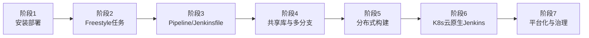

# Jenkins流水线配置

## 一、概述

Jenkins 是应用最广泛的开源 CI/CD 自动化服务器，核心价值在于**将构建、测试、部署流程代码化**（Pipeline as Code）。自 Jenkins 2.x 起，声明式流水线（Declarative Pipeline）与 `Jenkinsfile` 成为官方推荐的工程化方式：流水线脚本与业务代码同库存放、同版本演进，配合多分支流水线（Multibranch Pipeline）实现每个分支/PR 自动获得独立的构建任务。

> [!info]
> 截至调研时点（2026-11），Jenkins 最新 LTS 为 **2.580.2**（2026-10-28 发布），2025 年 4 月起的 LTS 线包括 2.492.x / 2.504.x / 2.516.x / 2.528.x / 2.541.x / 2.555.x / 2.568.x / 2.580.x。LTS 每 12 周一个大版本、每 4 周一个补丁版本。

相关笔记：[[Jenkins核心要点与最佳实践]]（架构/共享库/安全运维）、[[Jenkins资源高效利用方案]]（资源优化）、[[CI-CD现代实践与趋势]]（全景与选型）。

## 二、从入门到精通学习路线



| 阶段 | 目标 | 关键内容 |
| --- | --- | --- |
| 1. 安装部署 | 能跑起来 | Docker 安装（`jenkins/jenkins:lts-jdk21`）、war 包 + systemd、`JENKINS_HOME` 结构、镜像源加速（国内清华/中科大插件源） |
| 2. Freestyle | 理解 Job | 简单任务、定时构建、参数化、SSH 执行远程命令 |
| 3. Pipeline | 核心能力 | 声明式语法（`pipeline/agent/stages/steps/post/when`）、脚本式对比、`Jenkinsfile` 入库 |
| 4. 共享库与多分支 | 工程化复用 | Shared Library（`vars/src/resources`）、Multibranch / Organization Folder、`@Library` |
| 5. 分布式构建 | 弹性扩容 | Controller/Agent 架构、JNLP 与 SSH 接入、节点标签、并发与队列 |
| 6. K8s 云原生 | 动态 Agent | Kubernetes 插件、`podTemplate`、Kaniko 无 root 构建镜像 |
| 7. 平台化治理 | 规模运营 | GitOps 衔接、DORA 度量、备份升级、安全加固、监控告警 |

> [!tip]
> 学习顺序不要跳级：很多团队"一上来就 Jenkins on K8s + 动态 Agent 拉满"，结果被网络策略、PV 挂载、调度问题卡住。建议先在单机/Docker 上把 Pipeline 跑顺，再渐进式上 K8s。

## 三、Jenkinsfile 声明式流水线详解

### 3.1 必备骨架与关键字段

```groovy
pipeline {
    agent any                    // 必填：执行节点；可选 none/label/docker/kubernetes
    options {
        buildDiscarder(logRotator(numToKeepStr: '20'))   // 只保留最近20次构建
        timeout(time: 30, unit: 'MINUTES')
        timestamps()
        disableConcurrentBuilds()
    }
    environment {
        APP_NAME   = 'demo-service'
        DOCKER_REG = 'registry.example.com'
        // credentials() 绑定 Jenkins 凭据库，自动生成 _USR / _PSW 变量
        REG_CRED   = credentials('docker-registry-cred')
    }
    parameters {
        choice(name: 'DEPLOY_ENV', choices: ['dev', 'staging', 'prod'], description: '部署环境')
        booleanParam(name: 'SKIP_TEST', defaultValue: false, description: '跳过单测')
    }
    stages {
        stage('Checkout') {
            steps { checkout scm }
        }
        stage('Build & Test') {
            when {
                not { expression { params.SKIP_TEST } }
            }
            steps {
                sh 'mvn -B clean verify'
            }
        }
        stage('Deploy') {
            when { branch 'main' }        // 只有 main 分支才部署
            steps {
                sh "./deploy.sh ${params.DEPLOY_ENV}"
            }
        }
    }
    post {
        success { echo '构建成功 ✔' }
        failure {
            echo '构建失败，发送告警'
            // mail to: 'dev@example.com', subject: "Jenkins 失败: ${env.JOB_NAME} #${env.BUILD_NUMBER}"
        }
        always {
            junit allowEmptyResults: true, testResults: '**/target/surefire-reports/*.xml'
            cleanWs()                     // 清理工作空间
        }
        cleanup { echo '最后一步，无论成败都执行' }
    }
}
```

要点速查：

| 指令 | 层级 | 作用 |
| --- | --- | --- |
| `agent` | 顶层必填，stage 可覆盖 | 指定执行环境：`any/none/label/docker/kubernetes` |
| `stages` | 顶层必填 | 至少包含一个 `stage`，stage 必须有 `steps` |
| `post` | 顶层/stage | 条件：`always/success/failure/unstable/aborted/changed/fixed/regression/cleanup` |
| `when` | stage | 条件跳过：`branch/tag/changset/environment/expression/equals`，支持 `allOf/anyOf/not` 嵌套 |
| `parameters` | 仅顶层 | `string/text/booleanParam/choice/password`，通过 `params.XXX` 读取 |
| `environment` | 顶层/stage | 注入环境变量，支持 `credentials('凭据ID')` |
| `options` | 顶层/stage | `buildDiscarder/timeout/retry/disableConcurrentBuilds/skipDefaultCheckout` 等 |
| `triggers` | 仅顶层 | `cron('H 4 * * *')`、`pollSCM('@hourly')`、`upstream(...)` |

### 3.2 场景一：Java（Spring Boot）构建

```groovy
pipeline {
    agent {
        docker {
            image 'maven:3.9-eclipse-temurin-21'
            args '-v $HOME/.m2:/root/.m2'      // 挂载宿主机 Maven 缓存，加速依赖下载
        }
    }
    stages {
        stage('打包') { steps { sh 'mvn -B clean package -DskipTests' } }
        stage('单测与覆盖率') {
            steps {
                sh 'mvn -B verify'
                jacoco exclusionPattern: '**/entity/**'
            }
        }
    }
}
```

配合 [[SpringBoot最佳实践]]：Spring Boot 项目应始终用 `-B`（batch 模式）避免彩色日志污染 Jenkins 控制台，并把镜像构建交给下一阶段的 Kaniko。

### 3.3 场景二：前端项目（Node）构建

```groovy
pipeline {
    agent { docker { image 'node:22-alpine' } }
    stages {
        stage('安装依赖') {
            steps { sh 'npm ci --cache ~/.npm --prefer-offline' }
        }
        stage('Lint + 构建') {
            parallel {
                stage('Lint')  { steps { sh 'npm run lint' } }
                stage('Build') { steps { sh 'npm run build' } }
            }
        }
    }
    post {
        always {
            archiveArtifacts artifacts: 'dist/**', allowEmptyArchive: true
        }
    }
}
```

### 3.4 场景三：容器镜像构建与推送（K8s + Kaniko）

```groovy
pipeline {
    agent {
        kubernetes {
            yaml '''
kind: Pod
spec:
  containers:
  - name: kaniko
    image: gcr.io/kaniko-project/executor:debug
    imagePullPolicy: IfNotPresent
    command: ["/bin/sh", "-c", "sleep 999999"]
    volumeMounts:
    - name: docker-config
      mountPath: /kaniko/.docker
  volumes:
  - name: docker-config
    projected:
      sources:
      - secret:
          name: regcred
          items:
          - key: .dockerconfigjson
            path: config.json
'''
            defaultContainer 'kaniko'
        }
    }
    environment {
        IMAGE = "${env.DOCKER_REG ?: 'registry.example.com'}/demo:${env.BUILD_NUMBER}"
    }
    stages {
        stage('构建并推送镜像') {
            steps {
                sh '''/kaniko/executor \
                      --context=${WORKSPACE} \
                      --dockerfile=Dockerfile \
                      --destination=${IMAGE} \
                      --cache=true'''
            }
        }
    }
}
```

> [!warning]
> Kaniko 在 Pod 内无 root 构建镜像，避免了挂载 `/var/run/docker.sock` 的安全风险。若坚持用 Docker-in-Docker（dind），务必确认 `--privileged` Pod 的使用范围，并阅读 [[Dockerfile编写指南]] 控制镜像分层体积。

## 四、常用配置要点

### 4.1 触发器

```groovy
// 方式一：定时（cron 五段式；H 表示哈希错峰，避免整点并发）
triggers { cron('H 2 * * 1-5') }

// 方式二：轮询 SCM（退而求其次，费 API 配额）
triggers { pollSCM('@hourly') }

// 方式三：Webhook（推荐）—— 在 Git 平台配置 Push/MR/PR 事件
// GitLab: Settings -> Webhooks -> URL http://jenkins.example.com/project/<JOB>
// GitHub:  Settings -> Webhooks -> 勾选 "GitHub hook trigger for GITScm polling"
```

生产环境首选 Webhook + 定期扫描兜底；多分支任务在 Git 平台**组织级**配置 Webhook，配合 Organization Folder 自动增删任务。

### 4.2 凭据管理

```groovy
// 1) environment + credentials()：Secret Text / Username Password / SSH Key
environment { SSH = credentials('deploy-ssh-key') }
steps { sh 'ssh -i $SSH key "$SSH_USR@host"' }

// 2) withCredentials：步骤级作用域，推荐
withCredentials([usernamePassword(credentialsId: 'nexus-cred',
        usernameVariable: 'NEXUS_USR', passwordVariable: 'NEXUS_PSW')]) {
    sh 'mvn deploy -Drepo.user=$NEXUS_USR -Drepo.pass=$NEXUS_PSW'
}
```

凭据类型：Secret Text / Secret File / Username with password / SSH Private Key / Certificate / Cloud API 凭据。**原则：凭据只进 Jenkins 凭据库，绝不写进 Jenkinsfile 或日志。**

### 4.3 通知

```groovy
post {
    failure {
        // 企业微信机器人
        script {
            def msg = """【失败告警】${env.JOB_NAME} #${env.BUILD_NUMBER}\n地址: ${env.BUILD_URL}"""
            sh "curl -s -X POST 'https://qyapi.weixin.qq.com/cgi-bin/webhook/send?key=${WECOM_KEY}' -H 'Content-Type: application/json' -d '{\"msgtype\":\"text\",\"text\":{\"content\":\"${msg}\"}}'"
        }
        emailext subject: "构建失败: ${env.JOB_NAME}", to: 'team@example.com'
    }
}
```

## 五、分布式构建与 K8s 动态 Agent

### 5.1 架构

Controller（原 Master）只负责任务调度、UI 与插件，不跑构建；Agent 承接实际工作负载。接入方式：JNLP（Inbound，适合内网穿透）与 SSH（Outbound/Inbound）。K8s 部署下通过 **Kubernetes 插件**把集群声明为 Cloud，为每次构建动态创建 Agent Pod，构建结束自动回收。

### 5.2 K8s 动态 Agent 配置示例

```yaml
# Jenkins 系统配置中的 Kubernetes Cloud 关键参数
jenkinsUrl: http://jenkins.jenkins.svc:8080
podLabels:
  jenkins/agent: true
  jenkins/jenkins-jnlp-agent: true
podRetention: onFailure        # 默认 Always 会留脏 Pod，onFailure 便于排障
connectTimeout: 300
containerCap: 8                # 单 Pod 容器上限
```

```groovy
// 多容器 Pod：jnlp 由插件自动注入，业务容器按需叠加
podTemplate(
    inheritFrom: 'base-agent',
    containers: [
        containerTemplate(name: 'maven',  image: 'maven:3.9-eclipse-temurin-21', ttyEnabled: true, command: 'cat'),
        containerTemplate(name: 'docker', image: 'docker:27-cli', ttyEnabled: true, command: 'cat')
    ],
    volumes: [persistentVolumeClaim(claimName: 'maven-cache', mountPath: '/root/.m2')]
) {
    node(POD_LABEL) {
        stage('Build') {
            container('maven') { sh 'mvn -B clean package' }
        }
        stage('Push') {
            container('docker') { sh 'docker build -t demo:latest .' }
        }
    }
}
```

> [!tip]
> 动态 Agent 的核心收益是**弹性与隔离**：高峰期自动扩容、互不干扰。但要注意：Agent Pod 崩溃排查难，建议 `podRetention: onFailure` 保留失败 Pod；构建缓存（Maven/npm）通过 PVC 或节点级缓存挂载，否则每次冷启动拖慢 3-10 分钟。

## 六、常见坑与最佳实践

> [!warning] 常见坑
> 1. **`script {}` 滥用**：声明式里写大段 Groovy 逻辑，可读性、CPS 序列化都出问题——逻辑下沉到共享库。
> 2. **`sh` 用双引号包裹变量**：`sh "${VAR}"` 会在 Groovy 层求值，遇到 `$` 转义问题；优先单引号 + 环境变量 `sh '$VAR'`。
> 3. **凭据泄露**：`echo` 凭据变量、curl 带明文 token 上报，控制台日志永久留存；用 `withCredentials` + `sh(varsWithSecrets: ...)` 屏蔽。
> 4. **长命分支 + 巨大 MR**：违反持续集成初衷，构建失败难定位——小步合入主干。
> 5. **工作空间污染**：并行/重复构建复用 workspace 导致脏文件；关键 stage 用 `cleanWs()` 或 `disableConcurrentBuilds()`。
> 6. **插件不升级**：安全补丁长期不装，LTS 升级时插件兼容性爆炸——每月定期审插件。

> [!tip] 最佳实践
> 1. Jenkinsfile 与代码同库、同 review 流程；流水线变更也是代码变更。
> 2. 阶段切分遵循"**一个 stage 一个关注点**"，失败时能一眼定位到阶段。
> 3. 通用逻辑沉淀到 Shared Library，业务 Jenkinsfile 保持 20 行以内的编排层。
> 4. 用 Pipeline Syntax 片段生成器 + Replay 现场调试，避免"改-跑-错"循环。
> 5. `when { beforeAgent true }` 提前拦截，避免为不需要的 stage 占用 Agent。

## 七、2025-2026 动态

| 时间 | 动态 |
| --- | --- |
| 2025-02 起 | LTS **2.492.1** 引入全新头部导航与 Command Palette，取代旧搜索框，UI 持续翻新 |
| 2025-04 | LTS **2.504.1** 稳定支持 **JDK 21/25**，旧 JDK 逐步退场 |
| 2025-12 | weekly 2.543（12-23）启用新的 Linux 包仓库签名密钥 |
| 2026-04 | LTS **2.555.1** 起**要求 Java 21 或 25**，Java 17 不再支持、容器镜像移除 |
| 2026-09 | LTS **2.580.1** 完成大瘦身：JUnit/Mailer/Matrix Auth 等插件不再捆绑，`jenkins.war` 减重 20+ MB；默认禁止 Object 字段反序列化 |
| 2026-10-28 | 最新 LTS **2.580.2** 发布：Jetty 12.1.14 升级 + 多个安全修复 |
| 持续 | Jenkins 社区主推：云原生 Controller 镜像（jcasc）、插件安全审计提速、与 GitOps 生态（ArgoCD/Flux）做"CI 侧"互补 |

> [!info]
> 2026 年的 Jenkins 定位愈发清晰：**自托管、合规优先、深度定制**场景的 CI 中枢，交付环节则普遍交给 GitOps 工具（详见 [[CI-CD现代实践与趋势]]）。升级前务必核对 JDK 与插件矩阵，容器部署注意 2.568.x 起已移除 Windows 2019 controller 镜像。

## 八、参考资料

1. Jenkins 官方文档 - Pipeline Syntax：https://www.jenkins.io/doc/book/pipeline/syntax/
2. Jenkins 官方文档 - Using a Jenkinsfile：https://www.jenkins.io/doc/book/pipeline/jenkinsfile/
3. Jenkins 官方文档 - Extending with Shared Libraries：https://www.jenkins.io/doc/book/pipeline/shared-libraries/
4. Jenkins LTS Changelog（版本时间线）：https://www.jenkins.io/changelog-stable/
5. Kubernetes 插件官方页（动态 Agent）：https://plugins.jenkins.io/kubernetes/
6. CloudBees - Best Practices for Jenkins Pipeline：https://www.cloudbees.com/blog/best-practices-for-jenkins-pipeline
7. DevOpsCube - How to Setup Jenkins Build Agents on Kubernetes Pods：https://devopscube.com/jenkins-build-agents-kubernetes
8. OSCHINA - Jenkins共享库实战开发与最佳实践（2025）：https://my.oschina.net/emacs_7991204/blog/19216099
9. CSDN - 基于Jenkins+K8S的微服务CI/CD全链路实践（2025-05）：https://blog.csdn.net/weixin_50902636/article/details/147678373
