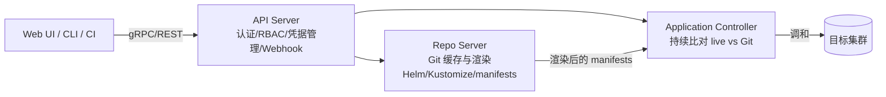

# K8s-GitOps与ArgoCD实战

> [!abstract] 摘要
> GitOps 把"集群期望状态放进 Git"，由集群内代理持续拉取并调和——这是当前 K8s 生产发布的标准姿势，也是 [[Kubernetes部署实践]] 学习路线第 5 阶段的核心内容。本笔记讲清 GitOps 四原则、ArgoCD 三大组件架构、Application CRD 与自动同步语义，并落地一条"改 Git 即发布"的完整流水线。

> [!info] 版本假设
> 本篇按 **Argo CD 3.x**（3.0 于 2025-05 发布，YAML 与 API 延续 `argoproj.io/v1alpha1`）、kubectl **v1.37** 编写。CLI 命令基于 `argocd` 客户端 v3。

## 一、概念与原理

### 1.1 GitOps 四原则（OpenGitOps v1.0.0）

1. **声明式（Declarative）**：期望状态必须以声明式表达——是"描述想要什么"而非脚本步骤。
2. **版本化且不可变（Versioned & Immutable）**：期望状态存于 Git 并保留完整版本历史，任何变更可追溯、可回滚。
3. **自动拉取（Pulled Automatically）**：由集群内代理**主动拉取**最新声明（pull 模式），而不是外部系统往集群里推。
4. **持续调和（Continuously Reconciled）**：代理持续观察实际状态并尝试应用期望状态，漂移自动纠正（自愈）。

与 CI/CD 的关系：CI（Jenkins/GitHub Actions，见 [[Jenkins流水线配置]]）负责"构建镜像 + 把新版本号写回 Git"，之后的部署完全交给 GitOps 代理——**CI 管提交，GitOps 管应用**，集群凭据不再暴露给 CI 系统。

### 1.2 ArgoCD 架构：三大核心组件



- **api-server**：对外唯一入口。应用管理与状态报告、触发 sync/rollback、仓库与集群凭据（以 K8s Secret 存储）、认证与 RBAC、Git webhook 监听。
- **repo-server**：内部服务，维护 Git 仓库本地缓存，按 repoURL/revision/路径/参数渲染出纯 K8s manifests。
- **application-controller**：核心控制器，持续监控运行中的应用，比较 live 状态与目标状态，发现 `OutOfSync` 并（可选）自动纠正；同时负责 PreSync/Sync/PostSync 生命周期钩子。

## 二、核心语法 / API 详解

### 2.1 安装与初始配置

```bash
# 1. 安装（非 HA 起步；HA 用 manifests/ha/install.yaml）
kubectl create namespace argocd
kubectl apply -n argocd -f https://raw.githubusercontent.com/argoproj/argo-cd/stable/manifests/install.yaml

# 2. 安装 CLI 后，取初始 admin 密码（首次登录后应删除该 Secret 让其重新生成）
kubectl -n argocd get secret argocd-initial-admin-secret \
  -o jsonpath='{.data.password}' | base64 -d; echo

# 3. 端口转发并登录
kubectl -n argocd port-forward svc/argocd-server 8080:443
argocd login localhost:8080 --username admin

# 4. 注册目标集群（本集群场景一般不需要；多集群时用）
argocd cluster add <kubeconfig-context-name>
```

### 2.2 Application CRD 字段详解

```yaml
apiVersion: argoproj.io/v1alpha1
kind: Application
metadata:
  name: web-prod
  namespace: argocd                    # Application 必须建在 argocd 命名空间
  finalizers: [resources-finalizer.argocd.argoproj.io]  # 删除 Application 时级联清理资源
spec:
  project: default                     # 归属 AppProject（多租户见 2.3）
  source:                              # 期望状态在哪
    repoURL: https://github.com/twd/gitops-repo.git
    targetRevision: main               # 分支/tag/commit
    path: apps/web/overlays/prod       # 目录（Kustomize/Helm/纯 YAML 自动识别）
    helm:
      valueFiles: [values-prod.yaml]   # Helm 场景传 values；多源场景可引用 $values
  destination:                         # 部署到哪
    server: https://kubernetes.default.svc   # ArgoCD 所在集群；外部集群用 API 地址
    namespace: web
  syncPolicy:
    automated:                         # 自动同步三开关
      prune: true        # Git 里删了 → 集群里也删（默认关闭：防误删的安全机制）
      selfHeal: true     # 集群被人改了 → 改回 Git 状态（默认关闭）
      allowEmpty: false  # Git 目录清空时不允许应用被清空
    syncOptions:
      - CreateNamespace=true           # 目标 ns 不存在时自动创建
      - PruneLast=true                 # 删资源放最后，降低发布窗口风险
      - ApplyOutOfSyncOnly=true        # 只应用有差异的资源，加速大应用
    retry:
      limit: 5
      backoff: { duration: 5s, factor: 2, maxDuration: 3m }  # 失败指数退避重试
```

### 2.3 自动同步语义与健康评估（官方文档确认的行为）

- **prune vs selfHeal 的方向差**：prune 处理"Git 删除 → 集群删除"；selfHeal 处理"集群改动 → 恢复 Git"。两者默认都关。
- 自动同步只在应用 **OutOfSync** 时触发；同一 commit SHA + 参数组合只尝试一次（selfHeal=true 时超时后会再次调和，默认自愈超时 5s）。
- 自动同步的应用**不能执行 Rollback**（想回滚就改 Git 或关自动同步）；调和周期由 `argocd-cm` 的 `timeout.reconciliation` 控制，默认 120s + 60s 抖动。
- **sync 与 health 是两个独立维度**：sync 反映"配置是否与 Git 一致"（Synced/OutOfSync/Unknown），health 反映"是否正常运行"（Healthy/Progressing/Degraded/Suspended/Missing）。常见组合如 Synced+Degraded（已按 Git 应用但 Pod 起不来）。

### 2.4 AppProject 与 ApplicationSet

AppProject 把"允许从哪些仓库、部署到哪些集群/命名空间、能建哪些资源"约束成项目边界，是多租户基础：

```yaml
apiVersion: argoproj.io/v1alpha1
kind: AppProject
metadata: { name: team-backend, namespace: argocd }
spec:
  sourceRepos: ["https://github.com/twd/backend-*"]        # 仓库白名单
  destinations:
    - { server: https://kubernetes.default.svc, namespace: backend-* }  # 命名空间白名单
  clusterResourceWhitelist: []   # 禁止创建集群级资源（Tenant 不可动 CRD/RBAC）
```

ApplicationSet 用生成器批量铺 Application（多环境/多集群一表管理）：

```yaml
apiVersion: argoproj.io/v1alpha1
kind: ApplicationSet
metadata: { name: web-envs, namespace: argocd }
spec:
  generators:
    - list:
        elements:
          - { env: dev, ns: web-dev, revision: main }
          - { env: prod, ns: web-prod, revision: main }
  template:
    metadata: { name: "web-{{env}}" }
    spec:
      project: team-backend
      source: { repoURL: https://github.com/twd/gitops-repo.git, targetRevision: "{{revision}}", path: "apps/web/overlays/{{env}}" }
      destination: { server: https://kubernetes.default.svc, namespace: "{{ns}}" }
      syncPolicy: { automated: { prune: true, selfHeal: true } }
```

### 2.5 Secret 管理方案

| 方案 | 思路 | 适用 |
| --- | --- | --- |
| Sealed Secrets | 明文经 `kubeseal` 加密成 SealedSecret 进 Git，集群内控制器解密成 Secret | 单集群、纯 Git 方案 |
| External Secrets Operator | ExternalSecret CRD 从 Vault/AWS SM/GCP SM 同步生成 K8s Secret | 多集群、已有密钥平台 |
| SOPS + age | Git 中存加密文件，部署时解密（Kustomize/ArgoCD 插件支持） | 文件级加密、可移植 |

背景共识：Secret 直接放 Git（哪怕 base64）等于明文泄露；K8s 原生 Secret 也仅 base64 编码不是加密（见 [[K8s-存储与配置管理]] 的 Secret 安全清单）。

## 三、实战案例

场景：v1.37 kind 集群 + Argo CD 3.x，建一条"Git 仓库自动部署"完整流程：Git 里放 Helm chart 与两套 values，改 values 即自动发布并自愈。

```bash
# 1. 准备 Git 仓库（结构示例）
# gitops-repo/
# ├── apps/web/overlays/dev/values.yaml    # image.tag: v1.4.1, replicaCount: 1
# └── apps/web/overlays/prod/values.yaml   # image.tag: v1.4.2, replicaCount: 3
git init gitops-repo && cd gitops-repo && git push origin main

# 2. 声明式创建 Application（也可用 argocd app create，等价）
cat > app-web-prod.yaml <<'EOF'
apiVersion: argoproj.io/v1alpha1
kind: Application
metadata: { name: web-prod, namespace: argocd }
spec:
  project: default
  source:
    repoURL: https://github.com/twd/gitops-repo.git
    targetRevision: main
    path: charts/web-chart            # 用 [[K8s-Helm包管理实战]] 里自写的 chart
    helm: { valueFiles: [../apps/web/overlays/prod/values.yaml] }
  destination: { server: https://kubernetes.default.svc, namespace: web }
  syncPolicy:
    automated: { prune: true, selfHeal: true }
    syncOptions: [CreateNamespace=true, PruneLast=true]
EOF
kubectl apply -f app-web-prod.yaml

# 3. 观察：两分钟内应从 OutOfSync → Synced+Healthy
argocd app get web-prod --refresh

# 4. 发布：CI 构建新镜像后，把 prod values 的 image.tag 改成 v1.4.3 并 push
git commit -am "release v1.4.3" && git push
argocd app get web-prod --refresh      # OutOfSync → 自动同步 → Synced

# 5. 验证自愈：手动改集群，观察被拉回 Git 状态
kubectl -n web scale deploy/web --replicas=5
sleep 180 && kubectl -n web get deploy web   # replicas 回到 3（selfHeal 调和）
```

推 Git 的动作可由 CI 完成（Jenkins 构建后用 `git commit` 更新 values），形成"CI 构建 → 写 Git → ArgoCD 拉取部署"的完整闭环；进一步把 [[Prometheus监控入门]] 的指标接入发布审批即可实现金丝雀。

## 四、动手练习

1. **基础**：安装 ArgoCD，登录 UI，用 UI 创建第一个 Application（指向任意公开 Helm 仓库，如 argo 官方示例），观察 sync/health 两个状态字段。
   提示：注意 UI 顶栏 App Details 里 sync 状态与健康状态的分区；首次同步可手动点 Sync 看事件流。
2. **自动同步语义**：对练习 1 的应用分别关闭/开启 selfHeal，手动 `kubectl edit` 改 Deployment 副本数，观察调和行为差异。
   提示：未开 selfHeal 时 live 状态会显示与 Git 的 diff；开启后约 2 分钟内被改回。
3. **AppProject 多租户**：建 team-backend 项目，`sourceRepos` 白名单外仓库创建 Application，验证被拒绝。
   提示：错误信息会指向 project 目标/源限制；再加 `clusterResourceWhitelist: []` 观察 Namespace 级资源也受限。
4. **完整流程（核心练习）**：建一条从 Git 仓库自动部署的完整流程——Git 仓库含 chart+values，创建自动化 Application（prune+selfHeal），依次验证"push 新镜像 tag → 自动发布""Git 删资源 → 集群清理（prune）""手动改集群 → 自愈"三条链路。
   提示：push 后立即 `argocd app get --refresh` 可加速观察；prune 验证前确认 `allowEmpty: false` 已设，避免误清空。
5. **进阶**：用 Sealed Secrets 把数据库密码纳入 Git 管理：安装 controller，`kubeseal` 加密一个 Secret 提交进仓库，验证 ArgoCD 部署后集群内出现同名 Secret。
   提示：SealedSecret 只能在**同集群同命名空间**解密（证书范围）；换集群需导出重封。

> [!success]- 练习 4 参考答案要点
> 1. 三条链路对应的开关：镜像 tag 发布靠自动同步（OutOfSync 触发）；Git 删资源靠 `automated.prune: true`；手动改集群靠 `automated.selfHeal: true`。
> 2. 观察 HUD：`argocd app get` 看 SYNC STATUS 与 HEALTH STATUS 两个独立列；事件里有 "Syncing (automated)" 记录。
> 3. 常见失败：Application 建在非 argocd 命名空间（报 CRD 不存在）；`destination.server` 写错；values 文件相对路径不对。
> 4. 回滚理解：自动同步应用不能 Rollback——回滚 = `git revert` 那次 values 提交，让 ArgoCD 自动调和回去，这才是 GitOps 语义的回滚。

## 五、常见坑与 FAQ

> [!warning] 开了 prune 却忘了 allowEmpty 保护
> prune 让"Git 删什么、集群删什么"成为现实。如果 Git 目录被误清空（或脚本误写空值文件），应用可能被整体清空。默认 Git 目标为空时有保护，若确实需要允许空应用必须显式 `allowEmpty: true`，并理解其风险。

> [!warning] 自动同步与手动操作打架
> 自动同步开启后：手动 `kubectl edit` 会被 selfHeal 拉回（这是特性不是故障）；`helm upgrade` 等命令式操作产生的"git 外差异"同样会被覆盖；自动同步的应用无法执行 Rollback。需要人工介入时先停自动同步（或改 Git）。

> [!tip] sync 与 health 分开看
> "Synced 但 Degraded"说明配置已与 Git 一致但应用运行异常（镜像拉不下、探针失败），排障应回到 Pod/Event 层（五步法见 [[Kubernetes核心要点与生产实践]]）；"OutOfSync 但 Healthy"则是配置漂移，看 diff 即可。

> [!tip] 凭据是软肋，最小化 Secret 落地面
> ArgoCD 仓库凭据以 K8s Secret 存在 argocd 命名空间——给 CI 分发个人凭据的模式已被 pull 模式取代；仓库侧配合分支保护 + required review，才能保证"Git 里的状态 = 通过评审的状态"。

FAQ：Q：多集群怎么管？A：`argocd cluster add` 注册后，ApplicationSet 用 cluster generator 一键铺开。Q：要不要把 Application 的 YAML 也进 Git？A：要——App-of-Apps 模式（一个根 Application 引用其余 Application 定义），连"部署器配置"本身也 GitOps 化。Q：同步周期能不能更快？A：调 `timeout.reconciliation`（默认 120s）或配 Git webhook 触发即时调和。

## 六、自检清单

- [ ] 能背出 GitOps 四原则并解释 pull 模式相对 push 的安全优势
- [ ] 能画出 api-server / repo-server / application-controller 的数据流
- [ ] 能写出含 automated(prune/selfHeal) 与 syncOptions 的 Application YAML
- [ ] 分得清 prune（Git 删除 → 集群删除）与 selfHeal（集群漂移 → 拉回 Git）
- [ ] 知道 sync 状态与 health 状态是两个独立维度及其常见组合
- [ ] 能用 AppProject 的 sourceRepos/destinations 白名单实现租户隔离
- [ ] 会用 ApplicationSet 的生成器批量铺多环境应用
- [ ] 知道 Sealed Secrets 与 External Secrets 的适用场景选择

## 七、关联笔记与参考

**关联笔记**：[[Kubernetes部署实践]]（GitOps 在生产清单中的位置）｜[[K8s-Helm包管理实战]]（Application 引用的 chart 来源）｜[[K8s-Service与网络]]（部署产物中的流量入口）｜[[Jenkins流水线配置]]（CI 写 Git 的上游环节）｜[[DevOps最佳实践与发展趋势]]（GitOps 与 DevOps 的关系）｜[[Prometheus监控入门]]（发布健康度验证）

**参考链接**：

1. [OpenGitOps — GitOps 四原则](https://opengitops.dev/)（CNCF 工作组定义的 v1.0.0 原则）
2. [Argo CD Architecture — 官方文档](https://argo-cd.readthedocs.io/en/stable/operator-manual/architecture/)（三大组件职责与数据流）
3. [Automatic Sync Policy — 官方文档](https://argo-cd.readthedocs.io/en/stable/user-guide/auto_sync/)（prune/selfHeal/allowEmpty/retry 语义）
4. [Projects (AppProject) — 官方文档](https://argo-cd.readthedocs.io/en/stable/operator-manual/declarative-projects/)（多租户白名单）
5. [ApplicationSet — 官方文档](https://argo-cd.readthedocs.io/en/stable/operator-manual/applicationset/)（生成器与批量管理）
6. [Sealed Secrets — GitHub](https://github.com/bitnami-labs/sealed-secrets)（kubeseal 加密进 Git）
7. [External Secrets Operator](https://external-secrets.io)（对接 Vault/云密钥平台）
