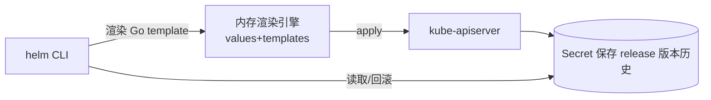

# K8s-Helm包管理实战

> [!abstract] 摘要
> Helm 是 Kubernetes 的事实包管理器：把一组 YAML 参数化成 chart，实现"一份模板、多环境部署、一键回滚"。本笔记逐文件拆解 chart 结构与 Go template 语法，讲清 values 覆盖优先级、依赖子 chart、hooks 与发布生命周期，学完能从零编写自己的 chart，并把现有 YAML 改造成可分发的 Helm 包。

> [!info] 版本假设
> 本篇按 **Helm 4.x**（2025 年底发布 4.0）编写，chart `apiVersion: v2` 在 Helm 3/4 完全通用；模板按 kubectl **v1.37** 集群渲染。选型与母笔记一致：[[Kubernetes部署实践]] 推荐 Helm 分发第三方应用、Kustomize 管理自研多环境变体。

## 一、概念与原理

### 1.1 Helm 架构：只有客户端

Helm 3 起移除了服务端 Tiller，helm CLI 直接用本地 kubeconfig 调 K8s API；**release 的元数据以 Secret 形式存在对应命名空间**（`sh.helm.release.v1.<name>.<rev>`），这就是"helm 能记住每版渲染结果、支持 rollback"的原因。



### 1.2 Chart 目录结构逐文件讲解

```
web-chart/
├── Chart.yaml          # chart 元数据（必填 apiVersion/name/version）
├── values.yaml         # 默认值（模板取值的第一优先级来源）
├── values.schema.json  # 可选：JSON Schema 校验最终 Values（install/lint 时生效）
├── charts/             # 依赖子 chart（.tgz，helm dependency update 下载）
├── crds/               # 自定义资源定义：不可模板化、先装后用、永不删除
└── templates/          # 模板：目录内所有文件都过模板引擎（_ 前缀除外）
    ├── _helpers.tpl    # 命名约定：define 定义可复用片段，不产出 K8s 对象
    ├── deployment.yaml
    ├── service.yaml
    └── NOTES.txt       # 安装后/status 时打印给用户的使用说明
```

## 二、核心语法 / API 详解

### 2.1 Chart.yaml 逐字段

```yaml
apiVersion: v2          # Helm 3/4 的 chart 格式版本
name: web-chart         # chart 名（必填）
version: 0.1.0          # chart 自身版本，SemVer 2（必填），每次升级要递增
appVersion: "1.27"      # 所含应用的版本；与 version 无关；务必加引号
type: application       # application 可安装；library 供复用不可安装
kubeVersion: ">=1.29.0-0"   # 兼容的 K8s 版本约束（semver）
dependencies:
  - name: redis
    version: "20.x"
    repository: https://charts.bitnami.com/bitnami
    condition: redis.enabled   # values 里 redis.enabled=false 可整体关闭
```

注意：v3.3.2 起 Chart.yaml **不允许额外字段**，自定义元数据放 `annotations`。

### 2.2 values 覆盖优先级（低 → 高）

1. chart 内 `values.yaml` 默认值；
2. （子 chart 场景）父 chart values.yaml 中的对应段；
3. `helm install -f` 指定的文件（按给定顺序后者覆盖前者）；
4. `--set` 命令行参数（优先级最高）。

要点：合并是**逐字段深合并**，用户文件里只写的字段覆盖、其余保留默认；`.Values.global.*` 全局段对所有层级可见，**父 chart 的 global 覆盖子 chart 的**；子 chart 拿不到父 chart 的其他值（作用域单向向下）。

### 2.3 模板语法（Go template + Sprig）

内置对象：`{{ .Release.Name }}`（发布名/Namespace/IsInstall）、`{{ .Values.* }}`（取值）、`{{ .Chart.* }}`（元数据，未知字段会被丢弃）、`{{ .Capabilities.KubeVersion }}`、`{{ .Files.Get "file" }}`。

```yaml
# templates/deployment.yaml —— 核心惯用法
apiVersion: apps/v1
kind: Deployment
metadata:
  name: {{ include "web-chart.fullname" . }}    # include：执行 define 片段并返回字符串
  labels: {{- include "web-chart.labels" . | nindent 4 }}
spec:
  replicas: {{ .Values.replicaCount }}
  template:
    spec:
      containers:
        - name: {{ .Chart.Name }}
          image: "{{ .Values.image.repository }}:{{ .Values.image.tag | default .Chart.AppVersion }}"
          resources: {{- toYaml .Values.resources | nindent 12 }}   # toYaml：对象转 YAML 再嵌缩进
          {{- with .Values.env }}      # with：切换作用域，空则整段跳过
          env: {{- toYaml . | nindent 12 }}
          {{- end }}
          {{- if .Values.ingress.enabled }}   # if/else 分支
          ...
          {{- end }}
```

`_helpers.tpl` 定义：

```
{{- define "web-chart.fullname" -}}
{{- printf "%s-%s" .Release.Name .Chart.Name | trunc 63 | trimSuffix "-" -}}
{{- end -}}
```

缩进惯用法：管道后用 `nindent N`（先换行再缩进）而不是 `indent N`，这是模板缩进错乱的头号修正点。本地验证：`helm template web-chart --debug` 渲染 + `helm lint` 静态检查。

### 2.4 依赖、hooks 与测试

- **依赖管理**：`dependencies` 声明后跑 `helm dependency update` 把子 chart 下载进 `charts/`；同名多实例用 `alias`；`condition`（values 布尔路径）优先于 `tags`；`import-values` 可把子 chart 的 exports 导入父 chart。
- **hooks**：给资源打注解 `helm.sh/hook: pre-install|post-install|pre-upgrade|post-rollback|test` 等；`helm.sh/hook-weight: "-5"` 控制顺序（字符串、升序执行）；`hook-delete-policy: before-hook-creation,hook-succeeded` 控制清理（默认 before-hook-creation）。Job/Pod 类 hook 会**阻塞到运行完成**，失败则整个 release 失败。
- **测试**：注解 `helm.sh/hook: test` 的 Job 由 `helm test <release>` 触发（旧写法 `test-success` 已统一为 `test`）。

```yaml
apiVersion: batch/v1
kind: Job
metadata:
  name: {{ include "web-chart.fullname" . }}-db-check
  annotations:
    "helm.sh/hook": pre-install,pre-upgrade
    "helm.sh/hook-weight": "0"
    "helm.sh/hook-delete-policy": before-hook-creation,hook-succeeded
```

## 三、实战案例

场景：从零编写自己的 chart 部署 Web 应用（v1.37 kind 集群，Helm 4.x CLI）。

```bash
# 1. 生成骨架并精简
helm create web-chart
rm web-chart/templates/*.yaml   # 清掉示例，自己逐个写（或直接改造默认生成的 nginx 模板）

# 2. 写 Chart.yaml / values.yaml / _helpers.tpl / deployment.yaml / service.yaml（见第二节）
helm lint web-chart                        # 静态检查
helm template web web-chart --debug        # 渲染预览，确认缩进与取值

# 3. 安装（多环境用 -f 覆盖）
helm install web web-chart -n web --create-namespace -f values-prod.yaml
kubectl get pods -n web -l app.kubernetes.io/instance=web

# 4. 升级与回滚：--atomic 失败自动回滚，--timeout 控制 hook/就绪等待
helm upgrade web web-chart -n web --atomic --timeout 5m
helm history web -n web                    # revision 列表
helm rollback web 1 -n web                 # 回滚到 revision 1

# 5. 运行 chart 自带的 test hook
helm test web -n web

# 6. 打包分发
helm package web-chart                     # 生成 web-chart-0.1.0.tgz
helm get manifest web -n web               # 查看真实渲染结果（排障利器）
```

改造要点对照：原 `deploy.yaml` 里硬编码的镜像/副本/资源 → 全部抽进 `values.yaml`；两套环境的差异只留两个 values 文件进 Git；`_helpers.tpl` 统一 name 与 labels，保证多实例不撞名。

## 四、动手练习

1. **基础**：`helm create demo` 生成骨架，用 `helm template demo --debug` 观察 `deployment.yaml` 中 `include/toYaml/nindent` 的渲染结果；故意把 `nindent` 改成 `indent` 看缩进错乱。
   提示：注意 `NOTES.txt` 只有 install/status 时打印，`helm template` 不输出。
2. **覆盖优先级**：对同一 chart 分别用 `-f a.yaml -f b.yaml` 与 `-f a.yaml --set x=y` 组合，验证"后者覆盖前者、--set 最高"。
   提示：用数组/嵌套对象字段测试深合并行为——`--set` 操作数组时是按下标整体替换。
3. **依赖**：加 bitnami/redis 子 chart，用 `condition: redis.enabled=false` 关闭它再安装，确认不会创建 redis 资源。
   提示：先 `helm dependency update`；子 chart 的值通过父 values 的同名键段传入。
4. **hook 与测试（核心练习）**：把现有 YAML 改造成 chart——拿 [[K8s-Pod与工作负载对象]] 三、实战案例的 `web-deploy.yaml`，改造成含 `pre-upgrade` 数据迁移 Job hook 和 `helm test` 验证 Job 的 chart，并用 `helm install → upgrade --atomic → rollback` 走完整生命周期。
   提示：hook Job 要写 `hook-delete-policy`，否则上次残留 Job 会卡住本次升级；test Job 检查 Service 可达即可。
5. **进阶**：加 `values.schema.json`，给 `replicaCount` 限制 1-10、`image.tag` 必填，验证非法 values 被 `helm lint` 拦截。
   提示：schema 校验的是合并后的最终 Values；`--skip-schema-validation` 可临时跳过。

> [!success]- 练习 4 参考答案要点
> 1. 目录：`helm create web` 后保留 `Chart.yaml/values.yaml/templates/`，把 deployment/service 模板化（image.tag default 到 Chart.AppVersion）。
> 2. pre-upgrade Job：注解 `"helm.sh/hook": pre-upgrade` + `"helm.sh/hook-weight": "0"` + `"helm.sh/hook-delete-policy": before-hook-creation`；Job 失败会令 `helm upgrade` 整体失败（配合 --atomic 自动回滚）。
> 3. test Job：`"helm.sh/hook": test`，`wget -q -O- http://{{ include "web.fullname" . }}`；运行 `helm test web -n web`，PHASE 应为 Succeeded。
> 4. 回滚验证：`helm history` 显示两个 revision；rollback 后 `helm get manifest` 内容回到旧版镜像 tag——注意 hook 资源不在版本管理内，rollback 不会动它们。

## 五、常见坑与 FAQ

> [!warning] --set 会把配置变成"黑盒"
> `--set` 参数不进 Git、CI 日志里难追溯，团队协作时极易出现"同一应用两套值"。规范做法：所有环境差异收敛到 `values-<env>.yaml` 进 Git，`--set` 只留给临时实验；密码类值用 `--set-file` 或外部 Secret 方案。

> [!warning] helm uninstall/rollback 不管 hook 资源
> 官方文档明确：hook 创建的资源不被 release 追踪，删除 release 时**不会**被清理。需要保留的注解 `helm.sh/resource-policy: keep`，需要清理的用 `hook-delete-policy` 或 Job 的 TTL 字段兜底；`crds/` 目录里的 CRD 同样永不删除。

> [!tip] 缩进错乱先用 nindent + helm template 验证
> Go template 的空白控制很脆：`toYaml .Values.resources | nindent 12` 是标准写法；`{{- -}}` 吞掉两侧空白。每次改模板先 `helm template --debug` 本地渲染，别直接 install 上集群调试。

> [!tip] appVersion 必须加引号
> 官方文档特别提醒：YAML 会把 `1.0` 解析成浮点、把形如 `1234e10` 的 SHA 解析成科学计数法，所以 `appVersion: "1.27"` 要带引号。

FAQ：Q：能回滚被 HPA 调过的副本数吗？A：能，rollback 恢复的是该 revision 的完整渲染结果（对比 rollout undo 只回滚 Pod template）。Q：chart 里有 CRD 怎么装？A：放 `crds/`（不可模板化，先于模板安装）；需要参数化的 CRD 由 Operator 自己管。

## 六、自检清单

- [ ] 能说出 Helm 3+ 无 Tiller、release 历史存在命名空间 Secret 中
- [ ] Chart.yaml 必填三字段（apiVersion/name/version）与 appVersion 加引号的原因
- [ ] 能背出 values 优先级：默认值 < 父 chart < -f 文件 < --set
- [ ] 会用 `include` + `define` + `toYaml | nindent` 组织模板
- [ ] 知道 `condition` 优先于 `tags`、子 chart 拿不到父 chart 的值
- [ ] 能写 pre-install Job hook 并配 hook-weight/hook-delete-policy
- [ ] 掌握 install/upgrade --atomic/rollback/history/get manifest 生命周期命令
- [ ] 知道 `crds/` 不可模板化且永不删除，hook 资源不受版本管理

## 七、关联笔记与参考

**关联笔记**：[[Kubernetes部署实践]]（Helm/Kustomize 选型经验）｜[[K8s-Pod与工作负载对象]]（被改造的 YAML 来源）｜[[K8s-GitOps与ArgoCD实战]]（chart 纳入 Git 自动部署）｜[[K8s-存储与配置管理]]（ConfigMap 模板化）｜[[Jenkins流水线配置]]（CI 中集成 helm lint/package）｜[[DevOps最佳实践与发展趋势]]（包管理在 CI/CD 的位置）

**参考链接**：

1. [Charts — Helm 官方文档](https://helm.sh/docs/topics/charts/)（chart 结构、Chart.yaml 字段、values 优先级、依赖）
2. [Chart Hooks — Helm 官方文档](https://helm.sh/docs/topics/charts_hooks/)（hook 注解、权重、删除策略、test）
3. [The Chart Template Developer's Guide — Helm 官方文档](https://helm.sh/docs/chart_template_guide/getting_started/)（Go template 与内置对象）
4. [Using Helm — Helm 官方文档](https://helm.sh/docs/intro/using_helm/)（install/upgrade/rollback 命令语义）
5. [Helm Releases — GitHub](https://github.com/helm/helm/releases)（Helm 4.x 发布与 v2 chart 兼容性说明）
