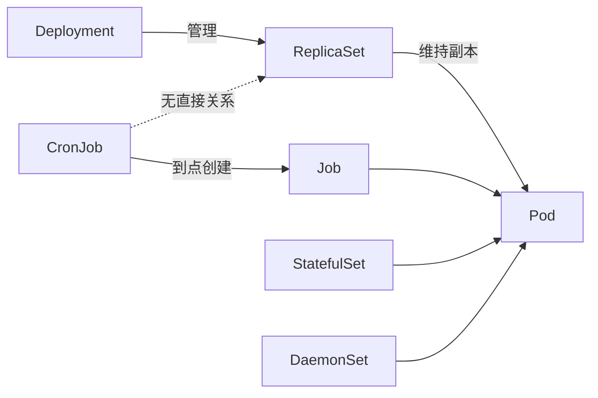

# K8s-Pod与工作负载对象

> [!abstract] 摘要
> Pod 是 Kubernetes 最小的调度单元，Deployment/StatefulSet/DaemonSet/Job/CronJob 都是围绕它封装的"工作负载控制器"。本笔记讲清 Pod 结构与生命周期、三种探针、Deployment 滚动更新（maxSurge/maxUnavailable）与 HPA 扩缩容，学完能独立完成一次带探针保护的零停机发布与回滚。

> [!info] 版本假设
> 本篇命令与 YAML 按 kubectl **v1.37**、API `apps/v1`、`autoscaling/v2` 编写，适用于 1.3x 集群；版本基线与 [[Kubernetes部署实践]] 一致。集群可用 minikube/kind 快速搭建。

## 一、概念与原理

### 1.1 从 Pod 到控制器：K8s 不直接"跑容器"

用户声明期望状态，控制器通过**调谐循环**把实际状态收敛到期望状态。直接创建的裸 Pod 被删除后不会重建；只有被控制器接管的 Pod 才有自愈、扩缩、滚动更新能力：



> [!note] 别手动管理 ReplicaSet
> ReplicaSet 是 Deployment 的内部实现，官方文档明确要求不要绕过 Deployment 直接操作它管理的 ReplicaSet——那样会绕开滚动更新与回滚逻辑。

### 1.2 Pod 生命周期与容器状态

`status.phase` 只有 5 个值（高层摘要，排障别只看它）：

| phase | 含义 |
| --- | --- |
| Pending | 已被集群接受但容器未就绪（含等待调度、拉镜像） |
| Running | 已绑定节点，至少一个容器在运行/启动/重启中 |
| Succeeded / Failed | 全部容器成功终止 / 至少一个失败终止 |
| Unknown | 与节点失联 |

容器有三态 `Waiting`（拉镜像、等 Secret，带 reason）→ `Running` → `Terminated`（可看 exitCode）。kubectl 里常见的 `CrashLoopBackOff`、`Terminating` 只是 Status 显示值，**不是 phase**。Pod 级 Condition 有：`PodScheduled`、`PodReadyToStartContainers`（v1.37 GA）、`Initialized`、`ContainersReady`、`Ready`、`DisruptionTarget` 等。

关键参数：

- `restartPolicy: Always | OnFailure | Never`，重启按指数退避 10s→20s→40s…上限 300s；容器稳定运行 10 分钟后重置退避。
- **Sidecar**：initContainers 中容器级 `restartPolicy: Always`（v1.33 GA），它忽略 Pod 级 restartPolicy，任何退出码都重启，且在业务容器之前启动、之后终止。

### 1.3 三种探针：分工决定生死与流量

| 探针 | 运行时机 | 失败后果 |
| --- | --- | --- |
| `startupProbe` | 仅启动阶段；成功前其他探针不启动 | kubelet 杀容器按 restartPolicy 重来 |
| `readinessProbe` | 全生命周期 | 从 Service 的 EndpointSlice 摘除，**不再接流量但不重启** |
| `livenessProbe` | 全生命周期 | 超过 `failureThreshold` 重启容器 |

检测方式三种：`httpGet` / `tcpSocket` / `exec`（`grpc` 也可）。原则：readiness 管流量、liveness 管"进程僵死"、慢启动交给 startupProbe。

### 1.4 工作负载对象选型对比

| 对象 | 适用场景 | 关键特性 | 一句话反例 |
| --- | --- | --- | --- |
| Deployment | 无状态 Web/API | 副本可替换、滚动更新、回滚 | 需要固定身份/独立存储时不行 |
| StatefulSet | 数据库、MQ、ZK | 稳定网络标识 `pod-0..n`、独立 PVC、有序启停 | 无状态应用用它纯属浪费 |
| DaemonSet | 日志/监控 agent、CNI 组件 | 每节点（或满足条件的节点）一个副本 | 不是"每个应用部署一份" |
| Job | 一次性批任务 | 跑到成功为止（completions/backoffLimit） | 常驻服务会一直重启 |
| CronJob | 定时任务 | 按 schedule 建Job（concurrencyPolicy） | 秒级高频任务别用 |

## 二、核心语法 / API 详解

### 2.1 Deployment YAML 逐字段注释（生产模板）

```yaml
apiVersion: apps/v1
kind: Deployment
metadata:
  name: web
  labels: { app: web }
spec:
  replicas: 3                    # 期望副本数，默认 1；扩缩容改这里或走 HPA
  revisionHistoryLimit: 5        # 保留旧 ReplicaSet 数，默认 10；设 0 将无法回滚
  minReadySeconds: 10            # 新 Pod 需 Ready 满足该时长才算"可用"，缓解抖动误判
  progressDeadlineSeconds: 600   # rollout 卡住超过该时长标记 ProgressDeadlineExceeded（默认 600）
  strategy:
    type: RollingUpdate          # 默认值；Recreate 是先杀光再建，有停机窗口
    rollingUpdate:
      maxSurge: 1                # 滚动期间总 Pod 数最多超出期望的个数/百分比（百分比向上取整）
      maxUnavailable: 0          # 滚动期间最多不可用个数/百分比（百分比向下取整）；生产建议 0
  selector:
    matchLabels: { app: web }    # 必填且创建后不可变；必须与 template.labels 匹配
  template:
    metadata:
      labels: { app: web }
    spec:
      containers:
        - name: web
          image: registry.example.com/web:v1.4.2   # 固定版本 tag，禁用 latest
          ports: [{ containerPort: 8080 }]
          resources:
            requests: { cpu: 250m, memory: 256Mi } # 调度依据
            limits: { memory: 512Mi }              # 内存设 limit；CPU 通常不设（避免 CFS 限流毛刺）
          startupProbe:                            # 慢启动应用：startup 成功前不跑 liveness/readiness
            httpGet: { path: /healthz, port: 8080 }
            failureThreshold: 30                   # 30*2s=60s 启动预算
            periodSeconds: 2
          readinessProbe:
            httpGet: { path: /ready, port: 8080 }
            periodSeconds: 5
          livenessProbe:
            httpGet: { path: /healthz, port: 8080 }
            periodSeconds: 10
          lifecycle:
            preStop: { sleep: { seconds: 3 } }     # 给 LB/EndpointSlice 摘流留时间，实现零停机
```

### 2.2 滚动更新规则（官方文档确认的细节）

- maxSurge/maxUnavailable 都接受**绝对数字或百分比**，默认都是 **25%**。
- 百分比换算：maxUnavailable **向下取整**，maxSurge **向上取整**。
- 二者**不能同时为 0**（否则没有新 Pod 名额也没有旧 Pod 可让位）。
- 只有 `.spec.template` 变化才触发新修订（revision）；改 replicas 不算发布。
- kubelet 计算可用副本时**不计入 Terminating 中的 Pod**，滚动期间实际占用可能短暂超过 replicas+maxSurge。
- rollout 中途扩缩容走**比例分摊**：新增副本按各活跃 ReplicaSet 现有副本比例分配，副本数为 0 的 RS 不参与扩容。

### 2.3 发布、回滚与 HPA 命令

```bash
kubectl set image deploy/web web=registry.example.com/web:v1.5.0
kubectl rollout status deploy/web -w        # 失败时退出码为 1，CI 可据此中止
kubectl rollout history deploy/web          # 查看 revision；CHANGE-CAUSE 来自 change-cause 注解
kubectl rollout undo deploy/web             # 回滚上一版；--to-revision=2 指定版本
kubectl rollout pause/resume deploy/web     # 暂停后可堆叠多次修改，恢复时一次性发布
kubectl scale deploy/web --replicas=5       # 手动扩缩容（注意与 HPA 冲突）
kubectl get pods -o kyaml                   # v1.34+ 推荐 KYAML 输出，歧义更少
```

HPA（`autoscaling/v2`）负责自动扩缩容，基于 Resource 指标时需要集群装有 metrics-server；HPA 与手动 `kubectl scale` 会互相覆盖，二者只能选一个做"谁说了算"：

```yaml
apiVersion: autoscaling/v2
kind: HorizontalPodAutoscaler
metadata: { name: web-hpa }
spec:
  scaleTargetRef: { apiVersion: apps/v1, kind: Deployment, name: web }
  minReplicas: 3
  maxReplicas: 20
  metrics:
    - type: Resource
      resource:
        name: cpu
        target: { type: Utilization, averageUtilization: 70 }  # 目标利用率 70%
  behavior:
    scaleDown:
      stabilizationWindowSeconds: 300    # 缩容冷静期 5 分钟，防抖
```

## 三、实战案例

场景：在 v1.37 kind/minikube 集群部署 3 副本 Web 应用，验证"零停机滚动更新 → 观察 → 回滚"完整闭环。

```bash
# 1. 部署（用上面 2.1 的 YAML，初始镜像 v1.4.2）
kubectl apply -f web-deploy.yaml
kubectl get pods -l app=web -w            # 观察 3 个 Pod 就绪

# 2. 发布新版本：先暂停，合并多处修改，一次 rollout
kubectl rollout pause deploy/web
kubectl set image deploy/web web=registry.example.com/web:v1.5.0
kubectl set resources deploy/web -c web --limits=memory=600Mi
kubectl rollout resume deploy/web

# 3. 观察滚动过程：maxSurge=1 时总数峰值 4（3+1），maxUnavailable=0 时可用数始终 >=3
kubectl get rs -l app=web                 # 新旧两个 ReplicaSet 并存
kubectl rollout status deploy/web

# 4. 假设 v1.5.0 有问题，回滚
kubectl rollout history deploy/web
kubectl rollout undo deploy/web --to-revision=1
kubectl rollout status deploy/web         # 等待重新收敛
```

验证零停机：另开终端 `while true; do curl <svc-ip>/healthz; sleep 0.5; done`，整个发布过程不应出现非 200 响应；`kubectl get events --field-selector reason=Unhealthy` 应无 readiness 失败记录。

## 四、动手练习

1. **基础**：用 `kubectl apply` 部署 2.1 模板，执行 `kubectl get pod <pod> -o jsonpath='{.status.phase} {.status.containerStatuses[0].state}'`，说出三个字段含义。
   提示：对比 `kubectl get pod` 显示的 STATUS 与真实 phase 的差别（如 CrashLoopBackOff 不是 phase）。
2. **探针**：故意把 readinessProbe 路径改成不存在的 `/wrong` 后 apply，观察 Pod 是否重启、Service 是否摘流。
   提示：`kubectl describe pod` 看 Events；再换成 livenessProbe 误配对比后果。
3. **滚动更新参数**：把 maxSurge/maxUnavailable 改为 `25%/25%`（默认）与 `0/1` 各跑一次发布，用 `kubectl get rs -w` 记录 Pod 总数峰值变化。
   提示：注意 maxUnavailable 向下取整、maxSurge 向上取整对 3 副本的实际取值。
4. **发布与回滚（核心练习）**：部署一个滚动更新的 Web 应用并验证发布回滚——用 nginx 镜像 `nginx:1.27` 起步，发布到 `nginx:1.28`，触发一次"坏发布"（镜像 tag 不存在），观察 `rollout status` 报错与 progressDeadline 行为，再执行 `rollout undo`。
   提示：坏镜像会让新 Pod 卡在 ImagePullBackOff，旧 RS 副本不会被缩掉。
5. **HPA**：为上述 Deployment 配 2.3 的 HPA，用 `kubectl run -it --rm load --image=busybox -- sh -c "while true; do wget -q -O- http://web; done"` 制造负载，观察 `kubectl get hpa -w` 的 REPLICAS 变化。
   提示：确认集群已装 metrics-server（kind 需单独安装）；CPU limit 未设置时 HPA 无法计算 Utilization 目标。

> [!success]- 练习 5 参考答案要点
> 1. HPA 目标 `averageUtilization: 70` 是相对 **requests** 的百分比，所以容器必须声明 CPU requests，否则 Utilization 无法计算、HPA 报 `<unknown>`。
> 2. `kubectl get hpa -w` 中 TARGETS 列先出现 `unknown/70%`，metrics-server 就绪后变为真实值；扩容有 ~15s-1min 的反应延迟（扩容无 stabilization 窗口，缩容有 300s 默认窗口）。
> 3. 扩容后的副本由新 ReplicaSet 之外的同一 RS 承接；若发布进行中触发扩容，会按比例分摊到新旧 RS。
> 4. 清理：`kubectl delete hpa web-hpa` 后副本数停留在当前值，不再自动回缩——这就是"HPA 删除后要手动把 replicas 调回"的坑。

## 五、常见坑与 FAQ

> [!warning] livenessProbe 误配引发重启风暴
> liveness 失败即重启容器，接口偶发超时、外部依赖抖动都会被放大成重启循环（退避最长 300s）。原则：liveness 只做轻量、无外部依赖的"进程是否僵死"检测，业务健康交给 readiness；慢启动应用必须先配 startupProbe。

> [!warning] 只改 replicas 不触发回滚入口
> `rollout undo` 只回滚 Pod template 部分；如果回滚后期望副本数已被 HPA 调过，undo 不会覆盖 HPA 的当前值。另外 revisionHistoryLimit=0 会让 Deployment 完全失去回滚能力。

> [!tip] 零停机三件套：maxUnavailable: 0 + readiness + preStop
> Pod 终止时 kube-proxy 摘流与容器退出存在竞态，`preStop` sleep 3~5 秒给 EndpointSlice 移除留出时间，配合 readiness 即可实现滚动更新零 5xx。配合 PodDisruptionBudget 可保护节点 drain 场景。

> [!tip] CrashLoopBackOff 排查入口
> `kubectl logs --previous` 看上一次崩溃日志；`kubectl describe pod` 看 Exit Code（1=应用错误，137=OOM/SIGKILL，143=SIGTERM）。v1.33+ 可用 alpha 特性把退避初始值降到 1s，加快调试循环。

FAQ：Q：Pod 有多个容器时 `kubectl logs` 怎么看？A：加 `-c <容器名>`。Q：为什么改了 selector 报错？A：`.spec.selector` 创建后不可变，需删（`--cascade=orphan` 保住 Pod）重建。

## 六、自检清单

- [ ] 能说出 phase 的 5 个取值，并知道 CrashLoopBackOff 不是 phase
- [ ] 能区分三探针的失败后果（重启 vs 摘流）与适用时机
- [ ] 能解释 maxSurge/maxUnavailable 的取整规则与"不能同时为 0"
- [ ] 知道只有 `.spec.template` 变化才产生新修订，扩缩容不算发布
- [ ] 会用 `rollout history/undo --to-revision` 完成"发布→观察→回滚"闭环
- [ ] 知道 HPA 基于 requests 计算利用率、需要 metrics-server、不能与手动 scale 混用
- [ ] 生产 Deployment 具备：资源声明、三探针、preStop、PDB
- [ ] 能按场景在 Deployment/StatefulSet/DaemonSet/Job/CronJob 间正确选型

## 七、关联笔记与参考

**关联笔记**：[[Kubernetes部署实践]]（部署主线与生产清单）｜[[Kubernetes核心要点与生产实践]]（调度原理与排障）｜[[K8s-Service与网络]]（Pod 就绪后如何对外服务）｜[[K8s-存储与配置管理]]（StatefulSet 的存储方案）｜[[K8s-Helm包管理实战]]（把本篇 YAML 模板化）｜[[Dockerfile编写指南]]（镜像层基础）｜[[Prometheus监控入门]]（扩缩容指标来源）

**参考链接**：

1. [Pod Lifecycle — Kubernetes 官方文档](https://kubernetes.io/docs/concepts/workloads/pods/pod-lifecycle/)（phase、容器状态、探针、重启退避）
2. [Deployments — Kubernetes 官方文档](https://kubernetes.io/docs/concepts/workloads/controllers/deployment/)（strategy/maxSurge/maxUnavailable/比例扩缩容）
3. [Horizontal Pod Autoscaling — Kubernetes 官方文档](https://kubernetes.io/docs/tasks/run-application/horizontal-pod-autoscale/)（HPA v2 行为与指标）
4. [StatefulSets — Kubernetes 官方文档](https://kubernetes.io/docs/concepts/workloads/controllers/statefulset/)（稳定标识与 volumeClaimTemplates）
5. [Jobs / CronJobs — Kubernetes 官方文档](https://kubernetes.io/docs/concepts/workloads/controllers/cron-jobs/)（completions、concurrencyPolicy）
