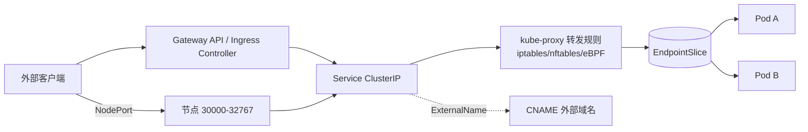

# K8s-Service与网络

> [!abstract] 摘要
> Pod IP 随生命周期漂移，Service 用稳定的虚拟 IP + 负载均衡把流量送到一组 Pod；Ingress/Gateway API 决定外部流量如何进来，CNI 与 NetworkPolicy 决定流量能不能走。本笔记覆盖四种 Service 类型、kube-proxy 转发原理、EndpointSlice、Gateway API 演进、CNI 选型与网络策略，学完能把一个内部服务完整暴露出去并用 NetworkPolicy 收紧访问面。

> [!info] 版本假设
> 按 kubectl **v1.37**、API `v1`、`networking.k8s.io/v1`、`gateway.networking.k8s.io/v1` 编写。注意 v1.35 起 kube-proxy IPVS 模式已弃用（迁移 nftables），Endpoints API 自 v1.33 弃用（统一用 EndpointSlice）。

## 一、概念与原理

### 1.1 流量链路全景



Pod 网络四原则（由 CNI 保证）：所有 Pod 之间 NAT-free 直通、节点与 Pod 直通、Service 提供稳定虚拟 IP、可用 NetworkPolicy 收紧。Service 是**逻辑层**（API 对象 + DNS），kube-proxy 是**数据面实现**（每节点把 Service 规则写进内核）。

### 1.2 四种 Service 类型（嵌套扩展关系）

| 类型 | 作用 | 关键字段 | 典型用途 |
| --- | --- | --- | --- |
| ClusterIP | 集群内稳定 VIP（默认类型） | `port`/`targetPort` | 微服务间调用 |
| NodePort | 每个节点开放端口对外 | `nodePort`（默认 30000-32767） | 无云 LB 的裸机/测试 |
| LoadBalancer | 云 LB 自动创建 | `loadBalancerClass`、注解 | 云上对外服务 |
| ExternalName | DNS CNAME 转发，无代理 | `externalName` | 指向集群外数据库域名 |

三层端口要分清：**port**（Service 对外端口）→ **targetPort**（Pod 容器端口，可用端口名引用）→ **nodePort**（节点监听端口）。NodePort 默认范围分静态段 30000-30085（手动指定优先用）与动态段 30086-32767（自动分配）；`loadBalancerIP` 字段 v1.24 已弃用，外网 IP 控制改用 provider 注解或 Gateway。

### 1.3 kube-proxy 转发原理与 Endpoints/EndpointSlice

- **iptables 模式**：每条 Service 规则展开为 NAT 链，随机概率负载均衡；规则量大时 O(n) 匹配变慢。
- **IPVS 模式**：内核哈希表，大规模集群性能好；**v1.35 起弃用**，新集群选 nftables。
- **nftables 模式**：新内核的高效规则集，NodePort 默认只绑定节点主 IP；Cilium 等 eBPF 数据面则完全绕过 kube-proxy。

后端发现由控制器维护：**EndpointSlice**（v1.21 GA）按 Service 名标签分片，默认每片 100 个端点，滚动摘流、扩容都在这个对象上发生。`selector` 匹配到 Pod 才会生成切片；**无 selector 的 Service** 需手动维护 EndpointSlice，适合"后端在集群外/跨命名空间/迁移期"场景。

## 二、核心语法 / API 详解

### 2.1 Service YAML 逐字段注释

```yaml
apiVersion: v1
kind: Service
metadata: { name: web }
spec:
  type: ClusterIP                  # ClusterIP/NodePort/LoadBalancer/ExternalName
  selector: { app: web }           # 匹配 Pod 标签；不写则需手动维护 EndpointSlice
  internalTrafficPolicy: Cluster   # Cluster=全集群端点均衡；Local=只本节点端点
  trafficDistribution: PreferSameZone  # v1.37：流量优先同 zone 端点（拓扑感知）
  ports:
    - name: http                   # 多端口必须命名（小写字母数字与 -）
      port: 80                     # Service 端口（也是 DNS 后面的端口）
      targetPort: 8080             # Pod 容器端口；可写端口名
      protocol: TCP                # TCP/UDP/SCTP
---
apiVersion: v1
kind: Service
metadata: { name: web-headless }
spec:
  clusterIP: None                  # headless：不做负载均衡，DNS 直接返回各 Pod IP
  selector: { app: web }
  ports: [{ port: 80 }]
```

### 2.2 NetworkPolicy：白名单 + 加法语义

- 只要有一条策略选中 Pod，该方向立即"隔离"，之后只放行各策略允许项的**并集**；策略之间不冲突、顺序无关。
- 源 Pod 的 egress 与目标 Pod 的 ingress **必须都放行**才通；回程流量隐式放行。
- 空 `podSelector: {}` 表示"本命名空间全部 Pod"，是 default-deny 的写法。

```yaml
apiVersion: networking.k8s.io/v1
kind: NetworkPolicy
metadata: { name: web-default-deny, namespace: web }
spec:
  podSelector: {}                  # 选中该命名空间所有 Pod
  policyTypes: [Ingress]           # 只写 Ingress 则 egress 不受限
  ingress: []                      # 无规则 = 全拒绝
---
apiVersion: networking.k8s.io/v1
kind: NetworkPolicy
metadata: { name: allow-frontend, namespace: web }
spec:
  podSelector: { matchLabels: { app: web } }
  policyTypes: [Ingress]
  ingress:
    - from:
        # 同一缩进块内两个元素是 OR；单元素里并列写是 AND（经典陷阱）
        - namespaceSelector:
            matchLabels:
              kubernetes.io/metadata.name: prod   # 按命名空间名选择
          podSelector:
            matchLabels: { role: frontend }        # AND：prod 命名空间里的 frontend
      ports:
        - { protocol: TCP, port: 8080 }            # 只放 8080
```

### 2.3 DNS 解析机制与排障命令

CoreDNS 为每个 Service 生成记录，Pod 内 `/etc/resolv.conf` 带 `ndots:5`：短名解析顺序为 当前命名空间 → `svc.cluster.local` → `cluster.local` → 外部 DNS。完整域名格式：`<svc>.<namespace>.svc.cluster.local`；headless Service 直接返回各 Pod 的 A 记录；命名端口支持 SRV 查询 `_http._tcp.web.web.svc.cluster.local`。

```bash
kubectl get svc,endpointslices -n web -o wide      # 排障第一步：切片里有没有端点
kubectl get endpointslices -l kubernetes.io/service-name=web
kubectl run tmp --rm -it --image=busybox -- wget -O- http://web.web:8080
kubectl run tmp --rm -it --image=busybox -- nslookup kubernetes.default
kubectl get pods -n kube-system -l k8s-app=kube-dns  # CoreDNS 是否正常
kubectl describe networkpolicy -n web              # 官方建议：看策略被如何解析（AND/OR 陷阱）
kubectl port-forward svc/web 8080:8080             # 本地调试；无 selector 的 Service 上会失败
```

## 三、实战案例

场景：把 2 副本 Web 服务先经 NodePort 暴露验证连通，再用 default-deny + 白名单策略收紧，环境为 v1.37 minikube（CNI 需支持 NetworkPolicy：Calico/Cilium/Antrea 均可，**Flannel 不行**）。

```yaml
# web-app.yaml：Deployment + Service
apiVersion: apps/v1
kind: Deployment
metadata: { name: web }
spec:
  replicas: 2
  selector: { matchLabels: { app: web } }
  template:
    metadata: { labels: { app: web } }
    spec:
      containers:
        - name: web
          image: nginx:1.27
          ports: [{ containerPort: 80 }]
---
apiVersion: v1
kind: Service
metadata: { name: web }
spec:
  type: NodePort                    # 本地环境用 NodePort 验证
  selector: { app: web }
  ports:
    - { port: 80, targetPort: 80, nodePort: 30080 }
```

```bash
kubectl apply -f web-app.yaml
curl $(minikube ip):30080            # 通
kubectl apply -f netpol.yaml         # 上面的 default-deny + allow-frontend
curl $(minikube ip):30080            # 断：NodePort 流量源不是 frontend Pod，被拒
kubectl run cli --rm -it --image=busybox --labels=role=frontend -- wget -O- http://web.web  # 通
```

对外入口的新趋势：Ingress NGINX 已于 **2026-03 退役**（2025 年 "IngressNightmare" 漏洞影响），官方推荐迁移 Gateway API（v1.0 于 2023-10 GA，v1.5 于 2026-02 大量特性转正，v1.6 于 2026-08 将 TCPRoute/UDPRoute 升为 GA）；存量 Ingress 可用 `ingress2gateway` 自动转换，Gateway/HTTPRoute 示例见 [[Kubernetes部署实践]]。

## 四、动手练习

1. **基础**：部署 nginx Deployment + ClusterIP Service，进入 busybox 容器分别用短名、跨命名空间全名、headless Service 三种方式解析 DNS。
   提示：`nslookup web` / `nslookup web.default.svc.cluster.local` / 观察 headless 返回的是 Pod IP 列表。
2. **类型对比**：把 Service 从 ClusterIP 依次改为 NodePort、LoadBalancer（minikube 下可用 `minikube tunnel`），对比三条访问路径。
   提示：NodePort 会自动创建底层 ClusterIP；LoadBalancer 状态在 `status.loadBalancer` 里异步出现。
3. **无 selector Service**：创建一个 selector 为空、手动维护 EndpointSlice 指向集群外 IP 的 Service 并验证连通。
   提示：EndpointSlice 必须带 `kubernetes.io/service-name` 标签；`kubectl port-forward` 会失败，属预期行为。
4. **NetworkPolicy（核心练习）**：暴露一个服务并配 NetworkPolicy 限制访问——先 default-deny ingress，再只放行带 `role=frontend` 标签的 Pod 访问 80 端口，用两个不同标签的 busybox 验证一通一断。
   提示：先确认 CNI 支持策略（Flannel 上策略静默无效）；断的时候检查是不是 DNS（53 端口 egress）也被误伤了。
5. **进阶**：给 default-deny 的命名空间补一条 egress 策略，只允许访问 DNS 与同命名空间 Pod，验证跨命名空间调用被阻断。
   提示：DNS 放行要用 `namespaceSelector: kubernetes.io/metadata.name: kube-system` + 端口 53（TCP+UDP）。

> [!success]- 练习 4 参考答案要点
> 1. 策略顺序：先 apply default-deny，所有 ingress 立即被隔离（包括已建立连接是否保留取决于插件实现，尽量别在带流量时改策略）。
> 2. 白名单规则中 `podSelector` 只匹配**策略所在命名空间**内的 Pod；要跨命名空间必须配合 `namespaceSelector`（注意 AND/OR 缩进陷阱），用 `kubectl describe networkpolicy` 核对解析结果。
> 3. 验证："断"的客户端报连接超时/拒绝；"通"的客户端 `wget -O- http://web` 返回 nginx 欢迎页。
> 4. 若全断：检查是否写了空的 `ingress: [{}]`（那会放行所有），以及 CNI 是否真正支持 NetworkPolicy。

## 五、常见坑与 FAQ

> [!warning] Flannel 上 NetworkPolicy 静默无效
> NetworkPolicy 资源创建成功不代表生效——必须有实现它的 CNI 控制器（Calico/Cilium/Antrea/Kube-router）。官方文档明确警告："Creating a NetworkPolicy resource without a controller that implements it will have no effect"，这是策略"配了却没拦住"的头号原因。

> [!warning] default-deny egress 会掐断 DNS
> 拒绝所有 egress 同时也挡住了 53 端口，服务表现为"解析不了域名"。必须补一条放行 kube-system 命名空间 53 端口（TCP+UDP）的规则；另外 allow-all 一旦存在，其他策略无法再收紧该方向。

> [!tip] Service 不通先看 EndpointSlice
> 大多数"Service 不通"是 selector 与 Pod 标签不匹配导致切片为空。`kubectl get endpointslices -l kubernetes.io/service-name=<svc>` 里没有端点，问题就在 selector；有端点还不通，再查 kube-proxy/网络策略。

> [!tip] 环境变量注入有先后顺序
> kubelet 只在 Pod 启动时注入 `{SVC}_SERVICE_HOST` 环境变量，先建 Pod 后建 Service 拿不到；业务代码里优先用 DNS 服务发现（无顺序依赖）。

FAQ：Q：为什么端口要命名？A：多端口 Service 必须命名，且 `targetPort` 引用端口名后，Pod 升级换端口号不破坏客户端。Q：InternalLB 怎么配？A：云 provider 注解（如 AWS `service.beta.kubernetes.io/aws-load-balancer-scheme: "internal"`），不用已弃用的 loadBalancerIP。

## 六、自检清单

- [ ] 能画出"客户端 → Gateway/NodePort → Service → EndpointSlice → Pod"的完整链路
- [ ] 分得清 port/targetPort/nodePort 三层端口与静态段 30000-30085
- [ ] 知道 headless Service（clusterIP: None）返回 Pod IP、用于 StatefulSet
- [ ] 排障时第一步查 `kubectl get endpointslices` 而不是先重启
- [ ] 能写出 default-deny + 白名单两条 NetworkPolicy 并说明加法语义
- [ ] 知道 AND/OR 缩进陷阱与 `kubernetes.io/metadata.name` 标签
- [ ] 了解 Ingress NGINX 2026-03 退役与 Gateway API 的替代路径
- [ ] 知道 IPVS 已弃用、Endpoints API 已弃用的替代方案（nftables/EndpointSlice）

## 七、关联笔记与参考

**关联笔记**：[[Kubernetes部署实践]]（Gateway API YAML 与版本动态）｜[[K8s-Pod与工作负载对象]]（readiness 探针决定 EndpointSlice 摘流）｜[[K8s-存储与配置管理]]（CoreDNS 配置之外的另一大集群组件体系）｜[[K8s-GitOps与ArgoCD实战]]（网络策略纳入 Git 管理）｜[[Kubernetes核心要点与生产实践]]（CNI 对比与网络模型原则）｜[[Prometheus监控入门]]（黑盒监控探测 Service 可用性）

**参考链接**：

1. [Service — Kubernetes 官方文档](https://kubernetes.io/docs/concepts/services-networking/service/)（四类型、headless、EndpointSlice、trafficPolicy）
2. [Network Policies — Kubernetes 官方文档](https://kubernetes.io/docs/concepts/services-networking/network-policies/)（白名单语义、AND/OR 陷阱、default-deny 示例）
3. [Gateway API — Kubernetes 官方文档](https://kubernetes.io/docs/concepts/services-networking/gateway/)（Ingress 的后继者）
4. [Ingress NGINX Retirement: What You Need to Know — KGateway Blog](https://kgateway.dev/blog/nginx-ingress-retirement-what-you-need-to-know)（2026-03 退役背景与迁移）
5. [Cilium — eBPF-based Networking](https://cilium.io)（eBPF 数据面与 L3-L7 网络策略）
