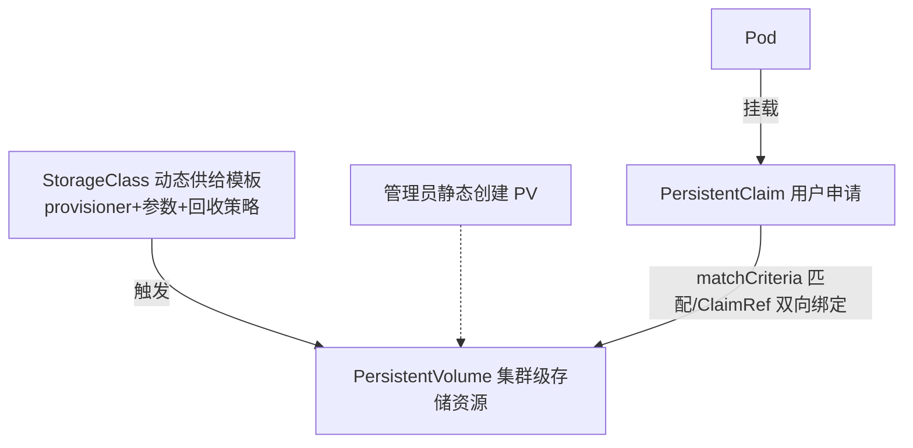

# K8s-存储与配置管理

> [!abstract] 摘要
> 容器是无状态的，但数据与配置不能丢：Volume/PV/PVC/StorageClass 解决"数据存哪"，ConfigMap/Secret 解决"配置从哪来"。本笔记讲清三层存储模型的绑定与回收流程、动态供给与 CSI 原理、配置对象的挂载与热更新边界，学完能独立完成"应用挂持久存储 + 注入配置"的标准组合，并动态申请一块 PVC。

> [!info] 版本假设
> 按 kubectl **v1.37**、API `v1`、`storage.k8s.io/v1` 编写。动态供给依赖集群安装了 CSI 驱动（minikube/kind 自带 local-path/standard 默认 StorageClass，云上为 ebs.csi.aws.com 等驱动）。

## 一、概念与原理

### 1.1 Volume 类型概览

容器文件系统随容器消失，Volume 把生命周期从"容器"提升到"Pod"：

| Volume | 生命周期 | 典型用途 |
| --- | --- | --- |
| `emptyDir` | Pod 级，临时 | 容器间共享 scratch 空间、sidecar 暂存 |
| `hostPath` | 节点级 | 节点日志/CNI socket（安全风险高，慎用于业务） |
| `configMap` / `secret` | 投影卷，随对象更新 | 配置文件注入（本篇第二节） |
| `persistentVolumeClaim` | 集群持久 | 数据库等有状态数据 |
| `csi` | 持久，由 CSI 驱动支持 | 接入任意厂商存储 |
| `image`（v1.35 beta） | 只读 | 把 OCI 镜像/制品直接当卷挂（AI 模型分发热门方案） |

注意：`gitRepo` 卷已在 v1.36 彻底移除，克隆仓库改用 initContainer。

### 1.2 PV / PVC / StorageClass 三层模型与绑定流程



绑定流程：控制平面监听新 PVC，按 **accessModes、storageClassName、selector、volumeMode、size**（matchCriteria）找匹配 PV；PVC↔PV 一对一绑定后独占，可能超额（拿到的卷 ≥ 申请量），匹配不到则 Pending。PV 生命周期：`Available → Bound → Released → Failed`。

**volumeBindingMode** 决定绑定时机：

- `Immediate`：PVC 创建立即绑定，可能与 Pod 不同可用区（跨区挂载失败）。
- `WaitForFirstConsumer`：**延迟到第一个消费 Pod 调度时**才供给/绑定，保证卷与 Pod 同可用区，生产默认选它。

### 1.3 回收策略与动态供给原理

| reclaimPolicy | PVC 删除后 | 适用 |
| --- | --- | --- |
| `Retain` | PV 变 **Released**，数据保留，需手动回收 | 生产关键数据防误删 |
| `Delete` | PV 对象与后端存储资产一起删除（动态卷默认） | 可再生数据 |
| `Recycle` | 已废弃 | 仅 nfs/hostPath 残留支持，别用 |

动态供给：PVC 命中某个 StorageClass（或默认 class，v1.28 起默认 class 后出现的旧 PVC 会被回填绑定）→ StorageClass 的 **provisioner（CSI 驱动）** 调云 API/存储控制器创建真实卷 → 自动生成 PV 并绑定，继承 class 的 reclaimPolicy。v1.33 起 PV 带删除保护 finalizer，保证"先删后端资产、再删 PV 对象"，顺序无关；另有两个保护 finalizer（`pvc-protection`/`pv-protection`）防止正在使用的对象被立即删除。

### 1.4 CSI 简介与访问模式

CSI（Container Storage Interface）是厂商驱动与 K8s 之间的标准接口；EBS/Azure Disk/GCE PD 等 in-tree 插件已全部迁出，快照恢复、克隆（`dataSource`）、RWOP 等新能力都只支持 CSI。访问模式：

| 模式 | 缩写 | 说明 |
| --- | --- | --- |
| ReadWriteOnce | RWO | 单节点读写（同节点多 Pod 可共享），数据库常见 |
| ReadOnlyMany | ROX | 多节点只读（NFS/对象存储） |
| ReadWriteMany | RWX | 多节点读写（共享文件系统） |
| ReadWriteOncePod | RWOP | v1.29 GA，单 **Pod** 读写，需 CSI 驱动支持 |

> [!warning] 访问模式不做写保护
> 官方文档明确："Volume access modes do not enforce write protection once the storage has been mounted"——挂载后 ROX 也不保证只读，访问模式是调度/绑定约束而非安全机制。

## 二、核心语法 / API 详解

### 2.1 StorageClass 与 PVC 逐字段注释

```yaml
apiVersion: storage.k8s.io/v1
kind: StorageClass
metadata:
  name: fast-ssd
  annotations:
    storageclass.kubernetes.io/is-default-class: "true"   # 默认 class，省写 storageClassName
provisioner: ebs.csi.aws.com              # CSI 驱动名，决定谁来真实创建卷
parameters: { type: gp3 }                 # 传给 CSI 驱动的厂商参数
reclaimPolicy: Delete                     # Delete/Retain；关键数据建议 Retain
allowVolumeExpansion: true                # 允许在线扩容（编辑 PVC 的 requests 即可）
volumeBindingMode: WaitForFirstConsumer   # 延迟绑定，卷随 Pod 同可用区
---
apiVersion: v1
kind: PersistentVolumeClaim
metadata: { name: data }
spec:
  storageClassName: fast-ssd              # 留空字符串 "" 表示只绑无 class 的 PV
  accessModes: [ReadWriteOnce]
  resources: { requests: { storage: 20Gi } }
```

扩容直接编辑 PVC `spec.resources.requests.storage` 调大；文件系统仅支持 XFS/Ext3/Ext4，**不支持缩小**；v1.24 起 in-use 扩容 GA，失败时按"PV 改 Retain → 删 PVC → 删 claimRef → 重建"流程恢复（v1.34 卷扩容失败恢复已 GA）。

### 2.2 ConfigMap 与 Secret：创建、挂载、热更新

```yaml
apiVersion: v1
kind: ConfigMap
metadata: { name: web-conf }
data:                       # UTF-8 字符串；binaryData 存 base64；总量上限 1MiB
  nginx.conf: |
    server { listen 8080; }
  LOG_LEVEL: info
immutable: false            # true 后不可改回、不可改 data，只能删除重建（v1.21 GA）
---
apiVersion: v1
kind: Secret
metadata: { name: web-db }
type: Opaque
stringData:                 # 明文写入，API 自动转 base64；data 字段则需自行编码
  db-password: changeme
```

三种消费方式与**热更新边界**（重点）：

| 方式 | 更新是否生效 | 原因 |
| --- | --- | --- |
| 卷挂载（`volumes[].configMap`） | **最终生效**（有延迟） | kubelet 周期同步投影卷；总延迟 = 同步周期 + 缓存传播延迟（watch/TTL/直连策略） |
| 环境变量（`env`/`envFrom`） | **永不更新** | 容器启动时一次性注入进程环境 |
| `subPath` 挂载单个文件 | **永不更新** | 绑定的是旧 inode，绕过了投影卷的符号链接更新机制 |

> [!tip] 让配置"生效"的三种正确姿势
> ① 卷挂载 + 应用支持重读文件（如 nginx reload）；② `kubectl rollout restart deployment/web` 让环境变量生效；③ 不可变 ConfigMap + 修改即新建对象，配合 rollout 重启——大规模场景还能关闭 watch 降低 apiserver 负载。

Secret 注意：默认只是 **base64 编码不是加密**，生产需开启 etcd encryption at rest 并限制 RBAC；卷挂载默认 `defaultMode: 0644`，敏感文件建议显式 `defaultMode: 0400`。

## 三、实战案例

场景：v1.37 minikube 中部署一个需要"持久存储 + 配置文件 + 数据库密码"的应用（以 default StorageClass `standard` 动态供给演示）。

```yaml
apiVersion: apps/v1
kind: Deployment
metadata: { name: notes-app }
spec:
  replicas: 1                # RWO 卷：副本数必须为 1，多副本会挂载失败
  selector: { matchLabels: { app: notes-app } }
  template:
    metadata: { labels: { app: notes-app } }
    spec:
      containers:
        - name: notes
          image: nginx:1.27
          volumeMounts:
            - name: data            # 持久数据目录
              mountPath: /usr/share/nginx/html
            - name: conf            # 配置文件（投影卷，可热更新）
              mountPath: /etc/nginx/conf.d
              readOnly: true
          env:
            - name: DB_PASSWORD     # Secret 注入环境变量（更新需重启）
              valueFrom:
                secretKeyRef: { name: web-db, key: db-password }
          resources: { requests: { cpu: 100m, memory: 128Mi } }
      volumes:
        - name: data
          persistentVolumeClaim: { claimName: notes-data }
        - name: conf
          configMap: { name: web-conf, defaultMode: 0444 }
---
apiVersion: v1
kind: PersistentVolumeClaim
metadata: { name: notes-data }
spec:
  accessModes: [ReadWriteOnce]
  resources: { requests: { storage: 1Gi } }   # 未写 storageClassName，命中默认 class 动态供给
```

```bash
kubectl apply -f notes-app.yaml
kubectl get pvc notes-data                  # STATUS 应为 Bound；describe 看 provisioned 的 PV
kubectl get pv                              # 动态生成的 PV，继承默认 class 的 reclaimPolicy
echo "hello" | kubectl exec -i deploy/notes-app -- sh -c 'cat > /usr/share/nginx/html/i.txt'
kubectl delete pod -l app=notes-app         # 杀 Pod 重建，数据仍在（PVC 不随 Pod 消失）
```

## 四、动手练习

1. **基础**：创建带 `emptyDir` 的双容器 Pod，A 容器写文件、B 容器读，验证共享；再对比 `hostPath` 的生命周期差异。
   提示：emptyDir 随 Pod 消亡，hostPath 随节点保留。
2. **动态供给（核心练习）**：创建 StorageClass 并动态申请 PVC——自建一个 `provisioner: kubernetes.io/minikube-hostpath`（minikube 自带驱动）、`volumeBindingMode: WaitForFirstConsumer` 的 class，申请 2Gi PVC 并观察绑定时机。
   提示：`Immediate` 模式下 PVC 创建即 Bound；`WaitForFirstConsumer` 下要先有 Pod 消费它，`kubectl get pvc` 会一直 Pending。
3. **热更新验证**：卷挂载方式注入 ConfigMap，修改后观察容器内文件多久变化；再用 subPath 挂同一 ConfigMap，验证永不更新。
   提示：`kubectl exec ... -- md5sum /etc/...` 轮询对比；延迟来自 kubelet 同步周期。
4. **回收策略**：给练习 2 的 PVC 所在 class 设 `reclaimPolicy: Retain`，删除 PVC 后观察 PV 变 Released，再手动清理。
   提示：Released 的 PV 不能直接被新 PVC 绑定；清理需删 PV + 处理后端资产（或清 claimRef 复用）。
5. **进阶**：给 nginx 挂 configMap 卷写一份自定义 `nginx.conf`，改配置后用 `nginx -s reload` 热生效，全程不重启 Pod。
   提示：这依赖投影卷热更新 + 应用支持 reload；如果用 subPath 挂载就会失败。

> [!success]- 练习 2 参考答案要点
> 1. StorageClass YAML 关键字段：`provisioner`（真实驱动）、`reclaimPolicy`（缺省 Delete）、`volumeBindingMode`、`allowVolumeExpansion`。
> 2. PVC 不写 `storageClassName` 会命中默认 class（annotation `storageclass.kubernetes.io/is-default-class: "true"`）；写了不存在的 class 名则永远 Pending。
> 3. `WaitForFirstConsumer` 下先建消费 Pod（如把 PVC 挂进 nginx），`kubectl get pvc` 才由 Pending 转 Bound——这是"卷与 Pod 同可用区"机制的表现。
> 4. 验证：`kubectl get pv` 出现自动生成的 PV，其 `claimRef` 指向该 PVC，`source` 为 CSI/local-path。

## 五、常见坑与 FAQ

> [!warning] RWO 卷配多副本 Deployment 直接挂载失败
> ReadWriteOnce 限制的是**单节点**，但多副本可能被调度到不同节点；MultiAttach 报错是典型案例。多副本共享读写请用 RWX（NFS/EFS/云文件存储），或改 StatefulSet 让每个副本拿独立 PVC（`volumeClaimTemplates`）。

> [!warning] 动态卷默认回收策略是 Delete
> PVC 误删即数据全删（v1.33 起有 finalizer 保护删除顺序，但不防业务误删本身）。生产数据库类 StorageClass 建议显式 `reclaimPolicy: Retain`，并理解 Released 状态的恢复流程。

> [!tip] 环境变量配置更新要靠重启
> `env`/`envFrom`/`subPath` 三种注入方式更新永不生效，这是"改了 ConfigMap 却没变化"的头号原因。需要热更新必须走投影卷挂载；改动敏感的配置建议 `immutable: true` + 版本化命名（`app-conf-v2`）+ 重建。

> [!tip] WaitForFirstConsumer 才是生产默认
> Immediate 模式 PVC 可能被供给在与 Pod 不同的可用区，Pod 挂卷报"volume node affinity conflict"。延迟绑定让调度器先选节点、再在同区供给卷。

FAQ：Q：ConfigMap 超过 1MiB 怎么办？A：改用挂卷的外部存储或拆分对象。Q：PV 能缩小吗？A：不能，扩容失败时可请求"比 status.capacity 大、比上次请求小"的值重试。Q：unused PVC 会怎样？A：v1.37 beta 为 PVC 增加 `Unused` condition，便于清理孤儿申请。

## 六、自检清单

- [ ] 能说出 Volume/PV/PVC/StorageClass 四个对象的层级与生命周期差异
- [ ] 能解释 WaitForFirstConsumer 延迟绑定解决什么问题
- [ ] 知道 Delete/Retain 的后果与 Released 状态的恢复流程
- [ ] 知道动态供给由 CSI provisioner 完成、in-tree 插件已全部迁出
- [ ] 能区分 RWO/ROX/RWX/RWOP 并为应用选对模式
- [ ] 能说出配置热更新的边界：卷挂载最终生效，env 与 subPath 永不生效
- [ ] 知道 Secret 仅 base64 不是加密，需要 etcd 加密与最小 RBAC
- [ ] 会用 immutable ConfigMap 做版本化配置

## 七、关联笔记与参考

**关联笔记**：[[K8s-Pod与工作负载对象]]（StatefulSet 的 volumeClaimTemplates）｜[[K8s-Helm包管理实战]]（把存储与配置对象模板化）｜[[Kubernetes部署实践]]（配置分离的生产清单）｜[[K8s-Service与网络]]（另一大平台组件体系）｜[[Kubernetes核心要点与生产实践]]（存储排障入口）｜[[Dockerfile编写指南]]（容器镜像与分层存储基础）

**参考链接**：

1. [Persistent Volumes — Kubernetes 官方文档](https://kubernetes.io/docs/concepts/storage/persistent-volumes/)（绑定流程、accessModes、reclaimPolicy、扩容恢复）
2. [Storage Classes — Kubernetes 官方文档](https://kubernetes.io/docs/concepts/storage/storage-classes/)（provisioner、volumeBindingMode）
3. [ConfigMaps — Kubernetes 官方文档](https://kubernetes.io/docs/concepts/configuration/configmap/)（挂载方式、热更新延迟、subPath 限制、immutable）
4. [Secrets — Kubernetes 官方文档](https://kubernetes.io/docs/concepts/configuration/secret/)（类型、挂载与安全实践）
5. [CSI 驱动列表 — Kubernetes CSI 文档](https://kubernetes-csi.github.io/docs/drivers.html)（各平台 CSI 驱动索引）
