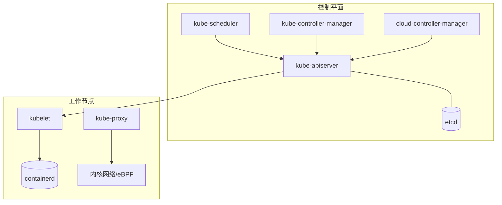

# Kubernetes核心要点与生产实践

## 概述

本笔记是 K8s 原理与运维主线：控制平面架构、调度原理、网络与 CNI、存储体系、RBAC 安全基线、故障排查思路、Prometheus 可观测性，以及 CKA 备考要点。部署与上线路径（kubeadm、Helm/Kustomize、滚动更新清单）见 [[Kubernetes部署实践]]，容器镜像基础见 [[Dockerfile编写指南]]，监控细节见 [[Prometheus监控入门]]。

## 架构组件



| 组件 | 角色 | 生产要点 |
| --- | --- | --- |
| kube-apiserver | 唯一读写入口，认证→鉴权→准入→落库 | 多副本 + LB；v1.34 起内置 OTel tracing GA，便于链路分析 |
| etcd | 集群唯一状态存储（Raft 一致性） | 3/5 节点奇数部署；定期快照 `etcdctl snapshot save`；磁盘建议 SSD 且与业务隔离 |
| kube-scheduler | 过滤+打分两阶段选节点 | v1.35 alpha 引入 Workload API/Gang 调度（all-or-nothing） |
| kube-controller-manager | Deployment/Node/Job 等控制循环 | 期望状态向实际状态收敛的"调谐循环" |
| kubelet | 节点代理，管理 Pod 生命周期与探针 | v1.35 起不支持 cgroup v1；cgroup driver 从 CRI 自动检测（v1.34 GA） |
| kube-proxy | Service 转发（iptables/IPVS/nftables/eBPF） | IPVS 自 v1.35 弃用，新集群直接用 nftables 或 CNI 内置转发 |
| containerd | OCI 容器运行时 | v1.36+ 必须 containerd 2.x；v1.35 是支持 1.7 的最后版本 |

## 调度原理

kube-scheduler 对每个待调度 Pod 执行两阶段：

1. **过滤（Filter/Predicates）**：剔除不满足硬性条件的节点——PodFitsResources（剩余资源）、NodeSelector/亲和性硬约束、污点容忍、端口冲突、卷拓扑（`volumeBindingMode: WaitForFirstConsumer` 时检查存储可用区）。
2. **打分（Score/Priorities）**：对通过节点打分取最优——`LeastRequestedPriority`（资源均衡）、镜像本地性、拓扑扩散 `topologySpreadConstraints`、自定义扩展点。

影响调度的配置速查：

| 手段 | YAML 位置 | 典型用途 |
| --- | --- | --- |
| 节点选择器 | `nodeSelector` | 简单指定节点池（如 GPU 节点） |
| 节点亲和 | `affinity.nodeAffinity`（required/preferred） | 软硬结合的多条件选择 |
| Pod 亲和/反亲和 | `affinity.podAffinity/podAntiAffinity` | 前后端就近、副本打散 |
| 拓扑扩散 | `topologySpreadConstraints`（maxSkew） | 跨可用区均匀分布，比硬反亲和更弹性 |
| 污点/容忍 | 节点 `taints` + Pod `tolerations` | 专用节点隔离、故障驱逐 |
| 资源请求 | `resources.requests` | 调度依据（不等于运行时上限） |

> [!tip] Pending 排查入口
> `kubectl describe pod` 的 Events 会直接写明原因，例如 `Insufficient cpu`、`node(s) didn't match pod's node affinity`、`0/6 nodes are available`。调度器拒绝的每个节点都有对应理由，按理由逐条解决即可。

## 网络模型与 CNI 对比

K8s 网络四原则：所有 Pod 互相可达（NAT-free）、节点与 Pod 互相可达、Service 提供稳定虚拟 IP、网络策略可实施。实际组网由 CNI 插件实现。

| CNI | 数据面 | 网络策略 | 适用场景 |
| --- | --- | --- | --- |
| Flannel | VXLAN/host-gw，简单 overlay | 不支持 | 学习/小集群 |
| Calico | BGP 路由或 VXLAN（IPIP） | 自有 NetworkPolicy 引擎，性能好 | 大规模、需要 BGP 的数据中心 |
| Cilium | eBPF（原生加速） | L3-L7 策略（基于身份而非 IP） | 大规模、服务网格、需要可观测与安全增强 |
| Antrea | OVS | 标准 NetworkPolicy + Traceflow | VMware 生态友好 |

Ingress/Gateway API 层面：Ingress NGINX 已于 2026-03 退役，新集群用 Gateway API（v1.5 2026-02、v1.6 2026-08 已把 TCPRoute/UDPRoute 转正）或 HAProxy/Envoy 系实现；存量迁移用 `ingress2gateway`。

## 存储体系

三层抽象：**PV**（集群级存储资源）→ **PVC**（用户申请）→ **StorageClass**（动态供给模板）。StatefulSet 通过 `volumeClaimTemplates` 为每个副本生成独立 PVC，实现"稳定标识+独立存储"。

```yaml
apiVersion: storage.k8s.io/v1
kind: StorageClass
metadata:
  name: fast-ssd
  annotations:
    storageclass.kubernetes.io/is-default-class: "true"
provisioner: ebs.csi.aws.com          # CSI 驱动（in-tree 插件已全面迁移 CSI）
parameters: { type: gp3 }
reclaimPolicy: Delete                 # Delete/Retain：生产关键数据用 Retain 防误删
allowVolumeExpansion: true            # 允许在线扩容
volumeBindingMode: WaitForFirstConsumer  # 延迟绑定，保证卷与 Pod 同可用区
---
apiVersion: v1
kind: PersistentVolumeClaim
metadata: { name: data }
spec:
  storageClassName: fast-ssd
  accessModes: [ReadWriteOnce]
  resources: { requests: { storage: 20Gi } }
```

要点：

- 访问模式：`RWO`（块存储常见）、`ROX`（NFS）、`RWX`（共享文件系统）；数据库多数只需 RWO。
- v1.34 GA：卷扩容失败恢复（`VolumeAttributesClass` 也在 v1.34 GA，支持在线改 IOPS/吞吐等级）。
- v1.35 beta：`Image Volume` 可把 OCI 镜像/制品直接作为只读卷挂载（AI 模型文件分发的热门方案）。
- v1.36：`gitRepo` 卷类型彻底移除，克隆仓库改用 initContainer。

## RBAC 与安全基线

RBAC 四对象：Role/ClusterRole（权限集合）+ RoleBinding/ClusterRoleBinding（授权给主体）。最小权限原则示例：

```yaml
apiVersion: rbac.authorization.k8s.io/v1
kind: Role
metadata: { namespace: prod, name: deployer }
rules:
  - apiGroups: ["apps"]
    resources: ["deployments"]
    verbs: ["get", "list", "watch", "update", "patch"]   # 不给 delete/create
  - apiGroups: [""]
    resources: ["pods", "pods/log"]
    verbs: ["get", "list", "watch"]
---
apiVersion: rbac.authorization.k8s.io/v1
kind: RoleBinding
metadata: { namespace: prod, name: deployer-bind }
subjects:
  - kind: Group
    name: team-backend
    apiGroup: rbac.authorization.k8s.io
roleRef:
  kind: Role
  name: deployer
  apiGroup: rbac.authorization.k8s.io
```

安全基线清单：

1. **Pod Security Admission**：命名空间打标 `pod-security.kubernetes.io/enforce: restricted`（三种模式 enforce/audit/warn，三档标准 privileged/baseline/restricted，先用 audit/warn 灰度再切 enforce）。
2. **NetworkPolicy 默认拒绝**：先 `selectAll: podSelector: {}` 全拒，再按调用关系放行（Cilium 可做 L7）。
3. **镜像安全**：固定 tag/digest、CI 中用 Trivy/Grype 扫描 CVE、只从可信私有仓库拉取；v1.35 beta 的 `KubeletEnsureSecretPulledImages` 修复了缓存镜像绕过凭证校验的问题。
4. **Secret 加固**：etcd encryption at rest + 最小 RBAC；v1.35 beta 的 Pod Certificates 支持由 kubelet 原生签发并自动轮换工作负载身份证书。
5. **鉴权可观测**：`kubectl auth can-i --list` 查看自身权限；审计日志（audit policy）记录 apiserver 全部请求。

## 故障排查思路

| 现象 | 高频原因 | 排查命令/路径 |
| --- | --- | --- |
| CrashLoopBackOff | 应用崩溃、配置错误、探针误杀 | `kubectl logs --previous`；`kubectl describe pod` 看 Exit Code（1=应用错误，137=OOM/SIGKILL，143=SIGTERM） |
| OOMKilled | 内存 limit 过小或内存泄漏 | `kubectl top pod`；`kubectl get pod -o jsonpath='{..lastState}'`；下调 limit 或修泄漏 |
| Pending | 资源不足/亲和不满足/PVC 未绑定 | `kubectl describe pod` Events；`kubectl get pvc`；`kubectl describe nodes` 看 Allocatable |
| ImagePullBackOff | 镜像不存在/凭证错误/仓库不通 | `kubectl describe pod`；`kubectl get secret`；节点上 `crictl pull` 复现 |
| Service 不通 | selector 与标签不匹配、endpoints 为空 | `kubectl get endpointslices`；`kubectl run tmp --rm -it --image=busybox -- wget -O- svc` |
| 节点 NotReady | kubelet 挂、磁盘满、容器运行时挂 | `kubectl describe node`（Conditions）；SSH 后 `journalctl -u kubelet -f`，参考 [[Linux常用命令集]] |
| DNS 解析失败 | CoreDNS 异常、ndots 过多 | `kubectl get pods -n kube-system -l k8s-app=kube-dns`；进容器 `nslookup kubernetes.default` |

通用五步法：**① describe 看 Events → ② logs（含 --previous）→ ③ exec/crictl 进容器复现 → ④ 查节点资源与系统日志 → ⑤ 查控制面组件与审计日志**。

> [!warning] 排障不要跳过 Events
> 90% 的调度与启动问题在 `kubectl describe pod` 的 Events 段落中已有答案（含被准入插件拒绝的原因、调度器逐节点失败理由）。先看 Events 再动手改配置，避免"盲改重启"。

## 可观测性（Prometheus + Grafana）

标准组合：**Prometheus** 采集指标 + **Grafana** 看板 + **kube-state-metrics**（对象状态指标）+ **node-exporter**（节点指标）+ **Alertmanager** 告警。采集方式对比：

| 类型 | 范围 | 关键指标 |
| --- | --- | --- |
| 资源层 | cAdvisor/node-exporter | `container_cpu_usage_seconds_total`、`container_memory_working_set_bytes`（OOM 判断用 working set 而非 rss） |
| 对象层 | kube-state-metrics | `kube_pod_status_phase`、`kube_deployment_status_replicas_available` |
| 业务层 | 应用 /metrics 自暴露 | QPS、延迟直方图、队列深度（配合 [[微服务架构设计]] 的 RED/USE 方法） |

```yaml
# ServiceMonitor（kube-prometheus-stack 自定义 CRD）
apiVersion: monitoring.coreos.com/v1
kind: ServiceMonitor
metadata: { name: web, labels: { release: kube-prometheus-stack } }
spec:
  selector: { matchLabels: { app: web } }
  endpoints:
    - port: metrics
      interval: 30s
```

告警基线建议：容器重启次数突增（`increase(kube_pod_container_status_restarts_total[15m])>3`）、PVC 即将满（>85%）、HPA 打满 `kube_horizontalpodautoscaler_status_current_replicas == max`、证书 30 天内到期。日志与链路统一采集的趋势是 OpenTelemetry Collector，K8s 组件自身的 tracing 自 v1.34 起 GA，可在 apiserver/scheduler 上直接开启。

## 核心要点速查

| 主题 | 一句话要点 |
| --- | --- |
| 声明式 API | 提交期望状态，控制器循环调谐到一致；`kubectl diff` 预览变更 |
| QoS 三档 | requests==limits 为 Guaranteed；只有 requests 为 Burstable；全不设为 BestEffort，驱逐顺序：BestEffort → Burstable → Guaranteed |
| 探针分工 | startup 解决慢启动、readiness 管流量、liveness 管"僵死"，勿让 liveness 依赖外部服务 |
| Service 端点 | EndpointsSlice 由控制器维护，selector 匹配才生成；headless service 直接返回 Pod IP |
| etcd 运维 | 定期快照 + 异机保存；`etcdctl endpoint health`；碎片整理 `defrag` |
| 版本升级 | 逐小版本升级（1.35→1.36→1.37），先 etcd 备份、先升级控制平面再节点，遵循偏差策略 |
| kubectl 效率 | `kuberc`（v1.34 beta）持久化偏好；`kubectl kustomize`/`--dry-run=server` 验证 |

## 常见坑与最佳实践

> [!warning] 升级前必看"三不"
> ① 不要跨小版本直接升级（必须逐级）；② 不要在 cgroup v1 节点上升级到 v1.35+（kubelet 直接无法启动）；③ 不要在 v1.36+ 节点使用 containerd 1.x（必须先换 2.x）。升级窗口前先做 etcd 快照。

> [!tip] 内存监控看 working set
> 判断容器是否接近 OOM，用 `container_memory_working_set_bytes`（kubelet 驱逐依据），而不是 RSS 或 usage——page cache 会造成 usage 虚高，误以为内存紧张。

> [!tip] CKA 备考要以"肌肉记忆"为目标
> CKA 全程线上实操、只允许开官方文档（kubernetes.io 的 docs 与 blog，不允许博客站）。高频考点见下表，备考期间刻意练习"不查资料写 YAML、只用官方文档检索"。

## CKA 认证备考要点

2025-02-18 考纲更新后新增 Gateway API、Helm/Kustomize、CRD 与 Operator 考点；考试环境跟踪较新的 K8s 版本（2026 年考试对应 v1.3x）。

| 领域 | 权重 | 必练技能 | 高频考点 |
| --- | --- | --- | --- |
| 集群架构与安装 | 10% | kubeadm 安装/升级/节点管理 | `kubeadm upgrade`、`etcdctl snapshot restore` |
| 工作负载与调度 | 15% | Deployment/Job/CronJob、调度约束 | nodeSelector、taint/toleration、topologySpread |
| 服务与网络 | 20% | Service、Gateway/HTTPRoute、NetworkPolicy | Gateway API 对象（新增）、CNI 排障 |
| 存储 | 10% | StorageClass/PV/PVC | 动态供给、扩容、Retain/Delete 策略 |
| 故障排查 | 30% | 节点/Pod/控制面排障 | Crictl、journalctl、kubelet 排障（占比最高） |
| RBAC 与安全 | 15% | ServiceAccount/Role/Binding | 最小权限授权、`kubectl auth can-i` |

备考资源：官方课程 LFS258、[Linux Foundation CKA 考纲变更公告](https://training.linuxfoundation.org/certified-kubernetes-administrator-cka-program-changes)、killercoda 免费实验环境；社区反馈 2025 版考试中 Helm、Kustomize、Gateway API、CRD 是新增易丢分点。

## 2025-2026 最新动态

- **v1.34（2025-08-27）**：DRA GA、API Server/kubelet OTel tracing GA、Pod 级 resources beta、KYAML alpha、cgroup driver 自动检测 GA。
- **v1.35（2025-12-17）**：In-place Pod resize GA（原地改 CPU/内存不重启，配合 Pod Generation 可追踪生效状态）、Pod Certificates beta、StatefulSet `maxUnavailable` beta、HPA tolerance 可配置；**移除 cgroup v1、弃用 IPVS、containerd 1.x 最后版本**。
- **v1.36（2026-04-22）**：DRA 支持在线 GPU 切分、gitRepo 卷移除、首个更长发布周期的版本。
- **v1.37（2026-08-26）**：约 70 项增强；SELinuxMount 默认启用；IPVS 弃用推进。
- **Ingress NGINX 退役（2026-03）**与 **Gateway API v1.5/v1.6（2026-02/2026-08）** 大量特性转正，四七层入口统一到 Gateway API。
- 运维侧：kube-proxy nftables 后端成熟、`Flagz`/`Statusz`（v1.35 alpha）让组件自身状态可 JSON 观测，可观测性正从"应用层"延伸到"控制面组件层"。

## 参考资料

1. [Pod Security Standards — Kubernetes 官方文档](https://kubernetes.io/docs/concepts/security/pod-security-standards/)（PSS 三档与 PSA 三模式，含命名空间标签配置）
2. [Kubernetes v1.34: Of Wind & Will — Kubernetes Blog](https://kubernetes.io/blog/2025/08/27/kubernetes-v1-34-release/)（DRA/tracing/KYAML 等 23 项 GA 清单）
3. [Kubernetes v1.35: Timbernetes — Kubernetes Blog](https://kubernetes.io/blog/2025/12/17/kubernetes-v1-35-release/)（In-place resize GA、cgroup v1 移除、IPVS 弃用）
4. [Kubernetes v1.37 release — Kubernetes Blog](https://kubernetes.io/blog/2026/08/26/kubernetes-v1-37-release)（最新稳定版，2026-08-26）
5. [Gateway API v1.5: Moving features to Stable — Kubernetes Blog](https://kubernetes.io/blog/2026/04/21/gateway-api-v1-5)（Gateway API 特性转正进展）
6. [Ingress NGINX Retirement — KGateway Blog](https://kgateway.dev/blog/nginx-ingress-retirement-what-you-need-to-know)（2026-03 退役与迁移路径）
7. [CKA Program Changes — Linux Foundation](https://training.linuxfoundation.org/certified-kubernetes-administrator-cka-program-changes)（2025-02-18 考纲更新）
8. [KEDA — Kubernetes Event-driven Autoscaling](https://keda.sh)（与 HPA 协同的事件驱动扩缩容）
9. [Creating a cluster with kubeadm — Kubernetes 官方文档](https://kubernetes.io/docs/setup/production-environment/tools/kubeadm/create-cluster-kubeadm/)（版本偏差策略与 HA 拓扑）
