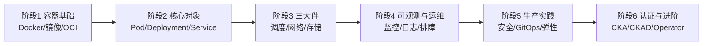

# Kubernetes部署实践

## 概述

Kubernetes（K8s）已是容器编排的事实标准，本笔记聚焦"从零搭建到生产落地"的完整部署实践主线：kubeadm 集群搭建、kubectl 日常操作、核心工作负载对象（Deployment/Service/Gateway API）、Helm 与 Kustomize 包管理，以及生产环境的资源、探针、滚动更新清单。原理层面的架构组件、调度、网络、存储、安全与故障排查见姊妹篇 [[Kubernetes核心要点与生产实践]]；CI/CD 与 DevOps 趋势见 [[DevOps最佳实践与发展趋势]]。

容器基础先行：镜像构建参考 [[Dockerfile编写指南]]，本地多容器编排参考 [[Docker-compose示例]]。

> [!info] 版本基线
> 截至 2026-11，Kubernetes 最新稳定版为 **v1.37 "Garhwal"**（2026-08-26 发布），在维护分支为 1.36 / 1.35。本文示例均按 1.3x 系列 API（`apps/v1`、`networking.k8s.io/v1`、`gateway.networking.k8s.io/v1`）编写。

## 从入门到精通：学习路线



| 阶段 | 目标 | 关键内容 | 实践产出 |
| --- | --- | --- | --- |
| 1 容器基础 | 理解镜像与容器 | Dockerfile、镜像分层、数据卷、compose | 能写出多阶段构建的镜像 |
| 2 核心对象 | 会部署会暴露 | Pod、Deployment、Service、ConfigMap/Secret、命名空间 | 用 kubectl 跑起一套 Web 服务 |
| 3 调度/网络/存储 | 理解平台机制 | kube-scheduler 原理、CNI/Ingress/Gateway API、PV/PVC/StorageClass | 手写网络策略与 StatefulSet |
| 4 可观测与运维 | 会看会修 | Prometheus+Grafana、日志采集、CrashLoopBackOff/Pending 排障 | 搭建监控并用指标定位故障 |
| 5 生产实践 | 能上生产 | 资源管理/QoS、探针、HPA/KEDA、RBAC、NetworkPolicy、GitOps(ArgoCD/Flux) | 完成一次零停机发布 |
| 6 认证与进阶 | 获得认证 | CKA 考纲（2025-02 起含 Gateway API、Helm/Kustomize、CRD/Operator） | 通过 CKA，学习 Operator 开发 |

> [!tip] 学习方法
> 以 [killercoda](https://killercoda.com) / 本地 minikube 或 kind 做实验，每个阶段都以"能独立完成一个可验证任务"收尾；2025-02-18 CKA 考纲更新后，新增了 Gateway API、Helm、Kustomize、CRD 与 Operator 考点，学习时不要跳过。

## 核心要点速查

| 类别 | 对象/工具 | 一句话说明 | 常用命令 |
| --- | --- | --- | --- |
| 工作负载 | Deployment | 无状态应用副本与滚动更新 | `kubectl rollout status deploy/nginx` |
| 工作负载 | StatefulSet | 有状态应用（稳定网络标识+存储） | `kubectl get sts` |
| 工作负载 | DaemonSet | 每节点一个副本（日志/监控代理） | `kubectl get ds -A` |
| 暴露 | Service | ClusterIP/NodePort/LoadBalancer | `kubectl get svc` |
| 暴露 | Gateway/HTTPRoute | Gateway API 流量入口（Ingress 后继者） | `kubectl get gateway,httproute` |
| 配置 | ConfigMap/Secret | 配置与敏感信息挂载 | `kubectl create configmap` |
| 弹性 | HPA/KEDA | CPU/内存与事件驱动扩缩容 | `kubectl get hpa` |
| 包管理 | Helm | 模板化 Chart 一键装应用 | `helm install/release` |
| 包管理 | Kustomize | 无模板的目录级差异化覆盖 | `kubectl apply -k overlays/prod` |
| 安全 | RBAC/NetworkPolicy | 权限与流量最小化 | `kubectl auth can-i` |

## 部署实战

### kubeadm 搭建集群要点

前置条件：每台机器 ≥2 GiB 内存、控制平面 ≥2 CPU、机器间网络互通、安装 containerd（v1.36+ 要求 containerd 2.x，v1.35 是最后一个支持 containerd 1.7 的版本）、关闭 swap（或配置 kubelet 容忍）。

```bash
# 1. 安装 kubeadm/kubelet/kubectl（以 Debian/Ubuntu 为例）
sudo apt-get install -y kubelet kubeadm kubectl
sudo apt-mark hold kubelet kubeadm kubectl

# 2. 初始化控制平面（务必用共享端点，便于日后扩展 HA）
sudo kubeadm init \
  --control-plane-endpoint "k8s-api.example.com:6443" \
  --pod-network-cidr "10.244.0.0/16" \
  --image-repository registry.aliyuncs.com/google_containers   # 国内拉镜像加速

# 3. 配置 kubectl 凭证
mkdir -p $HOME/.kube
sudo cp -i /etc/kubernetes/admin.conf $HOME/.kube/config
sudo chown $(id -u):$(id -g) $HOME/.kube/config

# 4. 安装 CNI（必须在 join 节点之前，否则 CoreDNS 不会 Running）
kubectl apply -f https://github.com/antrea-io/antrea/releases/latest/download/antrea.yml

# 5. 工作节点加入（token 与 CA 哈希来自 init 输出）
kubeadm join k8s-api.example.com:6443 \
  --token <token> \
  --discovery-token-ca-cert-hash sha256:<hash>
```

> [!warning] 两个不可逆的决定
> 1. `kubeadm init` 时不加 `--control-plane-endpoint`，官方**不支持**事后把单控制平面集群改成 HA——一开始就规划好共享端点（DNS 名或负载均衡 VIP）。
> 2. CNI 必须先于业务部署；Pod 网段不能与主机网络、Service 网段重叠。
> 另外自 v1.34 起，kubelet 的 cgroup driver 改为从 CRI 自动检测，手动配置 `cgroupDriver` 已弃用，v1.36 起移除；v1.35 起不再支持 cgroup v1 节点。

### kubectl 常用命令

```bash
# 资源查看
kubectl get pods,svc,deploy -A -o wide
kubectl describe pod <pod> -n <ns>          # 排障第一入口：Events

# 调试
kubectl logs -f <pod> [-c <container>]      # 容器日志
kubectl exec -it <pod> -- /bin/sh           # 进容器
kubectl port-forward svc/my-svc 8080:80     # 本地调试转发
kubectl debug -it <pod> --image=busybox     # 临时调试容器（ephemeral container）

# 发布
kubectl apply -f deploy.yaml --server-side  # 服务端 apply，避免冲突
kubectl rollout restart deployment/nginx    # 触发滚动重启（如加载新配置）
kubectl rollout undo deployment/nginx       # 回滚上一版本
kubectl scale deployment/nginx --replicas=5

# 输出格式
kubectl get deploy nginx -o yaml
kubectl get pods -o kyaml                   # v1.34+ 新增 KYAML，歧义更少更安全
kubectl diff -f deploy.yaml                 # 预览变更
```

### Deployment / Service / Gateway API YAML 示例

```yaml
apiVersion: apps/v1
kind: Deployment
metadata:
  name: web
  labels: { app: web }
spec:
  replicas: 3
  revisionHistoryLimit: 5
  strategy:
    type: RollingUpdate
    rollingUpdate:
      maxSurge: 1          # 滚动期间最多多出 1 个 Pod
      maxUnavailable: 0    # 生产建议 0：先扩后缩，保证容量不降
  selector:
    matchLabels: { app: web }
  template:
    metadata:
      labels: { app: web }
    spec:
      containers:
        - name: web
          image: registry.example.com/web:v1.4.2   # 禁用 latest
          ports: [{ containerPort: 8080 }]
          resources:
            requests: { cpu: 250m, memory: 256Mi }
            limits: { memory: 512Mi }               # CPU 不设 limit，避免限流抖动
          startupProbe:                             # 慢启动应用先配 startupProbe
            httpGet: { path: /healthz, port: 8080 }
            failureThreshold: 30
            periodSeconds: 2
          readinessProbe:
            httpGet: { path: /ready, port: 8080 }
            initialDelaySeconds: 1
            periodSeconds: 5
          livenessProbe:
            httpGet: { path: /healthz, port: 8080 }
            periodSeconds: 10
          lifecycle:
            preStop: { sleep: { seconds: 3 } }      # v1.34 允许 0 值；给 LB 摘流留时间
---
apiVersion: v1
kind: Service
metadata:
  name: web
spec:
  selector: { app: web }
  ports:
    - port: 80
      targetPort: 8080
```

Ingress NGINX 已于 **2026-03 退役**，新集群流量入口建议直接用 Gateway API（v1.0 于 2023-10 GA，v1.5 于 2026-02 发布并大量转正，v1.6 于 2026-08 将 TCPRoute/UDPRoute 升为 GA）：

```yaml
apiVersion: gateway.networking.k8s.io/v1
kind: Gateway
metadata:
  name: prod-gw
spec:
  gatewayClassName: envoy        # 取决于所选实现（Envoy/NGINX Fabric/KGateway 等）
  listeners:
    - name: http
      port: 80
      protocol: HTTP
---
apiVersion: gateway.networking.k8s.io/v1
kind: HTTPRoute
metadata:
  name: web-route
spec:
  parentRefs:
    - name: prod-gw
  hostnames: ["web.example.com"]
  rules:
    - backendRefs:
        - name: web
          port: 80
      matches:
        - path: { type: PathPrefix, value: / }
```

### Helm 与 Kustomize

```bash
# Helm：安装与升级（Chart = 模板化应用包）
helm repo add bitnami https://charts.bitnami.com/bitnami
helm install my-nginx bitnami/nginx -n web --create-namespace \
  --set replicaCount=3 --set ingress.enabled=true
helm upgrade my-nginx bitnami/nginx -n web -f values-prod.yaml
helm rollback my-nginx 1 -n web
helm get manifest my-nginx -n web        # 查看实际渲染结果

# Kustomize：base + overlay 差异化，kubectl 原生集成
kubectl apply -k overlays/prod
```

```yaml
# overlays/prod/kustomization.yaml：环境差异化覆盖，适合多集群多环境
apiVersion: kustomize.config.k8s.io/v1beta1
kind: Kustomization
namespace: prod
resources:
  - ../../base
images:
  - name: registry.example.com/web
    newTag: v1.4.2
replicas:
  - name: web
    count: 5
patches:
  - path: patch-resources.yaml
```

选型经验：**Helm 适合分发第三方应用**（中间件、监控栈），**Kustomize 适合自研服务的多环境变体**；两者可组合（Helm 生成模板 + post-renderer 做 Kustomize 覆盖）。二者也是 2025 版 CKA 新增考点。

## 生产环境清单（上线自查）

| 检查项 | 要求 | 关键配置 |
| --- | --- | --- |
| 资源声明 | 所有容器设置 requests；内存设 limits | QoS 分级：Guaranteed/Burstable/BestEffort |
| 探针 | 三探针齐备，慢启动用 startupProbe | readiness 决定摘流，liveness 误配会造成重启风暴 |
| 滚动更新 | `maxUnavailable: 0` + readiness + preStop | 配合 PDB 保证节点维护时最小副本 |
| 弹性 | HPA 基于 CPU/自定义指标；队列型负载用 KEDA | KEDA 支持 70+ 事件源、可缩容到 0 |
| 反亲和 | 多副本打散到不同节点/可用区 | `topologySpreadConstraints` 或 podAntiAffinity |
| 中断预算 | 关键服务配置 PodDisruptionBudget | `kubectl drain` 时保护可用副本数 |
| 安全基线 | 命名空间标注 Pod Security 级别 | `pod-security.kubernetes.io/enforce: restricted` |
| 配置分离 | ConfigMap/Secret 与镜像解耦；敏感信息用 Secret+加密 etcd | 避免把配置烧进镜像 |

```yaml
# HPA：CPU 弹性扩缩（v1.35 起 tolerance 可配置，减少抖动）
apiVersion: autoscaling/v2
kind: HorizontalPodAutoscaler
metadata:
  name: web-hpa
spec:
  scaleTargetRef: { apiVersion: apps/v1, kind: Deployment, name: web }
  minReplicas: 3
  maxReplicas: 20
  metrics:
    - type: Resource
      resource:
        name: cpu
        target: { type: Utilization, averageUtilization: 70 }
  behavior:
    scaleDown:
      stabilizationWindowSeconds: 300   # 缩容冷静期 5 分钟
---
apiVersion: policy/v1
kind: PodDisruptionBudget
metadata:
  name: web-pdb
spec:
  minAvailable: 2
  selector:
    matchLabels: { app: web }
```

## 常见坑与最佳实践

> [!warning] CPU limit 是双刃剑
> CPU 超过 limit 会被内核 CFS 强制节流（throttle），表现为接口 P99 毛刺而不是 OOM。社区主流做法：**内存必须设 limits，CPU 通常只设 requests 不设 limits**，让突发流量借到空闲算力；只有不可信/多租户负载才对 CPU 封顶。

> [!warning] livenessProbe 误配引发重启风暴
> liveness 失败即重启容器，接口偶发超时、依赖抖动都会被放大成重启循环。原则：liveness 只检测"进程本身是否僵死"（轻量、无外部依赖），业务依赖健康检查交给 readiness。

> [!tip] 就绪摘流 + preStop 组合才能零停机
> Pod 终止时 kube-proxy 摘流与容器退出存在竞态，`preStop` sleep 3~5 秒给端点移除留出时间，再配合 `terminationGracePeriodSeconds` 让在途请求处理完，即可实现滚动更新零 5xx。

> [!tip] 用 `topologySpreadConstraints` 而不是硬反亲和
> 大规模集群用 `podAntiAffinity` 硬性打散容易因调度约束无法满足而 Pending；`topologySpreadConstraints` 的 `maxSkew` 是软性目标，配合 `whenUnsatisfiable: ScheduleAnyway` 兼顾打散与可调度性。

其他高频坑：镜像用 `latest` 导致回滚失效（应固定版本 tag 或 digest）；Secret 默认仅 base64 不是加密（开启 etcd encryption at rest 并限制 RBAC）；节点Maintenance 时未配 PDB 导致服务容量骤降；`kubectl apply` 混用 `--force` 掩盖真实冲突。

## 2025-2026 版本动态

| 版本 | 发布时间 | 重点特性 |
| --- | --- | --- |
| v1.33 | 2025-04 | Sidecar 容器（`restartPolicy: Always`）GA；In-place Pod resize 进入 beta |
| v1.34 "Of Wind & Will" | 2025-08-27 | **DRA（动态资源分配）GA**（`resource.k8s.io/v1`）；API Server/kubelet OTel tracing GA；AppArmor GA；KYAML 输出（alpha）；Pod 级 resources beta |
| v1.35 "Timbernetes" | 2025-12-17 | **In-place Pod resize GA**（原地调整 CPU/内存不重启）；Pod Certificates beta；OCI 镜像卷 beta；StatefulSet `maxUnavailable` beta；Gang Scheduling（Workload API）alpha |
| v1.36 | 2026-04-22 | DRA 增强（GPU 动态切分）beta；Pod 级资源原地更新毕业；`gitRepo` 卷彻底移除；首个采用更长发布周期的版本 |
| v1.37 "Garhwal" | 2026-08-26 | 约 70 项增强（18 stable/25 beta/25 alpha）；IPVS 模式进一步弃用；SELinuxMount 默认启用 |

同期生态大事：

- **Ingress NGINX 退役**（2026-03 归档）：受 2025 年 "IngressNightmare" 系列漏洞影响，官方停止维护，官方推荐迁移 Gateway API，工具 `ingress2gateway` 可自动转换存量 Ingress 资源。
- **Gateway API v1.5**（2026-02-27 发布）将 6 个 experimental 特性转正（含 ListenerSet）；**v1.6**（2026-08）TCPRoute/UDPRoute GA，四层流量入口补齐。
- **kube-proxy IPVS 模式弃用**（v1.35 起），推荐迁移 nftables 后端；**cgroup v1 支持移除**（v1.35 起 kubelet 无法在 cgroup v1 节点启动）；**containerd 1.x 支持终止**（v1.35 为最后支持版本）。
- DRA（动态资源分配）取代 Device Plugin 成为 GPU/自定义设备管理的新标准，v1.36 支持在线 GPU 切分。

## 参考资料

1. [Kubernetes v1.34: Of Wind & Will (O' WaW) — Kubernetes Blog](https://kubernetes.io/blog/2025/08/27/kubernetes-v1-34-release/)（官方发布博客，2025-08-27）
2. [Kubernetes v1.35: Timbernetes — Kubernetes Blog](https://kubernetes.io/blog/2025/12/17/kubernetes-v1-35-release/)（官方发布博客，2025-12-17）
3. [Creating a cluster with kubeadm — Kubernetes 官方文档](https://kubernetes.io/docs/setup/production-environment/tools/kubeadm/create-cluster-kubeadm/)（kubeadm 前置条件、init/join、版本偏差策略）
4. [Gateway API v1.5: Moving features to Stable — Kubernetes Blog](https://kubernetes.io/blog/2026/04/21/gateway-api-v1-5)（2026-02-27 发布的 v1.5 特性转正清单）
5. [Ingress NGINX Retirement: What You Need to Know — KGateway Blog](https://kgateway.dev/blog/nginx-ingress-retirement-what-you-need-to-know)（2026-03 退役说明与迁移建议）
6. [Ingress NGINX is EOL: a practical guide for migrating to Gateway API — Datadog Blog](https://www.datadoghq.com/blog/migrate-to-gateway-api)（ingress2gateway 迁移实操）
7. [CKA Program Changes — Linux Foundation Training](https://training.linuxfoundation.org/certified-kubernetes-administrator-cka-program-changes)（2025-02-18 考纲变更：Gateway API/Helm/CRD/Operator）
8. [KEDA — Kubernetes Event-driven Autoscaling](https://keda.sh)（事件驱动扩缩容官方站，70+ scaler）
9. [Kubernetes v1.37 release — Kubernetes Blog](https://kubernetes.io/blog/2026/08/26/kubernetes-v1-37-release)（2026-08-26 最新稳定版）
10. [Pod Security Standards — Kubernetes 官方文档](https://kubernetes.io/docs/concepts/security/pod-security-standards/)（PSS 三级与 PSA 三模式）
