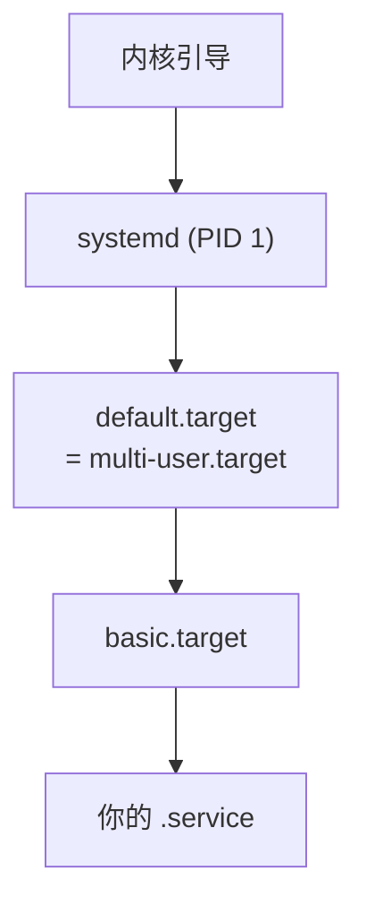

# Linux-systemd服务管理

> [!abstract] 摘要
> systemd 是现代 Linux 的 1 号进程与服务管理中枢：所有守护进程、定时任务、日志查询都经它编排。本篇覆盖 unit 类型体系、systemctl 日常命令、自写 service unit 的字段详解、target 与开机自启、timer 替代 cron、journalctl 实战，最后完整演示"把 Python 脚本注册为生产级服务"，与 [[Linux系统管理与运维要点]] 的 systemd 章节互为详略。

## 一、概念与原理

systemd 启动后成为 PID 1，把系统状态组织成**目标（target）** 与**单元（unit）** 的依赖图，按依赖关系并行拉起服务（传统 SysV 串行启动因此被淘汰）。



**unit 类型一览**（文件后缀即类型；`/etc/systemd/system/` 放自定义，`/usr/lib/systemd/system/` 放包管理器装的）：

| 类型 | 管什么 | 常用度 |
|---|---|---|
| `.service` | 守护进程 | 最高频 |
| `.timer` | 定时触发（替代 cron） | 高频 |
| `.target` | 一组 unit 的聚合点（如 multi-user.target） | 高频 |
| `.socket` | 按连接唤醒服务（socket 激活） | 低频但巧妙 |
| `.mount` / `.path` 等 | 挂载点 / 文件变化触发 | 低频 |

> [!info] 环境
> 本文基于 Ubuntu 22.04/24.04（systemd 249/255）验证，Debian 13 为 systemd 257。systemd 256 起新增 soft-reboot、259 起移除 cgroup v1（见 [[Linux-从入门到精通]] 第五节动态）；本文命令在 249-257 均可用。

## 二、核心语法 / 命令详解

### 2.1 systemctl 日常命令

```bash
sudo systemctl start|stop|restart|reload nginx   # 启动/停止/重启/重载配置
systemctl status nginx                           # 状态 + 最近 10 行日志
sudo systemctl enable --now nginx                # 开机自启 + 立即启动（is-active/is-enabled 查状态）
sudo systemctl mask nginx                        # 屏蔽：连手动都起不来，防误启（disable 反之）
systemctl list-units --type=service --state=failed   # 列出失败服务
systemctl show myapp -p MemoryMax,Restart        # 查询实际生效属性
systemd-analyze verify /etc/systemd/system/myapp.service   # 语法预检
systemd-analyze blame                            # 各服务启动耗时排名
```

### 2.2 自写 service unit：字段逐个讲解

以 `/etc/systemd/system/myapp.service` 为例：

```ini
[Unit]
Description=My Application Service    # status 里显示的描述
After=network-online.target           # 本 unit 在其后启动（顺序约束）
Wants=network-online.target           # 弱依赖：对方失败不影响我（对比 Requires= 强依赖）

[Service]
Type=exec                             # 见下方类型表
User=appuser                          # 以哪个用户运行（生产必配，勿用 root）
Group=appuser
WorkingDirectory=/opt/myapp           # 工作目录（相对路径/配置文件都以此为基准）
Environment="APP_ENV=prod" "LOG_LEVEL=info"     # 注入环境变量
EnvironmentFile=-/etc/myapp/env       # 从文件读变量；前缀 - 表示文件不存在不报错
ExecStart=/opt/myapp/venv/bin/python main.py    # 主进程命令（必须绝对路径）
ExecReload=/bin/kill -HUP $MAINPID    # reload 时的动作，$MAINPID 为主进程 PID
RuntimeDirectory=myapp                # 自动创建/清理 /run/myapp（并设属主）
Restart=on-failure                    # 非零退出/异常信号/OOM 时自动重启
RestartSec=5                          # 重启前等待 5 秒（默认 100ms，防风暴务必拉长）
StartLimitIntervalSec=300             # 300 秒窗口内
StartLimitBurst=10                    # 重启超 10 次不再尝试（进入 failed 便于告警）
LimitNOFILE=65536                     # 文件描述符上限（网络服务常用）
MemoryMax=1500M                       # cgroup v2 内存硬上限，超限被杀并按 Restart 处理

[Install]
WantedBy=multi-user.target            # enable 时挂到哪个 target 下
```

**Type= 决定"何时算启动成功"**（依据 [systemd.service(5)](https://www.freedesktop.org/software/systemd/man/latest/systemd.service.html)）：

| Type | 语义 | 适用 |
|---|---|---|
| `simple` | fork 后即算成功（默认值）——二进制不存在也"成功" | 最常见，但起不来难感知 |
| `exec` | fork **且 exec 成功**才算启动 | ==长驻服务推荐==，可发现二进制/权限问题 |
| `forking` | 父进程退出才算启动，需配 PIDFile= | 传统 SysV 式守护进程（不推荐新写） |
| `oneshot` | 进程退出算完成，允许多个 ExecStart | 一次性任务（配 timer） |
| `notify` | 程序发 `READY=1`（sd_notify）才算就绪 | Go/Python 支持 sd_notify 时最优 |

**Restart= 取值**：`no`（默认，不自动重启）、`on-failure`（异常退出/被信号杀/OOM 才重启，==长驻服务推荐==）、`always`（无论怎么退都重启）、`on-abnormal`/`on-abort`/`on-watchdog`（细分场景）。systemd 自己的 stop/restart 操作不触发自动重启。`Environment` 变量在 Exec*= 命令行中引用时注意：`$FOO` 会按空白拆成多个参数，`"${FOO}"` 才是单个字面参数，`$$` 转义美元号。

### 2.3 target 与开机自启

```bash
systemctl get-default                 # 查看默认启动目标（服务器通常是 multi-user.target）
sudo systemctl set-default multi-user.target    # graphical.target=+图形界面；rescue.target=单用户救援
```

自启的原理：`enable` 把 unit 链接进 `WantedBy=` 指定的 target 目录（`/etc/systemd/system/multi-user.target.wants/`），开机到达该 target 时按 `After/Wants` 依赖图拉起。改过 unit 文件必须 `sudo systemctl daemon-reload` 重新加载。

### 2.4 timer unit 替代 cron

timer 的优势（依据 [systemd.timer(5)](https://www.freedesktop.org/software/systemd/man/latest/systemd.timer.html)）：日志自动进 journald、`Persistent=true` 补跑停机期间错过的任务、`RandomizedDelaySec` 摊开多机同时触发的负载。**OnCalendar 语法**（依据 [systemd.time(7)](https://www.freedesktop.org/software/systemd/man/latest/systemd.time.html)）：

```text
格式：DayOfWeek  Year-Month-Day  Hour:Minute:Second
规则：任意段可写 *；逗号列举；.. 表示区间；/N 表示从起点起每 N 个单位
缺省：日期缺省为 *-*-*，秒缺省 :00；可加时区后缀如 daily UTC
常用缩写：hourly / daily / weekly / monthly / quarterly / yearly
```

```ini
# /etc/systemd/system/backup.timer
[Unit]
Description=Daily backup timer

[Timer]
OnCalendar=daily                      # 每天 00:00:00
OnCalendar=*-*-* 03:00:00             # 每天 03:00（一个 timer 可写多行 OnCalendar）
OnCalendar=*:0/30                     # 每 30 分钟（星期/区间可写 Mon..Fri 形式）
Persistent=true                       # 错过的任务开机后补跑
RandomizedDelaySec=30min              # 0-30 分钟随机延迟，防多机齐发

[Install]
WantedBy=timers.target
```

```ini
# /etc/systemd/system/backup.service —— timer 触发的执行体
[Unit]
Description=Backup job
[Service]
Type=oneshot
ExecStart=/usr/local/bin/backup.sh
```

```bash
sudo systemctl daemon-reload
sudo systemctl enable --now backup.timer
systemctl list-timers --all                    # 下次/上次触发时间一览
systemd-analyze calendar "Mon..Fri *-*-* 03:00:00"   # 校验表达式并预览下次触发
```

### 2.5 journalctl 查日志实战

```bash
journalctl -u myapp                            # 某服务全部日志（自动分页）
journalctl -u myapp -n 100 --no-pager          # 最近 100 行不分页（脚本友好）
journalctl -u myapp -f                         # 实时跟踪（等效 tail -f）
journalctl -u myapp --since "1 hour ago"       # 也可用 --since/--until 精确时间窗
journalctl --since "2026-11-18 20:00" --until "2026-11-19 08:00"
journalctl -p err -b                           # 本次启动内 err 及以上级别
journalctl -k | grep -i oom                    # 内核日志（OOM 排查入口）
journalctl --disk-usage                        # 日志总占用
sudo journalctl --vacuum-size=500M             # 手动收缩（--vacuum-time=30d 按时间收缩）
```

持久化：Ubuntu 默认 journald 只存内存，`sudo mkdir -p /var/log/journal && sudo systemctl restart systemd-journald` 后落盘（重启不丢）；上限在 `/etc/systemd/journald.conf` 的 `SystemMaxUse=`/`MaxRetentionSec=`。

## 三、实战案例：把 Python 脚本注册为生产级服务（Ubuntu 24.04）

场景：`/opt/flaskapp` 下的 Flask 应用，要求崩溃自动拉起、专属低权用户、日志可查、可 reload。

```bash
# ===== 1. 准备专用用户 =====
sudo useradd --system --home /opt/flaskapp --shell /usr/sbin/nologin flaskapp
# --system：系统用户（无过期）；nologin：禁止交互登录，只给 systemd 用
# ===== 2. 写 unit =====
sudo tee /etc/systemd/system/flaskapp.service >/dev/null <<'EOF'
[Unit]
Description=Flask production app (gunicorn)
After=network-online.target
Wants=network-online.target

[Service]
Type=notify
NotifyAccess=all                 # gunicorn 主进程与 worker 都可能发 READY
User=flaskapp
Group=flaskapp
WorkingDirectory=/opt/flaskapp
Environment="PYTHONUNBUFFERED=1"
Environment="LANG=C.UTF-8"
ExecStart=/opt/flaskapp/venv/bin/gunicorn -w 2 -b 127.0.0.1:8000 app:app
ExecReload=/bin/kill -HUP $MAINPID       # gunicorn 收 HUP 平滑重启 worker
Restart=on-failure
RestartSec=5
StartLimitIntervalSec=300
StartLimitBurst=10
LimitNOFILE=65536
MemoryMax=800M                           # 泄漏时被 OOM 杀掉再由 systemd 拉起
NoNewPrivileges=true                     # 安全加固：禁止提权

[Install]
WantedBy=multi-user.target
EOF
# ===== 3. 启用并验证 =====
sudo systemctl daemon-reload
sudo systemd-analyze verify flaskapp.service    # 语法预检
sudo systemctl enable --now flaskapp
systemctl status flaskapp
journalctl -u flaskapp -f                       # 看启动日志确认 READY

# ===== 4. 崩溃自愈演练 =====
sudo systemctl kill -s SIGKILL flaskapp         # 模拟崩溃
sleep 6 && systemctl is-active flaskapp         # 5 秒后应被自动拉起

# ===== 5. 日志轮转（应用必须写文件日志时的补充手段）=====
sudo tee /etc/logrotate.d/flaskapp >/dev/null <<'EOF'
/opt/flaskapp/logs/*.log { daily rotate 14 compress missingok notifempty copytruncate }
EOF
# copytruncate：Python 端不知道 logrotate 存在时用它
```

要点复盘：stdout/stderr 天然进 journald（`PYTHONUNBUFFERED=1` 避免缓冲延迟），**文件日志 + logrotate 只在应用必须写文件时才配**，二选一不要叠加（冲突原因见 [[Linux系统管理与运维要点]] 第三节）。日常运维节奏：改配置 → `daemon-reload` → `restart` → `status`/`journalctl` 验证。

## 四、动手练习

### 练习 1（热身）：日常操作

不查资料完成：启动 `nginx` 并设自启；查看其最近 50 行日志；统计系统里所有 failed 的 unit。
提示：`enable --now`；`journalctl -n`；`list-units --state=failed`。

### 练习 2（进阶）：写一个 oneshot + timer

写 `disk-cleanup.service`（oneshot）与 `disk-cleanup.timer`，要求每周日 04:30 触发、错过补跑、随机延迟 10 分钟。写完用 `systemd-analyze calendar` 校验表达式并列出下次触发时间。
提示：`OnCalendar=Sun *-*-* 04:30:00`；`Persistent=true`；`RandomizedDelaySec=10min`。

### 练习 3（综合）：改造一个脆弱服务

给定一个 `Type=simple`、root 运行、无 Restart 的 unit，改造为：专用系统用户运行、`Type=exec`、崩溃自愈（5 秒延迟、10 分钟内最多 8 次）、内存上限 500M、reload 支持。改完说明每一行为什么这么写。

> [!success]- 练习 3 参考答案要点
> ```ini
> [Service]
> Type=exec                       # exec 才能在二进制/权限缺失时暴露启动失败
> User=appuser                    # 建专用系统用户：useradd --system --shell /usr/sbin/nologin
> Group=appuser
> Restart=on-failure              # 异常退出/OOM 才重启；别用 always（干净退出也拉起）
> RestartSec=5                    # 防重启风暴
> StartLimitIntervalSec=600
> StartLimitBurst=8               # 10 分钟窗口内最多 8 次，之后进 failed 便于告警
> MemoryMax=500M                  # cgroup v2 硬上限
> ExecReload=/bin/kill -HUP $MAINPID
> ```
> 关键理解：`Type=exec` 比 `simple` 多一层 exec 成功校验；`Restart=on-failure` 是长驻服务默认推荐（systemd.service(5) 亦如此建议）；StartLimit* 两者必须成对配置；改完 `daemon-reload` 后用 `systemctl show myapp -p Restart,MemoryMax` 确认实际生效值。

## 五、常见坑与 FAQ

> [!danger] 改了 unit 文件忘记 daemon-reload
> `systemctl` 直接报 `Warning: unit file changed on disk` 或改完重启"没生效"。凡是手工改动 `/etc/systemd/system/` 下任何文件，下一步永远是 `sudo systemctl daemon-reload`。另一个隐性坑：`ExecStart=` 必须绝对路径（相对路径直接拒绝），且该行**不支持管道与通配符**——复杂逻辑包进脚本再调用。

> [!warning] Type=simple 掩盖启动失败
> `simple` 在 fork 成功的瞬间就报告"已启动"，程序随后因配置错误/端口占用退出只会留下 failed 单元和一段日志。自写 unit 默认建议 `Type=exec`；能接 sd_notify 的（如 gunicorn）用 `Type=notify`。`Restart=` 的自动重启都受 StartLimit* 节流，看到服务停在 `failed` 且日志有 `start-limit-hit`，就是触发限流了。

> [!warning] timer 的 OnCalendar 写错不报错、只是永远不触发
> `OnCalendar=每周日 4:30` 这类中文/错误格式会让 unit 静默失效。写完立刻 `systemd-analyze calendar '<表达式>'`，它会回显标准化形式并给出**下次触发时间**；再 `systemctl list-timers --all` 确认自己的 timer 在列且 `Next` 时间符合预期。cron 迁移过来的分钟级任务别忘了 `*:0/30` 这类"/N 步进"写法。

> [!tip] 排障三板斧 + verify 预检
> 服务异常固定顺序：`systemctl status <u>`（看退出码与状态）→ `journalctl -u <u> -n 100`（看具体报错）→ `systemd-analyze blame`（启动慢/卡住时）。写 unit 前先 `systemd-analyze verify` 再 reload 可拦住大多数语法与路径错误；`systemctl show <u> -p <属性>` 查询"实际生效值"，比盯着文件猜可靠。

## 六、自检清单

- [ ] 能列出常见 unit 类型及 `.service/.timer/.target` 的用途
- [ ] 会 `enable --now`、`mask/unmask`、`list-units --state=failed` 等日常命令
- [ ] 能解释 Type= 各取值语义，知道自写服务首选 exec/notify 而非 simple/forking
- [ ] 会配 Restart=on-failure + RestartSec + StartLimit* 三件套做崩溃自愈
- [ ] 能写出含 User/Environment/RuntimeDirectory/LimitNOFILE/MemoryMax 的完整 unit
- [ ] 会写 OnCalendar 表达式并用 systemd-analyze calendar 校验
- [ ] 知道 timer 相对 cron 的优势（journald 日志、Persistent 补跑、随机延迟）
- [ ] 会用 journalctl 按 unit/时间/级别过滤，知道如何持久化与收缩日志

## 七、关联笔记与参考

**库内笔记：**

- [[Linux-从入门到精通]] —— systemd 在阶段三的位置与 2025-2026 版本动态
- [[Linux系统管理与运维要点]] —— systemd 深入章节、logrotate 与安全加固清单
- [[Linux常用命令集]] —— systemctl/journalctl 命令速查
- [[Linux-Shell脚本编程]] —— unit 调用的备份/巡检脚本写法
- [[Linux-性能排查实战]] —— cgroup 资源限制与 OOM 排查衔接
- [[Dockerfile编写指南]] —— 容器时代 unit 与镜像的边界

**外部参考（均来自本次官方文档调研）：**

1. [freedesktop.org — systemd.service(5)](https://www.freedesktop.org/software/systemd/man/latest/systemd.service.html) —— Type/Restart/Exec* 字段权威语义
2. [freedesktop.org — systemd.timer(5)](https://www.freedesktop.org/software/systemd/man/latest/systemd.timer.html) —— OnCalendar/Persistent/RandomizedDelaySec
3. [freedesktop.org — systemd.time(7)](https://www.freedesktop.org/software/systemd/man/latest/systemd.time.html) —— 日历事件语法规则与缩写表
4. [freedesktop.org — systemd.exec(5)](https://www.freedesktop.org/software/systemd/man/latest/systemd.exec.html) —— User/Environment/RuntimeDirectory/LimitNOFILE 等执行环境选项
