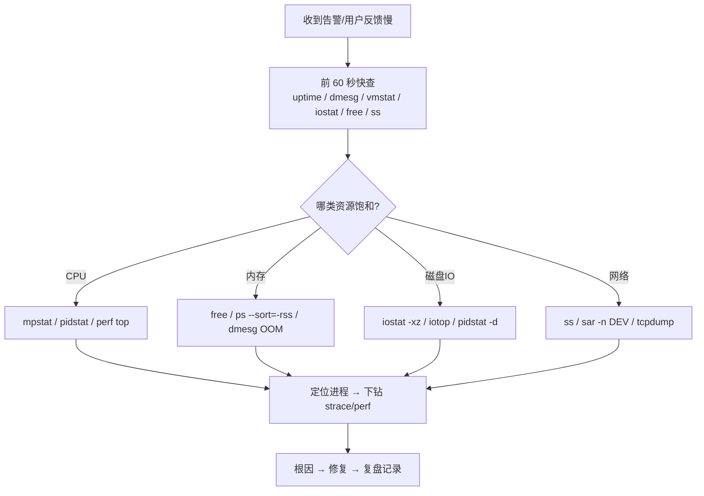

# Linux-性能排查实战

> [!abstract] 摘要
> 服务器变慢、变卡、被 OOM，排查能力直接决定故障恢复时间（MTTR）。本篇以 USE 方法论为骨架，覆盖 CPU、内存、磁盘 IO、网络四大资源的排查命令与判断标准，引入 strace/perf 下钻工具，并完整推演一个"服务器变慢"案例，是 [[Linux-从入门到精通]] 阶段三性能知识点与 [[Linux系统管理与运维要点]] 第五节的展开。

## 一、概念与原理

### 1.1 USE 方法论

[USE 方法](https://www.brendangregg.com/USEmethod/use-linux.html)（Brendan Gregg）：对**每种资源**依次检查三个维度，不靠直觉、按清单穷举：

| 维度 | 含义 | 典型证据 |
|---|---|---|
| **U**tilization 利用率 | 资源有多忙 | CPU %、磁盘 %util、带宽占满 |
| **S**aturation 饱和度 | 排队/等待有多严重 | run queue 长、IO await 飙升、swap 活动 |
| **E**rrors 错误 | 有没有报错 | ECC 报错、网卡错误计数、ENOSPC |

### 1.2 排查总路线



> [!info] 环境与工具准备
> Ubuntu/Debian 环境，本篇工具安装：`sudo apt install sysstat htop iotop tcpdump strace linux-tools-common linux-tools-$(uname -r)`（sysstat 提供 vmstat/iostat/mpstat/pidstat/sar）。所有命令普通用户可跑，抓包/读部分日志需 sudo。

## 二、核心语法 / 命令详解

### 2.1 CPU：top / load / vmstat / pidstat

```bash
uptime                        # load average：1/5/15 分钟指数平均
# Linux 的 load = 可运行进程 + 不可中断睡眠(D 状态)进程数，
# 因此磁盘 IO 卡死也会推高 load，不能直接归因 CPU；经验阈值：持续 > 逻辑核数

nproc                         # 逻辑核数，load 的对照基准

top                           # 动态监控；按 P(CPU) / M(内存) 排序，1 展开各核
# 关注 us(用户态) sy(内核态) wa(iowait) st(虚拟化抢走) 四列：
#   sy 高 → 内核路径问题；wa 高 → 转磁盘排查；st 高 → 与宿主机争抢

vmstat 1 5                    # 每 1 秒采一次共 5 次
# r  > 核数  → CPU 饱和（等 CPU 的进程在排队）
# b  > 0    → 有进程阻塞在 IO 上（配合 wa 高判断）
# us+sy ≈ 利用率；id 空闲；wa 等待 IO 的空转

mpstat -P ALL 1               # 每个核的利用率分布
# 个别核 100% 而整体不高 → 单线程应用/中断打在少数核上

pidstat 1                     # 进程级 CPU 采样（sysstat 套件）
pidstat -u -p 1234 1          # 针对单个 PID 每秒采样
```

### 2.2 内存：free 与 buffer/cache 区分

```bash
free -h
#               total   used   free   buff/cache  available
# Mem:           7.6Gi  2.1Gi  3.9Gi        1.6Gi      5.2Gi
# buffer  = 写缓冲（块设备元数据/脏页）；cache = 读缓存（文件页缓存）
# 两者都算"被用但可回收"，关键看 available 列——那是"分配给应用也绰绰有余"的估算值
# free 列很低是正常现象（Linux 拿空闲内存做缓存），available 低才是真告急

vmstat 1 5                    # si/so 两列：swap 换入/换出，持续非零 = 真缺内存
ps aux --sort=-rss | head     # RSS 排名找内存大户（leak 第一现场）
ps -o pid,rss,vsz,cmd -p 1234 # 单进程内存：RSS 物理占用 / VSZ 虚拟申请
cat /proc/meminfo | head      # 细节数据源（Cached/Dirty/SwapCached…）
```

### 2.3 OOM 案例：完整复盘

**现象**：某 Java 服务凌晨 02:17 无响应，SSH 还能登录，服务进程消失。

```bash
# 第 1 步：确认是否 OOM（内核日志是唯一真相）
sudo dmesg -T | grep -iE "out of memory|killed process"
# [Tue Nov 18 02:17:33 2026] Out of memory: Killed process 8712 (java) total-vm:8192000kB,
# anon-rss:7100000kB, ... oom_score_adj:0
# —— 看到被杀进程的 anon-rss（约 7.1GB）与当时机器内存水位

journalctl -k --since "2026-11-18 02:00" --until "2026-11-18 03:00"   # 重启过的机器从 journald 翻
grep oom_kill /proc/vmstat      # 累计 OOM 次数：oom_kill 3

# 第 2 步：还原时间线（cron/日志交叉验证）
# 结论：每天 02:15 的定时备份任务 tar 全量打包，页缓存暴涨 + JVM 堆已占 7G
#       → available 耗尽 → OOM killer 选中 RSS 最大的 java

# 第 3 步：修复（三管齐下）
sudo systemctl edit backup.service      # 限制备份任务的内存影响
#   [Service]
#   MemoryMax=1G                          # 备份进程组内存上限
#   IOSchedulingClass=best-effort
#   → 对长驻服务同样思路：unit 里加 MemoryMax/MemoryHigh 限制爆炸半径
```

**预防清单**：长驻服务一律配 `MemoryMax=`（见 [[Linux-systemd服务管理]]）；备份类任务错峰 + 限资源；监控 `available` 低于 5% 告警（参考 [Linuxize OOM 诊断指南](https://linuxize.com/post/how-to-diagnose-oom-killer-events-in-linux/)）。

### 2.4 磁盘 IO：iostat / iotop

```bash
iostat -xz 1                  # 每 1 秒，扩展统计，去空闲设备
# 关键列：
#   %util      磁盘饱和度（接近 100% = 设备一直有 IO 在飞）
#   await      单次 IO 平均耗时(ms)，机械盘常态 <10ms，SSD <1ms，飙升即异常
#   avgqu-sz   平均队列长度 > 1 持续出现 = 排队（饱和度证据）
#   r/s w/s rkB/s wkB/s   读写速率分布

iotop -oP                     # 只显示有 IO 的进程，按进程聚合
pidstat -d 1                  # 命令行友好：每秒每进程的 kB_rd/s、kB_wr/s
df -h && df -i                # 空间与 inode 双查（df -h 正常但 df -i 满也会 ENOSPC）
sudo lsof | grep deleted      # 已删除但进程还握着句柄的文件（空间不释放的经典原因）
```

### 2.5 网络：ss 与 tcpdump 抓包入门

```bash
ss -s                         # 连接总览：established/timed-wait 数量分布
ss -tlnp                      # 监听端口 + 进程（替代 netstat -tlnp）
ss -tn state established      # 已建立连接明细
ss -ti dst 10.0.0.5:443       # 带详细信息：rtt、重传（retrans）、拥塞窗口

sar -n DEV 1                  # 每网卡收发带宽（-n EDEV 看错误/丢包计数）
```

tcpdump（选项与过滤器语法依据 [man7.org tcpdump(8)](https://man7.org/linux/man-pages/man8/tcpdump.8.html)）：

```bash
sudo tcpdump -i eth0 -n -c 100 'port 443'          # 前 100 个包，数字形式显示
# -i 指定网卡(any=全部)   -n 不解析域名(快)   -c 抓够 N 个包就停
sudo tcpdump -i any -n 'host 10.0.0.5 and port 8080'   # 组合过滤 and/or/not
sudo tcpdump -i eth0 -n 'tcp[13] & 2 == 2'             # 只看 SYN 包（连接发起风暴定位）
sudo tcpdump -i eth0 -w dump.pcap -c 10000 'port 443'  # 存文件，离线用 Wireshark 分析
sudo tcpdump -r dump.pcap -nn 'tcp[tcpflags] & (tcp-syn|tcp-fin) != 0'  # 回放：连接建立/关闭
sudo tcpdump -i eth0 -A -n 'port 80'                   # -A：ASCII 看明文 payload（HTTP 调试）
```

入门心法：先 `ss` 看连接状态分布建立假设（大量 SYN-RECV = 半连接/丢包；大量重传 = 网络质量差），再用 tcpdump 窄条件抓包验证，永远 `-w` 落盘后回放，不在生产前台裸看。

### 2.6 strace / perf 入门

```bash
# strace：追系统调用（进程"卡住"到底卡在哪一步）
sudo strace -p 1234 -e trace=read,write,openat,connect -f -tt -T
#   -f 跟踪子进程  -tt 时间戳精确到微秒  -T 显示每次调用耗时
#   输出里看到 flock(...) 永远不返回 → 锁竞争；connect 反复 → 网络问题
sudo strace -c -p 1234        # 统计模式：各系统调用次数/耗时汇总（先给全景再细追）

# perf：CPU 热点（谁在烧 CPU）
sudo perf top                 # 实时热点函数排行（类似 top 的函数版）
sudo perf record -F 99 -p 1234 -g -- sleep 30    # 采样 30 秒带调用栈
sudo perf report              # 文本分析结果
sudo perf script | stackcollapse-perf.pl | flamegraph.pl > flame.svg   # 火焰图（可选装）
```

> [!tip] 先广后窄
> USE 清单跑完、知道"哪类资源饱和"之后才值得动用 strace/perf——它们本身有开销（strace 可使目标进程慢数倍），生产机上短时间采样即可，用完即走。

## 三、实战案例：一次"服务器变慢"完整推演（Ubuntu 22.04）

**背景**：16 核 32G 应用服务器（nginx + Java 应用 + MySQL），运维群报"接口响应从 50ms 涨到 3s"。

**第一步：前 60 秒快查，建立假设。**

```bash
uptime
# 10:23:01 up 45 days,  1 user,  load average: 42.30, 38.12, 12.05
# 解读：1 分钟 42 ≫ 16 核 → 严重饱和；15 分钟 12 → 刚刚恶化（时间窗在 10:00 前后）

dmesg -T | tail -20           # 无 OOM、无硬件报错 → 排除内存/硬件方向

vmstat 1 5
# r=35 b=28  us=12 sy=8  id=2 wa=78  si=0 so=0
# 解读：b=28（28 个进程阻塞）+ wa=78% → ==瓶颈大概率在磁盘 IO==，CPU 本身不忙
#       si/so=0 → 排除 swap 抖动
```

**第二步：沿"磁盘 IO 饱和"假设下钻。**

```bash
iostat -xz 1 3
# Device   %util  await avgqu-sz   rkB/s   wkB/s
# vda      99.5  480.00   45.2   21000  152000
# 解读：%util 99.5% + await 480ms + 队列 45 → 系统盘完全饱和，写入 150MB/s 异常高

pidstat -d 1 3
# 10:23:41 UID  Command   kB_wr/s
# 10:23:42 999  java      148000
# 解读：写入全部来自 java 进程 → 应用行为异常或日志暴涨

sudo lsof -p $(pgrep -f 'app.jar') | awk '$7~/REG/ {print $7, $9}' | grep log
# 定位：java 正在写 /var/log/app/app.log，且该文件 18G —— 日志级别误开 DEBUG
```

**第三步：验证根因闭环。** `journalctl -u app --since "09:55"` 显示 09:57 有一次带 `--debug` 参数的重启；`tail` 日志确认每请求打印十行 DEBUG。网络侧顺手排除：`ss -s` 连接数正常、无大量重传——慢不是网络，是应用线程全堵在写盘上。

**第四步：止血 + 根治。**

```bash
sudo systemctl edit app       # 追加 LogWatcher 式防御不现实，先止血：
# 直接改回日志级别并重启（改造为 reload 更优）
sudo sed -i.bak 's/log_level=debug/log_level=info/' /etc/app/app.conf
sudo systemctl restart app
iostat -xz 1 3                # await 回落到 2ms，%util 30%，load 一分钟内下穿 10 → 闭环
```

**复盘沉淀**：① 任何服务"顺手带 --debug 重启"必须走变更流程；② 给 `app.service` 加 `MemoryMax` 与日志目录 size 上限；③ 把本案例写进团队排障知识库，命令链固定为"uptime → vmstat → iostat → pidstat → lsof"。

## 四、动手练习

### 练习 1（热身）：读懂三个输出

在自己的 Ubuntu 机器（或 WSL2/虚拟机）上分别执行 `uptime`、`free -h`、`iostat -xz 1 2`，写下：load 与核数的比值、available 占比、最忙磁盘的 %util 与 await，并给三个数各下一个"正常/需关注"结论。
提示：load 对照 `nproc`；available 对照总内存；单次采样不可靠，看趋势。

### 练习 2（进阶）：制造一次 CPU 饱和并定位

新开终端跑 `yes > /dev/null &`（单核打满）×3 个，然后：用 `uptime` 观察 load 爬升 → `vmstat 1` 看 r 列 → `pidstat 1` 找出元凶 → `kill` 收尾。把整条命令链记录下来。
提示：`pgrep -f "yes > /dev/null"` 找 PID；收尾 `kill %1 %2 %3` 或按 PID。

### 练习 3（综合）：按排查清单做一次模拟排障

给自己搭的场景注入故障（任选其一）：`stress-ng --vm 1 --vm-bytes 90% --timeout 300s`（内存压力）或 `fio --name=t --filename=/tmp/fio.t --rw=randread --size=1g --time_based --runtime=120`（IO 压力）。要求：不预先知道是哪类故障，从"前 60 秒清单"开始走完整 USE 流程，最后输出一页排障报告（现象 → 假设 → 证据 → 根因 → 修复 → 预防）。

> [!success]- 练习 3 参考答案要点
> 排查报告骨架（以内存压力为例）：
> 1. **现象**：`uptime` load 缓慢上升；用户反馈进程变慢。
> 2. **前 60 秒**：`vmstat 1 5` 发现 `si/so` 持续非零（swap 换入换出）→ 假设"内存饱和"而非 CPU（r 列不高）；`dmesg -T | grep -i oom` 排除已发生 OOM。
> 3. **证据**：`free -h` available 从 5G 跌到 <500M；`ps aux --sort=-rss | head` 显示 stress-ng RSS 最大；`grep oom_kill /proc/vmstat` 计数未增长（还没到被杀线）。
> 4. **根因**：测试进程申请 90% 物理内存触发 kswapd 回收与 swap。
> 5. **修复**：`kill` 停 stress-ng，`free -h` 回落验证。
> 6. **预防**：长驻服务配 `MemoryMax=`；监控 available < 5% 告警；压测限定在专用环境。
> 评分点：每一步命令与结论一一对应；假设被证据推翻要记录（如"最初以为 CPU，vmstat r 列否定"）；报告以根因+预防收尾而不是"修好了"。

## 五、常见坑与 FAQ

> [!danger] 别把 free 列低当内存告急
> Linux 用空闲内存做文件缓存（buff/cache），`free` 列低是设计使然；告急标准看 `available`（持续 <5-10%）与 `vmstat` 的 `si/so`。对着 `free` 列告急去"优化内存"，经典误诊；同理 `cache` 高也**不是**该"清缓存"的理由——`echo 3 > /proc/sys/vm/drop_caches` 只在文件系统基准测试前用，平时清掉的是热缓存，反而让性能变差。

> [!warning] load 高 ≠ CPU 忙
> Linux load average 包含不可中断睡眠（D 状态）进程，磁盘/网络 IO 卡死会推高 load 而 CPU 很闲。判据就是 `vmstat` 的 `b` 列与 `wa` 值：b 高 + wa 高 → 转磁盘排查；r 高 + wa 低 → 才是 CPU 排队。这也是 USE 清单把 load 排除在 CPU 利用率证据之外的原因。

> [!warning] tcpdump 在生产机上裸抓全量
> 不带过滤表达式跑 `tcpdump`，万兆机上 CPU 与磁盘会先于网络出问题（抓包本身就是负载）。纪律：`-i` 指定网卡、`-n` 免解析、永远带 BPF 过滤、`-c` 限量或 `-w` 落盘后离线分析；条件允许优先在测试环境/镜像口抓。

> [!tip] 把"前 60 秒"做成肌肉记忆与团队清单
> `uptime → dmesg -T | tail → vmstat 1 5 → mpstat -P ALL 1 → pidstat 1 → iostat -xz 1 → free -h → ss -s`，八条命令一分钟跑完，覆盖 CPU/内存/IO/网络四资源的 U/S/E。跑完必有初步假设，再决定下钻工具。方法论原文见 [Brendan Gregg 的 Linux USE 清单](https://www.brendangregg.com/USEmethod/use-linux.html)与 [Linux Performance 页](https://www.brendangregg.com/linuxperf.html)。

## 六、自检清单

- [ ] 能说出 USE 三个维度含义，并对 CPU/内存/磁盘/网络各举一个 U/S/E 证据
- [ ] 熟练执行"前 60 秒"八连命令并解读输出
- [ ] 能解释 load average 的 Linux 特有语义（含 D 状态）与判饱和的正确姿势
- [ ] 能区分 buffer/cache/available，知道 OOM 的确认入口（dmesg/journalctl -k）
- [ ] 会用 iostat -xz 的 %util/await/avgqu-sz 判断磁盘是否饱和
- [ ] 会用 ss 看连接状态分布，会用 tcpdump 带过滤限量抓包并离线回放
- [ ] 知道 strace/perf 的适用时机与自身开销，先广后窄
- [ ] 能按"现象→假设→证据→根因→修复→预防"写出一份排障报告

## 七、关联笔记与参考

**库内笔记：**

- [[Linux-从入门到精通]] —— 阶段三性能知识点与 2025-2026 内核动态
- [[Linux系统管理与运维要点]] —— USE 法则速查表与"前 60 秒"清单（本篇为展开）
- [[Linux常用命令集]] —— top/df/lsof 等命令速查与组合技
- [[Linux-systemd服务管理]] —— MemoryMax/CPUQuota 资源限制与 OOM 自愈闭环
- [[Linux-文本三剑客实战]] —— 用 awk 聚合 vmstat/iostat 输出
- [[Prometheus监控入门]] —— 把本篇指标（load/available/%util）纳入持续监控

**外部参考（均来自本次官方文档调研）：**

1. [Brendan Gregg — USE Method: Linux Performance Checklist](https://www.brendangregg.com/USEmethod/use-linux.html) —— 各资源 U/S/E 检查项与工具映射
2. [Brendan Gregg — Linux Performance](https://www.brendangregg.com/linuxperf.html) —— 性能工具全景图
3. [man7.org — tcpdump(8) 手册页](https://man7.org/linux/man-pages/man8/tcpdump.8.html) —— 选项与 BPF 过滤语法权威来源
4. [Linuxize — How to Diagnose OOM Killer Events in Linux](https://linuxize.com/post/how-to-diagnose-oom-killer-events-in-linux/) —— OOM 复盘流程
