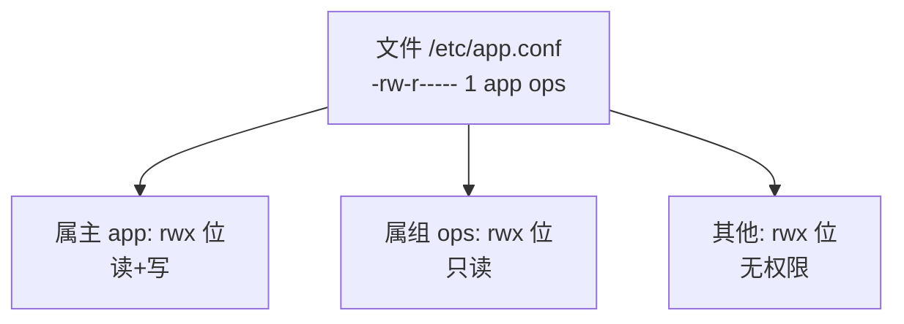

# Linux-权限与用户管理

> [!abstract] 摘要
> 权限体系决定"谁能对什么做什么"，是 Linux 安全的第一道墙，也是生产事故（权限不足服务起不来、误开 777）与安全审计的高频考点。本篇覆盖 UGO 模型、特殊权限、umask、ACL 细粒度授权、用户与组管理、sudoers 语法与文件属性 chattr，最后完整推演"给团队配置共享目录"，是 [[Linux-从入门到精通]] 阶段二权限知识点的展开。

## 一、概念与原理

### 1.1 UGO 权限模型

每个文件都有**属主（User）、属组（Group）、其他（Other）** 三段权限，每段独立设置 读(r=4) 写(w=2) 执行(x=1)：



`ls -l` 第一列 10 个字符的含义：`-rw-r-----` = 文件类型(`-` 目录 `d` 链接 `l`) + 属主 3 位 + 属组 3 位 + 其他 3 位。

| 数字表示 | 含义 | 典型用途 |
|---|---|---|
| 755 | 属主 rwx，组/其他 r-x | 目录、可执行脚本 |
| 644 | 属主 rw-，组/其他 r-- | 普通配置/数据文件 |
| 700 | 仅属主全权 | 私有目录如 `~/.ssh` |
| 640 | 属主 rw-，组 r--，其他无 | 服务配置（配合属组授权） |
| 600 | 仅属主 rw- | 密钥、凭据文件 |

### 1.2 权限判定顺序（内核检查逻辑）

对一次访问请求，内核按 **属主 → 命名用户(ACL) → 属组/命名组(ACL，受 mask 上限约束) → 其他** 的顺序找到第一个命中的段就停止判定——这意味着**普通用户命中"其他"段后，属组再宽也与他无关**。命中后逐位比对：读需要 `r`，写需要 `w`，进入目录/执行需要 `x`。

> [!info] 环境
> 本文命令均在 Ubuntu/Debian 验证（含 `acl` 包提供的 getfacl/setfacl；Ubuntu 24.04 起默认已装，22.04 需 `sudo apt install acl`）。RHEL 系语法一致，服务名与默认组不同。

## 二、核心语法 / 命令详解

### 2.1 chmod / chown / chgrp

```bash
# 数字法：一次设全三段
chmod 640 /etc/app.conf            # 属主 rw-，属组 r--，其他 ---
chmod 750 /opt/app/bin/start.sh    # 脚本：属主全权，组可读执行

# 符号法：增量修改（u/g/o/a + +-= + rwx）
chmod u+x run.sh                   # 给属主加执行位
chmod g-w,o-r secret.conf          # 去掉组写与其他人读
chmod -R g+rX /opt/share           # 递归给组加读；大写 X 表示仅目录/已有执行位者加 x

# 属主与属组（需 root）
sudo chown app:ops /opt/app        # 同时改属主和属组
sudo chown -R www-data:www-data /var/www
sudo chgrp ops file                # 只改属组
```

### 2.2 特殊权限：SUID / SGID / 粘滞位

| 位 | 数字 | 对文件 | 对目录 | 经典例子 |
|---|---|---|---|---|
| SUID | 4 | 执行者临时获得**属主**身份 | 无意义 | `/usr/bin/passwd`（4755） |
| SGID | 2 | 执行者临时获得**属组**身份 | 新建文件继承**目录属组** | 团队共享目录（2775） |
| 粘滞位 | 1 | 无意义 | 只有属主/root 能删自己的文件 | `/tmp`（1777） |

```bash
ls -l /usr/bin/passwd              # -rwsr-xr-x：属主位的 x 变成 s，即 SUID
ls -ld /tmp                        # drwxrwxrwt：其他位 x 变成 t，即粘滞位

sudo chmod 2775 /srv/project       # SGID 共享目录：组内新建文件自动归组
sudo chmod u+s /usr/local/bin/mytool   # 给自研工具加 SUID（谨慎，见第五节）

find / -perm -4000 -type f 2>/dev/null    # 安全审计：列出全盘 SUID 文件
find / -perm -2000 -type f 2>/dev/null    # 列出 SGID 文件
```

### 2.3 umask：新文件的默认权限

新文件的初始权限 = 基准值（文件 666 / 目录 777）**减去** umask 位。常见 `umask 022`：文件 666-022=644，目录 777-022=755。

```bash
umask                    # 查看当前掩码，Ubuntu 默认 002（own组可写）/022
umask 027                # 设置：新文件 640，新目录 750（组内可读，其他全无）

# 验证（注意文件基准 666 没有 x 位，不会因减 umask 出现执行位）
mkdir /tmp/t1 && touch /tmp/t1/f && ls -ld /tmp/t1 /tmp/t1/f
# drwxr-x--- … /tmp/t1    （umask 027 时）

# 持久化：写入 ~/.bashrc 或 /etc/login.defs（UMASK 行）
```

### 2.4 ACL：突破三段模型（依据 [man7.org acl(5)](https://man7.org/linux/man-pages/man5/acl.5.html)）

ACL 在 UGO 之上增加**命名用户/命名组**条目；`ls -l` 末尾出现 `+` 即表示有扩展 ACL。

```bash
# 查看（# 开头的注释行由 getfacl 生成）
getfacl /srv/project
# # user::rwx            ← 属主（USER_OBJ）
# # user:tom:rwx         ← 命名用户（ACL_USER）
# # group::r-x           ← 属组（GROUP_OBJ）
# # group:dev:r-x        ← 命名组（ACL_GROUP）
# # mask::rwx            ← 掩码：named 条目的上限
# # other::r-x           ← 其他（ACL_OTHER）

# 授权：给用户 tom 对目录的读写执行
sudo setfacl -m u:tom:rwx /srv/project

# 授权：给组 devs 读写（对目录必须含 x，否则进不去）
sudo setfacl -m g:devs:rx /srv/project

# 递归授权已有内容
sudo setfacl -R -m u:tom:rwX /srv/project

# 默认 ACL：目录下**新建**的文件/子目录自动继承（注意只影响新建，不影响已有）
sudo setfacl -d -m u:tom:rwx /srv/project

# 删除条目 / 清空全部扩展 ACL
sudo setfacl -x u:tom /srv/project
sudo setfacl -b /srv/project
```

**mask 的含义**：mask 是所有命名用户/命名组条目（及属组条目）的**有效权限上限**，二者按位与才是实际权限。`chmod g±` 会联动改 mask；看到 `#effective:r--` 就是说条目权限被 mask 限制了。

### 2.5 用户与组管理

```bash
sudo useradd -m -s /bin/bash -c "运维 张三" zhangsan   # -m 建家目录，-s 指定 shell
sudo passwd zhangsan                  # 设置密码
id zhangsan                           # 查看 UID/GID 与所属组

sudo usermod -aG sudo,docker zhangsan # 追加附加组；-aG 缺 -a 会**覆盖**原有附加组
sudo usermod -L zhangsan              # 锁定密码（禁登录）
sudo deluser --remove-home zhangsan   # 删除用户与家目录（Ubuntu 的 adduser/deluser 封装）

sudo groupadd devs                    # 建组
sudo gpasswd -a tom devs              # 把 tom 加进 devs 组
getent group devs                     # 查看组成员
```

关键文件：`/etc/passwd`（用户基本信息）、`/etc/shadow`（密码哈希，仅 root 可读）、`/etc/group`（组）。

### 2.6 sudoers 语法（必须用 visudo 编辑）

```bash
sudo visudo                    # 语法校验后再生效，写错会锁死提权
sudo visudo -f /etc/sudoers.d/deploy    # 推荐：独立片段文件，便于管理
```

```bash
# /etc/sudoers.d/deploy —— 一行语法：用户 主机=(以谁身份) 命令
deploy ALL=(root) NOPASSWD: /bin/systemctl restart myapp, /bin/systemctl status myapp
zhangsan ALL=(ALL) ALL                 # 完全提权（慎用，等价 wheel/sudo 组）
%devs  ALL=(root) NOPASSWD: /usr/bin/rsync   # %组名；NOPASSWD 免密
```

```bash
sudo -l                                # 列出当前用户被授权的命令
sudo -u appuser touch /tmp/x           # 以指定用户身份执行
```

### 2.7 文件属性：chattr / lsattr（超越权限位的锁）

chattr 设置 inode 级属性，对**任何用户（含 root）** 生效（依据 [man7.org chattr(1)](https://man7.org/linux/man-pages/man1/chattr.1.html)）：

```bash
sudo chattr +i /etc/hosts          # immutable：不可改/删/改名/建链接
lsattr /etc/hosts                  # ----i--------- /etc/hosts
sudo chattr -i /etc/hosts          # 修改前必须先解锁（编辑器写不进去的元凶）

sudo chattr +a /var/log/app.log    # append-only：只能追加写入，防篡改审计日志
lsattr /var/log/app.log            # -----a--------- /var/log/app.log

lsattr -R /etc | head              # 递归查看
```

> [!note] 文件系统支持
> chattr 是 inode 属性，ext4/xfs/btrfs 支持；tmpfs（如 Ubuntu 26.04 起的 `/tmp`）不支持，会报 `Inappropriate ioctl` 或无效。`c/s/u` 等属性在当前主线内核的 ext4 上未实现，别按老教材当真。

## 三、实战案例：给团队配置共享目录（Ubuntu 22.04/24.04 完整过程）

**需求**：团队 `devs`（成员 tom、jerry）共享 `/srv/project`；tom 额外需要从 `/var/log/app` 读日志；目录里新建的文件组内都可编辑；其他人完全无权限；防误删已锁定的发布清单。

```bash
# ===== 第 1 步：建组与成员 =====
sudo groupadd -r devs
sudo useradd -m -s /bin/bash tom && sudo usermod -aG devs tom
sudo useradd -m -s /bin/bash jerry && sudo usermod -aG devs jerry

# ===== 第 2 步：目录归属 + SGID =====
sudo mkdir -p /srv/project
sudo chown -R root:devs /srv/project
sudo chmod 2770 /srv/project        # 2=SGID：新文件继承 devs 组；组内可写；其他人无权

# ===== 第 3 步：默认 ACL，保证新建文件组内可编辑 =====
# 2770 只解决"继承组"，但新文件默认权限会被 umask 砍成 640（组没有 w）
# 默认 ACL 一步到位：以后在此目录新建的内容，组内自动 rwx/目录 rw/文件
sudo setfacl -R -m g:devs:rwX /srv/project
sudo setfacl -d -m g:devs:rwX /srv/project

# ===== 第 4 步：tom 的额外需求 —— 读 /var/log/app（不动原权限，用 ACL）=====
sudo setfacl -R -m u:tom:rx /var/log/app
getfacl /var/log/app | head -8      # 验证出现 user:tom:r-x

# ===== 第 5 步：锁定发布清单 =====
sudo touch /srv/project/RELEASE.md
sudo chattr +i /srv/project/RELEASE.md   # root 也改不了，直到 -i 解锁

# ===== 第 6 步：验证 =====
su - tom -c 'touch /srv/project/a.txt && echo ok > /srv/project/b.txt'
ls -l /srv/project/                 # 新文件属组应为 devs，且 ACL 带 +
su - tom -c 'head -1 /var/log/app/app.log'   # tom 能读日志
su - jerry -c 'echo x > /srv/project/a.txt'  # jerry 能改 tom 建的文件（默认ACL生效）
```

复核要点：`id tom` 确认组生效（需重新登录）；`getfacl` 双查目录与其子文件；`ls -l` 看权限位的 `s`/`t`/`+`。

## 四、动手练习

### 练习 1（热身）：读权限位

写出权限 `rwxr-s---`（目录）对应的数字，并回答：SGID 在这里对目录里的新文件意味着什么？
提示：数字位顺序 = SUID/SGID/粘滞 ×1000，SGID 记 2；组位上的 `s`。

### 练习 2（进阶）：umask 推算

设置 `umask 027` 后，分别新建文件与目录，写出各自默认权限数字；再用 `mkdir`/`touch` 实际验证。
提示：文件基准 666（无执行位可减）、目录基准 777；减法是"按位去掉"而非算术减。

### 练习 3（综合）：诊断 3 个 Permission denied 场景

逐个分析原因与最小代价修复（不要 777）：

1. `appuser` 执行 `/opt/app/start.sh` 报 `Permission denied`，`ls -l` 显示 `-rw-r--r--`；
2. `tom` 向共享目录 `/srv/project` 写文件失败，`ls -ld` 显示 `drwxrws--- root devs`，而 `id tom` 里有 `devs` 组；
3. root 执行 `echo x > /var/log/secure_audit.log` 失败，`lsattr` 显示 `-----a--------`。

> [!success]- 练习 3 参考答案要点
> 1. **没有执行位**：属主仅 rw-。修复 `chmod u+x /opt/app/start.sh`（或整体 750）。教训：`bash start.sh` 可绕过执行位，但服务化运行必须真有 x。
> 2. **组成员身份未生效**：`usermod -aG` 加入的组要**重新登录**才刷新（或 `newgrp devs`）；若确认已重登仍失败，查 ACL mask 是否把组条目压低了（`getfacl` 看 `#effective:`）。教训：诊断顺序 = 属主 → 组（id 实际命中）→ ACL → 其他，别一上来改权限数字。
> 3. **append-only 属性**：`+a` 允许追加、拒绝覆盖/截断，root 也一样。`>>` 可写入；要覆盖需 `chattr -a` 临时解锁。教训：`Permission denied` 不一定是权限位，`chattr`/SELinux/AppArmor 都可能拦在内核层。

## 五、常见坑与 FAQ

> [!danger] chmod 777 / 666 是"用炸药开锁"
> 与 [[Linux常用命令集]] 中反复强调的一致：`chmod -R 777` 让所有用户可写，既过不了安全审计，又掩盖了进程属主设计错误。正确路径永远是：`ps aux`/`id` 弄清"到底谁在访问" → `chown` 换属主或 `setfacl` 精确授权。同理，SUID 只该出现在极少数受控二进制上：给 shell 脚本加 SUID 是无效的（内核忽略），给自研程序加 SUID 前先想清楚提权面。

> [!warning] usermod -aG 忘记 -a 会清空附加组
> `usermod -G devs tom` 会把 tom 的附加组**替换成只剩 devs**——如果他原来在 sudo 组里，将直接失去管理员权限。永远写 `-aG`。另外改组后必须重新登录（SSH 重连/重新 su）才生效，`newgrp` 可临时切换。

> [!warning] sudoers 手写有锁死风险
> 直接用 `vi /etc/sudoers` 改错语法，可能导致**任何人都无法提权**（只能进单用户/救援模式修）。必须用 `visudo`（保存时自动语法校验）。推荐用 `/etc/sudoers.d/` 独立文件而非改主文件，且文件名不带 `.` 与 `~`，权限保持 0440。`NOPASSWD` 范围要尽量收窄到具体命令全路径。

> [!tip] 排查权限问题的固定四连
> `ls -l`（权限位+属主属组）→ `id 用户`（UID/组命中情况，注意补充组要重登）→ `getfacl`（有无 ACL 与 mask 限制）→ `lsattr`/SELinux/AppArmor（inode 属性与强制访问控制）。四连做完仍失败，再考虑文件系统只读（`mount | grep ro`）或磁盘满。

## 六、自检清单

- [ ] 能从 `ls -l` 输出完整读出类型/三段权限/特殊位，并互转数字表示
- [ ] 能解释 SUID/SGID/粘滞位对文件与目录的不同效果（举出 passwd、/tmp 例）
- [ ] 会算 umask：`umask 027` 时新文件/新目录各是什么权限
- [ ] 会用 setfacl 给命名用户/组授权，理解 mask 与 `#effective` 的含义
- [ ] 会用默认 ACL（`-d`）实现"目录内新建文件组内可编辑"
- [ ] 会建用户/组并用 `-aG` 追加组，知道何时需要重新登录
- [ ] 会写一条最小化 sudoers 白名单规则并用 visudo 校验
- [ ] 知道 chattr `+i/+a` 的语义、对 root 也生效，以及 tmpfs 不支持

## 七、关联笔记与参考

**库内笔记：**

- [[Linux-从入门到精通]] —— 权限体系在阶段二的位置与"核心要点速查"数字对照
- [[Linux常用命令集]] —— chmod/chown/useradd 等命令速查
- [[Linux-Shell脚本编程]] —— 脚本文件的执行权限与属主约定
- [[Linux-systemd服务管理]] —— 服务以专用低权用户运行的 User= 配置
- [[Linux-性能排查实战]] —— 排障中"文件读不到"与权限四连的交叉

**外部参考（均来自本次官方文档调研）：**

1. [man7.org — acl(5) POSIX ACL 手册](https://man7.org/linux/man-pages/man5/acl.5.html) —— 条目类型、判定顺序、mask 与默认 ACL 权威定义
2. [man7.org — chattr(1) 手册页](https://man7.org/linux/man-pages/man1/chattr.1.html) —— i/a 等属性语义与文件系统支持说明
3. [Ubuntu Server Guide — Users and Groups](https://documentation.ubuntu.com/server/server-administration/users-and-groups/) —— Ubuntu 官方用户/组管理文档
