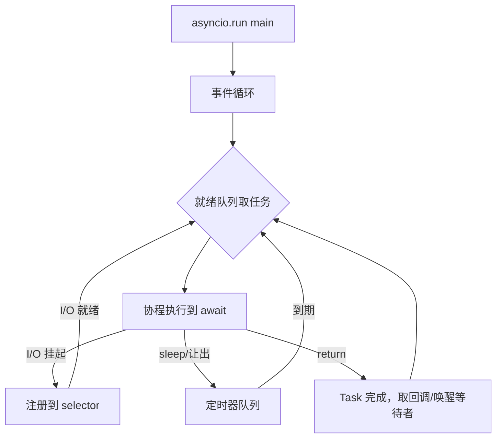

# Python-asyncio异步编程

> [!abstract] 摘要
> asyncio 用**单线程事件循环 + 协程协作式调度**实现高并发 I/O，数千并发连接时资源开销远低于线程模型。学完本篇能理解事件循环原理，熟练使用 `create_task`/`gather`/`as_completed`/`TaskGroup`，正确处理超时与取消，并用 aiohttp 写出带并发限制的异步爬虫与批量下载器。

## 一、概念与原理

### 1.1 同步 vs 异步模型对比

| 维度 | 同步阻塞（requests + 线程） | 异步（aiohttp + 协程） |
|------|---------------------------|----------------------|
| 并发单位 | 线程（OS 调度，栈约 MB 级） | 协程（用户态调度，KB 级） |
| 10000 并发连接 | 线程数爆炸、上下文切换开销大 | 轻松承载，切换成本极低 |
| 切换方式 | 抢占式（随时被打断，需加锁） | 协作式（只在 `await` 处让出） |
| CPU 并行 | 受 GIL 限制 | 单线程，**不适合** CPU 密集 |
| 生态约束 | 同步库随便用 | 必须全程异步库，一处阻塞全盘卡死 |

### 1.2 事件循环原理

事件循环（event loop）是一个"任务队列 + I/O 多路复用"的调度器：协程在 `await` 处让出控制权，循环挑选下一个就绪任务运行；网络 I/O 就绪事件由 `selectors`（epoll/kqueue/IOCP）通知。协程的暂停/恢复机制脱胎于生成器（见 [[Python-生成器与迭代器]] 的 `send`/`yield` 双向通信）。



### 1.3 async/await 语法心智模型

- `async def` 定义**协程函数**，调用它得到协程对象——**此刻什么都没执行**，必须 `await` 或包成 Task 才运行。
- `await expr` = "在这里挂起，等 `expr` 完成后从这一行恢复"；期间事件循环去跑别的协程。
- 协程只能被 `await`，不能直接 `next()`；asyncio 协程不是生成器，但共享同一套暂停/恢复思想。

## 二、核心语法 / API 详解

### 2.1 入口与基本并发

```python
import asyncio

async def fetch_data(i: int) -> int:
    await asyncio.sleep(1)          # 模拟 I/O 等待；绝不写 time.sleep！
    return i * 2

async def main() -> None:
    r = await fetch_data(1)                    # 顺序执行：共约 1s
    tasks = [asyncio.create_task(fetch_data(i)) for i in range(5)]
    results = await asyncio.gather(*tasks)     # 并发执行：总耗时约 1s
    print(r, results)

asyncio.run(main())     # 程序唯一入口：创建循环 → 运行 main → 关闭循环
```

### 2.2 gather / as_completed / TaskGroup

```python
# gather：结果按传入顺序返回；默认 return_exceptions=False，第一个异常立即抛出
results = await asyncio.gather(*tasks, return_exceptions=True)  # 异常也进列表
# 注意：gather 抛异常时其余任务不会被取消，仍在后台运行

# as_completed：谁先完成谁先产出（3.13+ 支持异步迭代器形式）
for coro in asyncio.as_completed(tasks):
    result = await coro                  # 完成顺序 ≠ 传入顺序
# 超时抛 TimeoutError，但不会取消剩余任务——它们会继续跑完

# TaskGroup（3.11+）：结构化并发，官方推荐
async with asyncio.TaskGroup() as tg:
    t1 = tg.create_task(fetch_data(1))
    t2 = tg.create_task(fetch_data(2))
# 退出 with 时隐式等待全部完成；任一任务失败 → 取消其余任务 → 抛 ExceptionGroup
print(t1.result(), t2.result())
```

> [!tip] create_task 后必须保存引用
> 事件循环只持有 Task 的**弱引用**，`asyncio.create_task(coro())` 的返回值不保存，任务可能中途被垃圾回收。fire-and-forget 场景要存入集合并用 `add_done_callback(discard)` 清理。

### 2.3 超时与取消

```python
# asyncio.timeout（3.11+）：上下文管理器形式，推荐
async with asyncio.timeout(5.0):
    data = await slow_call()        # 超时抛 TimeoutError，只能在 with 外捕获

# wait_for（3.7+）：函数形式；3.12 起内部用 timeout 实现
result = await asyncio.wait_for(slow_call(), timeout=5.0)

# 取消：task.cancel() 在协程下一个 await 点抛入 CancelledError
async def worker():
    try:
        await asyncio.sleep(3600)
    except asyncio.CancelledError:
        ...                          # 清理资源
        raise                        # 必须重新抛出，否则破坏结构化并发
```

`CancelledError` 继承自 `BaseException`，`except Exception` 拦不住它——这是有意设计（详见 [[Python-上下文管理器与异常处理]] 的异常体系）。确需"屏蔽取消"用 `asyncio.shield()`，但调用者自己仍会被取消。TaskGroup 内**吞掉 CancelledError 会让整组任务无法正常收尾**。

### 2.4 异步中的阻塞坑与 CPU 密集任务

```python
# 坑：事件循环里绝不能出现同步阻塞 —— time.sleep(5) 会让全部协程卡死 5 秒
#     requests、大文件同步读写、CPU 重计算同理

# 正确姿势 1：换异步库（requests→aiohttp/httpx，time.sleep→asyncio.sleep）
# 正确姿势 2：无法换库时丢进线程池/进程池
result = await loop.run_in_executor(None, blocking_io_func, arg)   # 线程池（默认）
result = await asyncio.to_thread(cpu_or_io_func, arg)              # 3.9+ 便捷封装
# CPU 密集任务应丢进程池（ProcessPoolExecutor），见 [[Python-并发编程实战]]
```

## 三、实战案例

**aiohttp 异步爬虫**（Python 3.12+；安装：`uv add aiohttp`，或 `pip install aiohttp`）：抓取 https://example.com 系列页面，演示 TaskGroup、超时、异常收集与限速。保存为 `crawler.py` 运行 `python crawler.py`。

```python
"""crawler.py — aiohttp + TaskGroup 的最小可用异步爬虫"""
import asyncio
import aiohttp                     # pip install aiohttp

URLS = [f"https://httpbin.org/delay/{i % 3}" for i in range(8)]  # 0~2s 延迟

async def fetch(session: aiohttp.ClientSession, url: str,
                sem: asyncio.Semaphore) -> tuple[str, int | str]:
    async with sem:                              # 并发限制：最多同时 4 个请求
        try:
            async with session.get(url, timeout=aiohttp.ClientTimeout(total=10)) as resp:
                body = await resp.text()
                return url, len(body)            # (url, 字节数)
        except (TimeoutError, aiohttp.ClientError) as e:
            return url, f"失败: {e!r}"           # 单个失败不拖垮整组

async def main() -> None:
    sem = asyncio.Semaphore(4)
    async with aiohttp.ClientSession() as session:
        try:
            async with asyncio.TaskGroup() as tg:
                tasks = [tg.create_task(fetch(session, u, sem)) for u in URLS]
        except* Exception as eg:                 # except* 拆解 ExceptionGroup（3.11+）
            for exc in eg.exceptions:
                print("组内异常:", exc)
    for url, size in (t.result() for t in tasks):
        print(f"{size!s:>12} | {url}")

if __name__ == "__main__":
    asyncio.run(main())
# 8 个请求总耗时 ≈ 最慢的一批（并发 4 分两批，约 4s），同步版需 8s+
```

要点复盘：`Semaphore` 控制并发度；`ClientTimeout(total=10)` 每请求独立超时；`except*`（3.11+）选择性处理 `ExceptionGroup` 中的异常类型；`async with session` 复用连接池。

## 四、动手练习

1. **热身**：写出下面程序的输出与总耗时：两个协程各 `await asyncio.sleep(1)`，用 `gather` 并发后打印结果。提示：总耗时 1s 还是 2s？
2. **基础**：实现 `async def with_retry(coro_fn, times=3)`：失败（抛异常）后等 `2 ** n` 秒重试。提示：`await asyncio.sleep`，最后一次 `raise`。
3. **进阶**：用 `as_completed` 实现"谁先完成先处理谁"，并保证整体超时 10s——超时后**主动取消**剩余任务再退出。提示：`asyncio.timeout` 包住整个 for 循环，收到 `TimeoutError` 后遍历 tasks 调用 `cancel()`。
4. **挑战（带并发限制的批量下载器）**：实现 `async def download_all(urls: list[str], concurrency: int = 5, timeout: float = 10.0)`——① 用 `Semaphore` 限制并发；② 每个下载独立超时；③ 失败任务重试 1 次；④ 返回 `(成功列表, 失败列表)`；⑤ 全程使用 TaskGroup，任何意外异常不静默丢失。用 httpbin 的 `/delay/N` 接口实测总耗时并对比串行版。
   提示：下载函数内部 `async with sem:`；超时用 `async with asyncio.timeout(timeout):`；重试在函数内循环；结果分类用 `list[tuple[str, bytes]]` 与 `list[tuple[str, str]]` 两个列表收集。

> [!success]- 练习 4 参考答案要点
> 骨架：`sem = asyncio.Semaphore(concurrency)`；`async def one(url):` 内部 `async with sem: / try: / async with asyncio.timeout(timeout): / async with session.get(url) as r: / return url, await r.read() / except (TimeoutError, aiohttp.ClientError) as e: 重试一次后 raise`；主流程 `async with TaskGroup() as tg: tasks = [tg.create_task(one(u)) for u in urls]`，随后 `for t in tasks: try: ok.append(t.result()) except (TimeoutError, aiohttp.ClientError) as e: failed.append((url_of(t), str(e)))`——用"任务内不抛出、外部按 result 分类"或"任务内抛出、外部 except 分类"二选一，关键是**分类逻辑与异常路径一一对应**。验收指标：10 个 `/delay/2` URL、并发 5 时总耗时约 4s（串行需 20s）；把 `sem` 上限改成 1 应退化为近似串行。进阶：加全局 `asyncio.timeout(30)` 防整体失控，或用 `aiohttp.TCPConnector(limit=...)` 在连接池层面限流（与应用层 Semaphore 二选一即可）。

## 五、常见坑与 FAQ

> [!warning] 在协程里调用同步阻塞函数
> `time.sleep`、`requests.get`、同步数据库驱动会把**整个事件循环**卡住——所有协程全部停摆，程序表现成"随机假死"。检查清单：I/O 用 aiohttp/httpx 异步客户端、等待用 `asyncio.sleep`、无法异步化的调用丢给 `asyncio.to_thread` 或 `run_in_executor`。可用 `loop.set_debug(True)` + 慢回调阈值（`PYTHONASYNCIODEBUG=1`）帮助定位阻塞点。

> [!warning] 吞掉 CancelledError 破坏取消机制
> `except Exception` 拦不住 `CancelledError`（它是 `BaseException` 子类），但 `except BaseException` 或裸 `except:` 会拦住且若不重抛，`TaskGroup`、`asyncio.timeout` 的取消流程全部失效。规则：捕获 `CancelledError` 做完清理后**必须 `raise`**。

> [!tip] gather 与 TaskGroup 怎么选
> 一次性并发固定数量的独立任务、想要"结果按顺序对齐"用 `gather(return_exceptions=True)`；任务集合会动态变化、或希望"一个失败立刻取消其余"用 `TaskGroup`（3.11+ 官方推荐，异常聚合成 `ExceptionGroup` 更难遗漏）。遗留代码里还要注意 gather 的一个特性：主任务被取消时它会取消全部子任务，但单个子任务失败不会。

> [!tip] 协程对象创建 ≠ 执行
> `coro = fetch(url)` 之后如果从不 `await` 它，Python 会发 `RuntimeWarning: coroutine was never awaited`——请求根本没发出去。同理 `TaskGroup` 的 `create_task` 要在 `async with` 体内完成。调试"请求没发出去"先查这两处。

## 六、自检清单

- [ ] 能说出协程/Task/Future 三者关系与 `create_task` 保存引用的原因
- [ ] 解释协作式调度与 `await` 让出点，画出简单的事件循环流程
- [ ] `gather`、`as_completed`、`TaskGroup` 的异常行为差异说得清
- [ ] 会用 `asyncio.timeout` 与 `wait_for`，知道超时本质是取消
- [ ] 捕获 `CancelledError` 后知道必须重新抛出
- [ ] 遇到 CPU 密集任务知道丢 `to_thread`/进程池，而不是硬算
- [ ] 写过 `except*` 处理 `ExceptionGroup`（3.11+）
- [ ] 能独立写出带 Semaphore 并发限制 + 超时 + 重试的异步下载器

## 七、关联笔记与参考

**关联笔记**：[[Python-生成器与迭代器]]（协程的生成器血统：`send`/`yield` 暂停恢复机制）、[[Python-并发编程实战]]（asyncio 与线程/进程的选型决策表与混合架构）、[[Python-上下文管理器与异常处理]]（`CancelledError` 属于 `BaseException` 的体系设计）、[[Python-工程化与现代工具链]]（asyncio 实战要点与 3.14 内省命令）、[[Python-从入门到精通路线]]（异步编程属阶段三）。

**参考资料**：

1. [asyncio — Tasks and Coroutines 官方文档](https://docs.python.org/3/library/asyncio-task.html)
2. [asyncio — 官方文档总览（事件循环与最佳实践）](https://docs.python.org/3/library/asyncio.html)
3. [PEP 3156 — Asynchronous IO Support Rebooted](https://peps.python.org/pep-3156/)
4. [aiohttp — Client Quickstart 官方文档](https://docs.aiohttp.org/en/stable/client_quickstart.html)
5. [PEP 654 — Exception Groups and except*](https://peps.python.org/pep-0654/)
