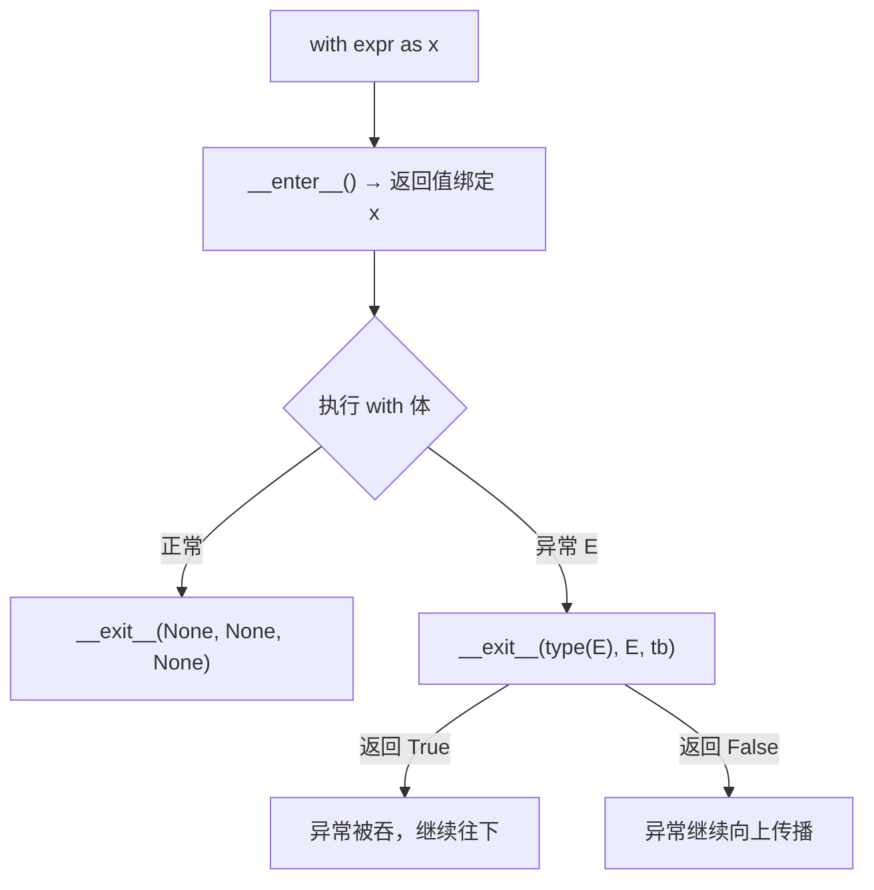

# Python-上下文管理器与异常处理

> [!abstract] 摘要
> `with` 语句保证资源**确定性释放**（文件、锁、事务、连接），异常体系与 `raise from` 链则是错误传播设计的地基。学完本篇能解释 `__enter__`/`__exit__` 的返回值语义，熟练使用 `contextlib` 五件套，设计自定义异常层次，并实现数据库事务管理器与"计时 + 回滚"事务上下文。

## 一、概念与原理

### 1.1 with 语句机制

`with expr as x` 的执行流程：调用 `expr.__enter__()`，**返回值绑定给 `as` 变量**；执行 with 体；退出时（无论正常还是异常）调用 `__exit__(exc_type, exc_val, exc_tb)`。

| `__exit__` 返回值 | 语义 |
|-------------------|------|
| `False` / `None`（默认） | 异常继续向外抛出（**绝大多数场景应该这样**） |
| `True` | 异常被**吞掉**，代码继续执行 with 之后的语句 |



### 1.2 异常体系（BaseException vs Exception）

官方异常树的关键分叉（详见 [内置异常文档](https://docs.python.org/3/library/exceptions.html#exception-hierarchy)）：

```
BaseException
├── SystemExit          # sys.exit() 触发
├── KeyboardInterrupt   # Ctrl+C
├── GeneratorExit       # 生成器关闭（.close()）
└── Exception           # 所有"业务异常"的基类
    ├── ValueError / TypeError / KeyError / OSError ...
    ├── StopIteration?  # 不是！它直接继承 BaseException
    └── 自定义异常应从这里派生
```

`StopIteration`、`GeneratorExit` 直接派生自 `BaseException`，正是为了防止被 `except Exception` 意外吞掉、破坏迭代器与生成器协议（见 [[Python-生成器与迭代器]]）。**业务代码永远只捕获 `Exception` 及其子类**，裸 `except:` 会连 `KeyboardInterrupt` 一起吞掉。

## 二、核心语法 / API 详解

### 2.1 手写上下文管理器类

```python
import time

class Timer:
    def __enter__(self):
        self.start = time.perf_counter()
        return self                        # 返回值赋给 as 变量（可返回任何对象）
    def __exit__(self, exc_type, exc_val, exc_tb):
        self.cost = time.perf_counter() - self.start
        print(f"耗时 {self.cost:.3f}s")
        return False                       # 默认不吞异常；想忽略特定异常才返回 True

with Timer() as t:
    sum(range(10_000_000))
```

### 2.2 contextlib 五件套

```python
from contextlib import contextmanager, suppress, ExitStack, closing, nullcontext

# ① @contextmanager：生成器函数变成上下文管理器（最常用）
@contextmanager
def temp_config(obj, **overrides):
    saved = {k: getattr(obj, k) for k in overrides}
    for k, v in overrides.items():
        setattr(obj, k, v)
    try:
        yield                       # yield 前 = __enter__，后 = __exit__
    finally:
        for k, v in saved.items():  # 无论是否异常都恢复
            setattr(obj, k, v)

# ② suppress：明确"该错误发生时静默跳过"
with suppress(FileNotFoundError):
    os.remove("tmp.txt")            # 等价 try/except FileNotFoundError: pass，但意图更清晰

# ③ ExitStack：动态管理不定数量的上下文，退出按注册逆序清理
with ExitStack() as stack:
    files = [stack.enter_context(open(p, encoding="utf-8")) for p in paths]
    # 中途任何一个 open 失败，已打开的文件也会全部关闭

# ④ closing：退出时自动调用 .close()，适配没有 __enter__/__exit__ 的对象
with closing(socket.create_connection(("host", 80))) as sock:
    ...

# ⑤ nullcontext：可选依赖的占位符（有没有上下文都成立）
with (lock if need_lock else nullcontext()):
    ...
```

`@contextmanager` 的重要细节：它装饰的是**生成器工厂**，每次 `with cm()` 才创建新生成器；with 体抛出的异常会在 `yield` 处重新抛入生成器——若想"记录但不吞掉"，生成器里捕获后必须**重新抛出**，否则会被当作"已处理"。

### 2.3 自定义异常设计

```python
class AppError(Exception):
    """应用异常基类：统一 exit_code 与日志钩子"""
    exit_code = 1

class ConfigError(AppError):          # 按领域分层：调用方可只 except AppError
    exit_code = 2

class RecordNotFound(AppError):
    exit_code = 4
    def __init__(self, table: str, pk: object):
        super().__init__(f"{table} 中找不到主键 {pk}")
        self.table, self.pk = table, pk
```

设计原则：① 全部继承自一个 `AppError` 基类，形成"捕获一族、区分个体"的层次；② 携带结构化字段（`table`、`pk`）而不是只塞字符串；③ 消息面向开发者可读，`args[0]` 保持稳定格式。

### 2.4 异常链与 try/except/else/finally

```python
try:
    conn = connect(cfg)
except ConnectionError as exc:
    raise RuntimeError("初始化数据库失败") from exc   # 显式链：__cause__ 指向原异常
# traceback 会显示 "The above exception was the direct cause of ..."；
# 不写 from 则是隐式链（__context__）："During handling of the above exception..."
# raise ... from None 可抑制链条（适合把底层细节转换为干净的公开异常）
```

`try/except/else/finally` 各自职责与最佳实践：

| 子句 | 执行时机 | 最佳实践 |
|------|---------|---------|
| `try` | 监视范围 | **只放会抛异常的那几行**，别把整段逻辑塞进去 |
| `except` | 对应异常发生时 | 精确类型；记录后 `raise` 或转译 `raise X from e`；禁止裸 `except:` |
| `else` | try 未抛异常时 | 把"成功路径"放这里，避免被误捕获 |
| `finally` | 无论成败 | 只放清理代码；**不要**在里面 `return`/`break`（会吞异常，3.14 起发 SyntaxWarning，PEP 765） |

## 三、实战案例

**数据库事务上下文管理器**（Python 3.12+，标准库 `sqlite3`，无需安装）：`transaction()` 保证成功提交、异常回滚、无论成败归还连接。

```python
"""tx_demo.py — sqlite3 事务上下文管理器：提交 / 回滚 / 归还连接"""
import sqlite3
from contextlib import contextmanager

@contextmanager
def transaction(db_path: str):
    conn = sqlite3.connect(db_path)
    try:
        yield conn                      # with 体拿到连接做业务操作
        conn.commit()                   # 正常退出 → 提交
        print("[tx] 已提交")
    except Exception:
        conn.rollback()                 # 异常退出 → 回滚，然后把异常继续抛出
        print("[tx] 已回滚")
        raise                           # 不吞异常，调用方自行决定如何处理
    finally:
        conn.close()                    # 无论成败都归还连接

def transfer(conn: sqlite3.Connection, from_id: int, to_id: int, amount: int):
    cur = conn.execute("UPDATE accounts SET balance = balance - ? WHERE id = ?",
                       (amount, from_id))
    if cur.rowcount != 1:
        raise ValueError(f"账户 {from_id} 不存在")     # 触发回滚
    conn.execute("UPDATE accounts SET balance = balance + ? WHERE id = ?",
                 (amount, to_id))

if __name__ == "__main__":
    with sqlite3.connect("bank.db") as init:          # sqlite3 自带 with：提交/回滚
        init.execute("CREATE TABLE IF NOT EXISTS accounts "
                     "(id INTEGER PRIMARY KEY, balance INTEGER)")
        init.execute("INSERT OR IGNORE INTO accounts VALUES (1, 100), (2, 100)")

    with transaction("bank.db") as conn:              # 正常转账 → 提交
        transfer(conn, 1, 2, 30)

    try:
        with transaction("bank.db") as conn:          # 失败 → 回滚
            transfer(conn, 1, 999, 30)                # 账户不存在
    except ValueError as e:
        print("业务失败:", e)

    with sqlite3.connect("bank.db") as check:
        print("最终余额:", check.execute(
            "SELECT id, balance FROM accounts ORDER BY id").fetchall())
    # 预期：[(1, 70), (2, 130)] —— 第二笔失败转账完全回滚
```

> [!tip] 事务边界放哪里
> 事务上下文管理器把"提交/回滚/关连接"三件事收敛到一处，业务函数（如 `transfer`）只写 SQL 不碰事务——这正是 [[Python-高级特性]] 与 [[RESTful-API规范]] 中"事务边界在服务层"约定的落地手法。更复杂的场景（嵌套事务、保存点）可在此基础上加 `SAVEPOINT`。

## 四、动手练习

1. **热身**：手写类版 `Timer`，要求 `with Timer() as t:` 后能读 `t.cost`；再把 `__exit__` 改成返回 `True` 并在 with 体里抛异常，观察现象。提示：关注异常被吞后的执行流。
2. **基础**：用 `@contextmanager` 实现 `indented(level)`：with 体期间 `print` 自动加前缀缩进（如 `"  | "`），退出后恢复。提示：替换 `builtins.print` 再还原，或改用 `contextlib.redirect_stdout` 包装一个带前缀的流。
3. **进阶**：实现 `suppress_and_log(*exceptions, logger=print)`——行为同 `contextlib.suppress`，但被抑制的异常会记录一条日志。提示：`try: yield / except exceptions as e: logger(e)`，注意**不要**再 `raise`。
4. **挑战（计时 + 回滚的事务管理器）**：实现类版 `TimedTransaction`，组合"计时 + 事务回滚 + 可重试"：`with TimedTransaction(conn, max_retries=2) as tx:` ——进入时记录开始时间并开启事务；退出时若体中发生死锁类异常（模拟用 `sqlite3.OperationalError`）则回滚并自动重试整个事务体（重试用循环实现，最多 `max_retries` 次），最终超过重试次数才抛出；正常退出则提交并打印耗时。
   提示：重试整个事务体无法在单个 `with` 里天然实现，可让 `__exit__` 返回 `True` 吞掉"可重试异常"并驱动内部重放循环——把业务体写成传给 `tx.run(fn)` 的函数是更清晰的替代方案；耗时用 `time.perf_counter()` 差值。

> [!success]- 练习 4 参考答案要点
> 推荐结构（`run` 驱动重放，语义比在 `__exit__` 吞异常更清晰）：`__enter__` 记录 `self.t0 = time.perf_counter()` 并返回 self；`run(fn, *args, **kwargs)` 内部 `for attempt in range(max_retries + 1):` 循环中 `try: fn(self.conn, *args); self.conn.commit(); break except sqlite3.OperationalError: self.conn.rollback(); if attempt == max_retries: raise`；`__exit__` 里只负责打印总耗时并返回 `False`（不吞异常）。关键点：① 重试计数放 `run` 的循环而不是 `__exit__`；② 每次重试前必须先 `rollback` 清理半途状态；③ `__exit__` 保持返回 `False`，让业务异常继续向上传播；④ 若坚持在 `__exit__` 里做，需要把"待重放业务"存到实例上并在返回 `True` 前重放——但要警惕返回 `True` 会连 `KeyboardInterrupt` 之外的异常一起吞掉，必须精确判断 `exc_type is sqlite3.OperationalError`。数据库事务更多背景见 [[MySQL优化技巧]]。

## 五、常见坑与 FAQ

> [!warning] `__exit__` 返回 True 吞掉一切
> `return True` 会抑制**所有**异常（包括 `KeyboardInterrupt`），错误被静默吞掉后排查极难。正确姿势：只在 `exc_type` 精确等于目标异常时返回 `True`，其余情况返回 `False`。用 `@contextmanager` 时同理：生成器里 `except` 后不 `raise` 就等于吞异常。

> [!warning] 裸 except: 与异常体系误用
> `except:` 连 `SystemExit`/`KeyboardInterrupt` 都捕获，`Ctrl+C` 都杀不掉脚本；`except Exception` 才是"捕获一切业务异常"的正确写法。另外 `except` 子句**从上到下第一个匹配者胜出**——把父类放前面会让后面的子类分支永远执行不到。

> [!tip] @contextmanager 是"一次性"的
> `cm = temp_config(...)` 之后两次 `with cm:`，第二次抛 `RuntimeError: generator didn't yield`。生成器耗尽后无法重放——要么每次 `with temp_config(...)` 现场创建，要么用类版上下文管理器（`__enter__` 每次调用都重新初始化状态）。

> [!tip] finally 里不要 return / break
> `try: return True / finally: return False` 的结果是 `False`——finally 的 `return` 覆盖 try 的返回值，还会把未处理异常一并吞掉（PEP 765 起 Python 3.14 对此发 `SyntaxWarning`）。finally 只写清理代码，返回值与异常都交给 try/except 处理。

## 六、自检清单

- [ ] 能画出 with 语句的执行流程图，说清 `as` 变量绑定的是 `__enter__` 的返回值
- [ ] 默写 `__exit__` 三个参数与返回值语义（True 吞异常 / False 传播）
- [ ] 说出 `SystemExit`、`KeyboardInterrupt`、`GeneratorExit` 为何不继承 `Exception`
- [ ] 用 `@contextmanager` 写过带 `try/finally` 的上下文管理器，理解异常在 `yield` 处抛入
- [ ] 用过 `ExitStack` 管理不定数量资源，知道 `callback`/`pop_all` 的 all-or-nothing 模式
- [ ] 设计过自定义异常层次（共同基类 + 结构化字段 + exit_code）
- [ ] 能解释 `raise X from e` 与隐式链 `__context__` 的区别，何时用 `from None`
- [ ] 知道 try 只包最小范围、else 放成功路径、finally 禁止 return

## 七、关联笔记与参考

**关联笔记**：[[Python-高级特性]]（母篇：上下文管理器协议概览）、[[Python-生成器与迭代器]]（`GeneratorExit` 与生成器关闭机制）、[[Python-类型注解实战]]（Pydantic `ValidationError` 的结构化错误处理）、[[Python-asyncio异步编程]]（`CancelledError` 属于 `BaseException` 的取消语义）、[[Python-从入门到精通路线]]（异常处理属阶段二进阶）。

**参考资料**：

1. [contextlib — 官方文档（contextmanager/suppress/ExitStack）](https://docs.python.org/3/library/contextlib.html)
2. [Python 教程第 8 章 — Errors and Exceptions（官方）](https://docs.python.org/3/tutorial/errors.html)
3. [内置异常层次 — 官方文档](https://docs.python.org/3/library/exceptions.html#exception-hierarchy)
4. [PEP 3134 — Exception Chaining and Embedded Tracebacks](https://peps.python.org/pep-3134/)
5. [PEP 765 — return/break/finally 语法警告（Python 3.14）](https://peps.python.org/pep-0765/)
6. [sqlite3 — 官方文档（连接与事务）](https://docs.python.org/3/library/sqlite3.html)
