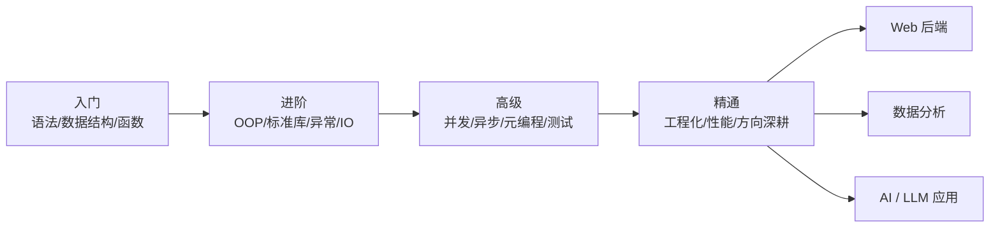

# Python-从入门到精通路线

## ① 概述

本笔记是 Python 学习的主线路线图，从零基础到能独立设计工程系统，按"入门 → 进阶 → 高级 → 精通"四个阶段组织，每阶段给出学习目标、核心知识点、实践项目与推荐资源。它是 [[Python学习]] 的路线总纲：语言机制细节见 [[Python-高级特性]]，工具链与工程化实践见 [[Python-工程化与现代工具链]]。

> [!tip] 路线使用方法
> 每个阶段遵循"学完即用"原则：学完一个知识点立刻在实践项目中落地。预计总时长 9-12 个月（每天 1-2 小时），有其他语言基础（如 [[Go语言入门]] 对应的后端经验）可压缩到 3-6 个月。

## ② 分阶段路线

### 阶段一：入门（约 1-2 个月）

| 维度 | 内容 |
|------|------|
| 学习目标 | 能独立编写 200 行以内的脚本，处理文件与命令行参数 |
| 核心知识点 | 环境搭建（推荐 uv 管理版本，见 [[Python-工程化与现代工具链]]）；变量与基本类型（int/float/str/bool/None）；流程控制（if/for/while、`match-case`）；字符串方法与 f-string；列表/字典/集合/元组四大容器；函数定义、参数传递、作用域初步 |
| 实践项目 | 批量重命名脚本；CSV 数据统计；命令行待办事项（JSON 存档） |
| 推荐资源 | 《Python 编程：从入门到实践》；官方入门教程 [docs.python.org/zh-cn/3/tutorial](https://docs.python.org/zh-cn/3/tutorial/)；[DataCamp 12 个月 Python 路线图](https://www.datacamp.com/zh/blog/python-roadmap) |

### 阶段二：进阶（约 2-3 个月）

| 维度 | 内容 |
|------|------|
| 学习目标 | 面向对象设计与模块化开发；能读写文件/数据库；熟练使用标准库解决常见问题 |
| 核心知识点 | OOP：类、继承、多态、魔术方法（`__repr__`/`__eq__`/`__len__`）；异常处理与异常链（`raise ... from`）；模块与包、`if __name__ == "__main__"`；文件 IO（pathlib、with 语句、编码处理）；常用标准库：`collections`、`itertools`、`datetime`、`json`、`re`、`logging`；数据库操作：sqlite3、SQLAlchemy 基础（数据库调优可延伸到 [[MySQL优化技巧]]） |
| 实践项目 | 命令行记账工具（sqlite3 存储 + logging）；简易爬虫（requests + re）；通讯录 CRUD（连接 [[MongoDB设计模式]] 中的文档建模思想） |
| 推荐资源 | 《流畅的 Python》（前 8 章）；[PEP 8 官方风格指南](https://peps.python.org/pep-0008/)；Linux 操作环境配合 [[Linux常用命令集]] |

### 阶段三：高级（约 3-4 个月）

| 维度 | 内容 |
|------|------|
| 学习目标 | 掌握语言级元编程机制与并发模型；写出可测试、类型安全的代码 |
| 核心知识点 | 装饰器/生成器/上下文管理器/描述符/元类（详见 [[Python-高级特性]]）；迭代器协议与惰性求值；并发三件套：threading / asyncio / multiprocessing 与 GIL；asyncio 协程与 `async/await`；类型注解：typing、Generic、Protocol、Pydantic；测试：pytest fixture/参数化/mock |
| 实践项目 | 并发图片下载器（对比三种并发模型耗时）；用装饰器实现重试/限流/缓存中间件；为旧项目补测试与类型注解（覆盖率 > 80%） |
| 推荐资源 | 《流畅的 Python》（9 章后）；[Effective Python 第 3 版](https://www.oreilly.com/library/view/effective-python-90/9780134854717/)；pytest 官方文档 [docs.pytest.org](https://docs.pytest.org/en/stable/) |

### 阶段四：精通（持续进行）

| 维度 | 内容 |
|------|------|
| 学习目标 | 独立负责生产级项目：从脚手架、CI、发布到性能调优 |
| 核心知识点 | 工程化：uv 依赖管理、ruff/mypy 质量门禁、pyproject.toml（见 [[Python-工程化与现代工具链]]）；性能优化：cProfile/py-spy 定位瓶颈、算法与数据结构优化、C 扩展调用；打包发布：构建 wheel、发 PyPI；方向深耕（任选 1-2 个）：Web 后端（FastAPI/Django，接口设计参考 [[RESTful-API规范]]）、数据分析（pandas/Polars）、AI 应用（PyTorch、LangChain、LLM 工程化） |
| 实践项目 | 完整 FastAPI 服务（JWT 鉴权 + 数据库 + Docker 部署，容器化见 [[Dockerfile编写指南]]）；开源库发布到 PyPI；kaggle 数据竞赛或 LLM RAG 应用 |
| 推荐资源 | [Hitchhiker's Guide to Python](https://docs.python-guide.org/)；[uv 官方文档](https://docs.astral.sh/uv/)；[py-free-threading 生态追踪](https://py-free-threading.github.io/tracking) |

### 方向深耕对比（精通阶段任选 1-2 个）

| 方向 | 核心技术栈 | 必备技能 | 产出项目示例 |
|------|-----------|---------|-------------|
| Web 后端 | FastAPI / Django、SQLAlchemy、Redis | ORM 设计、异步编程、认证鉴权 | 任务队列服务 + REST API |
| 数据分析 | pandas / Polars、numpy、matplotlib | 数据清洗、透视聚合、可视化 | 电商销售数据看板 |
| AI 应用 | PyTorch、transformers、LangChain | 向量检索、RAG、提示工程 | 本地知识库问答机器人 |

## ③ 核心要点速查表

| 主题 | 一句话要点 | 常用写法 |
|------|-----------|---------|
| 容器选择 | 频繁成员判断用 set/dict（O(1)），有序去重用 dict | `"x" in my_set` |
| 字符串格式化 | f-string（3.12 起支持任意嵌套引号） | `f"{name=}: {value:.2f}"` |
| 推导式 | 简单转换用推导式，多条件多层改用普通循环 | `[f(x) for x in xs if p(x)]` |
| 异常处理 | 精确捕获，禁止裸 `except:` | `except (ValueError, KeyError) as e:` |
| 文件操作 | 永远用 with + pathlib | `with open(p, encoding="utf-8") as f:` |
| 装饰器 | 带状态/带参数时用类或三层嵌套，别忘 `functools.wraps` | `@functools.wraps(func)` |
| 并发选型 | I/O 多用 asyncio，CPU 重用 multiprocessing | `ProcessPoolExecutor()` |
| 类型注解 | 公共 API 必注解；结构鸭子类型用 Protocol | `def f(x: int) -> str:` |
| 测试 | pytest fixture 组织前置，parametrize 覆盖边界 | `@pytest.mark.parametrize(...)` |
| 依赖管理 | 2025+ 默认 uv，锁文件进版本库 | `uv add requests` |
| 命名 | snake_case 函数变量、PascalCase 类、UPPER_CASE 常量 | `parse_config()` |
| 调试 | 交互式用 `breakpoint()`，生产进程用 py-spy | `python -m pdb -p PID`（3.14） |

## 各阶段自查清单

进入下一阶段前，用下面的清单自检（源自 2025 年各主流路线的共识框架：基础语法 → 数据结构 → OOP → 标准库 → 并发进阶 → 方向专精）。

- [ ] 入门：能解释 list/tuple/dict/set 的差异与各自适用场景
- [ ] 入门：能读懂 traceback 并独立修复自己脚本的报错
- [ ] 入门：会用 f-string 格式化输出，能正确处理 UTF-8 文本文件
- [ ] 进阶：能为领域问题设计 3-5 个类，合理使用继承与组合
- [ ] 进阶：熟练使用 pathlib、collections、json、re 解决日常任务
- [ ] 进阶：理解传参是"传对象引用"，能解释可变默认参数陷阱
- [ ] 高级：能手写带参数的装饰器与惰性生成器管道
- [ ] 高级：能说出 threading/asyncio/multiprocessing 的选型依据
- [ ] 高级：会写 fixture 驱动的 pytest 测试，能为公共 API 加类型注解
- [ ] 精通：能用 uv 从零搭建可复现项目，ruff/mypy 进 CI 门禁
- [ ] 精通：能用 cProfile/py-spy 定位并消除一个真实性能瓶颈
- [ ] 精通：在 Web/数据/AI 至少一个方向独立完成过完整项目

> [!info] 3.13+ 的新 REPL 是学习利器
> 从 Python 3.13 起自带的新交互式解释器支持多行编辑、语法高亮、F2 历史浏览与 F3 粘贴模式。入门阶段直接敲 `python` 练习即可，不必额外安装 IPython；用 `PYTHON_BASIC_REPL=1` 可随时回退旧版。

## ④ 常见坑与最佳实践

> [!warning] 新手高频错误
> 1. **可变默认参数**：`def f(x, items=[])` 的 items 被所有调用共享，用 `None` 哨兵替代。
> 2. **浮点数比较**：`0.1 + 0.2 != 0.3`，金额计算用 `decimal.Decimal`，比较用 `math.isclose`。
> 3. **脚本与库重命名冲突**：自己写的 `random.py` 会遮蔽标准库（3.13 起 traceback 会直接提示）。
> 4. **循环导入**：A 导 B、B 导 A —— 重构公共部分到第三个模块。
> 5. **忽略编码**：Windows 下 `open()` 默认编码随区域设置变化，显式传 `encoding="utf-8"`。

> [!info] 最佳实践清单
> - 每个项目独立虚拟环境，提交锁文件到 git，但不提交 `.venv/`。
> - 用 `python -m pytest` 而非全局 `pytest`，确保测试导入的是当前项目。
> - `main()` 入口 + `if __name__ == "__main__":` 保护，方便被导入与测试。
> - 先写测试再重构（尤其重构旧代码时），ruff + mypy 进 pre-commit 钩子。
> - 学会读 traceback 从**最后一行往回读**，定位最先出错的自己那行代码。

## ⑤ Python 3.13 / 3.14 新特性动态

> [!note] 版本时间线（截至 2026-11）
> - **3.12**（2023-10-02）：PEP 695 新泛型语法 `def f[T]` 与 `type` 语句；PEP 701 f-string 放开嵌套限制；PEP 698 `@override`；移除 distutils。
> - **3.13**（2024-10-07）：**实验性 free-threaded 构建**（PEP 703，需 `python3.13t`）；**实验性 JIT**（PEP 744）；全新彩色 REPL（多行编辑、F1/F2/F3）；PEP 667 修正 `locals()` 语义；类型系统新增 `TypeIs`/`ReadOnly`/`@deprecated`；移除 19 个 dead batteries 标准库模块（PEP 594）；iOS/Android 成为 tier 3 支持平台。
> - **3.14**（2025-10-07）：free-threading **正式受支持**（PEP 779），单线程损耗降至约 5-10%；t-string 模板字符串（PEP 750）用于防注入的安全模板；延迟注解求值（PEP 649/749），前向引用不再需要引号；子解释器 `concurrent.interpreters` 与 `InterpreterPoolExecutor`（PEP 734）；`compression.zstd`（PEP 784）；`except A, B` 无括号多异常（PEP 758）；Unix 下多进程默认启动方式从 `fork` 改为 `forkserver`；REPL 语法高亮与自动补全；pdb 支持远程调试（PEP 768）。
> - **选择建议（2026-11）**：新项目直接用 **3.13/3.14**；需要尝试多核并行的科学计算场景可安装 **3.14 free-threaded 构建**（需确认依赖提供 cp314t wheel）；仍在 3.8/3.9 的旧项目建议升级到 3.12+。

## ⑥ 参考资料

1. [Python 官方教程（中文）— docs.python.org](https://docs.python.org/zh-cn/3/tutorial/)
2. [What's New in Python 3.14 — Python 官方文档（2025-10-07 发布）](https://docs.python.org/3.14/whatsnew/3.14.html)
3. [What's New in Python 3.13 — Python 官方文档（2024-10-07 发布）](https://docs.python.org/3.13/whatsnew/3.13.html)
4. [Python 路线图：12 个月学习路径 — DataCamp](https://www.datacamp.com/zh/blog/python-roadmap)
5. [【2025最新】Python学习路线 — CSDN（2025-01）](https://blog.csdn.net/2401_89383448/article/details/145036220)
6. [2025年Python编程系统学习路线 — 腾讯云开发者社区（2025-01）](https://cloud.tencent.com/developer/article/2489993)
7. [Python从入门到精通的完整学习路线图 — 知乎](https://zhuanlan.zhihu.com/p/2012891783252689682)
8. [Free-Threading 兼容性追踪 — py-free-threading.github.io](https://py-free-threading.github.io/tracking)
9. [PEP 8 — Style Guide for Python Code](https://peps.python.org/pep-0008/)
10. [uv 官方文档 — Astral](https://docs.astral.sh/uv/)（工程化阶段环境搭建）
