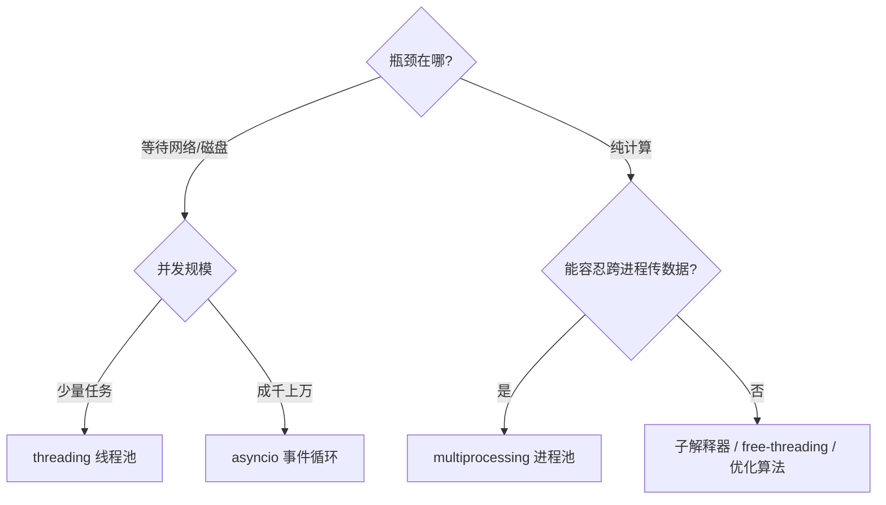

# Python-并发编程实战

> [!abstract] 摘要
> Python 并发的第一课是 GIL：它让多线程无法并行执行字节码，从而把问题变成"选型题"——I/O 密集选 threading 或 asyncio，CPU 密集选 multiprocessing。学完本篇能掌握选型决策表、`concurrent.futures` 线程/进程池实战、进程间通信（Queue/Pipe/共享内存）与线程安全要点，并完成"多线程 IO + 多进程 CPU + 混合架构"三个案例与并发改造练习。

## 一、概念与原理

### 1.1 GIL 现状（截至 2026-11）

GIL（全局解释器锁）保证同一时刻只有一个线程执行 Python 字节码，因此 threading **不是** CPU 密集任务的并行方案。但格局正在改变：**3.13**（2024-10）提供实验性 free-threaded 构建（PEP 703，`python3.13t`）；**3.14**（2025-10）free-threading **正式受支持**（PEP 779），单线程损耗降至约 5-10%；生态兼容约 51%，numpy 2.1+ / scipy 1.15+ / pandas 2.2.3+ 已提供 cp314t wheel。3.14 同时引入 `concurrent.interpreters` 子解释器（PEP 734，每解释器独立 GIL）。日常结论不变：**普通解释器下仍按"GIL 存在"来选型**，free-threading 是需显式安装专用构建的并行新选项（详见 [[Python-高级特性]]）。

### 1.2 选型决策表

| 任务特征 | 首选方案 | 理由 | 典型 API |
|----------|---------|------|---------|
| I/O 密集 + 任务数少（<100） | threading | 等待时释放 GIL，线程切换开销小 | `ThreadPoolExecutor` |
| I/O 密集 + 海量并发（千级连接） | asyncio | 协程 KB 级开销，单线程无锁 | `TaskGroup`/`gather`（见 [[Python-asyncio异步编程]]） |
| CPU 密集（计算/图像/压缩） | multiprocessing | 每进程独立解释器与 GIL，真并行 | `ProcessPoolExecutor` |
| CPU 密集 + 科学计算 + 可用专用构建 | free-threading 3.14t | 真线程并行，需 cp314t wheel | 普通 threading 代码 |
| CPU 密集 + 需要隔离 | 子解释器（3.14） | 每解释器独立 GIL，启动快于进程 | `InterpreterPoolExecutor` |



## 二、核心语法 / API 详解

### 2.1 concurrent.futures 池化实战

```python
from concurrent.futures import ThreadPoolExecutor, ProcessPoolExecutor, as_completed

# 线程池：max_workers 默认 min(32, os.process_cpu_count() + 4)（3.13+，I/O 友好）
with ThreadPoolExecutor(max_workers=10) as pool:
    fut = pool.submit(io_task, arg)            # 单个提交 → Future
    for result in pool.map(io_task, items):    # 批量提交，结果按输入顺序
        ...
    futures = {pool.submit(io_task, u): u for u in items}
    for f in as_completed(futures):            # 谁先完成先处理谁
        try:
            print(futures[f], f.result())      # result() 原样抛出任务异常
        except Exception as e:
            print(futures[f], "失败:", e)
# with 退出自动 shutdown(wait=True)；shutdown(cancel_futures=True) 可取消未开始任务

# 进程池：max_workers 默认 os.process_cpu_count()（Windows 上限 61）
with ProcessPoolExecutor(max_workers=8) as pool:
    results = list(pool.map(cpu_task, items, chunksize=64))  # chunksize 仅进程池有效，
    # 长迭代器配大 chunk 可显著减少跨进程序列化次数
```

关键差异速查：`submit` 返回单个 Future（灵活配 `as_completed`），`map` 立即收集可迭代对象并**按输入顺序**返回结果；进程池只接受**可 pickle** 的函数与参数（lambda、REPL 里定义的函数不行）；Future 的 `result(timeout=)` 超时抛 `TimeoutError`，`add_done_callback` 在完成时回调。

### 2.2 进程间通信（Queue / Pipe / 共享内存）

```python
from multiprocessing import Process, Queue, Pipe, shared_memory, Manager

def producer(q: Queue):
    for i in range(5):
        q.put(i)                     # 对象会被 pickle 序列化，取出是副本
    q.put(None)                      # 哨兵：通知消费者结束

q = Queue()
p = Process(target=producer, args=(q,)); p.start()
while (item := q.get()) is not None: ...
p.join()            # 注意：子进程 put 过数据后要等队列被消费完才能安全 join

parent_conn, child_conn = Pipe()     # 双向管道（duplex=True），点对点
# child_conn.send(obj) / parent_conn.recv()；两端不要并发读写同一端

# 共享内存（3.8+）：零拷贝，性能最高，适合大块数值数据
shm = shared_memory.SharedMemory(create=True, size=1024)
# 子进程 attach: SharedMemory(name=shm.name) 后直接读写 shm.buf（memoryview）
shm.close(); shm.unlink()            # close 只解除本进程映射，unlink 才真正释放

# Manager：代理对象共享任意 Python 结构（list/dict/set），慢但灵活
with Manager() as m:
    shared = m.dict()                # 代理对象，跨进程修改自动同步
```

### 2.3 线程安全（Lock / queue）

```python
import threading, queue

lock = threading.Lock()
counter = 0
def safe_increment():
    global counter
    with lock:                       # with 管理锁：异常也会释放
        counter += 1                 # "读-改-写"三步必须原子化

work_q: queue.Queue[int] = queue.Queue()   # queue 模块线程安全，天然免锁
for i in range(10):
    work_q.put(i)
item = work_q.get(timeout=1)         # 队列空阻塞，可设超时
```

> [!tip] 哪些操作其实不安全
> `counter += 1` 不是原子操作（LOAD/ADD/STORE 三条字节码）；`dict[key] = v`、`list.append` 在 CPython 下因 GIL 通常"看起来安全"，但**不要依赖实现细节**——共享可变状态一律加锁，或改用 `queue.Queue` 传数据（"用消息传递代替共享内存"）。

## 三、实战案例

三个完整可运行案例（Python 3.12+，零依赖；Windows 下多进程代码必须放在 `if __name__ == "__main__":` 内）。保存为 `concurrency_demo.py` 运行 `python concurrency_demo.py`。

```python
"""concurrency_demo.py — 多线程 IO + 多进程 CPU + 混合架构对比"""
import time, math
from concurrent.futures import ThreadPoolExecutor, ProcessPoolExecutor

# ---------- 案例 1：多线程 I/O 批量处理（模拟网络/磁盘等待） ----------
def io_task(url_id: int) -> int:
    time.sleep(0.5)                      # 模拟一次 0.5s 的网络/磁盘等待
    return url_id * 10

def run_io_concurrent(n: int, workers: int) -> float:
    t0 = time.perf_counter()
    with ThreadPoolExecutor(workers) as pool:
        results = list(pool.map(io_task, range(n)))
    cost = time.perf_counter() - t0
    print(f"[线程池] {n} 个 I/O 任务 / {workers} 线程：{cost:.2f}s（串行需 {n * 0.5:.1f}s）")
    return cost

# ---------- 案例 2：多进程 CPU 计算（sum of sqrt，真并行） ----------
def cpu_task(n: int) -> float:
    return math.sqrt(sum(i * i for i in range(n)))   # 纯计算，GIL 无法避免

def run_cpu_concurrent(n_tasks: int, size: int, workers: int) -> float:
    t0 = time.perf_counter()
    with ProcessPoolExecutor(workers) as pool:       # Windows/macOS 自动 spawn
        results = list(pool.map(cpu_task, [size] * n_tasks, chunksize=1))
    cost = time.perf_counter() - t0
    serial = time_single_cpu(n_tasks, size)
    print(f"[进程池] {n_tasks} 个 CPU 任务 / {workers} 进程：{cost:.2f}s（单核串行约 {serial:.2f}s）")
    return cost

def time_single_cpu(n_tasks: int, size: int) -> float:
    t0 = time.perf_counter()
    for _ in range(n_tasks):
        cpu_task(size)
    return time.perf_counter() - t0

# ---------- 案例 3：混合架构 —— 进程池算 CPU，每个进程内再开线程池做 I/O ----------
def hybrid_worker(batch: list[int]) -> list[int]:
    """每个子进程内部用线程池并发处理 I/O 等待（进程绕开 GIL，线程等 I/O）"""
    with ThreadPoolExecutor(4) as pool:
        return list(pool.map(io_task, batch))

def run_hybrid(n_items: int, workers: int) -> float:
    batches = [list(range(i, n_items, workers)) for i in range(workers)]
    t0 = time.perf_counter()
    with ProcessPoolExecutor(workers) as pool:
        total = sum(len(r) for r in pool.map(hybrid_worker, batches))
    cost = time.perf_counter() - t0
    print(f"[混合] {total} 个任务 / {workers} 进程 x 4 线程：{cost:.2f}s")
    return cost

if __name__ == "__main__":                    # 多进程必需的保护（spawn 要求可导入）
    run_io_concurrent(20, workers=10)         # 预期 ~1s（串行 10s）
    run_cpu_concurrent(n_tasks=4, size=3_000_000, workers=4)   # 预期接近 1/4 串行耗时
    run_hybrid(n_items=40, workers=4)         # 预期 ~1s
```

典型输出（8 核机器实测量级）：线程池 20 任务约 1s；进程池 4 任务约为单核串行的 1/3.5~1/4（含进程启动开销）；混合架构 40 任务约 1s。

## 四、动手练习

1. **热身**：解释为什么 `ThreadPoolExecutor` 跑 100 个 `time.sleep(1)` 能在约 1-2 秒完成，而跑 100 个同样的纯计算循环却约等于串行耗时。提示：GIL 在等待 I/O 时会释放。
2. **基础**：把案例 1 的 `run_io_concurrent` 改成 `as_completed` 版本：每个任务完成立刻打印结果，并用字典把 Future 映射回输入。提示：`futures = {pool.submit(...): x for x in ...}`。
3. **进阶**：写一个线程安全的有界滑动窗口计数器类 `RateCounter(window=60)`，`add()` 记录时间戳、`count()` 返回窗口内数量，用 `threading.Lock` 保护内部 deque，并用 10 个线程并发 `add` 验证无丢失。提示：`time.monotonic()`；对照 [[Python-装饰器详解]] 练习 4 的限流装饰器。
4. **挑战（单线程改造为并发版并对比耗时）**：给定单线程脚本——顺序读取 `data/` 目录下 50 个 CSV 文件（用 `io_task` 模拟每个 0.2s 的读盘 + 用 `cpu_task` 模拟每个 0.3s 的解析计算），要求：① 先实现并测量串行基准；② 用 `ThreadPoolExecutor` 改造 I/O 部分；③ 用 `ProcessPoolExecutor` 改造 CPU 解析部分（注意跨进程只能传可 pickle 的路径字符串，返回结果在主进程汇总）；④ 输出三种版本的耗时对比表，并解释哪一步收益最大。
   提示：文件枚举与读取是 I/O（线程池），`csv` 解析与统计是 CPU（进程池）；两阶段之间用列表衔接；进程池的 `map` 传"文件路径列表"，解析函数在子进程内自己 `open`（比把文件内容 pickle 过去更快）。

> [!success]- 练习 4 参考答案要点
> 串行基准：`for p in paths: raw = load(p); stats = parse(raw)`，约 50 × 0.5s = 25s。改造分两段流水：`with ThreadPoolExecutor(8) as io_pool: raws = list(io_pool.map(load, paths))`（约 50×0.2/8 ≈ 1.3s），再 `with ProcessPoolExecutor(4) as cpu_pool: results = list(cpu_pool.map(parse, raws))`（若 raws 是字符串则可 pickle；约 50×0.3/4 ≈ 3.8s）。更优变体：`cpu_pool.map(parse_and_load, paths)` 让子进程自己读文件，省掉内容传输，还能用 `chunksize` 减少调度开销。对比结论：① I/O 段收益来自"等待重叠"，线程足够；② CPU 段收益来自"多核并行"，必须进程（或 free-threading 构建）；③ 全程理想加速比约 25s → 5s；④ 若把两段合并成一个进程池函数，还能隐藏主进程汇总的串行时间。写对比表时注明机器核数与 Python 版本（含是否 3.14t），数据才可复现。

## 五、常见坑与 FAQ

> [!warning] 在 Windows/macOS 上忘记 if __name__ == "__main__"
> spawn 启动方式会**重新导入**主模块，没有 `main` 保护就无限递归开进程（报 `RuntimeError` 或弹窗轰炸）。所有多进程代码必须放在 `if __name__ == "__main__":` 内，且传给子进程的函数要定义在**可导入的模块顶层**——lambda 与 REPL 函数无法 pickle。

> [!warning] Queue 的 join 死锁与 shared_memory 泄漏
> 子进程 `put` 过数据后，缓冲区没刷完之前不会退出——主进程先 `p.join()` 再消费队列就会永久死锁。正确顺序：先消费到哨兵/空，再 `join()`。`SharedMemory` 忘记 `unlink()` 会泄漏到系统重启；`Manager` 的代理只同步"通过代理的操作"，直接改嵌套可变对象不会同步。

> [!tip] 线程池 max_workers 不是越大越好
> 线程过多放大上下文切换与内存开销，I/O 型 10-50 通常够用（默认 `min(32, cpu+4)` 是合理起点）；进程池超过物理核数只会增加调度负担。先测量单任务耗时与瓶颈（`cProfile`/`py-spy`，见 [[Python-工程化与现代工具链]]），再定并发度，并用 `Semaphore`/信号量控制对下游服务的冲击。

> [!tip] 异常不会自动浮出水面
> 池子里任务的异常保存在 Future 里，`map` 在迭代取值时才抛出；如果迭代没取完（提前 break）或没人调 `result()`，异常被静默吞掉。用 `as_completed` + `try/except` 逐个检查，或依赖 `with` 退出时的隐式等待并保留 `f.exception()` 日志。asyncio 的对应问题是 Task 异常无人 `await`（见 [[Python-asyncio异步编程]]）。

## 六、自检清单

- [ ] 能向别人解释 GIL 是什么、为什么多线程不能加速纯计算
- [ ] 知道 3.13 free-threading 是实验性构建、3.14 正式支持（PEP 779）及其生态现状
- [ ] 看到任务能 10 秒内给出 threading/asyncio/multiprocessing 选型结论
- [ ] 会用 `submit`+`as_completed` 与 `map`（含 `chunksize`）两种池化姿势
- [ ] 知道进程池只接受可 pickle 的函数与参数
- [ ] 用过 Queue/Pipe/共享内存/Manager，知道各自适用场景与代价
- [ ] 写多线程共享状态时默认加锁或改用 `queue.Queue`
- [ ] 做过"串行 → 并发"改造并用计时对比给出量化收益

## 七、关联笔记与参考

**关联笔记**：[[Python-高级特性]]（母篇：GIL 与并发模型对比、free-threading 进展）、[[Python-asyncio异步编程]]（I/O 海量并发时的首选模型与混合调度）、[[Python-装饰器详解]]（限流/锁相关装饰器实践）、[[Python-工程化与现代工具链]]（py-spy/cProfile 定位并发瓶颈）、[[Linux常用命令集]]（`top`/`htop`/`ps` 观察多进程资源）、[[Python-从入门到精通路线]]（并发三件套属阶段三）。

**参考资料**：

1. [concurrent.futures — 官方文档（Executor/Future）](https://docs.python.org/3/library/concurrent.futures.html)
2. [multiprocessing — 官方文档（Queue/Pipe/启动方式）](https://docs.python.org/3/library/multiprocessing.html)
3. [multiprocessing.shared_memory — 官方文档（3.8+）](https://docs.python.org/3/library/shared_memory.html)
4. [Free-threaded CPython 官方指南（PEP 703/779）](https://docs.python.org/3/howto/free-threading-python.html)
5. [Free-Threading 兼容性追踪 — py-free-threading.github.io](https://py-free-threading.github.io/tracking)
6. [threading — 官方文档（Lock/Event 等同步原语）](https://docs.python.org/3/library/threading.html)
