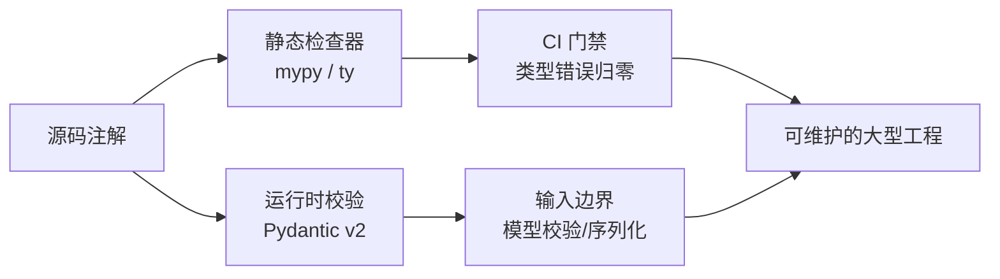

# Python-类型注解实战

> [!abstract] 摘要
> 类型注解让"注释式文档"变成"可执行契约"：静态期靠 mypy/ty 抓 bug，运行期靠 Pydantic 做数据校验（FastAPI 的地基）。学完本篇能掌握从基础注解到 PEP 695 新泛型的完整语法，用 Protocol 解耦依赖，落地 Pydantic v2 校验，并对无类型老代码实施渐进式注解改造。

## 一、概念与原理

Python 注解（PEP 484 起）是**静态期约定**：解释器默认不校验（3.14 延迟求值后更是零运行时开销，PEP 649/749），真正发挥作用靠两类工具——**静态检查器**（mypy/ty/pyright，写码与 CI 时抓类型错误）与**运行时校验器**（Pydantic，把注解变成数据契约）。

| 层次 | 工具 | 时机 | 典型产出 |
|------|------|------|---------|
| 语法层 | PEP 695 新泛型（3.12+） | 编写时 | `def f[T](x: list[T]) -> T` |
| 静态检查 | mypy / ty / pyright | 保存/CI 时 | 类型错误清单 |
| 运行时校验 | Pydantic v2 | 请求/输入边界 | `ValidationError`（见 [[Python-上下文管理器与异常处理]]） |



学习策略：先让**公共 API 与数据模型**带注解（收益最高），再向内部函数扩散；检查器从严到松逐级加码，而不是一上来 `strict = true`。

## 二、核心语法 / API 详解

### 2.1 基础注解与联合类型

```python
def greet(name: str, times: int = 1) -> str:
    return f"Hi {name}! " * times

# 3.10+ 用 | 替代 Union；Optional[int] 就是 int | None 的旧写法
def find(key: str, default: int | None = None) -> int | None:
    ...

# 容器类型直接用内建泛型（3.9+，无需 from typing import List/Dict）
counts: dict[str, list[int]] = {"a": [1, 2]}
```

### 2.2 常用特殊类型速查

```python
from typing import Any, Literal, TypedDict, Annotated, Final, Protocol

def set_level(level: Literal["debug", "info", "error"]) -> None: ...  # 枚举字面量

class User(TypedDict):                     # 描述"鸭子形状"的 JSON/dict
    name: str
    age: int

# Annotated：给类型附加元数据（Pydantic 用它做约束，FastAPI 用它做文档）
from pydantic import Field
Age = Annotated[int, Field(ge=0, le=150)]

MAX: Final = 100                           # 常量声明，重赋值会被检查器报错
```

### 2.3 PEP 695 泛型（3.12+）与 Protocol

```python
# 旧写法：T = TypeVar("T")；3.12+ 直接在方括号里声明类型参数
def first[T](items: list[T]) -> T:
    return items[0]

type Vector = list[float]                  # type 语句定义别名（惰性求值）
type Matrix[T] = list[list[T]]             # 泛型别名

class Stack[T]:
    def __init__(self) -> None:
        self._items: list[T] = []
    def push(self, item: T) -> None: self._items.append(item)
    def pop(self) -> T: return self._items.pop()

# Protocol：结构化子类型——"长得像就行"，不需要显式继承（鸭子类型的静态化）
from typing import Protocol, runtime_checkable

@runtime_checkable
class Drawable(Protocol):
    def draw(self) -> str: ...

def render(obj: Drawable) -> str:          # 任何有 draw() -> str 的对象都满足
    return obj.draw()
```

> [!tip] Protocol 是解耦利器
> 业务代码依赖 `Drawable` 协议而非具体类，测试时随便造一个鸭子对象即可通过静态检查，无需继承框架基类。这是把"依赖倒置"写进类型系统的 Python 方式。

### 2.4 Pydantic v2 数据校验实战

```python
# pip install "pydantic>=2.9"
from pydantic import BaseModel, Field, ValidationError, ConfigDict

class Address(BaseModel):
    city: str
    zipcode: str = Field(pattern=r"^\d{6}$")        # 正则约束（v2 用 pattern）

class User(BaseModel):
    model_config = ConfigDict(frozen=True,          # 不可变；validate_assignment=True 可校验赋值
                              strict=False)         # strict=True 关闭自动类型转换
    name: str = Field(min_length=1, max_length=50)
    age: int = Field(ge=0, le=150)
    address: Address                                 # 嵌套模型递归校验
    tags: list[str] = []                             # Pydantic 会深拷贝默认值，可变默认安全

u = User.model_validate({"name": "陶伟东", "age": 30, "address": {"city": "杭州", "zipcode": "310000"}})
u.age                       # 30
u.model_dump(mode="json")   # 嵌套 dict（mode="json" 确保全部为 JSON 兼容类型）
u.model_dump_json()         # JSON 字符串，核心字段用 Rust 序列化，比 v1 快数倍

try:
    User.model_validate_json('{"name": "", "age": -1, "address": {"city": "X", "zipcode": "abc"}}')
except ValidationError as e:
    for err in e.errors():      # 一次收集所有错误，适合直接返回给前端
        print(err["loc"], err["type"], err["msg"])
        # ('address', 'zipcode') string_pattern_mismatch String should match pattern ...
        # ('age',) greater_than_equal Input should be greater than or equal to 0
```

v2 要点：`model_validate`（dict/对象）、`model_validate_json`（原始 JSON 更快）、`model_dump`/`model_dump_json` 序列化；`ValidationError.errors()` 每项含 `loc`（位置元组）、`type`（错误码）、`msg`。

### 2.5 mypy 与 ty 检查实操

```bash
# 安装与运行（二选一或并存）
uvx mypy src/                       # mypy：最成熟，插件生态丰富，适合 CI 门禁
uvx ty check src/                   # ty：Astral 出品，2025-12 进入 beta（Rust 实现，
                                    #      无缓存比 mypy/pyright 快 10-60 倍，2026 年目标 1.0）

mypy --strict src/                  # 最严模式逐步放开
mypy --ignore-missing-imports .     # 无 stub 的三方库先放行
mypy file.py --follow-imports=silent
```

`pyproject.toml` 配置（与 [[Python-工程化与现代工具链]] 的模板一致）：

```toml
[tool.mypy]
python_version = "3.12"
files = ["src"]
check_untyped_defs = true       # 渐进式第一步：检查无注解函数体
warn_unused_ignores = true
warn_redundant_casts = true
no_implicit_optional = true

[[tool.mypy.overrides]]         # 按模块放宽（存量库过渡期常用）
module = ["legacy.*"]
ignore_errors = true
```

## 三、实战案例

**渐进式改造无类型老代码**（Python 3.12+，依赖 `pydantic>=2.9`）：一个典型的"接口层 + 业务层"模块，展示从无类型到强类型的完整落地。

```python
"""order_service.py — 类型注解驱动的小型订单服务"""
from dataclasses import dataclass
from pydantic import BaseModel, Field, ValidationError

# ---- 数据模型层：Pydantic 负责输入边界校验 ----
class OrderIn(BaseModel):
    sku: str = Field(min_length=3)
    qty: int = Field(gt=0, le=1000)
    price_cent: int = Field(ge=0)          # 金额用整数分，避免浮点误差

# ---- 内部领域对象：dataclass + 手写注解 ----
@dataclass
class Order:
    sku: str
    qty: int
    total_cent: int

# ---- 业务层：完整类型链，静态检查器可全程追踪 ----
DISCOUNTS: dict[int, float] = {100: 0.9, 500: 0.8}

def discount_rate(qty: int) -> float:
    """数量越大折扣越低（3.12+ 泛型展示：T 用于通用容器函数）"""
    rate = 1.0
    for threshold in sorted(DISCOUNTS, reverse=True):
        if qty >= threshold:
            rate = DISCOUNTS[threshold]
            break
    return rate

def place_order(payload: dict) -> tuple[Order | None, list[str]]:
    """返回 (订单, 错误列表)——错误收集式校验，适合表单场景"""
    try:
        data = OrderIn.model_validate(payload)
    except ValidationError as e:
        return None, [f"{'.'.join(map(str, err['loc']))}: {err['msg']}" for err in e.errors()]
    rate = discount_rate(data.qty)
    order = Order(sku=data.sku, qty=data.qty,
                  total_cent=int(data.price_cent * data.qty * rate))
    return order, []

if __name__ == "__main__":
    ok, errs = place_order({"sku": "BOOK-01", "qty": 120, "price_cent": 2990})
    print(ok, errs)        # Order(sku='BOOK-01', qty=120, total_cent=322920) []
    bad, errs = place_order({"sku": "B", "qty": -1})
    print(bad, errs)       # None ['sku: String should have at least 3 characters', ...]

    # 类型系统的静态价值：把 str 传给 qty 会被检查器报错（运行时反而被 Pydantic 转换）
    reveal_type(discount_rate)   # mypy 下显示 def (qty: int) -> float
```

运行：`uv run order_service.py`；检查：`uvx mypy --strict order_service.py` 应零错误。

## 四、动手练习

1. **热身**：给 `def calc(a, b, op): return a + b if op == "+" else a - b` 加注解，`op` 用 `Literal["+", "-"]`。提示：参数 `a, b` 是 `int | float` 时返回值怎么标最准确？
2. **基础**：用 `TypedDict` 定义 `Movie(title, year, tags)`，写函数 `newest(movies: list[Movie]) -> Movie | None`。提示：`max` 带 `key=`，空列表返回 `None`。
3. **进阶**：把 2.3 的 `Stack[T]` 改成支持 `peek()` 与 `__len__`，并用 `type` 语句定义 `type NameStack = Stack[str]`。提示：`__len__ -> int`；确认 `uvx mypy` 通过。
4. **挑战（老代码渐进加类型）**：下面是三段无类型老代码，逐步加注解直到 `mypy --strict` 零错误：① `def slugify(s): return "-".join(s.lower().split())`；② `def merge(d1, d2): out = dict(d1); out.update(d2); return out`；③ 一个 `process(records)` 函数，内部把 dict 列表转成 2.4 节的 `User` 模型并返回 `list[User]`，但输入可能是坏数据——要求错误处理路径也通过 `--strict`（`User | None`、异常分支全覆盖）。
   提示：① `str -> str`；② 参数用 `Mapping[str, V]` 泛型 `[V]`，返回 `dict[str, V]`；③ 捕获 `ValidationError` 后返回 `None` 或收集错误，让所有分支的返回类型一致。

> [!success]- 练习 4 参考答案要点
> ① `def slugify(s: str) -> str:` ——最小改动即通过 strict；② 用 `def merge[V](d1: Mapping[str, V], d2: Mapping[str, V]) -> dict[str, V]:`（PEP 695 泛型 + `collections.abc.Mapping` 接受任何只读映射），`dict(d1)` 已返回 `dict[str, V]`；③ 关键是**收窄输入**：`def process(records: list[dict[str, object]]) -> list[User]:`，循环里 `try: users.append(User.model_validate(r)) except ValidationError: errors.append(...)`（或跳过），保证每个分支都返回/收集一致类型——strict 模式下 `dict[str, object]` 里的值类型是 `object`，Pydantic 校验器天然兜住，这是"静态注解管函数签名、运行时校验管数据内容"的双层防线。验收命令：`uvx mypy --strict solution.py` 输出 `Success: no issues found`。工具链细节见 [[Python-工程化与现代工具链]]（ty 与 ruff 配置同仓库管理）。

## 五、常见坑与 FAQ

> [!warning] 注解 ≠ 校验：别指望运行时自动拦截
> `def f(x: int)` 收到 `"abc"` 照样不报错——注解默认只是元数据。需要运行时拦截就必须上 Pydantic / typeguard，或在函数入口显式断言。反之 Pydantic 的宽松转换（`"123"` → `123`）也常造成惊喜，敏感接口配 `strict=True` 或精确的 `Field` 约束。

> [!warning] 前向引用与旧版本兼容
> 3.14 前，类内方法互相引用对方类型、或注解引用"还没定义"的类时必须写成字符串：`def clone(self) -> "Node":`。3.14 起注解延迟求值（PEP 649/749）才真正免除引号。维护 3.12/3.13 代码时不要照抄 3.14 的写法。

> [!tip] Any 是类型系统的逃生舱，用多了等于没检查
> `Any` 会关闭该值的一切检查并"传染"给下游。过渡期优先用 `object`（保留部分检查）或泛型；确实无类型的三方库用 `[[tool.mypy.overrides]]` 按模块放行，而不是全局函数打 `# type: ignore`。`ignore` 要配 `warn_unused_ignores = true` 防止过期残留。

> [!tip] Protocol 与 ABC 怎么选
> 只关心"有没有这些方法"（鸭子形状）用 `Protocol`；需要**运行时注册表、共享实现、isinstance 强约束**才用抽象基类。`@runtime_checkable` 的 Protocol 只能检查方法是否存在，不检查签名/属性类型——真正的类型校验仍要靠静态检查器。

## 六、自检清单

- [ ] 能说出注解的两个消费方（静态检查器 / 运行时校验器）及各自代表工具
- [ ] 熟练使用 `int | None`、`Literal`、`TypedDict`、`Annotated`、`Final`
- [ ] 会写 PEP 695 泛型函数与 `type` 别名语句（3.12+）
- [ ] 能解释 Protocol 结构化子类型与继承式 ABC 的取舍
- [ ] 落地过 Pydantic v2：模型嵌套、`Field` 约束、`model_dump_json`、`errors()` 错误收集
- [ ] 会跑 `uvx mypy --strict` 并配置 `pyproject.toml` 的渐进规则
- [ ] 知道 ty 当前是 beta（2025-12 起）及它与 mypy 的定位差异
- [ ] 能对一段无类型老代码制定"签名 → 分支 → strict"的三步改造计划

## 七、关联笔记与参考

**关联笔记**：[[Python-高级特性]]（母篇：PEP 695/Protocol/Pydantic 速览）、[[Python-工程化与现代工具链]]（mypy/ty/ruff 的 CI 门禁配置）、[[Python-上下文管理器与异常处理]]（`ValidationError` 的结构化错误设计）、[[Python-装饰器详解]]（`ParamSpec` 给装饰器注类型）、[[Python-从入门到精通路线]]（类型注解属阶段三）。

**参考资料**：

1. [typing — 官方文档](https://docs.python.org/3/library/typing.html)
2. [PEP 695 — Type Parameter Syntax（Python 3.12）](https://peps.python.org/pep-0695/)
3. [Pydantic v2 官方文档 — Models](https://docs.pydantic.dev/latest/concepts/models/)
4. [mypy 官方文档](https://mypy.readthedocs.io/en/stable/)
5. [ty — Astral 类型检查器（beta 公告）](https://astral.sh/blog/ty)
6. [PEP 649 — Deferred Evaluation of Annotations（Python 3.14）](https://peps.python.org/pep-0649/)
