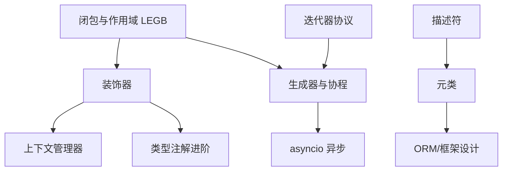

# Python-高级特性

## 概述

Python 的高级特性是区分"会写 Python"与"写好 Python"的分水岭。装饰器、生成器、上下文管理器、描述符、元类等机制构成了 Python 元编程与抽象能力的核心，也是 [[Python学习]] 进阶阶段的必修内容。本文系统梳理这些特性的原理与工程用法，并给出在 2025-2026 版本（3.12/3.13/3.14）下的最新实践。

> [!tip] 学习建议
> 高级特性不要孤立学习：装饰器依赖闭包，生成器是迭代器协议的语法糖，描述符是 `@property`、`classmethod` 的底层机制。按"闭包 → 装饰器 → 迭代器/生成器 → 上下文管理器 → 描述符 → 元类"的依赖顺序学习，事半功倍。

## 核心知识体系



## 闭包与作用域（LEGB）

Python 按 **L**ocal → **E**nclosing → **G**lobal → **B**uilt-in 顺序查找名字。内层函数引用外层变量形成闭包，需用 `nonlocal` 改写外层变量：

```python
def counter():
    count = 0
    def inc():
        nonlocal count      # 声明改写外层作用域变量
        count += 1
        return count
    return inc

c = counter()
c(), c(), c()  # 1, 2, 3 —— inc 捕获了 count 的引用而非副本
```

> [!warning] 闭包的 late binding（迟绑定）
> 闭包捕获的是**变量本身**，不是捕获时的值。循环里创建闭包是经典陷阱：
>
> ```python
> funcs = [lambda: i for i in range(3)]
> [f() for f in funcs]  # [2, 2, 2]，而非 [0, 1, 2]
>
> # 正确做法：用默认参数在定义时固化
> funcs = [lambda i=i: i for i in range(3)]
> [f() for f in funcs]  # [0, 1, 2]
> ```

## 装饰器

装饰器本质是"接收函数、返回新函数"的高阶函数，利用了 Python 函数是一等对象这一特性。

### 基础装饰器与 functools.wraps

```python
import functools
import time

def timer(func):
    @functools.wraps(func)          # 保留原函数的 __name__、__doc__ 等元信息
    def wrapper(*args, **kwargs):
        start = time.perf_counter()
        result = func(*args, **kwargs)
        cost = time.perf_counter() - start
        print(f"{func.__name__} 耗时 {cost:.4f}s")
        return result
    return wrapper

@timer
def fetch_data(n: int) -> list[int]:
    return list(range(n))

fetch_data(1000)   # fetch_data 耗时 0.0001s
print(fetch_data.__name__)  # fetch_data（不用 wraps 会变成 wrapper）
```

### 带参数的装饰器（三层嵌套）

```python
def retry(times: int = 3, delay: float = 0.5):
    """装饰器工厂：先接收参数，再返回真正的装饰器"""
    def decorator(func):
        @functools.wraps(func)
        def wrapper(*args, **kwargs):
            for attempt in range(1, times + 1):
                try:
                    return func(*args, **kwargs)
                except Exception as e:
                    if attempt == times:
                        raise
                    print(f"第 {attempt} 次失败: {e}，{delay}s 后重试")
                    time.sleep(delay)
        return wrapper
    return decorator
```

### 类装饰器与方法装饰器

```python
class CountCalls:
    """用类实现装饰器：__call__ 让实例可调用"""
    def __init__(self, func):
        functools.update_wrapper(self, func)
        self.func, self.count = func, 0
    def __call__(self, *args, **kwargs):
        self.count += 1
        print(f"调用 #{self.count}")
        return self.func(*args, **kwargs)
```

常用内置/标准库装饰器：`@property`、`@staticmethod`、`@classmethod`、`functools.cache`（3.9+，替代手写 memoize）、`functools.lru_cache`、`contextlib.contextmanager`、3.12 新增的 `typing.override`（PEP 698）。

## 迭代器协议与生成器

### 迭代器协议

可迭代对象实现 `__iter__()` 返回迭代器；迭代器实现 `__next__()`（耗尽时抛 `StopIteration`）。`for` 循环、解包、推导式的底层都是先调 `iter()` 再反复调 `next()`。手写迭代器类繁琐，下一节的生成器就是该协议的语法糖（解释器自动帮我们实现 `__iter__`/`__next__`）。

### 生成器：yield 是"暂停点"

生成器函数包含 `yield`，调用时**不执行函数体**，返回生成器对象；每次 `next()` 从上次暂停处恢复执行。

```python
def fibonacci():
    a, b = 0, 1
    while True:
        yield a             # 暂停并产出值
        a, b = b, a + b

fib = fibonacci()          # 调用时函数体不执行，返回生成器对象
[next(fib) for _ in range(8)]  # [0, 1, 1, 2, 3, 5, 8, 13]
```

生成器的核心价值：**惰性求值**，处理大数据流不占内存：

```python
# 读取 10GB 日志文件，内存占用恒定
def parse_large_log(path):
    with open(path, encoding="utf-8") as f:
        for line in f:
            if "ERROR" in line:
                yield line.strip()
```

### 生成器协程：send() 与 yield from

`yield` 可以双向通信，这是 asyncio 协程的历史雏形：

```python
def averager():
    total, count = 0.0, 0
    while True:
        value = yield total / count if count else None   # 接收 send 传入的值
        total += value
        count += 1

avg = averager()
next(avg)               # 预激（prime），推进到第一个 yield
avg.send(10)            # 10.0
avg.send(20)            # 15.0
```

> [!tip] 现代写法
> 日常开发中，基于生成器的手工协程已被 `async/await` 取代（协程本质仍是基于生成器的暂停/恢复机制）。生成器如今最常用在：惰性管道、无限序列、`yield` 做上下文分割（如 pytest 的 fixture）。大型数据管道可配合 `itertools` 链式处理。

## 上下文管理器

`with` 语句保证资源确定性释放，底层协议是 `__enter__` / `__exit__`：

```python
class Timer:
    def __enter__(self):
        self.start = time.perf_counter()
        return self                      # 返回值赋给 as 变量
    def __exit__(self, exc_type, exc_val, exc_tb):
        print(f"耗时 {time.perf_counter() - self.start:.3f}s")
        return False                     # False=异常继续抛出；True=吞掉异常

with Timer():
    sum(range(10_000_000))
```

用 `contextlib` 可以把生成器函数变成上下文管理器，绝大多数场景更简洁：

```python
from contextlib import contextmanager

@contextmanager
def temp_config(obj, **overrides):
    saved = {k: getattr(obj, k) for k in overrides}
    for k, v in overrides.items(): setattr(obj, k, v)
    try:
        yield                            # with 体内执行到这里
    finally:
        for k, v in saved.items():       # 无论是否异常都恢复
            setattr(obj, k, v)
```

其他实用工具：`contextlib.ExitStack`（动态管理不定数量的上下文）、`contextlib.suppress(FileNotFoundError)`（忽略特定异常）、`contextlib.AsyncExitStack`（异步版）。文件操作、锁、事务、连接池都应优先用 `with` 管理——工程上可参考 [[RESTful-API规范]] 中数据库事务边界的约定。

## *args / **kwargs 与结构化模式匹配

```python
def flexible(*args, **kwargs):
    print(args, kwargs)          # (1, 2) {'x': 3}

flexible(1, 2, x=3)

def log(level, *args, timestamp=None, **kwargs):
    ...                          # * 后面的参数强制用关键字传入
```

3.10 引入的 `match-case`（PEP 634）让 Python 有了结构化模式匹配，处理 JSON/消息时非常直观：

```python
def handle(event: dict) -> str:
    match event:
        case {"type": "click", "x": int(x), "y": int(y)}:
            return f"点击 ({x}, {y})"
        case {"type": "key", "key": "Enter" | "Escape" as k}:
            return f"按键 {k}"                 # | 表示或模式
        case {"type": t, **rest}:
            return f"未知事件 {t}: {rest}"      # **rest 收集剩余字段
        case _:
            return "无效"
```

## 类型注解进阶

### PEP 695 新泛型语法（3.12+）

```python
# 3.12 之前：T = TypeVar("T")
# 3.12+：直接在方括号里声明类型参数
def first[T](items: list[T]) -> T:
    return items[0]

type Vector = list[float]              # type 语句定义类型别名（惰性求值）
type Matrix[T] = list[list[T]]         # 泛型别名

class Stack[T]:
    def __init__(self) -> None:
        self._items: list[T] = []
    def push(self, item: T) -> None: self._items.append(item)
    def pop(self) -> T: return self._items.pop()
```

### Protocol：结构化子类型（鸭子类型的静态化）

```python
from typing import Protocol, runtime_checkable

@runtime_checkable
class Drawable(Protocol):
    def draw(self) -> str: ...

def render(obj: Drawable) -> str:   # 不需要显式继承，有 draw 方法即可
    return obj.draw()
```

### Pydantic：运行时数据校验

类型注解在运行时默认不生效，Pydantic 让注解成为真正的数据契约，是 FastAPI 的地基：

```python
from pydantic import BaseModel, Field

class User(BaseModel):
    name: str
    age: int = Field(ge=0, le=150)
    tags: list[str] = []

User.model_validate({"name": "陶伟东", "age": 30})   # 校验 + 解析
User.model_validate_json('{"name": "a", "age": -1}') # ValidationError: age
```

其他进阶点：`ParamSpec`（标注装饰器的参数透传）、`TypeVarTuple`（可变泛型）、3.13 的 `TypeIs`（比 `TypeGuard` 更直观的收窄）与 `ReadOnly[TypedDict]`、`@deprecated` 装饰器（PEP 702）、3.14 的**延迟注解求值**（PEP 649/749，前向引用不再需要引号包裹）。

## 描述符与元类简介

### 描述符：属性访问的底层机制

定义了 `__get__`/`__set__`/`__delete__` 的类就是描述符，`@property`、`classmethod`、ORM 字段的底层实现：

```python
class Positive:
    def __set_name__(self, owner, name):        # 自动拿到属性名（3.6+）
        self.name = name
    def __get__(self, obj, objtype=None):
        return obj.__dict__[self.name]
    def __set__(self, obj, value):
        if value <= 0:
            raise ValueError(f"{self.name} 必须为正数")
        obj.__dict__[self.name] = value

class Order:
    price = Positive(); qty = Positive()   # 赋值非法值时抛 ValueError
```

### 元类：类的类

类本身是 `type` 的实例，元类通过重写 `type.__new__`/`__init__` 控制类的创建过程：

```python
class AutoRegister(type):
    registry: dict[str, type] = {}
    def __new__(mcls, name, bases, ns, **kw):
        cls = super().__new__(mcls, name, bases, ns, **kw)
        mcls.registry[name.lower()] = cls       # 子类自动注册
        return cls

class Plugin(metaclass=AutoRegister): ...
class Encoder(Plugin): ...
AutoRegister.registry  # {'plugin': ..., 'encoder': ...}
```

> [!tip] 何时需要元类
> **99% 的场景不需要元类**。类校验、字段收集用 `__init_subclass__`（3.6+）更简单；属性控制用描述符；实例缓存用装饰器。元类真正的主战场是 ORM/序列化框架（如 SQLAlchemy、Pydantic v1）这类需要拦截"类定义"本身的库。推荐先读 isinstance 检查与 `__slots__` 等轻量手段，再考虑元类。

## GIL 与并发模型对比

GIL（全局解释器锁）保证同一时刻只有一个线程执行 Python 字节码，因此 threading **不是** CPU 密集任务的并行方案。2025-2026 年这一格局正在改变（见下文"最新动态"）。

| 模型 | 适用场景 | 原理 | 典型 API | 缺点 |
|------|---------|------|---------|------|
| threading | I/O 密集（网络/磁盘等待） | 多线程时间片轮转，GIL 保证字节码互斥 | `ThreadPoolExecutor` | GIL 下无 CPU 并行；存在竞态 |
| asyncio | 高并发 I/O（数千连接） | 单线程事件循环 + 协程协作式调度 | `async/await`、`gather` | 阻塞调用会拖垮整个循环；生态需异步库 |
| multiprocessing | CPU 密集（计算/图像） | 多进程各自持有解释器与 GIL | `ProcessPoolExecutor` | 进程启动/IPC 开销大；内存不共享 |
| free-threading | CPU 并行（3.13t/3.14t 构建） | 移除 GIL 的解释器构建，真并行 | 普通 threading 代码 | 需 `cp314t` 专用 wheel，生态约半数兼容 |
| 子解释器 | CPU 密集、需要隔离 | 每解释器独立 GIL（PEP 684） | 3.14 `concurrent.interpreters`（PEP 734） | C 扩展需适配 |

## 常见坑与最佳实践

> [!warning] 可变默认参数
> 默认参数在**函数定义时求值一次**，所有调用共享同一个对象：
>
> ```python
> def add_item(item, items=[]):        # 错误！多次调用共享同一 list
>     items.append(item)
>     return items
>
> def add_item(item, items=None):      # 正确写法
>     if items is None:
>         items = []
>     items.append(item)
>     return items
> ```

> [!warning] `is` 与 `==` 的区别
> `is` 比较对象身份（id），`==` 比较值。`x is None` 是正确用法；但小整数缓存（-5~256）与驻留字符串会让 `is` 偶然"正确"，掩盖 bug。旧式 union 类型比较用 `==` 而非 `is`（3.14 起 `typing.Union` 不再缓存）。

其他高频坑速查：

| 坑 | 说明 | 正确做法 |
|----|------|---------|
| 迭代时修改集合 | 遍历 dict/list 时增删元素抛 `RuntimeError` 或漏项 | 用 `list(d.items())` 拷贝后遍历 |
| `except:` 裸捕获 | 吞掉 `KeyboardInterrupt`/`SystemExit` | 至少写 `except Exception` |
| 默认用可变对象共享状态 | 类属性 `tags = []` 被所有实例共享 | 在 `__init__` 里创建实例属性 |
| `str` 拼接性能 | 循环内 `s += x` 是 O(n²) | 用 `''.join(parts)` |
| 忽略 `__exit__` 返回值 | 返回 `True` 会吞掉异常 | 默认返回 `False`/`None`，让异常传播 |

最佳实践：优先组合标准库原语（`functools`/`itertools`/`contextlib`），避免自造轮子；公共 API 必须带类型注解并跑类型检查器（见 [[Python-工程化与现代工具链]]）；深入语言机制可配合系统方向笔记 [[Go语言入门]] 对比两门语言的并发模型设计差异。

## 2025-2026 最新动态

以下特性直接影响高级特性的写法（版本与时间点已核对官方文档）：

| 时间点 | 版本/事件 | 关键变化 |
|--------|----------|---------|
| 2023-10 | Python 3.12 | PEP 695 泛型语法 `def f[T]` 与 `type` 语句；PEP 698 `@override`；PEP 701 f-string 支持任意嵌套引号；推导式内联最高快 2 倍 |
| 2024-10 | Python 3.13 | 实验性 free-threaded 构建（PEP 703，`python3.13t`）；实验性 JIT（PEP 744）；PEP 667 `locals()` 语义修正；`TypeIs`、`ReadOnly`、`@deprecated`；移除 19 个 dead batteries 模块 |
| 2025-10-07 | Python 3.14 | free-threading **正式受支持**（PEP 779），单线程损耗降至约 5-10%；t-string 模板字符串（PEP 750）；延迟注解求值（PEP 649/749）；子解释器模块 `concurrent.interpreters`（PEP 734）；`except A, B` 无括号写法（PEP 758）；Unix 多进程默认启动方式改为 `forkserver` |
| 2025-2026 | 生态 | free-threaded 生态兼容约 51%（numpy 2.1+/scipy 1.15+/pandas 2.2.3+ 提供 cp314t wheel）；PyTorch 免 GIL wheel 收敛到 3.14t |

## 参考资料

1. [What's New in Python 3.14 — Python 官方文档](https://docs.python.org/3.14/whatsnew/3.14.html)（发布于 2025-10-07）
2. [What's New in Python 3.13 — Python 官方文档](https://docs.python.org/3.13/whatsnew/3.13.html)
3. [What's New in Python 3.12 — Python 官方文档](https://docs.python.org/3.12/whatsnew/3.12.html)
4. [Free-threaded CPython 官方指南（no-GIL howto）](https://docs.python.org/3/howto/free-threading-python.html)
5. [Free-Threading 兼容性追踪（py-free-threading.github.io）](https://py-free-threading.github.io/tracking)
6. [The Register: Python 3.14 released with cautious free-threaded support](https://www.theregister.com/software/2025/10/08/python-314-released-with-cautious-free-threaded-support/349336)
7. [Stack Overflow: multiprocessing vs multithreading vs asyncio](https://stackoverflow.com/questions/27435284/multiprocessing-vs-multithreading-vs-asyncio)
