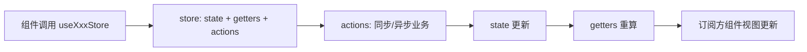

# Vue3-Pinia状态管理实战

> [!abstract] 摘要
> Pinia 是 Vue 官方指定的状态管理库（Vuex 4 已维护模式），API 更简、TS 推导完整、天然支持组合式 API。本文给出"什么状态该进 store"的判断清单、Option/Setup 两种 store 写法对比、state/getters/actions 与 storeToRefs 的正确用法、持久化插件配置，以及"用户认证 + 购物车"两个 store 完整联动案例。

## 一、概念与原理

### 1.1 什么状态需要进 store（判断清单）

| 数据特征 | 归属 | 例子 |
|----------|------|------|
| 跨路由、跨组件树共享且多处读写 | **Pinia store** | 登录态、购物车、主题、权限字典 |
| 仅父子/祖孙组件传递 | props / emit / provide-inject | 见 [[Vue3-组件设计模式]] |
| 逻辑要复用但状态各自独立 | composable | useMouse、useFetch，见 [[Vue3-组合式函数实战]] |
| 只在单个组件内部使用 | 组件本地 `ref` | 表单草稿、开关状态 |
| 全局只有一个实例、纯函数无状态 | 工具模块（`utils/`） | 日期格式化 |

原则：**"多个不相关的组件需要读写同一份数据"才进 store**，避免"上帝 store"。

### 1.2 Pinia 定位与数据流

对比 Vuex 4 的关键简化：无 mutation、无 modules 嵌套命名空间（平铺多 store）、TS 自动推导、DevTools 时间旅行。数据流如下：



## 二、核心语法 / API 详解

### 2.1 defineStore 两种写法对比

```ts
// 写法 A：Option Store（类 Options API，上手快）
import { defineStore } from 'pinia'

export const useCounterStore = defineStore('counter', {
  state: () => ({ count: 0 }),                    // 必须是函数，防跨请求污染
  getters: { double: (state) => state.count * 2 },
  actions: { increment() { this.count++ } },      // action 里用 this
})
```

```ts
// 写法 B：Setup Store（类组合式 API，官方推荐）
import { defineStore } from 'pinia'
import { ref, computed } from 'vue'

export const useCounterStore = defineStore('counter', () => {
  const count = ref(0)                            // ref→state
  const double = computed(() => count.value * 2)  // computed→getter
  function increment() { count.value++ }          // function→action
  return { count, double, increment }             // ⚠️ 必须 return 全部 state
})
```

| 维度 | Option Store | Setup Store |
|------|-------------|-------------|
| 对应关系 | state / getters / actions 三件套 | ref→state，computed→getter，function→action |
| `this` | actions 内可用 | 不存在，纯闭包变量 |
| 灵活性 | 固定结构 | 可调用任意 composable、可写 watcher |
| 约束 | state 必须工厂函数 | **必须 return 所有 state**，否则破坏 SSR / DevTools / 插件 |

### 2.2 state / getters / actions 与实例方法

```ts
const store = useCounterStore()

// state 可直改（DevTools 可见），但规范做法走 action，行为可追踪
store.count++

// $patch：批量更新，DevTools 只记一条历史，比逐字段赋值干净
store.$patch({ count: store.count + 1 })
store.$patch((state) => { state.count += 2 })

store.$reset()   // 恢复 state() 初始值（仅 Option Store 自带；Setup Store 需自己实现）

// $subscribe：订阅任何变化，可实现自定义持久化/同步
store.$subscribe((mutation, state) => localStorage.setItem('counter', JSON.stringify(state)))
```

### 2.3 storeToRefs：解构的正确姿势

store 是 reactive 包裹的对象，**直接解构 state/getter 会断开响应追踪**：

```ts
import { storeToRefs } from 'pinia'

const store = useCounterStore()
const { count, double } = storeToRefs(store)   // ✅ state/getter 转 ref
const { increment } = store                    // ✅ action 直接解构
```

### 2.4 store 互相调用

一个 store 的 getter / action 里直接调用另一个 `useXxxStore()` 即可（组件外调用要放在回调内，确保 pinia 已安装）：

```ts
const payable = computed(() => useAuthStore().user?.vip ? total.value * 0.9 : total.value)  // getter 里读
function logout() { useCartStore().clear() }   // action 里写另一个 store
```

### 2.5 持久化插件与 DevTools

```bash
npm i pinia-plugin-persistedstate
```

`main.ts` 中 `pinia.use(piniaPluginPersistedstate)` 注册插件后，store 上按需配置（默认 localStorage、key = store id）：

```ts
export const useCartStore = defineStore('cart', () => { /* ... */ }, {
  persist: { pick: ['items'], storage: localStorage },  // 可换 sessionStorage / cookie
})
```

DevTools 调试：Pinia 面板可查看/编辑 state、回放 action 时间线（时间旅行）、HMR 热更新 store 逻辑。

## 三、实战案例

> 环境：Vue 3.5+ / Vite 6+ / Pinia 3.x。**案例：用户认证 + 购物车两个 store 的完整实现与联动**。

```ts
// src/stores/auth.ts —— 认证 store（Setup 写法）
import { defineStore } from 'pinia'
import { ref, computed } from 'vue'
import { useCartStore } from './cart'

export const useAuthStore = defineStore('auth', () => {
  const token = ref('')               // state
  const user = ref(null)

  const isLoggedIn = computed(() => !!token.value)        // getters
  const displayName = computed(() => user.value?.nickname || '游客')
  async function login(username, password) {              // actions
    const res = await fetch('/api/login', {
      method: 'POST',
      headers: { 'Content-Type': 'application/json' },
      body: JSON.stringify({ username, password }),
    })
    if (!res.ok) throw new Error('登录失败：' + res.status)
    const data = await res.json()
    token.value = data.token
    user.value = data.user
  }

  function logout() {
    token.value = ''
    user.value = null
    useCartStore().clear()            // store 联动：退出登录清空购物车
  }

  async function restore() {          // 刷新页面后恢复会话
    token.value = localStorage.getItem('auth-token') || ''
    if (!token.value) return
    const res = await fetch('/api/me', { headers: { Authorization: `Bearer ${token.value}` } })
    if (res.ok) user.value = await res.json()
    else logout()
  }

  return { token, user, isLoggedIn, displayName, login, logout, restore }
})
```

```ts
// src/stores/cart.ts —— 购物车 store（Setup 写法 + 持久化）
import { defineStore } from 'pinia'
import { ref, computed } from 'vue'
import { useAuthStore } from './auth'

export const useCartStore = defineStore('cart', () => {
  const items = ref([])               // [{ id, name, price, qty }]

  const totalCount = computed(() => items.value.reduce((s, i) => s + i.qty, 0))
  const totalPrice = computed(() => items.value.reduce((s, i) => s + i.price * i.qty, 0))
  const payable = computed(() => {    // getter 里联动 auth store：会员 9 折
    const vip = useAuthStore().user?.vip
    return vip ? totalPrice.value * 0.9 : totalPrice.value
  })

  function add(product, qty = 1) {
    const found = items.value.find((i) => i.id === product.id)
    if (found) found.qty += qty
    else items.value.push({ ...product, qty })
  }
  function remove(id) { items.value = items.value.filter((i) => i.id !== id) }
  function clear() { items.value = [] }
  return { items, totalCount, totalPrice, payable, add, remove, clear }
}, {
  persist: { pick: ['items'] },       // 购物车持久化到 localStorage
})
```

```vue
<!-- src/views/Shop.vue —— 组件侧使用与联动 -->
<script setup>
import { onMounted } from 'vue'
import { storeToRefs } from 'pinia'
import { useAuthStore } from '@/stores/auth'
import { useCartStore } from '@/stores/cart'

const auth = useAuthStore()
const cart = useCartStore()

// state/getter 用 storeToRefs；action 直接解构
const { isLoggedIn, displayName } = storeToRefs(auth)
const { totalCount, totalPrice, payable } = storeToRefs(cart)
const { add, remove, clear } = cart

onMounted(() => auth.restore())     // 应用启动恢复会话

const products = [
  { id: 1, name: '机械键盘', price: 299 }, { id: 2, name: '显示器支架', price: 159 },
]
</script>

<template>
  <p v-if="!isLoggedIn"><button @click="auth.login('tao', '123456')">登录</button></p>
  <p v-else>欢迎，{{ displayName }} <button @click="auth.logout()">退出</button></p>

  <ul>
    <li v-for="p in products" :key="p.id">
      {{ p.name }} ￥{{ p.price }} <button @click="add(p)">加入购物车</button>
    </li>
  </ul>

  <footer v-if="totalCount > 0">
    共 {{ totalCount }} 件，合计 ￥{{ totalPrice }}，应付 ￥{{ payable }} <button @click="clear()">清空</button>
  </footer>
</template>
```

配套路由守卫（完整 Router 配置见 [[Vue3生态与工程化实践]]）：`router.beforeEach((to) => { const auth = useAuthStore(); if (to.meta.requiresAuth && !auth.isLoggedIn) return { path: '/login' } })`——注意 `useAuthStore()` 必须写在回调内部。

## 四、动手练习

1. **入门**：分别用 Option 与 Setup 两种写法实现同一个 `counter` store（含 count、double、increment），在组件里解构使用并验证响应式。提示：对照 2.1 逐行翻译。
2. **进阶**：给购物车加 `$subscribe`：任何变化都把 items 存入 sessionStorage，刷新后恢复。提示：启动时读取。
3. **进阶**：新建 `order` store，`checkout()` action 读取 cart 的 payable 生成订单并清空购物车。提示：action 内直接调用 `useCartStore()`。
4. **挑战**：在 Setup Store 里实现自定义 `$reset()`：把所有 ref 恢复初始值。提示：保存一份初始快照，`$reset` 里逐个 `.value = 快照`。
5. **挑战**：实现"401 统一登出"：auth 收到 401 时调用 logout 并 `router.push('/login')`。提示：store 里可 `import router`，或用 inject（Setup Store 支持）。

> [!success]- 练习 4 参考答案要点
> ```ts
> export const useCounterStore = defineStore('counter', () => {
>   const count = ref(0)
>   function $reset() { count.value = 0 }   // 多字段时保存初始快照逐个恢复
>   return { count, $reset }
> })
> ```
> 要点：① Setup Store 没有内置 `$reset`，官方文档明确说明需自行实现；② 多字段时把各 ref 初始值集中到一个快照对象；③ 嵌套对象恢复时注意引用替换。更稳妥方案：Option Store 自带 `$reset`，或提供 `reset()` 普通 action。

## 五、常见坑与 FAQ

> [!warning] 解构 store 不走 storeToRefs 会"静默失联"
> `const { count } = store` 之后 count 不再更新、不报错。规则记死：**state/getter 解构必用 `storeToRefs`，action 直接解构**。或者不解构，一直 `store.xxx` 访问。

> [!warning] Setup Store 少 return 一个 state 就是隐患
> 没 return 的 ref 不会被 DevTools 追踪、SSR 序列化会丢数据、插件（如持久化）也看不到它。写完 store 检查 return 列表与 state 一一对应。

> [!warning] 组件外过早调用 store 会崩
> `router/index.ts` 顶层执行 `useAuthStore()` 时 pinia 还没装上（`app.use(pinia)` 之前），报 "no active Pinia"。所有组件外调用都放进守卫/回调内部。

> [!tip] 一个业务域一个 store
> user / cart / order / ui 各自独立 store，互相调用通过 action/getter 内引用完成；不要做一个巨型 `app` store。批量更新用 `$patch` 合并为一次，DevTools 历史干净。

## 六、自检清单

- [ ] 能按"判断清单"说出哪些数据该进 store、哪些留在组件/composable
- [ ] 会用两种写法定义 store，并说出 ref/computed/function 与 state/getter/action 的对应关系
- [ ] 知道 Setup Store 必须 return 全部 state 的原因（SSR/DevTools/插件）
- [ ] 解构 store 时区分 storeToRefs 与直接解构的适用对象
- [ ] 能写出两个 store 在 getter 与 action 中互相调用的代码
- [ ] 配置过 pinia-plugin-persistedstate（pick / storage）；知道 $patch、$reset、$subscribe 的用途
- [ ] 路由守卫中使用 store 时把调用放进回调内

## 七、关联笔记与参考

**相关笔记**

- [[Vue3生态与工程化实践]] — Pinia 与 Router/Vite 全家桶工程配置
- [[Vue3-组合式函数实战]] — Setup Store 与 composable 共享同一套编写范式
- [[Vue3-响应式系统详解]] — storeToRefs 为何必要：reactive 解构丢响应的底层原因

**参考资料**

1. [Pinia 官方文档 — Core Concepts（defineStore 两种写法、storeToRefs）](https://pinia.vuejs.org/core-concepts/)，pinia.vuejs.org
2. [Pinia 官方文档 — State Management（官方设计理念）](https://vuejs.org/guide/scaling-up/state-management.html)，vuejs.org
3. [pinia-plugin-persistedstate 官方文档（pick/storage/serializer 配置）](https://prazdevs.github.io/pinia-plugin-persistedstate/)
4. [Pinia 官方文档 — 组合 Stores（cross-store 调用）](https://pinia.vuejs.org/cookbook/composing-stores.html)
