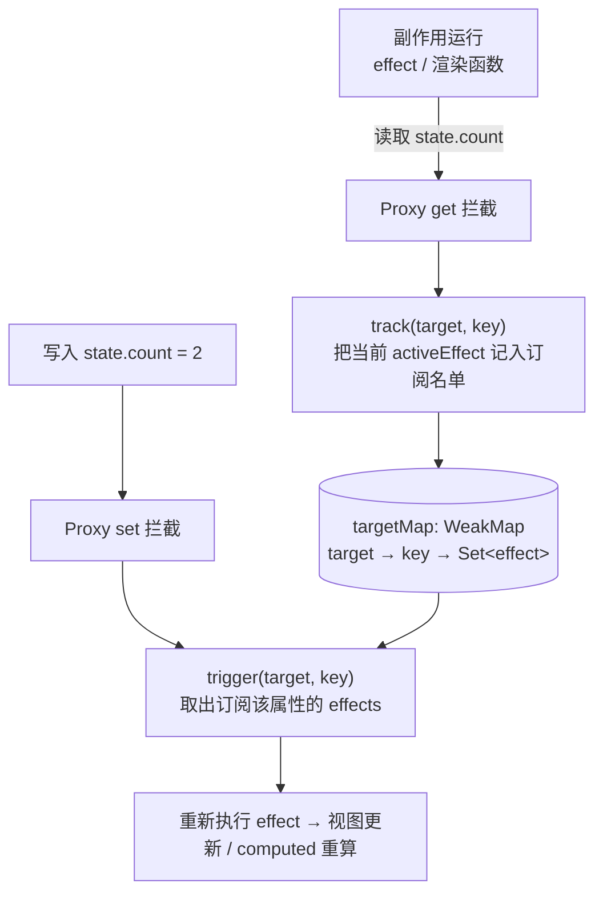

# Vue3-响应式系统详解

> [!abstract] 摘要
> 响应式系统是 Vue 的根基：它让"数据变了视图自动跟着变"成为可能，是理解 `ref`/`reactive`/`computed`/`watch` 行为差异的关键。本文从 Proxy 依赖收集与触发原理讲起，覆盖 ref 解包规则、工具 API（toRef/toRaw/shallowRef）的性能取舍、computed 缓存机制、watch 与 watchEffect 的选型，以及 Vue 3.5 的响应式升级，最后带你手写一个 mini reactive。

## 一、概念与原理

### 1.1 为什么需要响应式

没有响应式框架时，"数据变了"必须手写"改视图"：每个用到该数据的地方都要手动同步 DOM，耦合且易漏。响应式系统要解决的问题是：**当数据被读写时，自动追踪"谁用了它"，并在它变化时通知"用它的人"重新执行**。Vue 的模板渲染、`computed`、`watch` 全部构建在这套机制之上。

### 1.2 Vue 2 与 Vue 3 的实现差异

| 维度 | Vue 2（Object.defineProperty） | Vue 3（Proxy） |
|------|-------------------------------|----------------|
| 拦截方式 | 递归遍历，逐属性定义 getter/setter | 整个对象代理，get/set trap |
| 新增/删除属性 | 需要 `$set`/`$delete` | 原生支持（proxy 拦截） |
| 数组索引与 length | 拦截不到，需重写数组方法 | 原生支持 |
| Map/Set | 不支持 | 支持 |
| 性能 | 初始化即递归全部属性 | 访问到才懒代理（惰性） |

### 1.3 依赖收集与触发流程

核心数据结构是一个三级桶：**`WeakMap<target, Map<key, Set<effect>>>`**——哪个对象的哪个属性，被哪些副作用订阅。



三个关键角色：

1. **track（依赖收集）**：属性被读取时，若当前存在 `activeEffect`，把它加入该属性的订阅 Set。
2. **trigger（派发更新）**：属性被写入时，遍历订阅 Set，重新执行这些 effect。
3. **activeEffect**：副作用执行前把自己设为全局"当前 effect"，读取属性时才能被 track 收集到——这就是 `watchEffect` 能"自动追踪依赖"的原理。

> [!tip] ref 和 reactive 只是两种"拦截入口"
> `reactive` 用 Proxy 拦截对象的属性读写；`ref` 对对象值内部同样转成 reactive 代理，对原始值则靠 getter/setter 拦截 `.value` 的读写。最终都汇入同一套 track/trigger。

## 二、核心语法 / API 详解

### 2.1 ref 与 reactive 的基本行为

```js
import { ref, reactive } from 'vue'

// ref：包装任意值（含原始值），JS 中经 .value 读写并触发更新
const count = ref(0)
count.value++                       // set 拦截 → trigger

// reactive：仅接收对象类型，返回深度代理
const state = reactive({ user: { name: '陶伟东' }, tags: ['Vue'] })
state.user.name = 'weidong'         // 深层属性变更也能追踪（惰性代理）
```

### 2.2 ref 解包规则（最高频考点）

```js
import { ref, reactive } from 'vue'
const count = ref(0)
const state = reactive({ count, nested: { inner: ref(1) } })

// JS 中：reactive 对象内的 ref 读取时自动解包
console.log(state.count)            // 0，等价于 state.count.value
console.log(state.nested.inner)     // ⚠️ 不解包：嵌套对象内的属性仍是 ref

// 数组 / Map 等集合内的 ref 不解包；ref 嵌套 ref 自动扁平化
const arr = reactive([ref(0)])
arr[0].value                        // 必须手动 .value
```

```vue
<template>
  <p>{{ count }}</p>                <!-- 模板中：顶层 ref 自动解包 -->
  <p>{{ state.count }}</p>          <!-- 例外：最终求值结果 → 解包 -->
</template>
```

### 2.3 工具 API：toRef / toRefs / toRaw / shallowRef

```js
import { toRef, toRefs, toRaw, shallowRef, triggerRef, markRaw } from 'vue'

const state = reactive({ count: 0, user: { name: '陶' } })

// toRef：为 reactive 的单个属性建立"保持链接"的 ref（双向同步）
const countRef = toRef(state, 'count')
countRef.value++                    // state.count 同步变为 1

// toRefs：批量转换，解构 reactive 的标准姿势
const { count: c2, user } = toRefs(state)

// toRaw：拿回 Proxy 背后的原始对象；读它不触发依赖收集（跳过代理开销）
const raw = toRaw(state)
raw === state                       // false（代理与原对象身份不同）

// shallowRef：只有 .value 的替换是响应式的，内部值不做深度代理
const bigList = shallowRef([])      // 10 万条数据场景
bigList.value = [...bigList.value, newItem]   // ✅ 替换引用 → 触发
bigList.value.push(newItem)                   // ❌ 修改内容 → 不触发，需 triggerRef(bigList)

// markRaw：永不转换为代理（第三方类实例、图表实例等）
const chart = markRaw(new SomeHeavyChart())
```

### 2.4 computed：缓存派生值，不做副作用

```js
import { ref, computed } from 'vue'

const a = ref(1), b = ref(2)
const sum = computed(() => a.value + b.value)   // 依赖不变 → 直接返回缓存

// 可写 computed（把 v-model 透传给派生值）
const fullName = computed({
  get: () => `${last.value}${first.value}`,
  set: (v) => { last.value = v[0]; first.value = v.slice(1) },
})
```

三条铁律：**getter 必须纯**（改状态/发请求/操作 DOM 是 `watch`/`watchEffect` 的职责）；**有缓存**（依赖未变多次访问只算一次，method 每次渲染都重跑）；Vue 3.4+ 起值未变化不再触发下游副作用，但 getter 每次返回**新对象**会让值比较失效，可先完整计算再与旧值比较、不变就返回旧对象。

### 2.5 watch 与 watchEffect 差异对比

| 维度 | `watch(source, cb)` | `watchEffect(fn)` |
|------|--------------------|-------------------|
| 依赖声明 | 显式指定源（ref/reactive/getter/数组） | 回调内自动追踪 |
| 旧值 | 回调第二参数可拿 `(val, oldVal)` | 拿不到 |
| 执行时机 | 默认懒执行（`immediate: true` 可改） | 创建时立即执行一次 |
| 多个源 | 支持数组 `watch([a, b], ([na, nb]) => {})` | 天然支持 |
| 返回值 | 停止函数 | 停止函数 |

```js
import { ref, watch, watchEffect, onWatcherCleanup } from 'vue'

const id = ref(1)
// watch：显式源 + 旧值；Vue 3.5+ 的 deep 支持数值控制监听深度
watch(id, (val, old) => console.log(old, '->', val))

// watchEffect + onWatcherCleanup（3.5+）：自动清理上一次的副作用
watchEffect(() => {
  const controller = new AbortController()
  fetch(`/api/todos/${id.value}`, { signal: controller.signal })
  onWatcherCleanup(() => controller.abort())   // id 再变 / 停止监听时中止旧请求
})

// watch 整个 reactive 对象默认隐式深度监听；精确监听用 getter 指向属性：watch(() => state.user.name, cb)
```

### 2.6 Vue 3.5 响应式 Props 解构与内存优化

```vue
<script setup lang="ts">
// 3.5+ 稳定：解构出的变量由编译器转为 props.xxx，随 props 更新保持响应式
const { msg = 'hello', id = 0 } = defineProps<{ msg?: string; id?: number }>()
// 默认值用原生 JS 语法，不再需要 withDefaults

// 注意：解构变量作为"值"传出去会丢响应性，要传 getter
watch(() => id, (v) => console.log(v))    // ✅ getter 包装（❌ watch(id, ...) 是值快照）
</script>
```

Vue 3.5 同时重构了响应式内核（版本计数 + 双向链表结构），官方数据：**大数组与深层依赖场景内存占用降低约 56%**，行为不变、无需改代码。

## 三、实战案例

> 环境：Vue 3.5+ / Vite 6+，纯 JS 可运行。**案例：手写一个 mini reactive（简化版完整代码）**——真实版还需处理嵌套对象懒代理、数组方法、依赖清理、调度器等（见官方源码 @vue/reactivity）。

```js
// src/reactivity/mini-reactive.js —— 教学用简化实现

let activeEffect = null
const targetMap = new WeakMap()   // WeakMap<target, Map<key, Set<effect>>>

// 1) 依赖收集：读取属性时，把当前 effect 记入该属性的订阅名单
function track(target, key) {
  if (!activeEffect) return       // 不在 effect 中读取（如事件回调里）→ 不收集
  let depsMap = targetMap.get(target)
  if (!depsMap) targetMap.set(target, (depsMap = new Map()))
  let deps = depsMap.get(key)
  if (!deps) depsMap.set(key, (deps = new Set()))
  deps.add(activeEffect)
}

// 2) 派发更新：写入属性时，重跑所有订阅者
function trigger(target, key) {
  const deps = targetMap.get(target)?.get(key)
  if (deps) [...deps].forEach((effect) => effect())
}

// 3) 副作用包装：运行前把自己设为 activeEffect，内部读取才会被 track
function effect(fn) {
  const runner = () => {
    activeEffect = runner
    fn()                          // fn 内读取响应式数据 → 自动收集 runner
    activeEffect = null
  }
  runner()                        // 首次立即执行（同 watchEffect 行为）
  return runner
}

// 4) reactive：Proxy 拦截读写
export function reactive(obj) {
  return new Proxy(obj, {
    get(target, key) {
      track(target, key)
      return Reflect.get(target, key)
    },
    set(target, key, value) {
      const old = Reflect.get(target, key)
      const ok = Reflect.set(target, key, value)
      if (old !== value) trigger(target, key)   // 值真的变了才派发
      return ok
    },
  })
}

// 5) ref：原始值靠 getter/setter 拦截 .value（对象值真实实现会内部转 reactive）
export function ref(value) {
  return {
    get value() {
      track(value, 'value')
      return value
    },
    set value(newVal) {
      if (newVal === value) return
      value = newVal
      trigger(value, 'value')
    },
  }
}

// 6) watchEffect = effect 的官方包装：export function watchEffect(fn) { return effect(fn) }
```

用法与官方一致：`watchEffect(() => console.log(state.count, msg.value))` 会**立即打印一次**，此后 `state.count = 1` 或 `msg.value = 'hi'` 任一变化都会重新执行并打印新值——这正是 1.3 流程图的可运行版本。

## 四、动手练习

1. **入门**：用 `reactive` 定义一个包含嵌套对象与数组的 state，逐一验证"新增属性、删除属性、`arr[0] = x`、`arr.length = 0`"都会触发视图更新（对照 Vue 2 的 `$set` 痛点）。提示：模板里渲染每个操作的结果。
2. **进阶**：把 `const { count } = reactive({ count: 0 })` 解构出的 `count` 传给 `watch`，观察它为何不触发；再用 `toRefs` 修复。提示：解构后 `count` 是普通数字，不在 Proxy 上。
3. **进阶**：用 `shallowRef` 重构一个渲染 1 万条数据的列表页，把"插入一条数据"从深度代理改为整体替换引用（`value = [...old, item]`），用 Vue DevTools 对比更新耗时。提示：见 [[Vue3-性能优化实战]]。
4. **挑战**：在本文 mini reactive 基础上，给 `track` 增加"依赖清理"：effect 重跑时先移除旧的订阅（提示：`effect` 重跑前 `deps.delete(runner)`，防止分支切换后残留无效依赖）。
5. **挑战**：给 mini reactive 加一个 `computed(fn)`：缓存上次结果，仅当依赖变化时重算。提示：内部用一个 dirty 标志 + 在 effect 里对比新旧值。

> [!success]- 练习 5 参考答案要点
> 真实实现的思路：内部用"懒执行的 effect + 脏标记缓存"——effect 执行 getter 后 `dirty = false`；trigger 时置 `dirty = true`；`value` 被读取时若 dirty 才重算，否则返回缓存。核心考察点：能讲清"依赖变化 → 置脏 → 下次读取才重算"的失效链路即可，允许实现不完美。

## 五、常见坑与 FAQ

> [!warning] reactive 解构与整体替换都会"断线"
> `let { name } = state` 拿到的是普通值；`state = reactive({...})` 换了对象引用，旧订阅全部失效。解构用 `toRefs(state)`；需要"整体换数据"请改用 `ref`（`state.value = newObj`）。

> [!warning] shallowRef 改内部不触发，忘加 triggerRef 是静默 bug
> `bigList.value.push(x)` 不触发更新也不报错。要么整体替换引用（推荐，配合不可变更新），要么修改后手动 `triggerRef(bigList)`。

> [!warning] 3.5 响应式 props 解构后，传给 watch 要用 getter
> `watch(id, ...)` 传入的是值的快照，编译器会警告。永远写 `watch(() => id, ...)`，或把 getter 传给接收 ref/getter 输入的 composable（配合 `toValue`）。

> [!tip] 判断"该用哪个 API"的最小心智模型
> 默认用 `ref`（统一、可整体替换、解构安全）；确需深层自动响应且不整体替换用 `reactive`；大数据集/外部状态用 `shallowRef`；派生只读状态用 `computed`（异步副作用交给 `watchEffect`，见 [[Vue3-组合式API]]）。

## 六、自检清单

- [ ] 能说出 track / trigger / activeEffect 三者的职责与 `WeakMap<target, Map<key, Set<effect>>>` 结构
- [ ] 能解释 ref 用 getter/setter、reactive 用 Proxy 拦截的差别，以及为何 ref 能包装原始值
- [ ] 背出 ref 解包的 4 条规则（模板顶层、reactive 内、数组/Map 内、ref 嵌套 ref）
- [ ] 知道 `toRefs`、`toRef`、`toRaw`、`shallowRef`、`triggerRef`、`markRaw` 各自的使用场景
- [ ] 能不看表格说出 watch 与 watchEffect 的差异；知道 3.5 响应式 Props 解构与 watch 的 getter 注意点
- [ ] 亲手跑通本文的 mini reactive 并能画出依赖收集时序

## 七、关联笔记与参考

**相关笔记**

- [[Vue3-组合式API]] — 主线知识：ref/computed/watch 的 API 层面讲解与 3.5+ 新特性速览
- [[Vue3-组合式函数实战]] — 把响应式 API 组装成可复用逻辑单元
- [[Vue3-性能优化实战]] — shallowRef / markRaw / v-memo 的性能向应用
- [[JavaScript-ES6新特性]] — Proxy、Reflect、Map/WeakMap 前置知识

**参考资料**

1. [Vue 官方文档 — 深入响应式系统](https://vuejs.org/guide/extras/reactivity-in-depth.html)，vuejs.org
2. [Vue 官方文档 — 响应式基础（ref 解包规则）](https://vuejs.org/guide/essentials/reactivity-fundamentals.html)，vuejs.org
3. [Vue 官方 API — reactivity-core（toRef/toRaw/shallowRef 等）](https://vuejs.org/api/reactivity-core.html)，vuejs.org
4. [Announcing Vue 3.5（响应式内存优化 56%、响应式 Props 解构稳定）](https://blog.vuejs.org/posts/vue-3.5)，Vue 官方博客
5. [Vue 官方文档 — Watchers（onWatcherCleanup / deep 数值）](https://vuejs.org/guide/essentials/watchers.html)，vuejs.org
