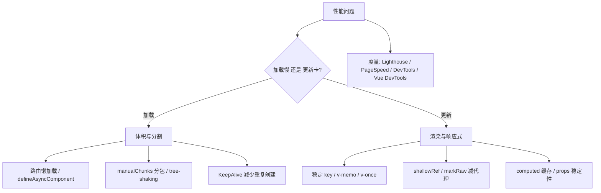

# Vue3-性能优化实战

> [!abstract] 摘要
> Vue 应用性能问题分两类：**页面加载慢**（LCP/INP，主因是包体积与阻塞资源）和**交互更新卡**（主因是渲染范围过大与响应式开销）。本文覆盖 v-memo/v-once/key 的渲染优化、虚拟列表、异步组件与 KeepAlive 缓存、shallowRef/markRaw 深层响应式瘦身、打包分包与 tree-shaking、性能测量工具链，并以"优化一个万级数据卡顿列表页"完整案例收尾。

## 一、概念与原理

### 1.1 两类性能问题与全景图

官方文档把优化分为两个维度：**页面加载性能**（首次访问多快出内容：LCP、INP）与**更新性能**（用户操作后多快响应）。Vue 侧的对应手段如下：



### 1.2 一个关键事实：组件实例比 DOM 节点贵

创建一个组件实例的开销远大于一个 DOM 节点。100 行列表 × 每行 3 个子组件 = 300 个实例，去掉一层"无渲染/高阶"抽象就能省下数百个实例。**大列表中，减少组件层级常常比微调渲染更快**；而只渲染一两次的组件无需过度优化。

## 二、核心语法 / API 详解

### 2.1 渲染优化：key / v-once / v-memo

```vue
<template>
  <!-- key：必须稳定唯一，禁用 index（重排/插入时 DOM 复用错乱、状态串位） -->
  <div v-for="item in list" :key="item.id">{{ item.name }}</div>

  <!-- v-once：内容只渲染一次，之后整个子树跳过 diff（纯静态内容） -->
  <footer v-once>© 2026 静态页脚</footer>

  <!-- v-memo：依赖数组不变时跳过该节点/子树更新；几乎总与 v-for 连用 -->
  <div v-for="item in list" :key="item.id" v-memo="[item.id === selectedId]">
    <!-- 仅选中状态变化的行才重新渲染，其余行全部跳过 -->
    {{ item.name }} <button @click="select(item.id)">选</button>
  </div>
</template>
```

### 2.2 props 稳定性：把计算移到父层

```vue
<!-- 不好：activeId 变化时，所有 ListItem 都收到新 props 并重渲染 -->
<ListItem v-for="item in list" :id="item.id" :active-id="activeId" />

<!-- 好：先在父层算出布尔值，只有真正"选中状态变化"的那几行才更新 -->
<ListItem v-for="item in list" :id="item.id" :active="item.id === activeId" />
```

### 2.3 computed vs method

| 维度 | computed | method |
|------|----------|--------|
| 缓存 | 依赖不变时直接返回缓存值 | 每次渲染都重新执行 |
| 用途 | 派生状态（过滤、汇总） | 需要传参、事件处理 |
| 大列表场景 | 过滤 1 万条只算一次 | 模板里调用即每次 diff 都跑 |

```js
// Vue 3.4+：computed 值不变时不再触发下游副作用；
// 但 getter 每次返回新对象会击穿"值比较"，可手动与旧值比较后返回旧对象
const stats = computed((old) => {
  const next = { even: count.value % 2 === 0, n: list.value.length }
  return old && old.even === next.even && old.n === next.n ? old : next
})
```

### 2.4 深层响应式瘦身：shallowRef / markRaw

```js
import { shallowRef, markRaw, triggerRef } from 'vue'

// 万级数据：只追踪引用替换，跳过对每个元素的深度代理（Vue 3.5 响应式内核本身已大幅提速，
// 但 10 万+ 属性访问场景 shallowRef 仍是官方推荐）
const items = shallowRef(loadHugeList())
items.value = [...items.value, newItem]      // ✅ 整体替换触发更新（不可变更新）
triggerRef(items)                            // 或修改后手动强制触发

// 第三方实例（图表、地图、编辑器）永不代理
const chart = markRaw(new EChartsInstance()) // markRaw 的对象不再被 reactive 包裹
```

原理与完整规则见 [[Vue3-响应式系统详解]]。

### 2.5 异步组件与路由懒加载

```js
import { defineAsyncComponent } from 'vue'

// 组件级懒加载：大图表/富文本等重组件，用到才加载
const HeavyChart = defineAsyncComponent(() => import('./HeavyChart.vue'))

// 路由级懒加载（Vite 自动拆 chunk）：
// { path: '/report', component: () => import('@/views/Report.vue') }
```

### 2.6 KeepAlive 缓存策略

```vue
<router-view v-slot="{ Component }">
  <KeepAlive :include="cachedViews" :max="10">
    <component :is="Component" />
  </KeepAlive>
</router-view>
```

策略要点：列表页进 `include`（回来不重渲染），配合组件内 `onActivated` 判断"离开期间数据是否过期"来刷新；`:max` 防止缓存无限膨胀；详情/表单页不缓存避免脏状态。

### 2.7 打包优化与性能测量

```ts
// vite.config.ts —— 分包与大依赖隔离
import { defineConfig } from 'vite'
export default defineConfig({
  build: {
    rollupOptions: {
      output: {
        manualChunks: {
          vendor: ['vue', 'vue-router', 'pinia'],   // 高频框架依赖合并
          echarts: ['echarts'],                     // 大库单独分包，缓存友好
        },
      },
    },
  },
})
```

清单：依赖选 ESM 版本（`lodash-es` 优于 `lodash`，可 tree-shaking）；组件库用 unplugin-vue-components 自动按需引入；`rollup-plugin-visualizer` 生成 treemap 找重复大依赖。从 Webpack 迁移对照见 [[Webpack配置指南]]，更多通用手段见 [[前端性能优化]]。

测量工具：**Lighthouse / PageSpeed Insights**（线上 LCP、INP）、**WebPageTest**（多地区网络模拟）、**Chrome DevTools Performance 面板**（设置 `app.config.performance = true` 显示 Vue 组件渲染时间标记）、**Vue DevTools**（组件渲染耗时、状态变更时间线）。

## 三、实战案例

> 环境：Vue 3.5+ / Vite 6+。**案例：优化一个卡顿日志列表页（1 万条数据）**。

```vue
<!-- src/views/LogList.vue —— 优化前：滚动/搜索明显卡顿 -->
<script setup>
import { reactive, computed } from 'vue'

// 问题 1：reactive 深度代理 1 万个对象，光创建就耗数百毫秒
const state = reactive({ logs: loadHugeLogs(), keyword: '', selectedId: 0 })
// 问题 2：method 格式化在每次渲染每行都执行
function fmt(log) { return new Date(log.ts).toLocaleString() }
// 问题 3：模板 :key="index"，插入数据后状态串位
// 问题 4：每行两个子组件实例 × 1 万行 = 2 万实例
</script>
```

```vue
<!-- src/views/LogList.vue —— 优化后（分步说明见注释） -->
<script setup>
import { shallowRef, ref, computed, onActivated } from 'vue'
import LogRow from '@/components/LogRow.vue'   // 行组件已扁平化：去掉内部嵌套抽象

// 步骤 1：shallowRef 只代理引用，创建成本从 O(n) 降到 O(1)
const logs = shallowRef(loadHugeLogs())
const keyword = ref('')
const selectedId = ref(0)
const ROW_H = 32
const scrollTop = ref(0)
const viewportH = ref(600)

// 步骤 2：computed 缓存过滤结果（keyword 不变不重算）
const filtered = computed(() => {
  const k = keyword.value.trim()
  return k ? logs.value.filter((l) => l.msg.includes(k)) : logs.value
})

// 步骤 3：虚拟列表——只渲染可视区 + 缓冲区，1 万条实际挂载 ~20 行
const start = computed(() => Math.floor(scrollTop.value / ROW_H))
const visibleCount = computed(() => Math.ceil(viewportH.value / ROW_H) + 2)
const offsetY = computed(() => start.value * ROW_H)
const visibleLogs = computed(() =>
  filtered.value.slice(start.value, start.value + visibleCount.value),
)
function onScroll(e) { scrollTop.value = e.target.scrollTop }

// 步骤 4：新增数据用不可变更新（shallowRef 只认引用替换）
function append(log) { logs.value = [...logs.value, log] }

// 步骤 5：配合 KeepAlive：页面从缓存恢复时按需刷新
onActivated(() => { if (stale()) logs.value = loadHugeLogs() })
</script>

<template>
  <input v-model="keyword" placeholder="搜索日志" />
  <!-- 6. 总高撑出真实滚动条；行容器按 offsetY 平移 -->
  <div
    class="viewport"
    style="height: 600px; overflow: auto"
    @scroll.passive="onScroll"
  >
    <div :style="{ height: filtered.length * ROW_H + 'px', position: 'relative' }">
      <div :style="{ transform: `translateY(${offsetY}px)` }">
        <LogRow
          v-for="log in visibleLogs"
          :key="log.id"                              <!-- 7. 稳定 key -->
          v-memo="[log.id === selectedId]"           <!-- 8. 未选中行跳过更新 -->
          :log="log"
          :active="log.id === selectedId"            <!-- 9. props 稳定性 -->
          :style="{ height: ROW_H + 'px' }"
          @click="selectedId = log.id"
        />
      </div>
    </div>
  </div>
</template>
```

```ts
// 步骤 10：vite.config.ts —— echarts 等大依赖单独分包，路由全部懒加载
manualChunks: { vendor: ['vue', 'vue-router', 'pinia'], echarts: ['echarts'] }
```

优化效果复盘：创建时间（1 万对象深度代理 → 浅代理）与滚动帧率（2 万实例 → 约 20 行）数量级改善；搜索由"每次渲染重算"变为 computed 缓存；首次加载因分包与懒加载显著下降。**顺序永远是：先测量（DevTools 找出真实瓶颈）→ 再上对应手段**。

## 四、动手练习

1. **入门**：写一个 computed 过滤列表与一个 `filterList()` method，在两者里 `console.log`，切换无关状态观察执行次数差异。提示：method 在模板中被调用就会随渲染执行。
2. **进阶**：给一个 1000 行表格加 `v-memo="[item.status === activeStatus]"`，用 Vue DevTools 对比勾选一行的渲染范围变化。提示：v-memo 几乎总与 v-for + 稳定 key 连用。
3. **进阶**：把本文虚拟列表扩展为"每行行高可配置"（传入 `rowHeight` prop）。提示：把常量 `ROW_H` 换成响应式 prop，start/offset 计算随之联动。
4. **挑战**：优化一个 1000 字段的"巨型表单"：用 `shallowRef` 管理字段对象，输入时只替换被改字段的路径并 `triggerRef`，或按步骤拆成多个 `ref`。提示：对比 `reactive` 深度代理时的输入延迟。
5. **挑战**：接入 `rollup-plugin-visualizer`，分析自己项目的打包产物，找出两个最大的依赖并尝试按需引入或分包。提示：`npm i -D rollup-plugin-visualizer`，在 plugins 里加 `visualizer({ open: true })`。

> [!success]- 练习 3 参考答案要点
> ```vue
> <script setup>
> const props = defineProps<{ rowHeight?: number }>()   // 默认 32
> const H = computed(() => props.rowHeight ?? 32)
> const start = computed(() => Math.floor(scrollTop.value / H.value))
> const offsetY = computed(() => start.value * H.value)
> const visibleCount = computed(() => Math.ceil(viewportH.value / H.value) + 2)
> </script>
> <!-- 外层总高与每行 style 都改用 H.value -->
> ```
> 要点：① 所有依赖行高的量（总高、可视行数、偏移）统一走 computed，行高变化自动联动；② 真实生产中行高不等（动态测量）要维护偏移量缓存表，通常直接用 VueUse 的 `useVirtualList` 或 `vue-virtual-scroller`；③ 本例固定行高的 O(1) 定位是理解动态方案的基石。

## 五、常见坑与 FAQ

> [!warning] key 用 index 是"列表错乱"头号元凶
> 列表重排、插入、删除时，index key 让 Vue 复用错误的 DOM 与组件状态（输入框串内容、复选框错位）。key 必须来自数据的稳定唯一 id。

> [!warning] v-memo 依赖数组漏写条件 = "不更新"静默 bug
> `v-memo="[]"` 表示永不重渲染该子树；依赖数组必须涵盖该节点所有影响渲染的状态。用错时没有报错，只有"界面没刷出来"的诡异现象，务必先小范围验证。

> [!warning] shallowRef 之后 push 不触发更新
> 这是静默的：数据变了、视图不动。统一采用不可变更新（`value = [...value, x]`），或在确认修改完成后 `triggerRef()`。深层规则见 [[Vue3-响应式系统详解]]。

> [!warning] computed 每次返回新对象会击穿缓存
> `{ ...x }`、`.map()` 生成的都是新引用，Vue 3.4+ 的"值不变不触发"判断失效。需要返回对象时，先完整计算再与旧值逐字段比较，相同则返回旧对象（见 2.3 示例）。

> [!tip] 先测量，后优化
> 没有数据支撑的优化常是负收益。流程：PageSpeed/Lighthouse 定位加载问题 → DevTools Performance 定位交互卡顿（`app.config.performance = true` 可看组件渲染耗时）→ 针对性选手段 → 复测。生产级虚拟列表（行高不定、吸顶分组）直接用 VueUse `useVirtualList`、`vue-virtual-scroller` 或 Element Plus `el-table-v2`。

## 六、自检清单

- [ ] 能区分加载性能与更新性能，并各说出 3 种对应手段
- [ ] 理解"组件实例比 DOM 贵"，会评估列表页的组件实例数量
- [ ] 列表 key 一律使用稳定唯一 id，能解释 index key 的错乱场景
- [ ] 会用 v-memo 与 v-once，并知道 v-memo 依赖数组的坑
- [ ] 能写出 props 稳定性与 computed 稳定性（返回旧对象）的优化写法
- [ ] 会用 shallowRef / markRaw 优化大数据与第三方实例
- [ ] 配置过路由懒加载、defineAsyncComponent、KeepAlive 与 manualChunks
- [ ] 会用 Lighthouse / PageSpeed / DevTools / Vue DevTools 定位性能瓶颈

## 七、关联笔记与参考

**相关笔记**

- [[Vue3-响应式系统详解]] — shallowRef/triggerRef/markRaw 的底层原理
- [[Vue3-组件设计模式]] — KeepAlive 与组件实例、插槽抽象的成本视角
- [[Vue3生态与工程化实践]] — Vite 分包、视觉化分析与工程化性能清单
- [[前端性能优化]] — 图片懒加载、HTTP 缓存等框架无关的通用手段
- [[Webpack配置指南]] — 从 Webpack 分包迁移到 Vite 的对照

**参考资料**

1. [Vue 官方文档 — Performance（v-memo/v-once、props 稳定性、computed 稳定性、虚拟列表库清单）](https://vuejs.org/guide/best-practices/performance.html)，vuejs.org
2. [Vue 官方文档 — KeepAlive（include / max / onActivated）](https://vuejs.org/guide/built-ins/keep-alive.html)，vuejs.org
3. [Announcing Vue 3.5（响应式内核重构，大数组与深层依赖内存 -56%）](https://blog.vuejs.org/posts/vue-3.5)，Vue 官方博客
4. [PageSpeed Insights](https://pagespeed.web.dev/)，Google（线上 LCP/INP 测量）
5. [WebPageTest](https://www.webpagetest.org/)（多地区网络环境模拟）
6. [vue-virtual-scroller](https://github.com/Akryum/vue-virtual-scroller)，GitHub（生产级虚拟列表）
7. [VueUse — useVirtualList](https://vueuse.org/)，VueUse 官方文档
