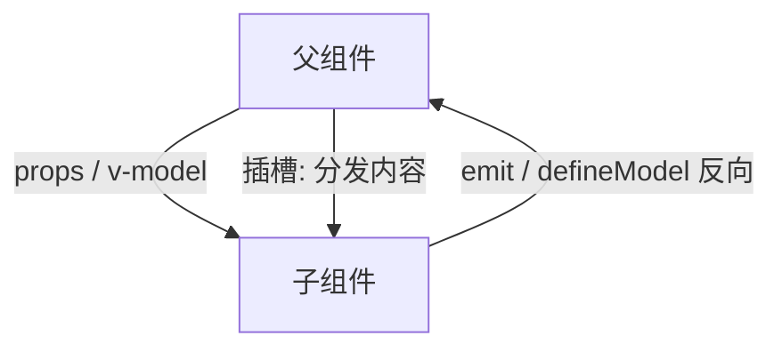

# Vue3-组件设计模式

> [!abstract] 摘要
> 组件是 Vue 应用的原子单元，"会不会设计组件"直接决定项目可维护性。本文系统对比 props/emit/v-model/provide-inject/expose 五种通信方式的适用边界，讲解 defineProps 类型化、defineModel 多绑定与修饰符（Vue 3.4+）、三层插槽体系、动态组件与 KeepAlive、透传属性控制，实战封装一个可复用表单输入组件与一个 DataTable 列表组件。

## 一、概念与原理

### 1.1 组件通信全方式对比

| 方式 | 方向 | 典型场景 | 关键 API |
|------|------|----------|----------|
| props | 父 → 子 | 传数据，单向数据流 | `defineProps` |
| emit | 子 → 父 | 事件通知、表单提交 | `defineEmits` |
| v-model | 父 ↔ 子 | 双向绑定表单控件 | `defineModel`（3.4+） |
| provide / inject | 祖先 → 任意后代 | 主题、多语言等跨层注入 | `provide()` / `inject()` |
| defineExpose + ref | 父 → 子实例 | 命令式调用（聚焦、重置） | `defineExpose` / `useTemplateRef` |
| 插槽 | 父 → 子（内容） | 内容分发、定制渲染 | `<slot>`，作用域插槽反向传数据 |

选型口诀：**数据下行用 props，事件上行用 emit，表单双向用 v-model，跨层注入用 provide，命令式操作用 expose，内容定制用插槽，跨页面共享进 Pinia**。



### 1.2 单向数据流

props 是"下行只读"的：子组件改 props 会警告；需要响应变化用本地 `ref(props.xxx)` 拷贝初值，或 `computed` 派生；要改父层数据就 emit 事件——这是所有通信设计的地基。

## 二、核心语法 / API 详解

### 2.1 defineProps：两种类型化写法（同一组件二选一）

```vue
<script setup>
// 写法 A：运行时声明，对象语法支持校验与默认值
const props = defineProps({
  type: { type: String, default: 'text', validator: (v) => ['text', 'password'].includes(v) },
  disabled: { type: Boolean, default: false },   // Boolean 特殊转换：<X disabled /> 即 true
})
</script>
```

```ts
// 写法 B：纯类型声明（编译期生成等价运行时校验）；3.5+ 响应式解构 + 原生默认值
const { type = 'text', disabled = false } = defineProps<{ type?: string; disabled?: boolean }>()
```

> 注意：解构出的 prop **作为值传给 watch/函数时要用 getter 包装**（`watch(() => type, ...)`），原理详见 [[Vue3-响应式系统详解]]。

### 2.2 defineEmits：类型化事件

```ts
const emit = defineEmits<{ change: [value: string]; submit: [] }>()   // 3.3+ 元组语法
```

### 2.3 defineModel：双向绑定（3.4+，优先用）

```vue
<script setup lang="ts">
// 单个 v-model：自动实现 props: modelValue + emit('update:modelValue')
const model = defineModel<string>()
// 多个 v-model：父组件写 <Form v-model:first-name="f" v-model:last-name="l" />
const firstName = defineModel<string>('firstName')
const lastName = defineModel<string>('lastName')
// 自定义修饰符：父组件写 v-model.capitalize="text"
const [model2, modifiers] = defineModel<string>({
  set(value) { return modifiers.capitalize ? value.charAt(0).toUpperCase() + value.slice(1) : value },
})
</script>
```

### 2.4 插槽体系：默认 / 具名 / 作用域

```vue
<!-- 子组件 BaseCard.vue -->
<template>
  <div class="card">
    <header><slot name="header">默认标题</slot></header>  <!-- 具名插槽 + 回退内容 -->
    <main><slot />默认内容（不传时显示）</main>            <!-- 默认插槽 -->
    <footer>
      <slot name="footer" :count="5">共 5 条</slot>        <!-- 作用域插槽：向父级传数据 -->
    </footer>
  </div>
</template>

<BaseCard>  <!-- 父组件 -->
  <template #header>我的标题</template>
  正文……
  <template #footer="{ count }">合计 {{ count }} 项</template>  <!-- 解构作用域数据 -->
</BaseCard>
```

### 2.5 动态组件与 KeepAlive

```vue
<script setup>
import { shallowRef } from 'vue'
import TabProfile from './TabProfile.vue'
import TabSettings from './TabSettings.vue'
const tabs = { profile: TabProfile, settings: TabSettings }
const current = shallowRef('profile')    // 组件对象无需深度响应式，shallowRef 即可
</script>
<template>
  <KeepAlive include="TabProfile" :max="5">   <!-- include 匹配组件 name；max 限制缓存数 -->
    <component :is="tabs[current]" />
  </KeepAlive>
</template>
```

`<script setup>` 组件名默认取文件名，需显式命名用 `defineOptions({ name: 'TabProfile' })`；被缓存组件用 `onActivated` / `onDeactivated` 感知"回来/离开"。

### 2.6 透传属性与 defineExpose

```vue
<script setup>
// 未声明为 props/emits 的属性默认透传到根元素；关闭后可手动指定落点（多根组件必须处理）
defineOptions({ inheritAttrs: false })
</script>

<template>
  <input v-bind="$attrs" />   <!-- class/style 会合并，v-on 监听器会合并调用 -->
</template>
<!-- 子组件暴露方法给父级（script setup 默认对外封闭） -->
<script setup>
import { ref } from 'vue'
const input = ref(null)
defineExpose({ focus: () => input.value?.focus(), reset: () => (input.value.value = '') })
</script>
<!-- 父组件：3.5 推荐 useTemplateRef -->
<script setup>
import { useTemplateRef } from 'vue'
const child = useTemplateRef('form-input')   // 模板里 <SmartInput ref="form-input" />
child.value?.focus()
</script>
```

## 三、实战案例

> 环境：Vue 3.5+ / Vite 6+。**案例一：可复用表单输入组件**（v-model + 修饰符 + 透传 + 插槽）。

```vue
<!-- src/components/SmartInput.vue -->
<script setup lang="ts">
defineOptions({ inheritAttrs: false })                 // 手动控制 $attrs 落点
const { label = '', type = 'text' } = defineProps<{ label?: string; type?: string }>()
const [model, modifiers] = defineModel<string>({
  set(value) {   // 支持 v-model.capitalize
    return modifiers.capitalize ? value.charAt(0).toUpperCase() + value.slice(1) : value
  },
})
const emit = defineEmits<{ change: [value: string] }>()
</script>

<template>
  <label class="smart-input">
    <span v-if="label" class="label">{{ label }}</span>
    <input v-model="model" v-bind="$attrs" :type="type" @change="emit('change', model)" />
    <slot name="suffix" />                              <!-- 放单位、图标、错误提示 -->
  </label>
</template>
```

```vue
<!-- 使用方：src/views/LoginForm.vue -->
<script setup>
import { ref } from 'vue'
import SmartInput from '@/components/SmartInput.vue'
const username = ref('')
</script>
<template>
  <SmartInput v-model.capitalize="username" label="用户名" placeholder="至少 2 个字符">
    <template #suffix>@tao</template>
  </SmartInput>
</template>
```
案例二：**DataTable 列表组件**——列配置驱动 + 作用域插槽定制单元格 + row-click。

```vue
<!-- src/components/DataTable.vue -->
<script setup lang="ts">
const { columns, rows, rowKey = 'id' } = defineProps<{
  columns: Array<{ key: string; title: string; width?: number }>
  rows: Array<Record<string, unknown>>
  rowKey?: string
}>()
defineEmits<{ 'row-click': [row: Record<string, unknown>] }>()
</script>
<template>
  <table class="data-table">
    <thead>
      <tr>
        <th v-for="col in columns" :key="col.key" :style="{ width: (col.width || 120) + 'px' }">
          <slot :name="`head-${col.key}`" :column="col">{{ col.title }}</slot>  <!-- 表头可覆写 -->
        </th>
      </tr>
    </thead>
    <tbody>
      <tr v-for="row in rows" :key="row[rowKey]" @click="$emit('row-click', row)">
        <td v-for="col in columns" :key="col.key">
          <slot :name="col.key" :row="row" :value="row[col.key]">{{ row[col.key] }}</slot>
        </td>
      </tr>
    </tbody>
    <slot name="footer" :rows="rows" />
  </table>
</template>
```

```vue
<!-- 使用方：src/views/UserList.vue -->
<script setup>
import { shallowRef } from 'vue'
import DataTable from '@/components/DataTable.vue'
// 数据量大时用 shallowRef + 整体替换（见 [[Vue3-性能优化实战]]）
const columns = [
  { key: 'name', title: '姓名', width: 160 }, { key: 'role', title: '角色' }, { key: 'active', title: '状态' },
]
const rows = shallowRef([
  { id: 1, name: '陶伟东', role: '前端工程师', active: true },
  { id: 2, name: '李雷', role: '后端工程师', active: false },
])
function openDetail(row) { console.log('查看详情', row) }
</script>
<template>
  <DataTable :columns="columns" :rows="rows" @row-click="openDetail">
    <!-- 只覆写 active 列：布尔值渲染为徽标，其余列走默认 -->
    <template #active="{ value }">
      <span :class="['badge', value ? 'ok' : 'off']">{{ value ? '启用' : '停用' }}</span>
    </template>
    <template #footer="{ rows }">共 {{ rows.length }} 条记录</template>
  </DataTable>
</template>
```

## 四、动手练习

1. **入门**：封装 `BaseButton`：props 支持 `type`（primary/danger）与 `size`，点击 emit `click`，插槽放文案。提示：样式绑定 `:class="[type, size]"`。
2. **进阶**：封装 `BaseModal`：`v-model` 控制显隐，具名插槽 `header`/默认/`footer`，默认 footer 放"取消/确定"。提示：`defineModel<boolean>()`。
3. **进阶**：给本文 DataTable 加排序：点击表头 emit `sort` 事件并带上 `key` 与方向，父组件负责重排数据（保持单向数据流）。提示：表头上绑 `@click="$emit('sort', col.key)"`。
4. **挑战**：封装 `SearchSelect`：`v-model` 选中值 + 内部输入过滤，并把 `reload` 方法通过 `defineExpose` 暴露给父级。提示：内部 `ref` 存 keyword，外部 `defineModel` 存选中项。
5. **挑战**：用 provide/inject 做 `FormContext`：外层 `<Form>` provide 校验函数，内部任意深度的 `SmartInput` inject 后自动校验并显示错误。提示：注入键用独立文件导出的 `Symbol`，inject 必须给默认值。

> [!success]- 练习 5 参考答案要点
> ```ts
> // Form.vue（祖先）
> const errors = ref({})
> provide(FormKey, { setErrors: (e) => (errors.value = e), validate: () => /* 比对 rules */ true })
> // SmartInput（任意后代）
> const ctx = inject(FormKey, null)      // 必须给默认值 null，组件可脱离 Form 单独使用
> ctx && ctx.setErrors({ name: '不能为空' })
> ```
> 要点：① 注入键用 `Symbol('form-context')` 导出自独立文件，避免字符串撞名；② inject 必须提供默认值并判空，保证组件独立性；③ provide 传函数而非传值副本，后代改的是源头（呼应 [[Vue3-组合式API]] 的 provide 响应式对象约定）。

## 五、常见坑与 FAQ

> [!warning] 子组件直接改 props / 改 props 的嵌套对象
> `props.title = 'x'` 直接警告；`props.user.name = 'x'` 能改但不规范（对象按引用传递），结果难以追溯。正确姿势：本地值用 `ref(props.xxx)` 初始化，联动用 computed，修改意图一律 emit 回父层。

> [!warning] 多根组件的透传警告
> 模板有多个根元素时，自动透传会因"不知道给谁"而告警。要么 `defineOptions({ inheritAttrs: false })` 后手动 `v-bind="$attrs"` 到目标元素，要么包一层单根容器。

> [!warning] KeepAlive 的 include 匹配不到组件
> `include` 按**组件 name** 匹配，`<script setup>` 的 name 默认来自文件名，嵌套引用或改名后常失配。显式 `defineOptions({ name: 'xxx' })` 最稳。

> [!tip] defineModel 消灭了"受控组件"样板代码
> Vue 3.4 之前手写 `props.modelValue` + `emit('update:modelValue')`，三段式又长又易错；3.4+ 一行 `defineModel()` 搞定。事件名在模板中用 kebab-case 监听（`@row-click`），是官方约定。

## 六、自检清单

- [ ] 能按场景说出五种通信方式的选型（口诀级别）
- [ ] 会用运行时与类型两种方式写 defineProps，并使用 3.5 响应式解构默认值
- [ ] 会用 defineModel 实现单个、多个 v-model 绑定与自定义修饰符
- [ ] 能区分默认/具名/作用域插槽并说出作用域插槽"数据反向流动"的含义
- [ ] 会用动态组件 + KeepAlive + include/max 做页面缓存
- [ ] 理解 $attrs 透传规则，会处理多根组件的 inheritAttrs；会用 defineExpose 做命令式父子交互

## 七、关联笔记与参考

**相关笔记**

- [[Vue3-组合式API]] — provide/inject 与编译宏的基础
- [[Vue3-Pinia状态管理实战]] — 超出组件树通信能力的全局状态方案
- [[Vue3-性能优化实战]] — KeepAlive 缓存策略与组件实例成本

**参考资料**

1. [Vue 官方文档 — Props（类型声明 / 3.5 响应式解构）](https://vuejs.org/guide/components/props.html)，vuejs.org
2. [Vue 官方文档 — 组件 v-model（defineModel / 修饰符）](https://vuejs.org/guide/components/v-model.html)，vuejs.org
3. [Vue 官方文档 — Slots（插槽体系）](https://vuejs.org/guide/components/slots.html)，vuejs.org
4. [Vue 官方文档 — Fallthrough Attributes（透传与 inheritAttrs）](https://vuejs.org/guide/components/attrs.html)，vuejs.org
5. [Vue 官方文档 — KeepAlive（include / max / 生命周期）](https://vuejs.org/guide/built-ins/keep-alive.html)，vuejs.org
