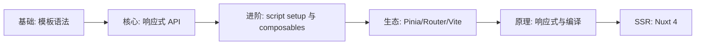

# Vue3-组合式API

## 一、概述：为什么需要组合式 API

组合式 API（Composition API）是 Vue 3 最核心的更新。它解决的问题主要来自 Vue 2 Options API 在大型项目中的三个痛点：

1. **逻辑分散**：同一个功能（如搜索列表）的 data、methods、watch 被拆散到不同选项中，代码上下文割裂。
2. **逻辑复用困难**：mixin 存在命名冲突、来源不清晰等问题，TypeScript 类型推导也很差。
3. **类型支持薄弱**：`this` 的动态指向让 TS 难以推断，IDE 补全体验差。

组合式 API 的思路是：**按逻辑关注点组织代码**，把相关联的状态与行为放在一起，并通过**组合式函数（composables）**实现干净的逻辑复用——这也是它与 [[React-Hooks详解|React Hooks]] 殊途同归的地方（但 Hooks 每次渲染都会重新执行，而 Vue 的 setup 只执行一次，心智模型更接近"一次声明、持续追踪"）。

> [!tip] 何时该用组合式 API
> 官方立场：两种风格都受支持，但在 Vue 3 新项目、需要 TypeScript、需要复用复杂逻辑的场景下，**推荐一律使用组合式 API + `<script setup>`**。Options API 仍然适合轻量级组件和老项目渐进迁移。

## 二、从入门到精通：学习路线

| 阶段 | 目标 | 关键内容 |
|------|------|---------|
| 1. 基础 | 会写组件 | 环境搭建（Vite）、模板语法、响应式基础、事件与表单绑定 |
| 2. 核心 | 掌握响应式 | `ref`/`reactive`、`computed`/`watch`/`watchEffect`、生命周期、组件通信（props/emit/v-model） |
| 3. 组合式进阶 | 会复用逻辑 | `<script setup>`、defineProps/defineEmits/defineModel、composables 设计、provide/inject |
| 4. 生态与工程化 | 能做项目 | Pinia、Vue Router 4、VueUse、Vite、Vitest、ESLint（详见 [[Vue3生态与工程化实践]]） |
| 5. 深入原理 | 懂底层 | 响应式系统（Proxy + effect）、虚拟 DOM 与 patch、编译优化、性能调优（详见 [[前端性能优化]]） |
| 6. SSR/Nuxt | 全栈能力 | SSR 原理、水合（hydration）、Nuxt 4、服务端数据获取 |



> 前置知识建议：先打好 [[JavaScript-ES6新特性]] 基础（解构、Proxy、模块化、异步），组合式 API 大量使用这些语法。

## 三、setup 与 `<script setup>`

`setup()` 是组合式 API 的入口。在 SFC 中推荐使用编译语法糖 `<script setup>`：更少样板代码、编译器优化、组件自动注册。

```vue
<script setup>
import { ref, onMounted } from 'vue'

// 顶层代码即 setup 内容，import 与变量直接在模板中可用
const count = ref(0)

function increment() {
  count.value++
}

onMounted(() => console.log('组件已挂载'))
</script>

<template>
  <button @click="increment">点击了 {{ count }} 次</button>
</template>
```

要点：

- `setup()` 内 `this` 是 `undefined`，不存在"实例上下文"，一切都是闭包变量。
- 顶层的 `import`、函数、变量自动暴露给模板，无需 `return`。
- 编译宏（defineProps / defineEmits / defineModel / defineExpose / defineSlots）无需 import，编译期处理。

## 四、核心 API 详解

### 4.1 ref：任意值的响应式引用

```js
import { ref } from 'vue'

const count = ref(0)
console.log(count.value)   // JS 中必须 .value
count.value++              // 触发依赖更新

// 浅层 ref：大对象只想替换引用时用，避免深度代理开销
import { shallowRef, triggerRef } from 'vue'
const bigList = shallowRef([])
bigList.value = newArr          // 触发更新
bigList.value.push(x)           // 不触发
triggerRef(bigList)             // 需要时手动触发
```

### 4.2 reactive：对象的深度响应式代理

```js
import { reactive } from 'vue'

const state = reactive({
  user: { name: '陶伟东', age: 18 },
  tags: ['Vue', 'TS'],
})
state.user.age = 19            // 深层自动响应
state.tags.push('Vite')        // 数组方法同样追踪
```

### 4.3 computed：派生状态（有缓存）

```js
import { ref, computed } from 'vue'

const firstName = ref('伟东')
const lastName = ref('陶')

// 只读 computed
const fullName = computed(() => lastName.value + firstName.value)

// 可写 computed（少见）
const proxy = computed({
  get: () => fullName.value,
  set: (v) => { lastName.value = v.slice(0, 1); firstName.value = v.slice(1) },
})
```

### 4.4 watch：显式监听

```js
import { ref, watch } from 'vue'

const question = ref('')
const answer = ref('')

// 单个源
watch(question, async (val, oldVal) => {
  answer.value = await ask(val)
}, { deep: false, immediate: false })

// 多个源 + 3.5+ 深度监听支持数值
import { reactive, watch } from 'vue'
const obj = reactive({ a: { b: { c: 1 } } })
watch(obj, () => { /* ... */ }, { deep: 2 })  // Vue 3.5+：控制监听深度为 2 层

// 3.5+ 新增 onWatcherCleanup：注册清理逻辑
import { onWatcherCleanup, watch } from 'vue'
watch(id, (newId) => {
  const controller = new AbortController()
  fetch(`/api/${newId}`, { signal: controller.signal })
  onWatcherCleanup(() => controller.abort())  // 依赖变更/停止时中止旧请求
})
```

### 4.5 watchEffect：自动追踪依赖的副作用

```js
import { ref, watchEffect } from 'vue'

const todoId = ref(1)
const data = ref(null)

watchEffect(async () => {
  // 回调中用到的响应式源都会被自动追踪
  const res = await fetch(`/api/todos/${todoId.value}`)
  data.value = await res.json()
})
```

`watch` vs `watchEffect` 选择：

| 维度 | watch | watchEffect |
|------|-------|-------------|
| 依赖 | 显式声明，可拿到旧值 | 自动追踪，拿不到旧值 |
| 执行时机 | 默认懒执行 | 立即执行一次 |
| 适用 | 需要新旧值比较、按条件监听 | 依赖关系简单的副作用 |

### 4.6 provide / inject：跨层注入

```vue
<!-- 祖先组件 -->
<script setup>
import { ref, provide } from 'vue'
const theme = ref('dark')
provide('theme', theme)   // 提供响应式对象
function updateTheme(v) { theme.value = v }
provide('updateTheme', updateTheme)
</script>
```

```vue
<!-- 后代组件 -->
<script setup>
import { inject } from 'vue'
const theme = inject('theme', 'light')      // 第二参数为默认值
const updateTheme = inject('updateTheme')
</script>
```

### 4.7 生命周期钩子

```js
import { onMounted, onUpdated, onUnmounted, onBeforeUnmount } from 'vue'

onMounted(() => { /* 访问 DOM、初始化第三方库 */ })
onBeforeUnmount(() => { /* 清理定时器、事件监听 */ })
```

| 阶段 | Options API | 组合式 API |
|------|-------------|-----------|
| 创建 | beforeCreate / created | setup（本身就是） |
| 挂载前/后 | beforeMount / mounted | onBeforeMount / onMounted |
| 更新 | beforeUpdate / updated | onBeforeUpdate / onUpdated |
| 卸载 | beforeUnmount / unmounted | onBeforeUnmount / onUnmounted |
| 捕获错误 | errorCaptured | onErrorCaptured |

## 五、Composable 编写最佳实践

组合式函数（composable）是组合式 API 的复用单元，命名约定为 `useXxx`。

```js
// src/composables/useMouse.js —— 跟踪鼠标位置
import { ref, onMounted, onUnmounted } from 'vue'

export function useMouse() {
  const x = ref(0)
  const y = ref(0)

  function update(e) {
    x.value = e.pageX
    y.value = e.pageY
  }

  onMounted(() => window.addEventListener('mousemove', update))
  onUnmounted(() => window.removeEventListener('mousemove', update))

  return { x, y }
}
```

```js
// src/composables/useFetch.js —— 输入是 ref，输出也是 ref，保持"响应式流水线"
import { ref, watchEffect, toValue } from 'vue'

export function useFetch(url) {
  const data = ref(null)
  const error = ref(null)

  watchEffect(async () => {
    data.value = null
    error.value = null
    try {
      // toValue() 兼容 ref / getter / 普通值三种输入
      const res = await fetch(toValue(url))
      data.value = await res.json()
    } catch (e) {
      error.value = e
    }
  })

  return { data, error }
}
```

设计准则（官方约定）：

1. **输入输出都是 ref/getter**，让调用方可以链式串联响应式数据；参数用 `toValue()` 规范化。
2. **在 composable 内部注册生命周期钩子**是安全的（等同于在 setup 中调用）；不要在异步回调后再注册。
3. 无状态逻辑用纯函数，有状态逻辑才用 composable；一个 composable 只做一件事。
4. 组合而非嵌套：大 composable 由小 composable 组装（如 `useUserProfile = useFetch + useAuth`）。

> [!tip] 与 React Hooks 的关键差异
> Vue 的 setup 只执行一次，composable 中的 `ref` 不会因"重渲染"被反复创建，因此**不需要依赖数组**，也基本不存在 React Hooks 那样的闭包陷阱问题。理解这一点是写出地道 Vue 代码的关键。

## 六、与 Options API 对比

| 维度 | Options API | 组合式 API |
|------|-------------|-----------|
| 代码组织 | 按选项类型分散 | 按逻辑功能聚合 |
| 逻辑复用 | mixin（易冲突） | composables（清晰、可类型化） |
| TypeScript | `this` 推导受限 | 天然友好，泛型 props 类型完备 |
| 学习成本 | 低，概念固定 | 需理解 ref/响应式心智模型 |
| 适用场景 | 中小组件、快速原型、渐进迁移 | 大型项目、复杂交互、组件库开发 |
| `this` | 依赖实例上下文 | 不存在 `this`，纯闭包 |

结论：**Vue 3 新项目默认用组合式 API**；两者可在同一组件混用，迁移可渐进进行。

## 七、常见坑与最佳实践

> [!warning] reactive 整体解构 / 赋值会失去响应式
> `let { name } = state` 是把普通值复制出来，后续 `name` 的变化不会追踪；`state = reactive({...})` 直接替换对象引用同样会断开。解构请用 `toRefs(state)`，或改用 `ref`。
> ```js
> import { toRefs } from 'vue'
> const { name, age } = toRefs(state)  // 每个属性都是 ref，保持追踪
> ```

> [!warning] ref 在 JS 中忘写 `.value`，在模板中多写 `.value`
> 模板中自动解包（顶层属性）；JS 里必须 `count.value`。在 `reactive` 对象内部访问 `ref` 也会自动解包，但数组/Map 等集合元素不会。

> [!warning] props 解构传给 watch 会失效
> Vue 3.5+ 中 `const { foo } = defineProps(['foo'])` 虽然响应式，但 `watch(foo, ...)` 相当于把当前值传了进去。应写成 getter：`watch(() => foo, ...)`。

> [!warning] watch reactive 对象默认隐式深度监听
> 监听整个 reactive 对象时默认 deep 且拿不到准确旧值（新旧引用相同）。要精确监听请指向具体属性：`watch(() => state.count, cb)`。

> [!tip] 副作用必须清理
> `onMounted` 里注册的全局事件、定时器、订阅，务必在 `onBeforeUnmount` / `onWatcherCleanup` 中清理，否则内存泄漏。封装进 composable 后天然闭环。

## 八、Vue 3.5+ 新特性速览（2024.9 – 2026）

| 特性 | 版本/时间 | 说明 |
|------|-----------|------|
| 响应式 Props 解构稳定 | 3.5（2024-09-01） | `const { foo = '默认值' } = defineProps<{ foo?: string }>()`，解构变量随 props 更新，默认值用原生 JS 语法 |
| `useTemplateRef()` | 3.5 | 类型安全的模板 ref 获取：`const el = useTemplateRef('input')`，不再依赖同名变量技巧 |
| `onWatcherCleanup()` | 3.5 | watcher 清理回调的官方 API，取代 watch 回调中第三参数 onCleanup 的大部分用法 |
| watch `deep` 支持数值 | 3.5 | `{ deep: 2 }` 控制监听深度，兼顾性能与便利 |
| `useId()` / Teleport defer | 3.5 | SSR 安全的随机 ID、延迟渲染 Teleport 内容 |
| SSR 懒水合 | 3.5 | async 组件支持 `hydrateAfter` 等时机控制 |
| 响应式系统内存优化 | 3.5 | 重构依赖追踪结构，内存占用降低约 56% |
| Vapor Mode（无虚拟 DOM） | 3.6（2025-07 VueConf 发布 alpha，2026 进入 RC） | 编译期生成直接操作真实 DOM 的代码，结合细粒度响应式，显著减小运行时体积；作为可选编译模式，不影响现有代码 |

> [!info] 关于 Vue 3.6 / Vapor Mode
> 2025 年 7 月 12 日 VueConf 2025 上 Vue 3.6.0-alpha.1 正式把 Vapor 整合进核心；2026 年进入 RC 阶段。它不是"Vue 4"，而是 SFC 的一种新编译模式：模板编译成 DOM 操作代码，跳过 vdom diff。当前生态工具（DevTools 等）仍在适配中，生产项目建议等待正式版。

## 九、核心要点速查

| API | 一句话 | 返回 | 注意 |
|-----|--------|------|------|
| `ref(v)` | 值的响应式包装 | Ref | JS 中 `.value` |
| `reactive(o)` | 对象深度代理 | Proxy | 不可整体替换、解构会失联 |
| `computed(fn)` | 缓存派生值 | Ref（只读） | 内含副作用不佳，用 watchEffect |
| `watch(src, cb)` | 显式监听 | 停止函数 | reactive 源默认 deep |
| `watchEffect(fn)` | 自动追踪副作用 | 停止函数 | 立即执行一次 |
| `provide/inject` | 跨层传值 | — | 提供响应式对象并连 setter |
| `defineProps/defineEmits/defineModel` | SFC 编译宏 | — | 3.5+ props 可响应式解构 |
| `useTemplateRef` | 类型安全模板引用 | Ref | 3.5+ |

## 十、参考资料

1. [Vue 官方文档 — 组合式 API（setup）](https://vuejs.org/api/composition-api-setup.html)，vuejs.org
2. [Vue 官方文档 — Props 响应式解构](https://vuejs.org/guide/components/props.html)，vuejs.org
3. [Announcing Vue 3.5](https://blog.vuejs.org/)，Vue 官方博客，2024-09-01
4. [Vue 3.6 RC 发布与 Vapor Mode 解析（知乎专栏）](https://zhuanlan.zhihu.com/p/2062910484576313795)，2026
5. [深入浅出学习 Vue 3.6 Vapor Mode（掘金）](https://juejin.cn/post/7533044069938085898)，2025
6. [vue3-roadmap：Vue2 & Vue3 源码学习路线](https://github.com/sl1673495/vue3-roadmap)，GitHub

## 相关笔记

- [[Vue3生态与工程化实践]] — Vite/Pinia/Router/Vitest 等全家桶实践
- [[JavaScript-ES6新特性]] — Proxy、解构、模块化等前置知识
- [[React-Hooks详解]] — 对照学习 React 侧的复用模型
- [[前端性能优化]] — 原理篇之外的通用优化手段
