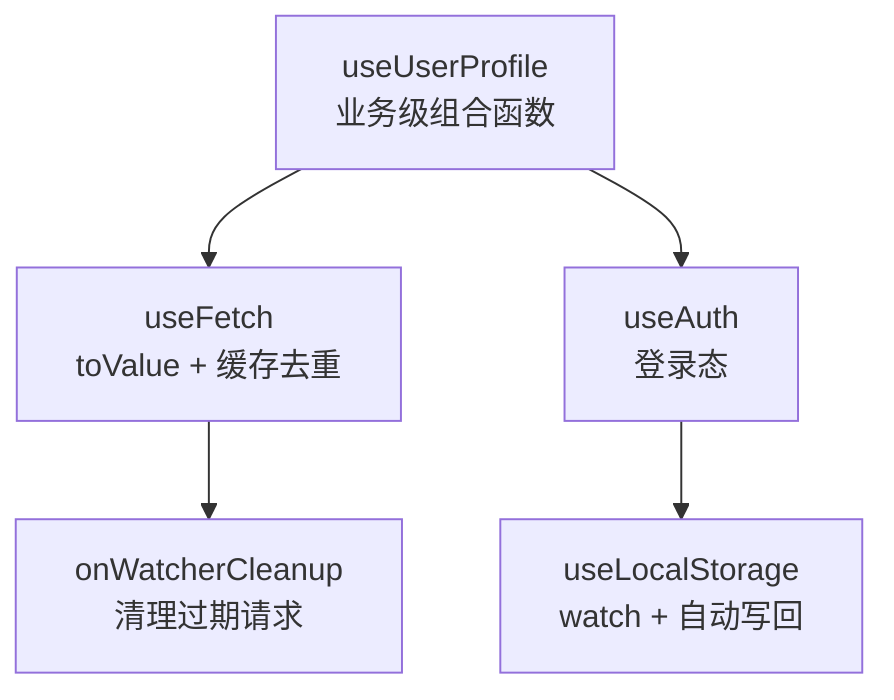

# Vue3-组合式函数实战

> [!abstract] 摘要
> 组合式函数（composable）是组合式 API 的复用单元：利用 Vue "闭包 + 响应式" 的特性，把有状态的逻辑封装成 `useXxx()` 函数，在多个组件间干净地复用，彻底取代 mixin。本文覆盖官方设计约定、useFetch/useMouse/useLocalStorage/useDebounce 四大内置范式、副作用清理与 SSR 兼容、测试方法，实战部分带你写一个带缓存与并发去重的 useApi。

## 一、概念与原理

### 1.1 composable 是什么

在组合式 API（见 [[Vue3-组合式API]]）中，"组合式函数"指**封装了响应式状态与逻辑、以 `use` 开头的函数**。它与普通工具函数的区别是：**内部维护自己的响应式状态（ref/computed），并可能在生命周期里注册与清理副作用**。

| 维度 | mixin（Vue2 遗留） | composable |
|------|-------------------|------------|
| 来源追溯 | 属性混入后看不出来自哪个 mixin | 每个 `useXxx()` 调用清晰可见 |
| 命名冲突 | 属性/方法互相覆盖 | 调用方可自由解构重命名 |
| 类型推导 | 极差 | 天然 TS 友好 |
| 状态隔离 | 共享同一份数据（隐式单例） | 每次调用独立实例（除非刻意模块级共享） |

### 1.2 设计原则（官方约定）

1. **命名**：camelCase 且以 `use` 开头（`useMouse()`），一个文件一个函数便于 tree-shaking 与维护。
2. **输入灵活**：参数可以接受"字符串 / ref / getter"三种形态，内部统一用 `toValue()` 归一化，让调用方能把响应式数据"接进"逻辑。
3. **返回约定**：**返回一个包含多个 ref 的普通对象**（不是 reactive 对象），保证 `const { x, y } = useMouse()` 解构后不丢响应性。
4. **单一职责**：一个 composable 只做一件事；复杂功能由小 composable 组合而成（如 `useUserProfile = useFetch + useAuth`）。
5. **副作用必须可清理**：事件监听、定时器、订阅要在 `onUnmounted` 或随 watcher（`onWatcherCleanup`）自动清理。



> [!tip] 与 React Hooks 的心智差异
> Vue 的 setup 只执行一次，composable 里的 `ref` 不会随"重渲染"反复创建，因此**不需要依赖数组**，也不存在闭包过期问题——"一次声明、持续追踪"。

## 二、核心语法 / API 详解

### 2.1 范式一：useMouse（事件监听 + 生命周期清理）

```js
// src/composables/useEventListener.js —— 自动清理的监听器（官方推荐封装）
import { onMounted, onUnmounted } from 'vue'

export function useEventListener(target, event, callback) {
  onMounted(() => target.addEventListener(event, callback))
  onUnmounted(() => target.removeEventListener(event, callback))
}
```

```js
// src/composables/useMouse.js —— 组合 useEventListener，跟踪鼠标位置
import { ref } from 'vue'
import { useEventListener } from './useEventListener.js'

export function useMouse() {
  const x = ref(0)
  const y = ref(0)
  useEventListener(window, 'mousemove', (e) => {
    x.value = e.pageX
    y.value = e.pageY
  })
  return { x, y }                    // ✅ 返回 ref 对象，解构安全
}
```

### 2.2 范式二：useFetch（toValue 输入归一化）

```js
// src/composables/useFetch.js —— url 可以是字符串 / ref / getter
import { ref, watchEffect, toValue } from 'vue'

export function useFetch(url) {
  const data = ref(null)
  const error = ref(null)
  watchEffect(async () => {
    data.value = null
    error.value = null
    try {
      const res = await fetch(toValue(url))    // 三种输入统一取值，url 变化自动重取
      data.value = await res.json()
    } catch (e) { error.value = e }
  })
  return { data, error }
}
```

### 2.3 范式三：useLocalStorage（持久化状态）

```js
// src/composables/useLocalStorage.js —— 状态写回 localStorage
import { ref, watch } from 'vue'

export function useLocalStorage(key, defaultValue) {
  const saved = localStorage.getItem(key)                    // SSR 下此行会崩，见 2.5
  const state = ref(saved !== null ? JSON.parse(saved) : defaultValue)
  watch(state, (v) => localStorage.setItem(key, JSON.stringify(v)), { deep: true })  // 对象内部变化也写回
  return state
}
```

### 2.4 范式四：useDebounce（防抖 ref）

```js
// src/composables/useDebounce.js —— 源 ref 变化后，静默 delay 毫秒才更新结果
import { ref, watch, toValue } from 'vue'

export function useDebounce(source, delay = 300) {
  const debounced = ref(toValue(source))
  let timer = null
  watch(() => toValue(source), (v) => {          // getter 兼容三种输入
    clearTimeout(timer)
    timer = setTimeout(() => (debounced.value = v), delay)
  })
  return debounced    // 用法：watch(debounced, () => 发请求)
}
```

### 2.5 副作用清理与调用时机规则

- composable 内注册生命周期钩子是安全的（等同在 setup 中调用），但**只能在同步的 setup 上下文中注册**：普通 `setup()` 中 `await` 之后再调用会丢失实例上下文；`<script setup>` 是唯一能在 `await` 之后继续调用的地方（编译器自动恢复上下文）。
- 请求类副作用优先用 `onWatcherCleanup`（Vue 3.5+）随 watcher 自动清理。
- **SSR 兼容**：`window`/`localStorage` 等浏览器 API 必须放进 `onMounted`（服务端不执行）；watcher 在服务端不执行，不要依赖它做服务端逻辑。

### 2.6 composable 的测试方法

```js
// src/composables/useCounter.test.ts —— Vitest + effectScope 提供生命周期上下文
import { effectScope } from 'vue'
import { describe, it, expect } from 'vitest'
import { useCounter } from '@/composables/useCounter'

describe('useCounter', () => {
  it('increment 后 count 为 1', () => {
    const scope = effectScope()
    scope.run(() => {
      const { count, increment } = useCounter()
      increment()
      expect(count.value).toBe(1)
    })
    scope.stop()      // 停掉 watcher/生命周期，避免用例间泄漏
  })
})
```

组件级验证（含 DOM 交互）用 `@vue/test-utils` 的 `mount()`（详见 [[Vue3生态与工程化实践]]）。

## 三、实战案例

> 环境：Vue 3.5+ / Vite 6+。**案例：编写带缓存与并发去重的 useApi**——同一 url 多组件并发只发一次请求，结果带 TTL 缓存，url 变更自动重取并丢弃过期响应。

```js
// src/composables/useApi.js
import { ref, shallowRef, toValue, watchEffect, onWatcherCleanup } from 'vue'

// 模块级缓存 = 跨组件共享的单例状态；需要实例隔离时把这两行移进函数体
const cache = new Map()        // Map<url, { data, ts }>
const inflight = new Map()     // Map<url, Promise> —— 进行中的请求，供去重

export function useApi(url, { ttl = 30_000 } = {}) {
  const data = shallowRef(null)   // 响应体可能是大对象，shallowRef 减少代理开销
  const error = ref(null)
  const loading = ref(false)

  watchEffect(async () => {
    const key = toValue(url)                       // 兼容 字符串/ref/getter
    if (!key) return

    // 1) 缓存命中且未过期 → 直接返回，不发请求
    const hit = cache.get(key)
    if (hit && Date.now() - hit.ts < ttl) {
      data.value = hit.data
      error.value = null
      return
    }

    loading.value = true
    error.value = null

    // 2) 注册清理：url 变更 / 组件卸载 / 停止监听时，丢弃本次过期结果
    let cancelled = false
    onWatcherCleanup(() => { cancelled = true })   // 必须在 await 前同步注册

    try {
      // 3) 去重：同一 url 的并发请求共用同一个 Promise
      if (!inflight.has(key)) {
        inflight.set(
          key,
          fetch(key)
            .then((res) => {
              if (!res.ok) throw new Error(`HTTP ${res.status}`)
              return res.json()
            })
            .finally(() => inflight.delete(key)),  // 结束后允许下次重新发起
        )
      }
      const json = await inflight.get(key)
      if (cancelled) return                        // 响应已过期，不写入
      cache.set(key, { data: json, ts: Date.now() })
      data.value = json
    } catch (e) {
      if (!cancelled) error.value = e
    } finally {
      if (!cancelled) loading.value = false
    }
  })

  return { data, error, loading }                  // 约定：返回 ref 对象
}
```

```vue
<!-- src/views/UserPanel.vue —— 使用示例：切 id 自动取数，切回秒出（缓存） -->
<script setup>
import { ref } from 'vue'
import { useApi } from '@/composables/useApi'

const userId = ref(1)
const { data: user, error, loading } = useApi(
  () => `/api/users/${userId.value}`,   // getter 输入：userId 变化 → 自动重新请求
)
</script>

<template>
  <select v-model.number="userId">
    <option :value="1">用户 1</option>
    <option :value="2">用户 2</option>
  </select>
  <p v-if="loading">加载中…</p>
  <p v-else-if="error">出错了：{{ error.message }}</p>
  <pre v-else>{{ user }}</pre>
</template>
```

案例要点复盘：**缓存 Map 做空间换时间，inflight Map 做并发去重，onWatcherCleanup + cancelled 标志解决竞态**——这三件事是生产级 useApi 与玩具版的差距。

## 四、动手练习

1. **入门**：手写 `useMouse()` 并在一个组件中显示坐标；打开两个使用它的组件，验证两者的 x/y 各自独立（状态隔离）。提示：每个组件实例的 setup 各跑一次。
2. **进阶**：写 `useTitle(title)`：title 是 ref/getter/字符串皆可，变化时同步 `document.title`，卸载时恢复原标题。提示：`toValue` + `watchEffect` + `onWatcherCleanup`。
3. **进阶**：给本文 `useDebounce` 加 `immediate` 选项：首次立即取值，后续防抖。提示：在 watch 回调里区分"第一次"。
4. **挑战**：为 `useApi` 加 `AbortController`：请求用 `{ signal }` 发出，url 变更时中止旧请求（提示：把 controller 存进 `inflight`，`onWatcherCleanup` 里调用 `controller.abort()`）。
5. **挑战**：给 `useApi` 写单元测试：mock 全局 fetch，验证"相同 url 并发调用只发一次 fetch"。提示：`vi.stubGlobal('fetch', vi.fn(...))` 让 watchEffect 微任务跑完。

> [!success]- 练习 4 参考答案要点
> ```js
> let cancelled = false
> const controller = new AbortController()
> onWatcherCleanup(() => { cancelled = true; controller.abort() })
> // fetch(key, { signal: controller.signal })
> ```
> 要点：① controller 与 cancelled 标志都在**每次 effect 运行的作用域内**创建；② abort 放在 onWatcherCleanup，依赖变更与组件卸载都会触发；③ abort 后 fetch 会 reject（AbortError），catch 里用 `cancelled` 或 `e.name === 'AbortError'` 过滤，不把它当业务错误展示。

## 五、常见坑与 FAQ

> [!warning] 生命周期钩子注册晚了 = 注册不上
> 在异步回调（setTimeout、await 之后、事件回调）里调用 `onMounted`/`onUnmounted` 会静默失败，因为此时已无法定位"当前组件实例"。所有生命周期注册必须发生在 composable 同步执行期间；异步后需要清理时改用 `onWatcherCleanup` 或 `effectScope`。

> [!warning] 忘记清理副作用 → 内存泄漏与重复回调
> `addEventListener`、`setInterval`、第三方 SDK 订阅，凡是 composable 里注册的，都要有对应的移除路径。优先复用 `useEventListener` 这类"自带清理"的封装（VueUse 的 `useEventListener` 可直接替代手写）。

> [!warning] 返回 reactive 对象会让解构失去响应性
> `return reactive({ x, y })` 后 `const { x } = useMouse()` 得到的是快照值。始终返回 `{ x, y }` 这样的 ref 对象；调用方想要 `.x` 属性访问风格可自行 `reactive(useMouse())` 包一层。

> [!tip] 输入参数用 toValue 归一化是"可组合性"的关键
> 支持 `useApi('/a')`、`useApi(urlRef)`、`useApi(() => url.value)` 三种输入，composable 才能被任意上游响应式数据驱动——这是官方文档反复强调的最佳实践。边界把握：局部逻辑用 composable，跨组件共享的全局状态进 Pinia（见 [[Vue3-Pinia状态管理实战]]）。

## 六、自检清单

- [ ] 能说出 composable 与普通函数、mixin、Pinia store 的区别
- [ ] 会用 `toValue()` 让输入兼容 字符串 / ref / getter 三种形态
- [ ] 遵守"返回包含多个 ref 的普通对象"的返回约定，并能解释原因
- [ ] 每个注册过的副作用（监听/定时器/订阅）都有对应清理路径（onUnmounted / onWatcherCleanup）
- [ ] 知道生命周期钩子只能在同步 setup 上下文注册，`<script setup>` 中 await 后仍可调用
- [ ] 能说出 SSR 下 composable 的两条约束（浏览器 API 进 onMounted、watcher 服务端不执行）
- [ ] 会用 effectScope + Vitest 测 composable，实现过带缓存/去重/竞态处理的异步 composable

## 七、关联笔记与参考

**相关笔记**

- [[Vue3-组合式API]] — ref/watchEffect 等底层 API 与 composable 的关系
- [[Vue3-Pinia状态管理实战]] — 跨组件全局状态的正确去处
- [[Vue3生态与工程化实践]] — VueUse 工具库与 Vitest 测试工程化
- [[Vue3-响应式系统详解]] — watchEffect 自动追踪与 onWatcherCleanup 的原理

**参考资料**

1. [Vue 官方文档 — 组合式函数（Composables）](https://vuejs.org/guide/reusability/composables.html)，vuejs.org（本文设计原则、useMouse/useEventListener/useFetch 均出自此页）
2. [Vue 官方文档 — Watchers（onWatcherCleanup）](https://vuejs.org/guide/essentials/watchers.html)，vuejs.org
3. [VueUse 官方文档](https://vueuse.org/)，生产环境建议优先复用现成 composables
4. [Vitest 官方文档](https://vitest.dev/)，composable 单元测试
