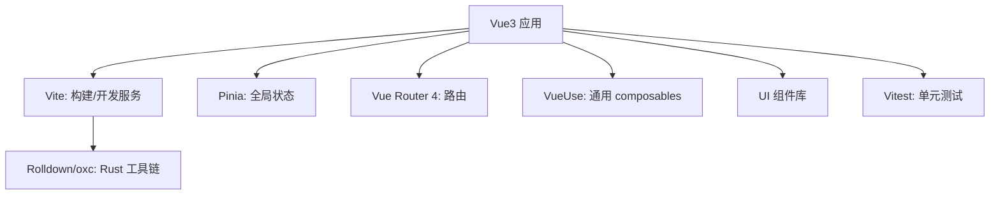

# Vue3生态与工程化实践

## 一、概述

Vue3 项目的"能打仗"能力，一半来自组合式 API（见 [[Vue3-组合式API]]），另一半来自生态与工程化：Vite 构建、Pinia 状态管理、Vue Router 路由、VueUse 工具函数、组件库、Vitest 测试与 lint 规范。本文汇总 2025-2026 年这套全家桶的选型现状与落地要点。



## 二、Vite 工程配置要点

Vite 7（2025-06-24 发布）要求 Node.js 20.19+ / 22.12+，首次提供稳定的 Node API，并可通过 `rolldown-vite` 体验 Rust 打包（生产构建提速 3-16 倍）。

```ts
// vite.config.ts 关键配置
import { defineConfig } from 'vite'
import vue from '@vitejs/plugin-vue'
import { fileURLToPath, URL } from 'node:url'

export default defineConfig({
  plugins: [vue()],
  resolve: {
    alias: { '@': fileURLToPath(new URL('./src', import.meta.url)) },
  },
  server: {
    port: 5173,
    proxy: {
      '/api': { target: 'http://localhost:8080', changeOrigin: true },
    },
  },
  build: {
    target: 'es2020',
    rollupOptions: {
      output: {
        manualChunks: {
          vendor: ['vue', 'vue-router', 'pinia'],
          echarts: ['echarts'],   // 大依赖单独分包
        },
      },
    },
  },
})
```

工程要点：

1. **环境变量**：`.env.development` / `.env.production` 中 `VITE_` 前缀变量，通过 `import.meta.env.VITE_XXX` 访问。
2. **分包策略**：路由级 `import()` 动态导入 + `manualChunks` 控制公共依赖。
3. **按需加载**：组件库样式用 unplugin-auto-import / unplugin-vue-components 自动按需引入。
4. 从 Webpack 迁移的对照与思路可参考 [[Webpack配置指南]]。

## 三、Pinia 状态管理

Vue 官方推荐的新项目统一使用 Pinia；Vuex 4 处于维护模式（2025 年社区对比中 Pinia 因更简 API、更优 TS 推导成为默认选择）。

| 维度 | Vuex 4 | Pinia |
|------|--------|-------|
| 概念 | state/getter/mutation/action | state/getter/action（无 mutation） |
| 模块化 | 嵌套 modules + namespace | 平铺多 store（defineStore 一个域一个） |
| TypeScript | 类型推导繁琐 | 完整自动推导 |
| 组合式 API | 需适配 | 天然支持 setup 风格 store |
| DevTools | 支持 | 支持且更好（时间旅行、热更新） |

```ts
// src/stores/counter.ts —— Setup 写法（推荐）
import { defineStore } from 'pinia'
import { ref, computed } from 'vue'

export const useCounterStore = defineStore('counter', () => {
  const count = ref(0)                       // state
  const double = computed(() => count.value * 2)  // getter
  function increment() { count.value++ }     // action
  async function fetchInit() {
    const res = await fetch('/api/counter')
    count.value = (await res.json()).count
  }
  return { count, double, increment, fetchInit }
})
```

```vue
<script setup>
import { useCounterStore } from '@/stores/counter'
import { storeToRefs } from 'pinia'

const store = useCounterStore()
// 解构保持响应式必须用 storeToRefs（直接解构会失去响应性，与 reactive 同理）
const { count, double } = storeToRefs(store)
const { increment } = store          // action 可直接解构
</script>
```

> [!tip] store 拆分原则
> 一个业务域一个 store（user、cart、project……），不要造一个"上帝 store"。跨 store 调用直接在一个 action 里引用另一个 store，Pinia 天然支持。

## 四、Vue Router 4：守卫与懒加载

```ts
// src/router/index.ts
import { createRouter, createWebHistory } from 'vue-router'
import { useAuthStore } from '@/stores/auth'

const router = createRouter({
  history: createWebHistory(),
  routes: [
    { path: '/', component: () => import('@/views/Home.vue') },        // 路由懒加载
    { path: '/about', component: () => import('@/views/About.vue') },
    { path: '/admin', component: () => import('@/views/Admin.vue'),
      meta: { requiresAuth: true } },
    { path: '/:pathMatch(.*)*', component: () => import('@/views/404.vue') },
  ],
})

// 全局前置守卫：鉴权经典范式
router.beforeEach((to) => {
  const auth = useAuthStore()
  if (to.meta.requiresAuth && !auth.isLoggedIn) {
    return { path: '/login', query: { redirect: to.fullPath } }  // 返回路由对象即重定向
  }
})

export default router
```

要点：

- **懒加载 + chunk 命名**：`component: () => import(/* webpackChunkName: "home" */ '...')`（Vite 下 rollupOptions 可统一命名）。
- 守卫体系：`beforeEach`（鉴权）、`beforeResolve`、`afterEach`（埋点、标题）、组件内 `onBeforeRouteUpdate`。
- 守卫里用 Pinia：**在守卫回调内部调用 `useAuthStore()`**，确保 pinia 实例已安装。
- 动态路由：登录后 `router.addRoute()` 追加权限路由，退出时逐个 `removeRoute`。

## 五、VueUse 常用组合式函数

VueUse（@vueuse/core）是 Vue 生态事实上的 composables 标准库，200+ 个函数，全部基于组合式 API，可替代大量手写逻辑。

| 函数 | 用途 | 场景 |
|------|------|------|
| `useLocalStorage(key, ref)` | 同步状态到 localStorage | 表单草稿、偏好设置 |
| `useDebounceFn` / `refDebounced` | 防抖 | 搜索输入 |
| `useThrottleFn` | 节流 | scroll/resize |
| `useDark()` / `useToggle()` | 暗色模式切换 | 主题系统 |
| `useIntersectionObserver` | 元素进入视口检测 | 图片懒加载、曝光埋点 |
| `useEventListener` | 自动随组件卸载移除的监听 | 替代手动 onUnmounted |
| `useInfiniteScroll` | 无限滚动 | 信息流 |
| `useTitle` | 动态修改页面标题 | 多标签页应用 |

```js
import { useLocalStorage, useDebounceFn, useDark, useToggle } from '@vueuse/core'

const draft = useLocalStorage('draft-content', '')          // 持久化，开箱即用
const search = ref('')
const debouncedSearch = refDebounced(search, 300)           // 300ms 防抖后驱动请求
watchEffect(() => query(debouncedSearch.value))

const isDark = useDark()
const toggleDark = useToggle(isDark)
```

## 六、UI 组件库选型对比（2025-2026）

| 库 | 定位 | 优势 | 风险/短板 | 适用 |
|----|------|------|-----------|------|
| Element Plus | 国内最广泛的后台组件库 | 生态成熟、文档全、社区活跃 | 设计偏传统 | 中后台系统首选 |
| Naive UI | 现代、TS 友好 | 类型完备、主题定制灵活（不依赖 CSS 预处理） | 复杂场景覆盖不足，曾有 SSR 性能问题反馈 | 注重 TS 与定制的新项目 |
| Ant Design Vue | AntD 设计规范的 Vue 实现 | 规范成熟、企业级组件丰富 | 维护节奏放缓，选型需评估跟进度 | 团队已熟悉 AntD 规范 |
| Arco Design Vue / TDesign | 字节/腾讯出品 | 大厂背书、设计统一 | 社区规模小于 Element Plus | 特定设计体系诉求 |

> [!info] 新趋势
> 2025 年底开始出现面向 AI 界面的组件库（如 Element Plus X，聊天/流式/AIGC 场景组件），若业务是 AI 应用可关注。任何组件库都建议搭配 VueUse 使用，UI 库管"皮"，composables 管"逻辑"。

## 七、Vitest 单元测试

Vitest 与 Vite 共享同一套转换管线（同源配置、esbuild/oxc 转译），是 Vue3 项目的默认单测方案。

```ts
// src/composables/useCounter.test.ts
import { describe, it, expect } from 'vitest'
import { mount } from '@vue/test-utils'
import Counter from '@/components/Counter.vue'

describe('Counter.vue', () => {
  it('点击按钮后计数 +1', async () => {
    const wrapper = mount(Counter)
    expect(wrapper.text()).toContain('0')
    await wrapper.find('button').trigger('click')
    expect(wrapper.text()).toContain('1')
  })
})
```

```ts
// 测 composable：用 withSetup 或直接依赖注入环境
import { effectScope } from 'vue'
import { useCounter } from '@/composables/useCounter'

it('useCounter 自增', () => {
  const scope = effectScope()
  scope.run(() => {
    const { count, increment } = useCounter()
    increment()
    expect(count.value).toBe(1)
  })
})
```

配置要点：`environment: 'jsdom'`、`globals: true` 可选；组件测试配 `@vue/test-utils`；E2E 用 Playwright/Cypress。

## 八、ESLint / Prettier 规范

- **ESLint flat config**（`eslint.config.js`，9.x 起默认）：`eslint-plugin-vue` 的 `flat/recommended` 预设 + `@typescript-eslint`。
- **Prettier** 管格式，ESLint 管质量，两者冲突项用 `eslint-config-prettier` 关闭。
- **提交前钩子**：husky + lint-staged 只检查暂存文件；`vue-tsc --noEmit` 做全量类型检查。

```js
// eslint.config.js 片段
import js from '@eslint/js'
import pluginVue from 'eslint-plugin-vue'

export default [
  js.configs.recommended,
  ...pluginVue.configs['flat/recommended'],
  {
    rules: {
      'vue/multi-word-component-names': 'off',
      'no-unused-vars': ['error', { argsIgnorePattern: '^_' }],
    },
  },
]
```

## 九、性能优化清单

1. **keep-alive**：`<router-view v-slot="{ Component }"><keep-alive :include="cached"><component :is="Component"/></keep-alive></router-view>` 缓存列表页，配合 `onActivated` 刷新数据。
2. **虚拟列表**：万级数据用 `vueuse` 的 `useVirtualList` 或 `virtual-list` 组件，只渲染可视区。
3. **路由懒加载 + 图片懒加载**：`loading="lazy"`、`useIntersectionObserver`；异步组件 `defineAsyncComponent`。
4. **打包分析**：`rollup-plugin-visualizer` 生成 treemap，砍掉重复大依赖；大库用 CDN externals 或按需引入。
5. **v-show vs v-if**：频繁切换用 v-show，条件很少变化用 v-if；列表 key 用稳定 id，禁用 index。
6. **shallowRef / shallowReactive**：大数据集只追踪引用变化，配合 `triggerRef` 手动触发（详见 [[Vue3-组合式API]]）。
7. 更多通用手段见 [[前端性能优化]] 与 [[Web安全最佳实践]]（安全同样属于工程化）。

## 十、Nuxt SSR 简介

Nuxt 4（2025-07-15 正式发布）是 Vue 官方生态的 SSR/全栈框架，主打稳定与 DX：新 `app/` 目录结构（HMR 更快）、改进的 `useFetch`/`useAsyncData` 数据获取、严格 TypeScript 类型隔离、Nitro 服务端引擎优化；`server/api/` 可直接写后端接口操作数据库，替代"Express + SPA"的分离架构。

```vue
<script setup>
// Nuxt 页面：服务端取数，SSR 输出完整 HTML，利于 SEO 与首屏
const { data: posts, pending } = await useAsyncData('posts', () =>
  $fetch('/api/posts')
)
</script>
```

选型判断：**强 SEO / 首屏性能 / 内容型** → Nuxt SSR 或 SSG；纯中后台（登录后才可用）→ SPA + Vite 更简单，SSR 收益有限。服务端部署与 Node 服务可参考 [[NodeJS-Express框架笔记]] 与 [[HTTP协议详解]]（缓存、压缩、状态码对 SSR 性能影响极大）。

## 十一、常见坑与最佳实践

> [!warning] 解构 store 或 props 必走响应式通道
> `const { count } = useCounterStore()` 会失去响应式，必须 `storeToRefs(store)`；props 解构后传给 `watch` 要用 getter 形式。

> [!warning] 路由守卫里过早调用 store
> 在 `router/index.ts` 顶层执行 `useAuthStore()` 会因 pinia 未安装而报错，务必放在 `beforeEach` 回调内部。

> [!tip] 工程化三件套一次配齐
> 新项目初始化后先配：ESLint(flat config) + Prettier + husky/lint-staged，再配 Vitest + `vue-tsc` CI 检查。越晚补成本越高，AI 生成代码量越大的今天，静态检查是质量底线。

## 十二、参考资料

1. [Vite 7.0 is out!](https://vite.dev/blog/announcing-vite7)，Vite 官方博客，2025-06-24
2. [rolldown-vite：Rust 驱动的 Vite 替代方案](https://github.com/vitejs/rolldown-vite)，GitHub（生产构建 3-16 倍提速）
3. [Vuex vs Pinia: Complete Comparison 2025](https://generalistprogrammer.com/comparisons/vuex-vs-pinia)
4. [State Management in Vue: Vuex vs. Pinia](https://johnkavanagh.co.uk/articles/state-management-in-vue-vuex-vs-pinia)
5. [宣布发布 Nuxt 4.0（Nuxt 官方博客）](https://nuxt.com/blog/v4)，2025-07-15
6. [VueUse 官方文档](https://vueuse.org/)
7. [Vue 官方文档 — 组合式函数](https://vuejs.org/guide/reusability/composables.html)

## 相关笔记

- [[Vue3-组合式API]] — 组合式 API 主线知识
- [[Webpack配置指南]] — 从 Webpack 到 Vite 的迁移参照
- [[前端性能优化]] — 通用性能方法论
- [[NodeJS-Express框架笔记]] — Nuxt server/api 的服务端背景知识
