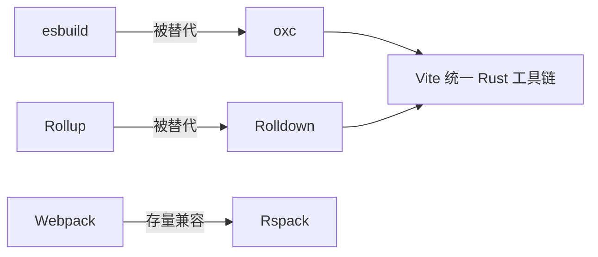

# 前端发展趋势2026

## 一、概述

2025-2026 年前端领域的三条主线：**响应式模型大一统（Signals）**、**构建工具 Rust 化**、**AI 辅助开发重塑工作流**。框架层面 React 仍占最大份额但复杂度饱受争议，Vue/Svelte/Solid 在开发者满意度上持续领先，TypeScript 已成为 GitHub 上使用量第一的语言。本文做一次速览式盘点，为选型与学习规划提供依据。

## 二、2025-2026 框架格局

| 框架 | 版本动态 | 关键演进 | 现状判断 |
|------|----------|----------|----------|
| React | React 19 稳定 | Server Components、React Compiler（编译期优化，自动 memo）、use()/Actions | 份额第一，就业市场最强；心智负担（服务端/客户端边界）仍被诟病 |
| Vue | 3.5 → 3.6 | 响应式 Props 解构、useTemplateRef、Vapor Mode（3.6 RC，2025-07 VueConf 发 alpha） | 国内主流，渐进式与 DX 平衡最好；生态详见 [[Vue3生态与工程化实践]] |
| Svelte | Svelte 5 | Runes（$state/$derived/$effect，signals 化）替代响应式赋值 | 满意度第一梯队，语法最简，岗位较少 |
| Solid | 稳定迭代 | 细粒度响应式（signals 发源地之一），JSX 但无 VDOM | 技术影响力大于市场份额，性能标杆 |
| Angular | v18+ zoneless | Signals 全面铺开、Zoneless 变更检测 | 大型企业平台化项目；正在向 signals 转型 |
| Next.js / Nuxt | Next.js 持续领先全栈框架 / Nuxt 4（2025-07-15） | RSC 全栈化 / app 目录 + Nitro | 全栈框架两强，分别代表 React 与 Vue 阵营 |
| Astro | 快速上升 | 内容站默认岛架构（Islands），框架无关 | 内容型站点黑马 |

> [!info] 共同方向
> 各家都在收敛到同一件事：**把运行时优化挪到编译期**（React Compiler、Vue Vapor、Svelte 5 编译产物），并以 **signals 式细粒度响应式**取代粗粒度 vdom diff。

## 三、构建工具变革：Rust 化浪潮

| 工具 | 出品方 | 定位 | 状态（2025-2026） |
|------|--------|------|-------------------|
| Vite | VoidZero | 开发服务 + 打包 | Vite 7（2025-06-24）发布；Rolldown 以 `rolldown-vite` 形式可选接入 |
| Rolldown | VoidZero | Rust 版 Rollup（API 兼容） | 成为 Vite 未来默认打包器的路线图明确 |
| oxc | VoidZero | Rust 版 JS/TS 工具链（parser/linter/transformer/minifier） | 替代 Babel/esbuild 的转换与压缩环节 |
| Rspack | 字节跳动 | Rust 版 Webpack（API 兼容） | Webpack 存量项目提速方案 |
| Turbopack | Vercel | Rust 增量打包器 | Next.js 默认构建链，独立使用场景收窄 |

关键事实：`rolldown-vite` 实测生产构建提速 **3-16 倍**、内存占用显著下降；Vite 生态统一到 Rolldown + oxc 后，开发与生产将共享同一套 Rust 工具链，"dev 快但 build 慢"的历史问题终结。对传统 Webpack 项目的迁移思路见 [[Webpack配置指南]]。

## 四、Signals：响应式的跨框架收敛

Signals 是"可追踪的值容器 + 惰性求值的派生图"：读取时自动收集依赖，写入时最小化更新。Vue 的 `ref`、Solid 的 signal、Preact 的 `@preact/signals`、Angular 的 signal、Svelte 5 的 runes，本质都是同一模型。

- **TC39 Signals 提案**（[proposal-signals](https://github.com/tc39/proposal-signals)）已进入标准流程，目标是把 signals 做成原生 JS 原语；其设计明确参考了 Vue `reactive()` 与 Solid 的实现思路。
- 若最终落地，意味着：响应式状态可**跨框架共享**（同一个 signal 同时驱动 Vue 与 Solid 组件），UI 库可以把大量精力从响应式实现转向组件层。
- 对 Vue 开发者的意义：组合式 API 的心智模型（ref/computed/watch）就是 signals 模型，未来迁移到原生原语几乎是平滑替换。

> [!tip] 学响应式就学"图"
> 无论 API 怎么变，理解依赖收集 → 惰性求值 → 精确失效这张有向无环图，就掌握了所有框架响应式的共同本质。

## 五、TypeScript：AI 时代的基础设施

- GitHub **Octoverse 2025** 报告：2025 年 8 月 TypeScript 超越 Python 与 JavaScript，成为 **GitHub 使用量第一的语言**。
- Stack Overflow 2025 调查（4.9 万开发者）：**84% 的开发者使用 AI 工具**，但对 AI 输出准确性的信任度下降（46% 不信任）——类型系统正是给 AI 生成代码加上的"机器可校验安全网"。
- AI 编码时代 TS 被普遍认为是更可靠的语言：类型声明给 LLM 提供了丰富上下文，编译期错误拦截幻觉 API。
- Vue 3 生态对 TS 的支持已是第一公民水准：`<script setup lang="ts">`、defineProps 泛型、Pinia 自动推导、Nuxt 4 的严格类型隔离。

## 六、微前端现状

热度回归理性，从"万能银弹"变成特定场景工具：

- **qiankun/wujie/micro-app** 等国内方案趋于稳定，主要服务超大型组织（几十个团队、多技术栈并存）的旧系统整合。
- 模块联邦（Module Federation）从 Webpack 特性被 Rspack/Rolldown 等新工具链继承，"运行时共享构建产物"更多用于微模块而非完整微前端。
- 社区共识：**能不微前端就不微前端**；新项目优先考虑 monorepo（pnpm workspace + Turborepo）+ 组件库共享，复杂度低一个数量级。

## 七、AI 编程工具对前端工作流的影响

1. **工作流重构**：从"写代码"转向"审代码 + 定义规格"。需求 → AI 生成组件/测试 → 人工 review 类型与边界 → 提交。lint、类型检查、单测覆盖率是 AI 代码质量的底线设施（工程化配置见 [[Vue3生态与工程化实践]]）。
2. **AI 界面组件兴起**：聊天流式 UI、引用、AIGC 卡片成为新组件类别（如 Element Plus X，2025 年底出现），前端要为"AI 应用"设计交互。
3. **前端是 AI 应用的主战场**：GitHub 2025 开发者调查显示 TypeScript 已是 AI 应用开发的第一语言，Web 端（Agent 控制台、对话界面）需求爆发。
4. **不变的部分**：架构判断、性能与安全（[[Web安全最佳实践]]）、协议层理解（[[HTTP协议详解]]）依然是人类工程师的核心价值——AI 补的是"手"，不是"判断"。

## 八、服务端渲染与边缘渲染趋势

- **SSR/SSG 全面主流化**：Next.js（RSC）、Nuxt 4（Nitro）、SvelteKit 把"服务端优先"变成默认选项；SPA 仅保留在纯内部系统中。
- **边缘渲染（Edge Rendering）**：Nitro、Vercel Edge Functions、Cloudflare Workers 让渲染逻辑部署到离用户最近的节点，TTFB 大幅下降；Node 运行时之外的 WinterCG/workerd 标准化推进中，框架运行时愈发可移植。
- **懒水合/岛屿架构**：Vue 3.5 引入 async 组件懒水合（`hydrateAfter` 等），Astro 岛屿架构在内容站普及——"首屏 HTML 完整 + 交互按需激活"成为常见架构。
- 对后端协作与部署的要求：理解缓存策略、流式响应、HTTP/2/3，见 [[HTTP协议详解]] 与 [[NodeJS-Express框架笔记]]。

主流 AI 编码工具在前端场景的大致分工（2025-2026 社区反馈综合）：

| 工具类型 | 代表 | 强项 | 使用建议 |
|----------|------|------|----------|
| IDE 内置助手 | Copilot、Cursor、Claude Code | 补全、重构、多文件编辑 | 日常主力，配 TS + ESLint 兜底 |
| 终端 Agent | Claude Code、Codex CLI | 跨文件任务、跑测试修复 | 大改动先出计划再执行 |
| 站点级生成 | v0、Bolt、Lovable | 原型、营销页、组件初稿 | 只当起点，勿直接进主干 |
| 精确对话/问答 | ChatGPT、豆包、Kimi | 方案对比、报错解释、文档问答 | 学习与排错利器 |

无论用哪种工具，团队都应守住同一条底线：**AI 的产出必须经过类型检查、lint、测试与人工 review 才能合并**——这正是第五节 TS 数据背后信任度下降的现实映射。

## 九、浏览器平台与样式方案趋势

浏览器原生能力在 2025-2026 年补齐了大量过去依赖 JS 库实现的功能，"少写一个库"成为新常态：

- **View Transitions API**：跨页面/跨状态过渡动画原生支持，Chrome 与 Safari 已可用；SPA 框架（Vue Router、Next.js）陆续封装接入，路由切换动画不再需要动画库。
- **CSS 原生方案崛起**：容器查询（Container Queries）、`:has()` 选择器、原生嵌套（CSS Nesting）全面可用，组件级自适应布局不再依赖 JS 监听宽度。样式工具层面 Tailwind CSS（v4 基于原生引擎 + Oxide/Rust 加速）继续是最主流的原子化方案，UnoCSS、CSS Modules 各有拥趸。
- **Popover API / Dialog 原生元素**：弹层、模态框的锚定与焦点管理浏览器原生接管，`anchor positioning` 逐步落地。
- **WebGPU**：从图形计算走向 AI 推理（浏览器端跑本地模型的路径之一），适合在 B 端可视化与端侧 AI 场景关注。
- **对开发习惯的影响**：CSS 写得好、懂浏览器平台的能力边界，比记住某组件库 API 更保值；相关布局基本功见 [[HTML-CSS布局技巧]]。

## 十、常见认知坑

> [!warning] 别把"新"当"该用"
> Vapor Mode（Vue 3.6 RC）、React Compiler 都处于生态适配期；生产环境等正式版 + 主流组件库跟进再上。架构选型看团队熟悉度与生态成熟度，不看发布会。

> [!warning] 微前端不是架构升级
> 多数"感觉需要微前端"的问题（构建慢、模块复用难、多团队协作）用 monorepo + 分包 + 设计系统能更好解决；微前端只解决"多技术栈运行时共存"这一种问题。

> [!tip] 用"底层不变量"对冲框架更迭
> 2025-2026 每个框架的具体 API 都在变，但三层不变量值得长期投入：① signals 响应式模型；② 编译期优化的思想；③ 浏览器平台本身（HTTP、安全、性能、无障碍）。押注不变量，框架只当方言学。

## 十一、学习建议（按投入优先级）

| 优先级 | 内容 | 理由 |
|--------|------|------|
| 1 | TypeScript + 一个主流框架深入（Vue3 或 React） | 就业与 AI 时代的通用底座 |
| 2 | Vite 全家桶工程化 | 所有项目都要用，且正快速演进 |
| 3 | SSR/全栈框架（Nuxt 4 或 Next.js） | 前端全栈化趋势，SEO 与性能主战场 |
| 4 | 响应式原理（signals/effect 图） | 一次投入，横跨所有框架 |
| 5 | AI 协作工作流（规格化提示词 + review 能力） | 84% 开发者已在用，是效率分水岭 |

## 十二、参考资料

1. [Strapi: 6 Best JavaScript Frameworks for 2026](https://strapi.io/blog/best-javascript-frameworks)
2. [TC39 Signals Proposal](https://github.com/tc39/proposal-signals)，ECMAScript 标准提案仓库
3. [GitHub Octoverse 2025](https://github.blog/news-insights/octoverse/) — TypeScript 成为 GitHub 第一语言
4. [Vite 7.0 is out!](https://vite.dev/blog/announcing-vite7)，Vite 官方博客，2025-06-24
5. [rolldown-vite（Rolldown 集成仓库）](https://github.com/vitejs/rolldown-vite) — 生产构建 3-16 倍提速
6. [宣布发布 Nuxt 4.0](https://nuxt.com/blog/v4)，Nuxt 官方博客，2025-07-15
7. [What just happened with TypeScript?](https://www.codestackr.com/blog/what-just-happened-with-typescript) — TS 与 AI 编码时代

## 相关笔记

- [[Vue3-组合式API]] / [[Vue3生态与工程化实践]] — Vue 主线知识
- [[React-Hooks详解]] — 对照 React 侧演进
- [[JavaScript-ES6新特性]] — 语言层基础
- [[HTML-CSS布局技巧]] — 浏览器平台与样式基本功
- [[HTTP协议详解]] / [[Web安全最佳实践]] — 不变量层
