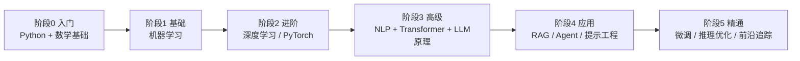

# AI学习路径

> [!info] 概述
> 本笔记是 AI 领域从入门到精通的**主线学习路线**，按「数学与编程 → 机器学习 → 深度学习 → 大模型原理 → LLM 应用开发 → 前沿追踪」六阶段递进。每个阶段给出学习目标、核心知识点、推荐资源与实践项目。原理细节见 [[大模型基础核心要点]]，应用开发实战见 [[LLM应用开发-RAG与Agent]]，更完整的原理+落地全景可参考 [[AI与大模型-从入门到精通]]。

## 一、总路线图



各阶段时长因人而异：有编程经验者通常 3-6 个月可完成阶段 0-2，再花 3 个月进入 LLM 应用开发；目标是"用 AI"而非"造 AI"的学习者可从阶段 3 直接切入，把原理学习后置。

## 二、分阶段学习路线

### 阶段 0：入门 —— Python 与数学基础

| 项目 | 内容 |
| --- | --- |
| 学习目标 | 能用 Python 完成数据处理与可视化；理解梯度下降背后的微积分含义 |
| 核心知识点 | Python（NumPy / Pandas / Matplotlib）；线性代数（矩阵乘法、特征值）；微积分（导数、链式法则、偏导）；概率统计（条件概率、分布、最大似然估计） |
| 推荐资源 | 《Python编程：从入门到实践》；3Blue1Brown《线性代数的本质》《神经网络》系列；Khan Academy 概率统计 |
| 实践项目 | 用 NumPy 手写线性回归（含手推梯度）；用 Pandas 分析一份真实数据集并绘图 |

> [!tip] 数学学到什么程度够用
> 大模型方向对数学的要求是"读懂公式"而非"证明定理"：矩阵运算（attention 本质是矩阵乘法）、链式法则（反向传播）、概率分布与交叉熵（语言模型的损失函数）。遇到公式再回查，比先啃完整本教材更高效。

阶段 0 的"验收代码"：只用 NumPy 手写梯度下降拟合 $y=wx+b$，跑通它就同时复习了微积分与优化思想。

```python
import numpy as np

x = np.random.rand(100)                       # 训练数据
y = 3.0 * x + 2.0 + 0.05 * np.random.randn(100)
w, b, lr = 0.0, 0.0, 0.1

for step in range(500):
    pred = w * x + b
    grad_w = 2 * ((pred - y) * x).mean()      # 损失 MSE 对 w 的偏导
    grad_b = 2 * (pred - y).mean()
    w -= lr * grad_w                          # 梯度下降更新
    b -= lr * grad_b
    if step % 100 == 0:
        print(f"step={step} w={w:.3f} b={b:.3f}")
```

之后再把同样的问题分别用 scikit-learn（阶段 1）和 PyTorch（阶段 2）各实现一遍，对比"手写 → 框架"的抽象差异，是理解框架价值的最快路径。

### 阶段 1：基础 —— 机器学习

| 项目 | 内容 |
| --- | --- |
| 学习目标 | 理解监督/无监督学习范式，能独立完成一个建模闭环：特征 → 训练 → 评估 → 调参 |
| 核心知识点 | 线性/逻辑回归、决策树与集成学习（XGBoost）、SVM、聚类（K-Means）、过拟合与正则化、交叉验证、评估指标（Accuracy / Precision / Recall / F1 / AUC） |
| 推荐资源 | 吴恩达《Machine Learning》（Coursera）；李航《统计学习方法》；scikit-learn 官方教程；库内笔记 [[机器学习-机器学习基础入门总结]] |
| 实践项目 | Kaggle Titanic 分类赛；用 scikit-learn 完成房价预测并写实验报告 |

### 阶段 2：进阶 —— 深度学习与 PyTorch

| 项目 | 内容 |
| --- | --- |
| 学习目标 | 理解神经网络如何"学"（前向传播/反向传播/优化器），熟练用 PyTorch 搭建与训练模型 |
| 核心知识点 | MLP、激活函数、损失函数、反向传播；CNN 与计算机视觉入门、RNN 序列建模；优化器（SGD/Adam）、学习率调度、BatchNorm/Dropout；GPU 训练与混合精度 |
| 推荐资源 | 《动手学深度学习》（李沐，d2l.ai，PyTorch 版）；Karpathy《Neural Networks: Zero to Hero》；PyTorch 官方 60 分钟教程；库内笔记 [[深度学习-PyTorch入门]] |
| 实践项目 | 手写 MNIST 分类网络；CIFAR-10 上训练 CNN 并做数据增强实验；复现 Karpathy 的 micrograd / makemore |

### 阶段 3：高级 —— NLP 与大模型原理

| 项目 | 内容 |
| --- | --- |
| 学习目标 | 从 Word2Vec 到 Transformer 建立完整 NLP 视角，能讲清 LLM 的训练全流程（预训练 → SFT → RLHF） |
| 核心知识点 | 词向量 Word2Vec/GloVe；Seq2Seq 与注意力机制；Transformer 结构（Self-Attention、多头、FFN、位置编码 RoPE）；BERT 的双向掩码语言模型（见 [[自然语言处理-BERT模型详解]]）；GPT 式自回归预训练；Scaling Laws 与 MoE；SFT/RLHF/DPO 对齐技术 |
| 推荐资源 | 《Attention Is All You Need》原文；Karpathy「Let's build GPT from scratch」；The Illustrated Transformer（Jay Alammar）；Hugging Face LLM Course（免费） |
| 实践项目 | 从零实现一个迷你 GPT（nanoGPT 路线）；用 Hugging Face Transformers 微调 BERT 做文本分类；精读 DeepSeek-R1 论文并写总结 |

### 阶段 4：应用 —— LLM 应用开发（当前就业市场主流方向）

| 项目 | 内容 |
| --- | --- |
| 学习目标 | 独立开发一个生产可用的 LLM 应用：包含提示工程、RAG、Agent 与评估 |
| 核心知识点 | 提示工程（结构化提示、少样本示例、思维链）；API 与流式输出；RAG 全流程（分块/向量检索/重排/生成）；Agent（工具调用、ReAct、MCP 协议）；框架（LangChain / LlamaIndex / Dify）；RAGAS 等评估体系 |
| 推荐资源 | Anthropic《Building Effective Agents》；MCP 官方文档 modelcontextprotocol.io；LangChain / LlamaIndex 官方文档；库内笔记 [[AI工具-LangChain实战]] 与 [[LLM应用开发-RAG与Agent]] |
| 实践项目 | 给自己的笔记库做一个本地知识问答 RAG；开发一个能查天气+读写文件的工具调用 Agent；用 Dify 搭建一个客服工单分流工作流 |

### 阶段 5：精通 —— 微调、推理优化与前沿追踪

| 项目 | 内容 |
| --- | --- |
| 学习目标 | 掌握把开源模型改造成专属模型、并低成本部署的完整能力 |
| 核心知识点 | 参数高效微调（LoRA / QLoRA）；分布式训练入门（DeepSpeed / FSDP）；推理优化（KV Cache、量化 GPTQ/AWQ、投机解码、vLLM/SGLang 部署）；模型评测（通用 benchmark + 垂直场景评测集）；开源模型选型（Qwen / DeepSeek / GLM / Llama） |
| 推荐资源 | Hugging Face PEFT 文档；vLLM 官方文档；LLM101n（Karpathy）；Papers with Code 趋势榜；arXiv 每周扫描 |
| 实践项目 | 用 QLoRA 在消费级显卡上微调 7B 模型注入领域知识；用 vLLM + 量化把模型部署为 OpenAI 兼容 API；搭建自己的 LLM 评测流水线 |

## 三、核心要点速查

| 阶段 | 一句话目标 | 最小技能集 | 验收标志 |
| --- | --- | --- | --- |
| 入门 | 会用 Python 处理数据，读懂梯度 | NumPy / Pandas / 微积分直觉 | 手写线性回归收敛 |
| 机器学习 | 完成建模闭环 | scikit-learn / 评估指标 / 交叉验证 | Kaggle 入门赛拿到非垫底分数 |
| 深度学习 | 会训神经网络 | PyTorch / 反向传播 / 调参 | MNIST→CIFAR-10 完整实验 |
| NLP/大模型原理 | 讲清 Transformer 与训练全流程 | Attention 手推 / 预训练-SFT-RLHF 脉络 | 从零写出迷你 GPT |
| 应用开发 | 交付 LLM 应用 | 提示工程 / RAG / Agent / MCP / 评估 | 上线一个真实可用的 RAG 问答 |
| 精通 | 拥有专属模型与生产部署 | LoRA / 量化 / vLLM / 评测 | 消费级显卡跑起微调+部署全链路 |

## 四、常见坑与最佳实践

> [!warning] 常见坑
> 1. **只看视频不动手**：AI 学习最大的坑是"收藏等于学会"，每个阶段必须有一个跑通的代码仓库。
> 2. **数学完美主义**：卡在"先把数学学完"会导致永远到不了大模型；按需回查即可。
> 3. **跳过机器学习直奔 LLM**：不理解过拟合、评估、数据分布漂移，做 RAG 评估时会寸步难行。
> 4. **追逐所有新模型**：版本半年一换，但 Transformer、训练范式、RAG/Agent 方法论相当稳定，先抓不变的。
> 5. **把 LangChain 当黑盒**：框架一多就难调试，Anthropic 官方建议先裸写 API 调用，理解原理后再引入框架。

> [!tip] 最佳实践
> 1. **以项目为锚**：每阶段定一个"做出来"的项目，倒逼知识学习；项目放进 GitHub 作为作品集。
> 2. **用 AI 学 AI**：2026 年的正确姿势是全程使用 Claude Code / Cursor 等 AI 编程工具结对学习（可先用 [[AI应用场景分析]] 梳理自己要用 AI 解决什么问题）。
> 3. **读一手来源**：优先读论文原文、官方文档与发布博客，二手自媒体信息必须回源核对。
> 4. **建立评测意识**：从第一个 LLM 应用开始就写评估脚本，"感觉变好了"不是工程语言。
> 5. **持续追踪**：订阅 Hugging Face Blog、各大实验室官方账号，每月花 2 小时扫一遍前沿，其余时间深耕主线。

## 五、2025-2026 最新动态（信息截至 2026-11-18）

| 时间 | 动态 | 对学习路线的影响 |
| --- | --- | --- |
| 2025-01 | DeepSeek-R1 开源推理模型，验证了"强化学习激发推理能力"路线（RLVR） | 推理模型（Reasoning Models）成为必修概念 |
| 2025-11-12 | OpenAI 发布 GPT-5.1，主打**自适应推理**，分 Instant / Thinking 双档 | 学会按任务难度选模型档位，控制成本 |
| 2025-11-18 | Google 发布 Gemini 3 Pro，多模态与推理达到 SOTA，1M 上下文 | 长上下文应用（整库代码/整本书）可行性大增 |
| 2025-11-24 | Anthropic 发布 Claude Opus 4.5，SWE-bench Verified 80.9%，价格低于前代 | Agentic 编程成为默认开发方式 |
| 2025-12 | DeepSeek-V3.2 发布，思考能力首次集成进工具调用；Speciale 版在 IMO/CMO/ICPC 达金牌水平 | Agent + 推理融合是明确趋势 |
| 2026 年 | MCP 成为事实行业标准（OpenAI、Google 均已采纳，2026-07-28 发布新版规范）；Agentic RAG 成为主流 RAG 形态 | 工具接入优先选 MCP，而非自造私有协议 |
| 2026-08~10 | DeepSeek-V4 Pro GA、V4.1-Flash 相继发布；Kimi K2.6、GLM-5、Qwen3 大 MoE 等新一代开源模型迭代 | 开源模型在多数场景已"够用且便宜"，自托管门槛下降 |

> [!info] 学习者视角的判断
> 2026 年的格局是"闭源旗舰（GPT/Claude/Gemini）+ 开源紧追（DeepSeek/Qwen/GLM/Kimi）"双轨并行，多模态成为标配。对个人学习者而言：**应用层技能（RAG/Agent/MCP/评估）的半衰期长于任何具体模型版本**，把时间投入在方法论上回报最高。

## 六、参考资料

1. [大模型学习路线（2025最新）从零基础入门到精通 - 知乎](https://zhuanlan.zhihu.com/p/25167920984)（知乎，2025-05）
2. [2025年最全大模型学习路线，从零基础到精通 - CSDN](https://blog.csdn.net/weixin_47933729/article/details/144896087)（CSDN，2025-01）
3. [Machine Learning Roadmap — Beginner to Expert (2026)](https://www.coursera.org/resources/ml-learning-roadmap)（Coursera）
4. [deep-learning-llm-agent-notes - GitHub](https://github.com/loveunk/deep-learning-llm-agent-notes)（含 30 天新人路线）
5. [Building Effective Agents - Anthropic](https://www.anthropic.com/research/building-effective-agents)（2024-12，Agent 架构方法论）
6. [Model Context Protocol 官方文档](https://modelcontextprotocol.io/docs/getting-started/intro)（MCP 协议）
7. [Why the Model Context Protocol Won - The New Stack](https://thenewstack.io/why-the-model-context-protocol-won)（2025-12）
8. [Claude Opus 4.5 发布公告 - Anthropic](https://www.anthropic.com/news/claude-opus-4-5)（2025-11-24）
9. [DeepSeek API 新闻：V3.2 发布](https://api-docs.deepseek.com/news/news251201)（2025-12-01）
10. [RAG Techniques Compared: Best Practices Guide - Starmorph](https://blog.starmorph.com/blog/rag-techniques-compared-best-practices-guide)（2026）
11. [Claude Prompting Best Practices - Anthropic 官方文档](https://platform.claude.com/docs/en/build-with-claude/prompt-engineering/claude-prompting-best-practices)
