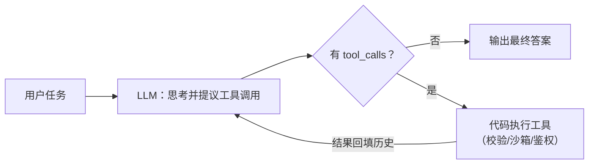
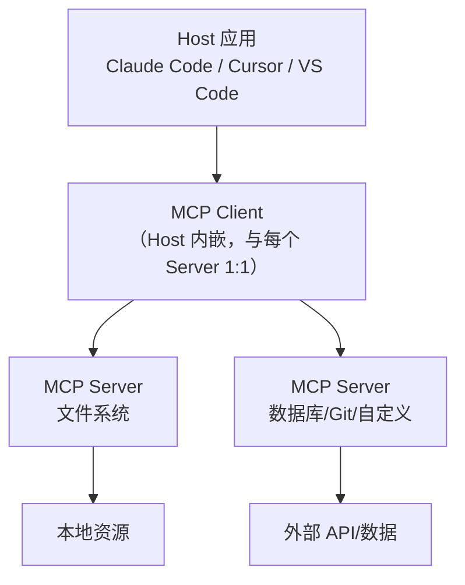

# LLM-Agent与MCP协议

> [!abstract] 摘要
> Agent 让 LLM 从"回答问题"升级为"完成任务"：自主规划、调用工具、观察结果、循环迭代；MCP（Model Context Protocol）则是 2026 年工具接入的事实标准——一次开发、处处可用。本笔记讲清工作流与 Agent 的边界（Anthropic 五模式）、ReAct 循环与 function calling 协议细节、MCP 架构与规范演进，并给出手写最小工具调用 Agent 的完整代码。学完你能：从零实现带自定义工具的 Agent，并知道何时上 MCP、何时退回工作流。

主线定位：[[AI学习路径]] 阶段 4 的进阶篇；RAG 与 Agent 全景速查见 [[LLM应用开发-RAG与Agent]]；Agent 场景提示词与防注入见 [[LLM-提示工程实战]]；检索作为工具的 Agentic RAG 见 [[LLM-RAG检索增强生成]]。

## 一、概念与原理

### 1.1 工作流 vs Agent：Anthropic 的行业定义

Anthropic《Building Effective Agents》（2024-12）的核心区分已成为行业共同语言：

- **工作流（Workflow）**：LLM 与工具按**预定义代码路径**编排——流程是人写的，模型只填空。确定性高、成本低、易调试；
- **智能体（Agent）**：LLM **自己决定流程与工具使用**——代码只提供循环与护栏。适合开放式任务，代价是成本、延迟与错误累积。

推荐的五种工作流模式（解决 80% 需求，先于 Agent 使用）：**提示链**（串行拆步，如生成→翻译→校对）、**路由**（先分类再分发，如客服分流）、**并行化**（分段同时处理/多次生成投票）、**编排者-执行者**（一个 LLM 动态拆解分派，如多文件代码改动）、**评估者-优化者**（生成-评审循环直至达标）。总原则：**从最简单的方案开始，能一次调用解决就不要上 Agent；流程固定用工作流，任务开放才用 Agent。**

### 1.2 ReAct 循环：Agent 的心跳

ReAct（Reason + Act）：模型交替输出"思考 → 行动（调工具）→ 观察结果"，直到得出答案。现代 API 已把这套模式固化为 function calling——模型不再输出文本形式的"Action:"，而是返回结构化的 `tool_calls`，由应用代码执行并回填结果。



### 1.3 Function calling 协议细节（OpenAI 兼容协议）

三个角色分工：**模型只提议**（依据工具描述决定调不调、参数怎么填），**应用负责一切工程**（校验、执行、错误处理）。

```python
tools = [{
    "type": "function",
    "function": {
        "name": "get_weather",
        "description": "查询指定城市当前天气。城市名用中文。",   # 模型的"说明书"
        "parameters": {                          # JSON Schema 约束参数
            "type": "object",
            "properties": {
                "city": {"type": "string", "description": "城市名，如'北京'"},
            },
            "required": ["city"],
        },
    },
}]
```

协议要点：

1. **模型返回 `tool_calls` 数组**：可能一次返回多个（并行调用），必须遍历整个数组，不要假设只有一个；每个结果用 `role="tool"`、携带对应 `tool_call_id` 回填；
2. **错误也要回填**：执行失败时把结构化错误信息（而非空串）回填，模型会自行调整策略——工具描述清晰、返回带错误提示，收益高于堆提示词；
3. 跨厂商差异：OpenAI 侧参数是字符串需 `json.loads(call.function.arguments)`；Anthropic 侧直接是 dict（`block.input`），适配层注意区分。

### 1.4 MCP 架构：AI 应用的 USB-C

MCP 由 Anthropic 于 2024-11 发布并开源，目标是用统一协议取代每个"模型×工具"对之间的私有集成：



| 概念 | 说明 |
| --- | --- |
| Host | 面向用户的 LLM 应用（Claude Code、Cursor、自研 Agent） |
| Client | Host 内的连接器，与每个 Server 保持 1:1 会话 |
| Server | 轻量进程，封装一种数据源或能力 |
| **tools** | 模型可主动调用的操作（增删改查、发请求） |
| **resources** | 可读取的数据（文件、记录），由应用或用户拉取 |
| **prompts** | 预定义提示模板，用户触发 |
| 传输 | 本地 `stdio`；远程 **Streamable HTTP**（可部署为共享服务） |

**规范演进时间线（2024-11 → 2026）**：

| 版本 | 关键变化 |
| --- | --- |
| 2024-11-05 | 首个正式规范 |
| 2025-03-26 | 引入 OAuth 2.1 授权框架；Streamable HTTP 替代 HTTP+SSE |
| 2025-06-18 / 2025-11-25 | 持续修订（安全与采样等细化） |
| **2026-07-28（v2）** | 协议史上最大更新：核心架构从有状态会话转向**无状态化**，引入新的扩展框架，`/mcp` 端点向后兼容旧客户端 |
| 2027-03-30 | 官方路线图目标 |

生态现状（2026）：OpenAI Agents SDK、Google、VS Code/Cursor 均已采纳；The New Stack 评价"MCP 赢了"——**自建私有工具协议的投资应当停止**。

### 1.5 多 Agent 协作模式

单 Agent + 好工具能解决 80% 问题；确需多 Agent 时常用三种编排：**对话式**（AutoGen 风格，角色间互发消息辩论/协作，适合推理类任务，调试成本高）、**角色分工**（CrewAI 风格，规划者/研究者/写作者流水线，隐喻直观）、**图状态机**（LangGraph 风格，节点是 Agent、边是控制流，支持循环与**人工审批节点**，生产级首选）。工程警示：多 Agent 会**放大**成本与错误传播（下游拿上游的错误输出继续走），引入前先确认单 Agent 确实失败。

## 二、核心语法 / API 详解

### 2.1 手写最小 Agent 循环：逐行讲解

```python
import json
from openai import OpenAI

client = OpenAI()   # 或 OpenAI(base_url="https://api.deepseek.com/v1", api_key=KEY)
MODEL = "deepseek-chat"

# ---- ① 工具实现：真正的"手" ----
def get_weather(city: str) -> dict:
    """演示用假实现；生产中这里是 requests.get(...) 等。"""
    return {"city": city, "temp": 26, "weather": "多云", "unit": "摄氏"}

TOOLS_IMPL = {"get_weather": get_weather}          # 名字 → Python 函数

# ---- ② 工具 schema：模型看得到的"说明书" ----
TOOLS = [{"type": "function", "function": {
    "name": "get_weather",
    "description": "查询指定城市当前天气，城市名用中文。",
    "parameters": {"type": "object",
                   "properties": {"city": {"type": "string", "description": "城市名"}},
                   "required": ["city"]}}}]

# ---- ③ Agent 主循环 ----
def agent(task: str, max_steps: int = 8) -> str:
    """max_steps 是安全护栏：防止模型陷入无限循环烧钱。"""
    history = [{"role": "user", "content": task}]
    for _ in range(max_steps):
        resp = client.chat.completions.create(
            model=MODEL, messages=history, tools=TOOLS)
        msg = resp.choices[0].message
        history.append(msg)                        # assistant 消息（含 tool_calls）入历史
        if not msg.tool_calls:                     # 模型不再提议工具 → 任务完成
            return msg.content
        for tc in msg.tool_calls:                  # 并行调用：必须遍历全部
            name, args = tc.function.name, json.loads(tc.function.arguments)
            try:                                   # 执行 + 错误兜底
                result = TOOLS_IMPL[name](**args)
            except Exception as e:                 # 错误也回填：模型会自己调整
                result = {"error": f"{type(e).__name__}: {e}"}
            history.append({"role": "tool", "tool_call_id": tc.id,
                            "content": json.dumps(result, ensure_ascii=False)})
    return "已达到最大步数，任务未完成。"
```

要点标注（对照注释）：`max_steps` 护栏 → `if not msg.tool_calls` 判停 → 遍历并行调用 → `try/except` 错误回填 → `tool_call_id` 对齐。这 40 行就是所有 Agent 框架的内核；Anthropic 官方建议先裸写理解原理再上框架。

### 2.2 极简 MCP Server（Python SDK）

```python
# pip install "mcp[cli]"    （Python 3.10+）
from mcp.server.fastmcp import FastMCP

mcp = FastMCP("note-tools")           # Server 名字

@mcp.tool()
def count_words(text: str) -> int:
    """统计文本字数。docstring 就是模型看到的工具描述。"""
    return len(text)

if __name__ == "__main__":
    mcp.run()                          # 默认 stdio 传输
```

在 Claude Code / Cursor 等 Host 的 MCP 配置中以 `{"command": "python", "args": ["server.py"]}` 方式注册即可。写一次 Server，所有兼容 MCP 的客户端（Claude、ChatGPT、Cursor、VS Code）都能使用——这就是"USB-C"的价值。

## 三、实战案例

**场景**：给一个"技术选型助手" Agent 加两个自定义工具（检索本地笔记 + 查天气演示），让它能自主决定查什么、查几轮。

**运行环境**：Python 3.10+，依赖 `pip install openai`；任意 OpenAI 兼容端点。

```python
# agent_custom.py —— 带 2 个自定义工具的最小 Agent（完整可运行）
import json, pathlib
from openai import OpenAI

client = OpenAI()          # 按需改 base_url / api_key
MODEL = "deepseek-chat"

def search_notes(query: str, top_k: int = 3) -> list[str]:
    """工具1：在本知识库目录做关键词检索（真实实现，零依赖）。"""
    hits = []
    for p in pathlib.Path("40-AI技术").glob("*.md"):
        text = p.read_text(encoding="utf-8")
        if query in text:
            i = text.index(query)
            hits.append(f"{p.name}: ...{text[max(0,i-50):i+150]}...")
    return hits[:top_k] or ["未找到匹配笔记"]

def get_weather(city: str) -> dict:
    """工具2：天气（演示用假实现，生产换成真实 API）。"""
    return {"city": city, "temp": 26, "weather": "多云"}

IMPL = {"search_notes": search_notes, "get_weather": get_weather}

def tool(name, desc, props, required):
    """工具 schema 的紧凑工厂函数，避免重复样板。"""
    return {"type": "function", "function": {
        "name": name, "description": desc,
        "parameters": {"type": "object", "properties": props,
                       "required": required}}}

TOOLS = [
    tool("search_notes", "在本地 AI 技术知识库中按关键词检索笔记片段。",
         {"query": {"type": "string", "description": "中文关键词"}}, ["query"]),
    tool("get_weather", "查询某城市当前天气（用于演示工具调用）。",
         {"city": {"type": "string", "description": "城市名"}}, ["city"]),
]

def run_agent(task: str, max_steps: int = 10):
    history = [
        {"role": "system", "content":
         "你是技术选型助手。回答前先检索本地笔记获取依据；引用笔记时给出文件名。"},
        {"role": "user", "content": task},
    ]
    for step in range(max_steps):
        resp = client.chat.completions.create(model=MODEL, messages=history, tools=TOOLS)
        msg = resp.choices[0].message
        history.append(msg)
        if not msg.tool_calls:                     # 无工具提议 → 输出最终答案
            return msg.content
        for tc in msg.tool_calls:
            fn = IMPL.get(tc.function.name)
            result = (fn(**json.loads(tc.function.arguments))
                      if fn else {"error": f"未知工具 {tc.function.name}"})
            history.append({"role": "tool", "tool_call_id": tc.id,
                            "content": json.dumps(result, ensure_ascii=False)})
    return "超出最大步数。"

if __name__ == "__main__":
    print(run_agent("知识库里有没有讲 KV Cache 的笔记？顺便查下北京今天天气"))
    # 预期：第一轮提议 search_notes（可能并行两个），下一轮补查，末轮综合回答
```

## 四、动手练习

1. **手算 ReAct**：给出任务"查询北京天气并决定是否带伞"，写出 Agent 前三轮完整的"思考/工具调用/观察"消息序列（伪代码即可）。
   提示：注意每轮 history 如何增长；tool 消息必须带 tool_call_id。
2. **加自定义工具**：给第三节代码新增 `write_file(path, content)` 工具，让 Agent 能把选型结论写入 Markdown。
   提示：用 `tool(...)` 工厂一行注册；思考要不要对写入路径加白名单（安全）。
3. **错误回填实验**：把 `get_weather` 改成必抛异常的版本，观察模型收到 `{"error": ...}` 后第二轮的行为，对比"回填空串"的差异。
4. **护栏设计**：给 Agent 加上"写文件类工具调用前必须打印待执行操作并等待确认"的 human-in-the-loop 逻辑。
   提示：在执行分叉处区分只读/写入工具；这是生产 Agent 的必备设计。
5. **综合：写一个极简 MCP Server 并接入真实 Host**：实现一个暴露 `search_notes` 工具的 FastMCP Server，在 Claude Code（或其他 MCP Host）中注册，用自然语言验证工具被调用。
   提示：注册后先确认 Host 工具列表出现 `search_notes`；调用失败优先检查 python 路径与依赖环境。

> [!success]- 练习 5 参考答案要点
> 验收标准：(1) Server 代码含 `@mcp.tool()` 装饰器与 docstring（docstring 即模型看到的工具描述）；(2) Host 配置的 `command`/`args` 指向正确解释器，stdio 型无需端口；(3) 验证链路完整：Host 工具列表出现 `search_notes` → 自然语言提问触发调用 → 返回结果进入模型回答并带笔记文件名；(4) 常见故障——依赖装在错误环境（建议 venv 固定路径）、docstring 缺失导致模型不知道何时调用。

## 五、常见坑与 FAQ

> [!warning] Agent 无护栏上线
> 不设 `max_steps`、不给工具做权限隔离与沙箱，一次错误调用就可能删文件、发邮件、烧光 token。最低配置三件套：最大迭代数、工具分级权限（只读/写入）、敏感操作人工确认。

> [!warning] 只处理第一个 tool_call
> 模型一轮可以返回多个并行工具调用，只处理第一个会导致其余结果永久缺失、历史错位，模型开始"幻觉工具结果"。必须遍历整个 `tool_calls` 数组并逐个回填。

> [!warning] 工具执行失败时返回空结果
> 空串/空 dict 让模型无法区分"查到了空结果"与"出错了"。正确做法是把结构化错误信息回填（含异常类型与建议动作），模型会自主调整策略——这往往比写更复杂的提示词更有效。

> [!tip] FAQ：什么时候需要 MCP，什么时候直接 function calling？
> 自用或单一应用内嵌工具 → 直接 function calling（更简单、可控）；工具要被多个 Host/团队复用（既有 Claude Code 又有 Cursor）→ 实现 MCP Server。2026 年"新工具一律 MCP"是默认答案，但个人玩具工具不必为了 MCP 而 MCP。

## 六、自检清单

- [ ] 能说出工作流与 Agent 的区别，并判断一个任务该用哪种
- [ ] 能列出 Anthropic 五种工作流模式及各自适用场景
- [ ] 能不看资料写出"提议→执行→回填→判停"的 Agent 主循环
- [ ] 知道 tool_calls 是数组、必须遍历、错误也要回填
- [ ] 能画出 MCP 的 Host/Client/Server 架构并说出 tools/resources/prompts 三原语
- [ ] 知道 MCP 规范 2025-03（OAuth/Streamable HTTP）与 2026-07（无状态化）两次关键演进
- [ ] 写过至少一个自定义工具并验证过完整调用链路
- [ ] 能说出多 Agent 协作的收益与代价，知道何时留在单 Agent

## 七、关联笔记与参考

**库内关联**：[[LLM应用开发-RAG与Agent]]（Agent 与 RAG 全景） · [[LLM-提示工程实战]]（系统提示与防注入） · [[LLM-RAG检索增强生成]]（Agentic RAG） · [[AI学习路径]]（阶段 4 定位） · [[AI工具-LangChain实战]]（框架化实现）

**参考资料**：

1. [Building Effective Agents - Anthropic](https://www.anthropic.com/research/building-effective-agents)（工作流五模式与 Agent 原则）
2. [Model Context Protocol 官方文档](https://modelcontextprotocol.io/docs/getting-started/intro)（架构、传输、核心原语）
3. [MCP 规范变更日志（2025-03-26 版：OAuth 2.1 与 Streamable HTTP）](https://modelcontextprotocol.io/specification/2025-03-26/changelog)
4. [Function Calling 指南 - OpenAI 官方文档](https://developers.openai.com/api/docs/guides/function-calling)（JSON Schema 定义与 tool_calls 协议细节）
5. [Introducing the Model Context Protocol - Anthropic](https://www.anthropic.com/news/model-context-protocol)（2024-11 发布文）
6. [Why the Model Context Protocol Won - The New Stack](https://thenewstack.io/why-the-model-context-protocol-won)（2025-12 生态评述）
7. [MCP Python SDK - GitHub](https://github.com/modelcontextprotocol/python-sdk)（FastMCP 官方实现）
