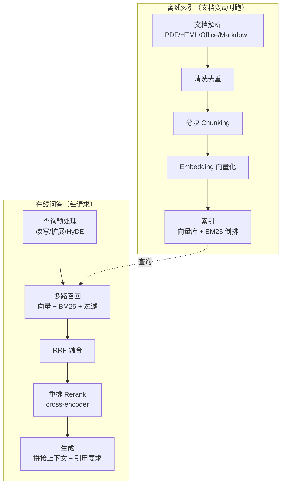

# LLM-RAG检索增强生成

> [!abstract] 摘要
> RAG（Retrieval-Augmented Generation）让模型在回答前先检索外部知识，解决私有知识与时效性两大问题、缓解幻觉并让答案可溯源——它是 2026 年企业 LLM 应用渗透率最高的架构。本笔记讲透"解析→分块→embedding→索引→检索→重排→生成"全流程、分块与 embedding 选型决策、RAGAS 评估指标，并给出 LangChain + FAISS 的最小可运行实现与进阶技术。学完你能：为自己的文档库搭一个可评估、可迭代的 RAG 问答系统。

主线定位：[[AI学习路径]] 阶段 4 的主体；架构速查版见 [[LLM应用开发-RAG与Agent]]；框架细节见 [[AI工具-LangChain实战]]；"RAG 管知识、微调管行为"的分工见 [[大模型-训练范式与微调实战]]。

## 一、概念与原理

### 1.1 为什么需要 RAG

模型参数里的知识有三个天然缺陷：**截止日期**（训练后的事一无所知）、**私有性**（公司文档、个人笔记不在语料里）、**不可溯源**（说错了不知道引的谁）。RAG 把"生成"改为"检索后生成"，代价是工程链路变长——所以 RAG 的质量本质上是**检索质量**问题，生成端只是最后一步。

### 1.2 全流程架构



### 1.3 分块策略对比（影响检索质量的第一变量）

| 策略 | 做法 | 优点 | 缺点 | 适用 |
| --- | --- | --- | --- | --- |
| 固定长度 | 256~1024 token/块，重叠 10%~20% | 简单、快 | 可能把语义切半 | 基线/快跑通 |
| 递归字符切分 | 按段落→句子→字符层级递归切 | 保留自然边界，通用默认 | 仍是"大小"视角 | **首选基线**（LangChain 默认） |
| 结构化切分 | 按 Markdown 标题/HTML 标签/代码块切 | 保留章节路径，天然语义单元 | 依赖文档结构规范 | 文档站、Wiki、笔记库 |
| 语义分块 | 用 embedding 找相邻句相似度断点 | 主题漂移大的语料表现好 | 多一遍 embedding 成本 | 高质量语料 |
| 父子块（small-to-big） | 检索用小块（准），回喂父大块（全） | 精度与上下文兼得，生产最常用 | 双份存储与索引 | 生产默认推荐 |
| Late chunking | 先整篇出 token 级向量，后按边界池化 | 长上下文 embedding 模型专属 | 需支持长输入的模型 | bge-m3 等长文本场景 |

经验起点：512 token + 15% 重叠 + 父子块，先跑通再优化；**没有普适最优块大小，必须用自己的金标集量出来**。

### 1.4 Embedding 选型（中文场景）

| 模型 | 维度 | 最大输入 | 特点 |
| --- | --- | --- | --- |
| `BAAI/bge-large-zh-v1.5` | 1024 | 512 token | 中文风险最小的默认选择 |
| `BAAI/bge-m3` | 1024 | 8192 token | 长文档+多语言；同时支持 dense/sparse/Colbert 三种检索，可做混合召回 |
| `BAAI/bge-small-zh-v1.5` | 512 | 512 token | 延迟/资源敏感场景 |
| `text-embedding-3-large`（OpenAI） | 3072 | 8191 token | API 付费、英文强，中文可选 bge 对标 |

选型四条铁律：**① 查询与文档必须用同一模型**；② 归一化后用内积（≈余弦）；③ 用自己的语料小规模评测（C-MTEB 榜单只做初筛）；④ bge 系列配套 `bge-reranker` 可一站式解决"召回+精排"。

### 1.5 检索评估：RAGAS 四维指标

RAGAS（docs.ragas.io）用 LLM-as-a-judge 对四维打分，是 RAG 评估的事实标准：

| 指标 | 衡量什么 | 需要什么输入 |
| --- | --- | --- |
| Faithfulness 忠实度 | 答案是否被检索内容支持（幻觉率代理指标） | 问题+答案+上下文 |
| Answer Relevancy | 答案与问题的相关程度 | 问题+答案 |
| Context Precision | 相关 chunk 是否排在无关 chunk 前面 | 问题+上下文（可无标注） |
| Context Recall | 该找齐的内容找齐了没有 | 需要标准答案（ground truth） |

工程顺序建议：先建 20~50 条"问题-标准出处"金标集 → 离线先看 Context Recall/Precision（检索层诊断）→ 在线看 Faithfulness/Relevancy（生成层诊断）→ 每次改动（分块/模型/重排）重跑同一评测。MRR/NDCG/HitRate 可在没有强 LLM judge 时做纯排序指标补充。

## 二、核心语法 / API 详解

### 2.1 LangChain 核心组件

LangChain 的 RAG 相关抽象只有五类，理解它们比背 API 重要：

```python
# pip install langchain langchain-community faiss-cpu sentence-transformers
from langchain_community.document_loaders import DirectoryLoader
from langchain_text_splitters import RecursiveCharacterTextSplitter
from langchain_huggingface import HuggingFaceEmbeddings
from langchain_community.vectorstores import FAISS
from langchain_core.documents import Document

# ① Loader：把文件变成 Document 对象（page_content + metadata）
docs = DirectoryLoader("docs/", glob="**/*.md").load()

# ② Splitter：分块（chunk_overlap 是重叠 token/字符数）
splitter = RecursiveCharacterTextSplitter(
    chunk_size=512, chunk_overlap=64,
    separators=["\n# ", "\n## ", "\n\n", "。", "，"],  # 中文语料自定义分隔符优先级
)
chunks = splitter.split_documents(docs)          # metadata 自动继承

# ③ Embeddings：查询与文档共用同一模型（铁律）
embeddings = HuggingFaceEmbeddings(
    model_name="BAAI/bge-small-zh-v1.5",
    encode_kwargs={"normalize_embeddings": True}, # 归一化：内积≈余弦
)

# ④ VectorStore：入库（FAISS 本地零部署）
vs = FAISS.from_documents(chunks, embeddings)
vs.save_local("faiss_index")                     # 持久化；下次 FAISS.load_local

# ⑤ Retriever：检索入口（后续可链式加过滤/重排）
retriever = vs.as_retriever(search_kwargs={"k": 4})
hits = retriever.invoke("RAG 怎么评估？")          # 返回 List[Document]
```

### 2.2 重排与多路召回 RRF

```python
# 重排：cross-encoder 对 query-chunk 对逐个精打分（比双塔准，比 LLM 便宜）
# pip install sentence-transformers
from sentence_transformers import CrossEncoder
reranker = CrossEncoder("BAAI/bge-reranker-base")
def rerank(query, docs, top_k=3):
    pairs = [(query, d.page_content) for d in docs]
    scores = reranker.predict(pairs)              # 相关性分数
    ranked = sorted(zip(docs, scores), key=lambda x: -x[1])
    return [d for d, _ in ranked[:top_k]]

# 多路召回 RRF（Reciprocal Rank Fusion）：按倒数排名融合多个检索通道
def rrf_merge(list_a: list, list_b: list, k: int = 60) -> list:
    """list_a/list_b: 两个已排序的检索结果（如向量+BM25），返回融合后排序。"""
    scores = {}
    for ranked in (list_a, list_b):
        for pos, item in enumerate(ranked):
            key = item.page_content[:64]          # 以内容为键去重
            scores.setdefault(key, [0.0, item])
            scores[key][0] += 1.0 / (k + pos + 1) # RRF 公式：Σ 1/(k+rank)
    return [x[1] for x in sorted(scores.values(), key=lambda s: -s[0])]
```

### 2.3 生成端提示词（引用与防幻觉）

```python
def answer(query: str, retriever, llm) -> str:
    docs = rerank(query, retriever.invoke(query, k=6), top_k=3)
    context = "\n".join(
        f"[{i+1}] (来源: {d.metadata.get('source', '?')}) {d.page_content}"
        for i, d in enumerate(docs))
    prompt = (
        "仅依据【资料】回答问题；每个结论后标注引用编号 [n]；"
        "资料不足以回答时明确说'资料中未找到'，不要编造。\n\n"
        f"【资料】\n{context}\n\n【问题】{query}")
    return llm.invoke(prompt)
```

## 三、实战案例

**场景**：为本知识库的 Markdown 笔记搭建本地 RAG 问答（对笔记内容提问，返回带来源的答案）。

**运行环境**：Python 3.10+；依赖 `pip install langchain langchain-community langchain-huggingface langchain-openai faiss-cpu sentence-transformers openai`；首次运行自动下载 bge 模型（约 100MB）。

```python
# rag_min.py —— LangChain + FAISS 最小 RAG（可运行）
import faiss, glob
from langchain_core.documents import Document
from langchain_text_splitters import RecursiveCharacterTextSplitter
from langchain_huggingface import HuggingFaceEmbeddings
from langchain_community.vectorstores import FAISS
from langchain_openai import ChatOpenAI
from sentence_transformers import CrossEncoder

# ① 加载：直接读笔记文件（生产换 DirectoryLoader/PDF loader）
docs = []
for path in glob.glob("40-AI技术/*.md"):
    with open(path, encoding="utf-8") as f:
        docs.append(Document(page_content=f.read(), metadata={"source": path}))

# ② 分块 + 入库（①②为离线阶段，跑过一次后可 load_local 直连）
splitter = RecursiveCharacterTextSplitter(chunk_size=512, chunk_overlap=64)
chunks = splitter.split_documents(docs)
emb = HuggingFaceEmbeddings(model_name="BAAI/bge-small-zh-v1.5",
                            encode_kwargs={"normalize_embeddings": True})
vs = FAISS.from_documents(chunks, emb)

# ③ 在线：检索 → 重排 → 生成
reranker = CrossEncoder("BAAI/bge-reranker-base")
llm = ChatOpenAI(model="deepseek-chat", temperature=0.1)   # 任意兼容端点

def answer(query: str) -> str:
    hits = vs.as_retriever(search_kwargs={"k": 6}).invoke(query)
    pairs = [(query, d.page_content) for d in hits]
    top = [d for d, _ in sorted(zip(hits, reranker.predict(pairs)),
                                key=lambda x: -x[1])[:3]]
    ctx = "\n".join(f"[{i+1}] ({d.metadata['source']}) {d.page_content[:400]}"
                    for i, d in enumerate(top))
    return llm.invoke(
        "仅依据【资料】回答并标注引用编号 [n]；资料不足时直说未找到。\n\n"
        f"【资料】\n{ctx}\n\n【问题】{query}").content

if __name__ == "__main__":
    print(answer("学习 RAG 之前应该掌握哪些前置知识？"))
```

预期输出：一段带 `[1][2]` 引用编号、指向具体笔记文件的中文回答。**升级路径**：FAISS→Milvus/pgvector（持久化+过滤）、单路向量→向量+BM25 多路 RRF、加载→父分块、手写评估→RAGAS 四指标脚本。

## 四、动手练习

1. **分块实验**：用同一批文档分别以 chunk_size=256 / 512 / 1024 入库，构造 10 个测试问题统计"标准出处是否进 top-3"（Hit@3），写出最佳块大小。
   提示：只改一个变量；统计脚本可以复用 2.1 的检索代码。
2. **召回对比**：对 5 个含专有名词/编号的问题（如模型名、API 参数名），对比纯向量检索与纯 BM25（`langchain_community.rank_bm25` 模块）的命中情况，体会"向量+BM25 必须配对"的原因。
3. **RAGAS 评估**：为 10 条问答对计算 Faithfulness 与 Context Recall（`pip install ragas`，judge 模型用同一个 LLM），输出四指标表格。
4. **进阶实现**：在第三节代码上实现 HyDE——先让 LLM 对问题写一段 100 字"假设性答案"，用它替代原问题做检索，对比 5 个"问题与答案措辞差异大"的 case。
5. **综合：为自己的笔记库搭 RAG 并写评估报告**：选 30~100 个文件，走完"分块选型→入库→检索→重排→生成"，构造 20 条金标问题，跑 RAGAS 四指标，然后做一次优化（加重排或改分块）并给出前后对比数字。
   提示：报告只有三段话就够——基线指标、改动与理由、改进后指标；没有数字的"感觉变好"不算结果。

> [!success]- 练习 5 参考答案要点
> 合格报告的关键特征：(1) 金标集先于优化存在，且 20 条覆盖不同难度（关键词精确型/语义概括型/多跳型）；(2) 基线典型结果——Context Recall 偏低说明分块或 embedding 问题，Faithfulness 偏低说明生成提示缺"仅依据资料"约束；(3) 单变量改动并重跑：如"加 bge-reranker 后 Context Precision 从 0.61→0.79，Answer Relevancy 0.72→0.85"；(4) 明确下一步（BM25 多路召回/父分块），体现"评估驱动迭代"闭环。

## 五、常见坑与 FAQ

> [!warning] 只做向量检索，不配 BM25
> 专有名词、型号编号、代码符号、生僻人名在向量空间的区分度很差（embedding 是语义压缩），BM25 的精确匹配不可替代。生产 RAG 的标配是稠密+稀疏多路召回 + RRF 融合。

> [!warning] 查询与文档用了不同 embedding 模型
> 两套模型的向量空间互不相通，检索结果是"看似正常的随机数"——常见于文档用 bge 入库、查询走了 API embedding。另外改 embedding 模型必须**全量重建索引**，增量混灌必出问题。

> [!warning] 检索内容照单全收，无引用无拒答
> 不要求"仅依据资料回答"，等于把幻觉从"模型编"升级为"模型引用着编"——更难识别。生成端两条硬约束（引用编号 + 资料不足即拒答）是最低配置。

> [!tip] FAQ：上下文窗口 1M 了，RAG 还需要吗？
> 需要。① 成本：每次塞全库文档的 token 费用远高于检索；② 质量：Lost in the Middle 使长上下文中间信息利用率下降；③ 权限与合规：检索层过滤是权限控制的正确位置。长上下文是 RAG 的补充（如单篇长文档直接放），不是替代。

> [!tip] FAQ：怎么判断瓶颈在检索层还是生成层？
> 用指标分层：Context Recall 低（该找的没找齐）→ 检索/分块/embedding 问题；Context Precision 低（找回来的没排序好）→ 重排问题；两者都高但 Faithfulness 低 → 生成端提示问题。先诊断后开药，别一上来就换模型。

## 六、自检清单

- [ ] 能画出离线索引与在线问答两阶段的完整流程图
- [ ] 能说出至少 4 种分块策略及其适用场景
- [ ] 知道中文 embedding 的默认选择与"同模型+归一化+内积"三铁律
- [ ] 用 FAISS 或其他向量库完成过入库与检索
- [ ] 实现过或解释过 RRF 融合与 cross-encoder 重排
- [ ] 能说出 RAGAS 四指标各自衡量什么、哪个需要标注
- [ ] 维护过金标集并做过一次"指标前后对比"的优化
- [ ] 知道 HyDE/GraphRAG/Agentic RAG 分别解决什么问题

## 七、关联笔记与参考

**库内关联**：[[LLM应用开发-RAG与Agent]]（RAG+Agent 全景速查） · [[AI工具-LangChain实战]]（框架详解） · [[AI学习路径]]（阶段 4 定位） · [[LLM-提示工程实战]]（生成端提示设计） · [[LLM-Agent与MCP协议]]（Agentic RAG 的 Agent 基础）

**参考资料**：

1. [RAGAS 官方文档：可用指标](https://docs.ragas.io/en/stable/concepts/metrics/available_metrics)（Faithfulness/Context Precision/Recall/Relevancy 定义）
2. [BAAI/bge-m3 - Hugging Face](https://huggingface.co/BAAI/bge-m3)（多语言长文本 embedding + 稀疏检索）
3. [FlagEmbedding - GitHub](https://github.com/FlagOpen/FlagEmbedding)（BGE 系列官方仓库，含评测与微调）
4. [中文 RAG Embedding 选型指南 - GitHub](https://github.com/ForceInjection/AI-fundamentals/blob/main/07_rag_and_tools/rag_basics/chinese_rag_embedding_model_selection.md)
5. [Best Chunking Strategies for RAG Pipelines - Redis Blog](https://redis.io/blog/chunking-strategy-rag-pipelines)（分块策略工程对比）
6. [RAG Chunking Strategies: Fixed-Size vs Semantic vs Parent Document Retrieval - Nexcore](https://nexcorewebsolution.com/rag-chunking-strategies-fixed-size-vs-semantic-vs-parent-document-retrieval)
7. [Precise Zero-Shot Dense Retrieval via Relevance Feedback (HyDE, arXiv:2212.10496)](https://arxiv.org/abs/2212.10496)
8. [GraphRAG 官方文档 - Microsoft](https://microsoft.github.io/graphrag/)（知识图谱增强 RAG）
9. [RAG Techniques Compared: Best Practices Guide - Starmorph](https://blog.starmorph.com/blog/rag-techniques-compared-best-practices-guide)（Advanced/Agentic RAG 综述，2026）
10. [LangChain 官方文档：RAG 教程](https://python.langchain.com/docs/tutorials/rag/)
