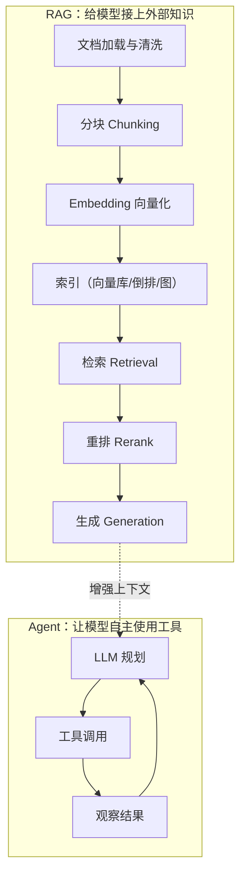

# LLM应用开发-RAG与Agent

> [!info] 概述
> 本笔记是 LLM 应用开发的实战要点：RAG 架构全流程与评估、进阶检索技术（HyDE/GraphRAG/多路召回）、Agent 核心概念（ReAct/工具调用/MCP/多 Agent）、主流框架对比与生产部署。原理层（Transformer/对齐/推理优化）见 [[大模型基础核心要点]]，学习路线见 [[AI学习路径]]，框架上手笔记见 [[AI工具-LangChain实战]]，用例梳理见 [[AI应用场景分析]]。

## 一、知识体系总览



一句话区分：**RAG 解决"模型不知道"**（知识时效与私有知识），**Agent 解决"模型做不到"**（需要查库、调 API、执行操作的场景）；2025 年后二者融合为 Agentic RAG。

## 二、RAG 架构全流程

### 2.1 离线索引阶段

1. **加载与清洗**：PDF/HTML/Office 解析（注意表格、双栏、扫描件的特殊处理），去噪、去重。
2. **分块（Chunking）**：影响检索质量的第一个关键变量。

| 策略 | 做法 | 适用 |
| --- | --- | --- |
| 固定长度 | 每 256~1024 token 一块，重叠 10%~20% | 通用基线 |
| 递归/结构分块 | 按标题-段落-句子层级切，保留章节路径 | Markdown/文档站 |
| 语义分块 | 用 embedding 相邻句相似度找断点 | 质量要求高的语料 |
| 保留父子块 | 检索用小块（准），生成喂大块（全） | 生产常用（Parent-Document） |

3. **Embedding**：选中文效果好的模型（如 `BAAI/bge-m3`、`text-embedding-3` 系列），注意**查询与文档必须用同一模型**，并确认其最大输入长度与维度。
4. **索引**：向量库（FAISS/Milvus/Qdrant/pgvector/Elasticsearch）+ 稠密向量；生产一般同时建 BM25 倒排索引备用。

### 2.2 在线检索与生成阶段

1. **查询预处理**：改写（口语→关键词）、扩展（多角度生成子查询）、HyDE（见第三节）。
2. **召回（多路）**：向量检索 + BM25 关键词检索 + 元数据过滤（时间/部门/权限）并行，用 **RRF（倒数排名融合）** 合并。
3. **重排（Rerank）**：用 cross-encoder（`bge-reranker`、Cohere Rerank）对 top-50 精排出 top-5——这是性价比最高的质量提升手段。
4. **生成**：拼接检索片段 + 引用来源，提示词中要求"仅依据资料回答，并标注引用"；流式输出。

## 三、RAG 进阶技术

| 技术 | 核心思想 | 适用场景 |
| --- | --- | --- |
| **HyDE** | 先让 LLM 生成"假设性答案"，用它（而非原问题）做向量检索 | 问题与答案措辞差异大时 |
| **GraphRAG** | 从语料抽取实体-关系建知识图谱 + 社区摘要，检索图路径而非平面块 | 多跳问题、全局性总结（"这批文档的主线观点"） |
| **多路召回 + RRF** | 稠密+稀疏+图谱多通道融合 | 生产标配，显著优于单路 |
| **Corrective RAG** | 用评估器判断检索结果质量，不合格触发改写重查或 web 搜索 | 降噪、容错 |
| **Adaptive RAG** | 查询分类器按复杂度路由：简单直答 / 中等单次检索 / 复杂多跳迭代 | 成本与质量平衡 |
| **Agentic RAG** | Agent 自主决定查不查、查什么、查几轮，检索作为工具 | 2026 年主流形态 |

评估指标（RAGAS 等框架常用四维 + 检索经典指标）：

| 指标 | 衡量什么 |
| --- | --- |
| Faithfulness（忠实度） | 答案是否被检索内容支持（幻觉检测） |
| Answer Relevancy | 答案与问题的相关度 |
| Context Precision | 检索回来的内容里有多少真正有用 |
| Context Recall | 该找到的内容找齐了没有（需标注） |
| MRR / NDCG / Hit Rate | 检索排序质量（离线可用标注集算） |

> [!tip] 评估先行
> 先用 20~50 条人工标注的"问题-标准出处"对建立金标集，任何改动（换分块/换 embedding/加重排）都跑同一评测对比；没有评估的 RAG 调优等于盲调。原则：**RAG 管知识，微调管行为**，二者解决不同问题、常组合使用。

## 四、Agent 核心概念

### 4.1 工作流 vs 智能体

Anthropic《Building Effective Agents》（见参考资料[1]）给出的区分已成为行业标准语言：

- **工作流（Workflow）**：LLM 与工具按**预定义代码路径**编排，确定性高、成本低；
- **智能体（Agent）**：LLM **自己决定流程与工具使用**，适合开放式任务，代价是成本与错误累积。

推荐先用的五种工作流模式：**提示链**（串行拆步）、**路由**（先分类再分发）、**并行化**（分段/投票）、**编排者-执行者**（动态拆解分派）、**评估者-优化者**（生成-评审循环）。总原则：**从最简单的方案开始，能一次调用解决就不要上 Agent**。

### 4.2 ReAct 与工具调用

ReAct（Reason + Act）范式：模型交替输出"思考 → 行动（调工具）→ 观察结果"，循环直到得出答案。现代 API 把其固化为 **function calling / tool use**：开发者声明工具 schema，模型返回结构化调用请求，由代码执行后回填结果。

```python
# 工具调用主循环（OpenAI 兼容协议骨架）
history = [{"role": "user", "content": "帮我把 D 盘报告目录里最新的周报总结成 3 条要点"}]
while True:
    resp = client.chat.completions.create(
        model=MODEL, messages=history, tools=TOOLS)   # TOOLS: JSON Schema 声明
    msg = resp.choices[0].message
    history.append(msg)
    if not msg.tool_calls:                            # 模型不再调用工具 → 输出最终答案
        print(msg.content)
        break
    for tc in msg.tool_calls:                         # 执行每个工具并把结果回填
        result = dispatch(tc.function.name, tc.function.arguments)
        history.append({"role": "tool", "tool_call_id": tc.id,
                        "content": json.dumps(result, ensure_ascii=False)})
```

### 4.3 MCP 协议（Model Context Protocol）

MCP 由 Anthropic 于 2024-11 发布，2026 年已成**连接 LLM 与工具/数据的事实标准**（OpenAI、Google 相继采纳，"AI 应用的 USB-C 接口"，见参考资料[2][3]）。

- **架构**：Host（如 Claude Code/Cursor）内嵌 MCP Client，与多个 MCP Server 通信；Server 封装数据源或工具能力。
- **传输**：本地 `stdio`；远程 **Streamable HTTP**（可部署为共享服务）。
- **核心能力**：`tools`（可执行操作）、`resources`（可读取数据）、`prompts`（复用提示模板），并支持能力协商与通知。
- **价值**：一次开发、处处可用——写好的 MCP Server 可同时接入 Claude、ChatGPT、Cursor、VS Code 等客户端，替代碎片化的私有集成。

MCP Server 配置示例（本地 stdio 型）：

```json
{
  "mcpServers": {
    "filesystem": {
      "command": "npx",
      "args": ["-y", "@modelcontextprotocol/server-filesystem", "E:/陶伟东-知识库"]
    }
  }
}
```

### 4.4 多 Agent 协作

复杂任务可拆给多个角色化 Agent（规划者/执行者/评审者，或按业务域分工），通过消息传递或共享任务清单协作。代表框架：Microsoft **AutoGen**（对话式多 Agent）、**CrewAI**（角色分工编排）、LangGraph（图状态机，支持人工审批节点）。工程提醒：多 Agent 会放大成本与错误传播，**先用单 Agent + 好工具解决 80% 问题**。

## 五、框架对比（2026 主流技术栈）

| 框架 | 定位 | 优势 | 注意点 |
| --- | --- | --- | --- |
| LangChain / LangGraph | 通用编排 + 图状态机 | 生态最大、集成最多、LangSmith 观测 | 抽象层厚，需读源码才能深调 |
| LlamaIndex | RAG 专用数据框架 | Ingestion/索引/查询路由开箱即用 | Agent 编排相对弱 |
| Dify | 可视化低代码平台 | 快速搭建工作流与知识库应用，适合非算法同学 | 复杂自定义逻辑受限 |
| AutoGen (Microsoft) | 多 Agent 对话框架 | 多角色协作研究与应用均成熟 | 调试成本高 |
| CrewAI | 角色分工多 Agent | 上手快、角色隐喻直观 | 生产级复杂控制需搭配 LangGraph |
| OpenAI Agents SDK | 轻量 Agent 开发 | 原生 MCP、handoffs，代码量小 | 绑定 OpenAI 生态（可接兼容端点） |
| vLLM / SGLang | 模型服务层 | OpenAI 兼容 API + 量化 + 投机解码 | 属于部署层，与上述编排层互补 |

选型口诀：**重 RAG 选 LlamaIndex、重编排选 LangGraph、要可视化选 Dify、多 Agent 玩 AutoGen/CrewAI、接工具标准一律 MCP**；框架不熟时先用裸 API 写通原型再迁移（Anthropic 官方亦如此建议）。

## 六、RAG 最小可运行示例

```python
# pip install sentence-transformers faiss-cpu openai
import faiss
from sentence_transformers import SentenceTransformer
from openai import OpenAI

emb = SentenceTransformer("BAAI/bge-small-zh-v1.5")   # 中文小模型，够跑通流程
docs = [
    "RAG 先检索外部知识再生成，可缓解幻觉并让答案可溯源。",
    "Agent 让 LLM 自主规划并调用工具，MCP 是其开放工具接入标准。",
    "KV Cache 缓存历史 Key/Value，避免自回归生成时重复计算。",
]
vecs = emb.encode(docs, normalize_embeddings=True)     # 归一化后内积≈余弦相似度
index = faiss.IndexFlatIP(vecs.shape[1])
index.add(vecs)

def retrieve(query: str, k: int = 2) -> list[str]:
    q = emb.encode([query], normalize_embeddings=True)
    _, idx = index.search(q, k)
    return [docs[i] for i in idx[0]]

llm = OpenAI()   # 任意 OpenAI 兼容端点均可
def answer(query: str) -> str:
    context = "\n".join(f"[{i+1}] {t}" for i, t in enumerate(retrieve(query)))
    prompt = (f"仅依据以下资料回答，并标注引用编号；资料不足以回答时明确说明。\n\n"
              f"资料：\n{context}\n\n问题：{query}")
    return llm.chat.completions.create(
        model="deepseek-chat", temperature=0.1,
        messages=[{"role": "user", "content": prompt}],
    ).choices[0].message.content

print(answer("RAG 为什么能减少幻觉？"))
```

生产化升级路径：把 `faiss` 换成 Milvus/pgvector，加 BM25 多路召回与 reranker，加评估脚本与引用校验，即得一个可用的生产雏形。

## 七、核心要点速查

| 主题 | 一句话要点 |
| --- | --- |
| 分块 | 512 token + 10%~20% 重叠起步，按结构切分优先 |
| Embedding | 查询与文档同模型；归一化后用内积 |
| 多路召回 | 稠密 + BM25 + 过滤，RRF 融合 |
| 重排 | cross-encoder 精排 top-5，性价比最高的提质手段 |
| HyDE | 用"假设答案"代替问题去检索 |
| GraphRAG | 实体关系图 + 社区摘要，治多跳与全局总结 |
| RAG 评估 | 忠实度 / 相关度 / 上下文精确率 / 召回率，金标集先行 |
| 工作流 vs Agent | 确定性流程用工作流，开放式任务才用 Agent |
| ReAct | 思考→行动→观察循环，固化为 function calling |
| MCP | AI 应用的 USB-C：tools/resources/prompts 三原语 |
| 多 Agent | 会放大成本与错误，先单 Agent + 好工具 |
| 安全 | 工具调用要鉴权、最小权限、防提示注入 |

## 八、常见坑与最佳实践

> [!warning] 常见坑
> 1. **只做向量检索**：专有名词、编号、代码符号在向量空间区分度差，不配 BM25 的 RAG 在生产必翻车。
> 2. **无评估迭代**：改了分块/模型却拿不出对比数据，无法判断是优化还是回退。
> 3. **把检索内容照单全收**：不校验、不要求引用，等于把幻觉从"模型编"升级为"模型引用着编"。
> 4. **Agent 无护栏**：不设最大迭代数、不给工具做权限隔离与沙箱，一次错误调用可能删库或泄露数据。
> 5. **提示注入**：外部文档/网页内容里藏指令可劫持 Agent，需内容隔离标记与敏感操作二次确认。

> [!tip] 最佳实践
> 1. **从最小管线开始**：先跑通"分块→检索→生成"五十行代码，再加 rerank、多路、评估，每加一层都验证收益。
> 2. **引用与溯源内置**：让每句结论带来源编号，既减幻觉又赢得用户信任。
> 3. **工具设计即产品**：Anthropic 实测中优化"模型-工具接口"（工具描述清晰、参数简单、返回带错误提示）的收益高于堆提示词。
> 4. **MCP 标准化接入**：新工具一律实现为 MCP Server，避免私车私有协议锁死客户端。
> 5. **观测三件套**：全链路日志（每次检索命中、每步工具调用）、token 成本看板、线上 bad case 回流为评测集。

## 九、生产部署要点

| 维度 | 要点 |
| --- | --- |
| 模型层 | 网关统一路由（按任务难度分配旗舰/轻量档位）；推理引擎 vLLM/SGLang；关键业务配推理模型 |
| 数据层 | 向量库定期重建索引；分块版本化（改分块须重灌）；权限过滤在检索层生效，而非只在提示词里 |
| 编排层 | 流式输出 + 超时/重试/降级（检索失败退化为纯生成并声明）；幂等与并发控制 |
| 质量层 | 上线前金标评测 + 红队用例；线上抽样 LLM-as-judge 打分；bad case 回流 |
| 成本层 | 语义缓存（相同/相似问题命中缓存）；长历史做摘要压缩；监控单次会话 token 成本 |
| 安全层 | 工具最小权限、输出内容过滤、审计日志留存；MCP Server 遵循官方安全最佳实践 |

## 十、2025-2026 最新动态（信息截至 2026-11-18）

| 时间点 | 动态 | 对开发的影响 |
| --- | --- | --- |
| 2024-11 → 2025 | Anthropic 发布 MCP；OpenAI Agents SDK、Google、VS Code/Cursor 相继采纳 | 工具接入事实标准确立，The New Stack 评价"MCP 赢了"（2025-12） |
| 2025-11~12 | Claude Opus 4.5 与 DeepSeek-V3.2 把思考能力与工具调用融合 | 复杂任务"单模型多步自主执行"成为现实，编排代码可更薄 |
| 2025-12 | The New Stack：《Why the Model Context Protocol Won》 | 自建私有工具协议的投资应停止 |
| 2026-03 | WorkOS《Everything your team needs to know about MCP in 2026》 | 企业级 MCP：安全、治理、权限成为落地重点 |
| 2026-07-28 | MCP 发布新版规范 | 关注安全最佳实践章节与新版传输能力 |
| 2026 全年 | Agentic RAG / Adaptive RAG 成主流（社区综述与实战报告均指向此形态，部分报告称检索验证并行化带来至多 5 倍质量提升） | RAG 从"管线"演进为"会自我纠错的检索 Agent" |

## 十一、参考资料

1. [Building Effective Agents - Anthropic](https://www.anthropic.com/research/building-effective-agents)（工作流/Agent 模式与原则）
2. [Model Context Protocol 官方文档](https://modelcontextprotocol.io/docs/getting-started/intro)（架构、传输、核心原语）
3. [Introducing the Model Context Protocol - Anthropic](https://www.anthropic.com/news/model-context-protocol)（2024-11 发布文）
4. [Why the Model Context Protocol Won - The New Stack](https://thenewstack.io/why-the-model-context-protocol-won)（2025-12）
5. [Everything your team needs to know about MCP in 2026 - WorkOS](https://workos.com/blog/everything-your-team-needs-to-know-about-mcp-in-2026)（2026-03）
6. [RAG Techniques Compared: Best Practices Guide - Starmorph](https://blog.starmorph.com/blog/rag-techniques-compared-best-practices-guide)（Advanced/GraphRAG/Agentic RAG 对比）
7. [GraphRAG 官方文档 - Microsoft](https://microsoft.github.io/graphrag/)（知识图谱增强 RAG）
8. [LangChain 官方文档](https://python.langchain.com/docs/introduction/) / [LlamaIndex 官方文档](https://docs.llamaindex.ai/)
9. [DeepSeek API 新闻：V3.2 发布](https://api-docs.deepseek.com/news/news251201)（思考与工具调用融合，2025-12-01）
10. [Claude Opus 4.5 发布公告 - Anthropic](https://www.anthropic.com/news/claude-opus-4-5)（2025-11-24）
