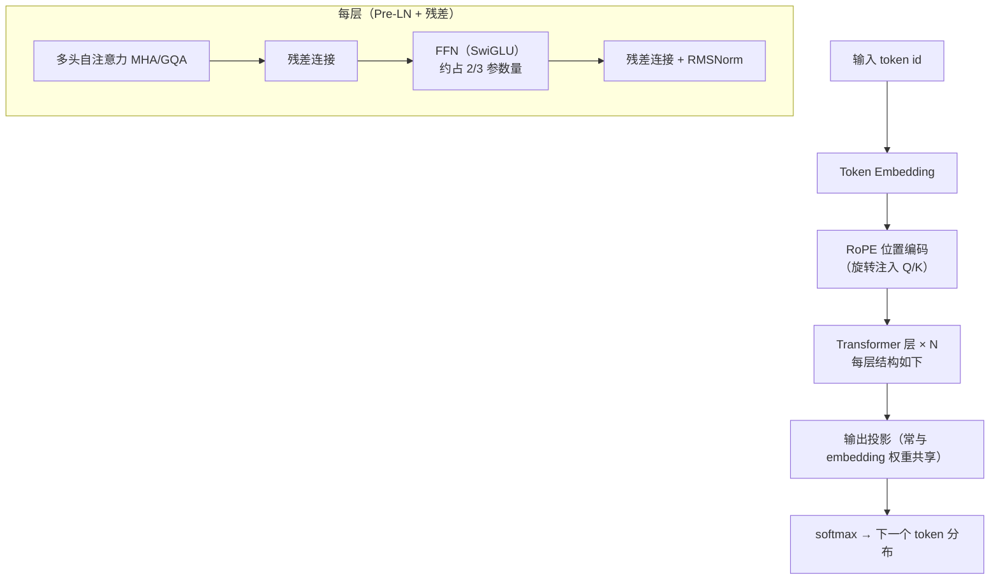

# 大模型-Transformer与注意力机制

> [!abstract] 摘要
> Transformer 是所有现代大模型（GPT/Qwen/DeepSeek/Llama）的骨架，Self-Attention 是其中唯一的"token 间通信"机制。本笔记讲透整体架构与位置编码 RoPE、Attention 的矩阵推导、MHA→MQA→GQA→MLA 的演进逻辑、KV Cache 原理，并给出 PyTorch 手写最小 attention 的完整代码与动手练习。学完你能：白板手推一次 attention、说清"为什么除以 √d_k"、算清一个模型的 KV Cache 显存。

主线定位：本笔记是 [[AI学习路径]] 阶段 3 的核心，原理速查版见 [[大模型基础核心要点]]（第二节），BERT 的 encoder-only 视角见 [[自然语言处理-BERT模型详解]]。

## 一、概念与原理

### 1.1 整体架构：Encoder / Decoder / Decoder-only

原始论文《Attention Is All You Need》(2017) 是 Encoder-Decoder 机器翻译结构；今天的 LLM 只保留 Decoder 一侧，堆叠 N 层相同模块：



三种架构一句话区分：

| 架构 | 注意力方向 | 代表 | 适用 |
| --- | --- | --- | --- |
| Encoder-only | 双向 | BERT | 理解类任务（分类、检索） |
| Decoder-only | 因果（只看过去） | GPT / Qwen / DeepSeek | 生成类任务，LLM 事实标准 |
| Encoder-Decoder | 编码双向 + 解码因果 + 交叉注意力 | T5、翻译模型 | 序列到序列 |

### 1.2 Self-Attention 数学原理与矩阵推导

每个 token 由同一向量 $x_i$ 经三个投影矩阵生成三个角色：

- **Query $Q$**：我想找什么信息
- **Key $K$**：我有什么标签
- **Value $V$**：我实际携带的内容

$$
\text{Attention}(Q,K,V)=\text{softmax}\!\left(\frac{QK^{\top}}{\sqrt{d_k}}\right)V
$$

矩阵视角逐步推导（$X \in \mathbb{R}^{n\times d}$，$n$ 为序列长度）：

1. 投影：$Q=XW_Q,\ K=XW_K,\ V=XW_V$（三个 $d\times d_k$ 矩阵）；
2. 打分：$S=QK^{\top}\in\mathbb{R}^{n\times n}$，$S_{ij}$ = 第 $i$ 个 query 对第 $j$ 个 key 的点积相似度；
3. 缩放：$S/\sqrt{d_k}$——若不缩放，$d_k$ 大时点积方差 $\approx d_k$，softmax 进入饱和区，梯度趋近 0（这是面试高频题的答案）；
4. 因果掩码：decoder-only 下把 $j>i$ 的位置填 $-\infty$，softmax 后权重为 0，保证不能"偷看未来"；
5. 归一化加权：$O=\text{softmax}(S)_{\text{行}}\cdot V$，每行权重和为 1，输出是 value 的凸组合。

多头（Multi-Head）：把 $d_{model}$ 切成 $h$ 份，每份 $d_k=d_{model}/h$ 独立算注意力再拼接——让不同头分别关注语法、指代、位置等不同模式。

### 1.3 位置编码：从绝对到 RoPE

注意力本身是"集合运算"（打乱 token 顺序结果不变），必须显式注入位置信息：

| 方案 | 思路 | 问题/优点 |
| --- | --- | --- |
| 正弦绝对位置编码 | 固定函数加到 embedding 上 | 原始 Transformer；无法表达相对位置 |
| 可学习位置编码 | 位置向量当参数训 | GPT-2；长度受限 |
| **RoPE（旋转位置编码）** | 用与位置 $m$ 成正比的旋转矩阵作用于 Q/K | Llama/Qwen/DeepSeek 全采用 |

RoPE 核心思想（苏剑林提出，论文 RoFormer）：把 Q/K 向量两两分组视为复数，第 $m$ 个位置的向量乘以 $e^{im\theta}$（即平面旋转）。关键性质：

$$
\langle R_m q,\ R_n k\rangle = \langle q,\ R_{n-m} k\rangle
$$

**旋转后的内积只依赖相对位置差 $m-n$**——绝对位置的编码方式天然给出相对位置性质，且远程衰减、易于外推。长上下文扩展用 NTK-aware 缩放 / YaRN 等插值方法。

### 1.4 MHA → MQA → GQA → MLA：一条 KV Cache 主线

自回归生成时，前面 token 的 K/V 不会变，缓存起来避免重算（详见 1.5）。KV Cache 显存 ≈ `2 × 层数 × KV头数 × head_dim × 字节数 × seq_len × batch`——所以"减少要存几份 KV / 压缩 KV 本身"成为结构演进主线：

| 变体 | 思路 | KV Cache | 质量 | 代表 |
| --- | --- | --- | --- | --- |
| MHA | 每个 Q 头独立 K/V 头 | 最大（基准） | 最好 | GPT-2、原始 Transformer |
| MQA | 所有 Q 头共享 1 组 K/V | 缩小 $h$ 倍 | 大模型上掉点明显 | PaLM、早期 Falcon |
| GQA | Q 头分 $g$ 组，组内共享 K/V | 缩小 $h/g$ 倍 | MHA≈的折中 | Llama 2/3 70B、Qwen |
| MLA | K/V 低秩联合压缩进 latent 向量（RoPE 解耦 + 矩阵吸收） | ≈ 2.25 组 GQA | 不降反升 | DeepSeek-V2/V3（KV Cache 减少 93.3%） |

本质区别一句话：**GQA/MQA 是"少存几份"，MLA 是"把要存的东西压缩了"**（低秩潜空间压缩），故能省显存同时保持表达力。工程上另有 FlashAttention——不改数学结果，只优化 GPU 显存读写（分块计算 + online softmax），是训练与推理的事实标配。

### 1.5 KV Cache 为什么是推理加速的核心

无缓存：生成第 $t$ 个 token 要对全部 $t$ 个位置重算 K/V，总计算量 $O(n^2)$。有缓存：历史 K/V 直接查表，每步只算新 token 的 $q_t,k_t,v_t$，注意力打分变成 $1\times t$ 的向量乘矩阵。代价是显存换时间——以 7B 模型（32 层、32 KV 头、head_dim 128、FP16）为例，32K 上下文单请求 KV Cache ≈ `2×32×32×128×2B×32768 ≈ 16 GB`，比权重（14GB）还大，这就是 GQA/MLA/量化存在的理由。vLLM 的 PagedAttention 进一步把 KV Cache 分页管理，解决显存碎片。

## 二、核心语法 / API 详解

手写 attention 只用到最基础的 PyTorch 张量操作，逐行看懂下面四个函数就掌握了全部机制：

```python
import torch
import torch.nn as nn
import torch.nn.functional as F
import math

def scaled_dot_product_attention(Q, K, V, mask=None):
    """缩放点积注意力。
    Q,K,V: (batch, heads, seq_len, d_k)
    mask:  (seq_len, seq_len) 布尔阵，True 表示允许attend
    """
    d_k = Q.size(-1)
    # ① 打分：最后一维做点积 → (batch, heads, n, n)
    scores = Q @ K.transpose(-2, -1) / math.sqrt(d_k)
    # ② 因果掩码：未来位置填 -inf，softmax 后变成 0
    if mask is not None:
        scores = scores.masked_fill(~mask, float("-inf"))
    # ③ 最后一维归一化：每个 query 对所有 key 的权重和为 1
    attn = F.softmax(scores, dim=-1)
    # ④ 用权重对 value 加权求和
    return attn @ V, attn

def rope_apply(x, positions, base=10000.0):
    """RoPE 的极简实现：把最后一维两两分组做平面旋转。
    x: (batch, heads, seq_len, d)，d 必须为偶数
    """
    d = x.size(-1)
    # 每个维度对使用不同频率 theta_i = base^(-2i/d)，低维低频、高维高频
    inv_freq = base ** (-torch.arange(0, d, 2, dtype=torch.float32) / d)  # (d/2,)
    angles = positions[:, None].float() * inv_freq        # (seq_len, d/2) 旋转角 m*theta
    cos, sin = angles.cos(), angles.sin()                 # 广播到 (1,1,seq_len,d/2)
    x1, x2 = x[..., 0::2], x[..., 1::2]                   # 拆成偶/奇两个"平面坐标"
    out = torch.empty_like(x)
    out[..., 0::2] = x1 * cos - x2 * sin                  # 旋转公式（复数乘法实部）
    out[..., 1::2] = x1 * sin + x2 * cos                  # 旋转公式（复数乘法虚部）
    return out

class MultiHeadAttention(nn.Module):
    """多头注意力模块（含 GQA 开关）。"""
    def __init__(self, d_model, n_heads, n_kv_heads=None):
        super().__init__()
        self.n_heads = n_heads
        self.n_kv_heads = n_kv_heads or n_heads      # kv头数 < q头数 即为 GQA
        assert d_model % n_heads == 0
        self.d_k = d_model // n_heads
        self.wq = nn.Linear(d_model, n_heads * self.d_k, bias=False)
        self.wk = nn.Linear(d_model, self.n_kv_heads * self.d_k, bias=False)
        self.wv = nn.Linear(d_model, self.n_kv_heads * self.d_k, bias=False)
        self.wo = nn.Linear(n_heads * self.d_k, d_model, bias=False)

    def forward(self, x):
        B, n, _ = x.shape
        # 投影并拆头：(B, n, d) → (B, heads, n, d_k)
        q = self.wq(x).view(B, n, self.n_heads, self.d_k).transpose(1, 2)
        k = self.wk(x).view(B, n, self.n_kv_heads, self.d_k).transpose(1, 2)
        v = self.wv(x).view(B, n, self.n_kv_heads, self.d_k).transpose(1, 2)
        pos = torch.arange(n, device=x.device)
        q, k = rope_apply(q, pos), rope_apply(k, pos)   # RoPE 只作用于 Q/K
        # GQA：把 KV 头沿头维复制扩展到 Q 头数（repeat_interleave）
        if self.n_kv_heads != self.n_heads:
            rep = self.n_heads // self.n_kv_heads
            k = k.repeat_interleave(rep, dim=1)
            v = v.repeat_interleave(rep, dim=1)
        causal = torch.ones(n, n, dtype=torch.bool, device=x.device).tril()
        out, attn = scaled_dot_product_attention(q, k, v, mask=causal)
        out = out.transpose(1, 2).reshape(B, n, -1)     # 拼回多头
        return self.wo(out), attn
```

要点解读：

- `transpose(-2, -1)`：对最后两维转置实现 $QK^\top$，batch/head 维自动广播；
- `masked_fill(~mask, -inf)` 必须在 softmax **之前**；
- GQA 只需改 `n_kv_heads` 一个参数（训练态用 `repeat_interleave` 扩展 KV 头，推理态每组只存一份 KV）——工程上"结构压缩"就是这么轻。

## 三、实战案例

**场景**：用上面模块拼一个微型 GPT（2 层、d_model=128），在玩具语料上训练，并对比"带 KV Cache"的推理速度。

**运行环境**：Python 3.10+，PyTorch ≥ 2.0（`pip install torch`），CPU 即可跑通（有 GPU 更快）。

```python
# mini_gpt.py —— 迷你 GPT：训练 + 生成（依赖：torch>=2.0，CPU 可跑）
import torch, torch.nn as nn, torch.nn.functional as F, math

class Block(nn.Module):
    def __init__(self, d_model, n_heads):
        super().__init__()
        self.ln1 = nn.LayerNorm(d_model)          # Pre-LN：先进归一化再进子层
        self.attn = MultiHeadAttention(d_model, n_heads)   # 复用第二节的模块
        self.ln2 = nn.LayerNorm(d_model)
        self.ffn = nn.Sequential(
            nn.Linear(d_model, 4 * d_model), nn.GELU(), nn.Linear(4 * d_model, d_model))

    def forward(self, x):
        x = x + self.attn(self.ln1(x))[0]         # 残差：attention 分支
        x = x + self.ffn(self.ln2(x))             # 残差：FFN 分支
        return x

class MiniGPT(nn.Module):
    def __init__(self, vocab, d_model=128, n_heads=4, n_layers=2, max_len=64):
        super().__init__()
        self.tok_emb = nn.Embedding(vocab, d_model)
        self.pos_emb = nn.Embedding(max_len, d_model)  # 玩具版用可学习位置编码
        self.blocks = nn.Sequential(*[Block(d_model, n_heads) for _ in range(n_layers)])
        self.ln_f = nn.LayerNorm(d_model)
        self.head = nn.Linear(d_model, vocab, bias=False)

    def forward(self, idx, targets=None):
        B, n = idx.shape
        pos = torch.arange(n, device=idx.device)
        x = self.tok_emb(idx) + self.pos_emb(pos)[None]
        x = self.blocks(x)
        logits = self.head(self.ln_f(x))          # (B, n, vocab)
        loss = None
        if targets is not None:
            loss = F.cross_entropy(logits.view(-1, logits.size(-1)), targets.view(-1))
        return logits, loss

if __name__ == "__main__":
    text = "大模型的核心是注意力机制，注意力让每个 token 关注上下文。" * 30
    chars = sorted(set(text)); stoi = {c: i for i, c in enumerate(chars)}
    data = torch.tensor([stoi[c] for c in text])
    model = MiniGPT(vocab=len(chars))
    opt = torch.optim.AdamW(model.parameters(), lr=3e-4)
    for step in range(300):
        ix = torch.randint(0, len(data) - 65, (8,))            # 8 条随机起点
        xb = torch.stack([data[i:i+64] for i in ix])           # 输入 64 个字符
        yb = torch.stack([data[i+1:i+65] for i in ix])         # 标签右移一位
        _, loss = model(xb, yb)
        opt.zero_grad(); loss.backward(); opt.step()
        if step % 100 == 0: print(f"step {step} loss {loss.item():.3f}")
    # 自回归生成：拼 ctx 循环采样即可（最后位置 logits → multinomial → cat 回 ctx）
    stoinv = {i: c for c, i in stoi.items()}
    print("".join(stoinv[c.item()] for c in data[:40]))
```

预期结果：loss 从 ~4.6 降到 <1.5，生成出与训练语料风格一致的中文句子。这个 100 行的"微缩模型"就是 nanoGPT（Karpathy）路线的最小版，完整训练态+KV Cache 推理态可参考其仓库。

## 四、动手练习

1. **手算一次 attention（纸笔）**：设 3 个 token 的 $Q,K,V$ 分别为
   $Q=\begin{pmatrix}1&0\\0&1\\1&1\end{pmatrix}$，$K=\begin{pmatrix}1&1\\0&1\\1&0\end{pmatrix}$，$V=\begin{pmatrix}1&2\\3&4\\5&6\end{pmatrix}$，$d_k=2$。
   提示：先算 $QK^\top$（3×3），除以 $\sqrt{2}$，逐行 softmax（可用计算器），再乘 $V$；观察第一个输出的第一位权重大约落在哪个 token 上。
2. **实现多头拆分**：给定 `(B, n, d_model=512)` 的张量与 `n_heads=8`，用 `view` + `transpose` 拆成 `(B, 8, n, 64)`，再无损拼回去。
   提示：`reshape` 与 `view` 的区别？`transpose(1,2)` 之后必须 `.contiguous()` 或 `.reshape` 才能 `view`。
3. **验证 RoPE 的相对位置性质**：随机生成两组 Q/K 向量，分别对位置 $(m,n)$ 与 $(m+5,n+5)$ 施加上文的 `rope_apply`，验证两组内积完全相等。
4. **实现 GQA 的 KV Cache 推理态**：给 `MultiHeadAttention` 加 `past_kv` 参数，生成时只计算新 token 的 K/V 并追加缓存，返回更新后的缓存；用 `time.time()` 对比 64 步生成有无缓存的耗时。
5. **综合：把 FlashAttention 思想说清楚**：读参考资料[7]后，用自己的话写 200 字说明"online softmax 为什么能把显存读写从 O(n²) 降到 O(n)"。
   提示：关键在 softmax 分母可以分块累积（max 与 sum 的滚动更新），中间矩阵 $S$ 从不需要完整物化到 HBM。

> [!success]- 练习 1 参考答案要点
> $QK^\top=\begin{pmatrix}1&0&1\\1&1&0\\2&1&1\end{pmatrix}$，除以 $\sqrt2\approx1.414$ 后逐行 softmax。以第一行为例：得分 $\approx(0.707,\ 0,\ 0.707)$，softmax ≈ $(0.395,\ 0.210,\ 0.395)$。三行权重分别对 $V$ 加权求和，输出第一位 ≈ $0.395×1+0.210×3+0.395×5=2.77$。观察结论：token1 与 token3 的 query 得分并列最高（都是与 K 的点积 1），权重分布验证了"权重和为 1、注意力是凸组合"两个性质。

## 五、常见坑与 FAQ

> [!warning] 掩码必须在 softmax 之前
> 把 `masked_fill` 放在 softmax 之后毫无作用——softmax 已把 $-\infty$ 的信息混入所有权重。同理，`float("-inf")` 行全掩码（长度为 0 的有效区）会输出 NaN，padding 批处理时要保证每行至少一个有效位置。

> [!warning] `view` 拆头顺序搞错不报错但结果全错
> `(B, n, heads, d_k)` 与 `(B, heads, n, d_k)` 是两个不同布局：先 `view(B, n, heads, d_k)` 再 `transpose(1,2)` 才对；直接 `view(B, heads, n, d_k)` 会把序列与头维混排，训练照常收敛到很差的效果——这是复现 attention 时最常见的静默 bug。

> [!tip] FAQ：为什么除以 $\sqrt{d_k}$？
> 假设 Q、K 各分量独立同分布、均值 0 方差 1，则点积方差为 $d_k$；不缩放时 $d_k$ 越大 softmax 越接近 one-hot，梯度消失。除以 $\sqrt{d_k}$ 使方差回到 1，训练稳定。

## 六、自检清单

- [ ] 能不看资料写出 $\text{softmax}(QK^\top/\sqrt{d_k})V$ 并解释每一项的含义
- [ ] 能解释"为什么除以 $\sqrt{d_k}$"（方差论证）
- [ ] 能手推 3×3 小例子的 attention（练习 1 水平）
- [ ] 能说清 causal mask 加在哪一步、为什么 decoder-only 必需
- [ ] 能画出 RoPE 的核心性质：$\langle R_m q, R_n k\rangle$ 只依赖 $m-n$
- [ ] 能列出 MHA/MQA/GQA/MLA 各自的 KV Cache 缩小倍数与代表模型
- [ ] 能估算一个给定配置模型的 KV Cache 显存占用
- [ ] 写过至少一次多头拆分（view+transpose）且验证过形状正确性

## 七、关联笔记与参考

**库内关联**：[[AI学习路径]]（阶段 3 主线） · [[大模型基础核心要点]]（速查版原理全景） · [[深度学习-PyTorch入门]]（张量操作与训练基础） · [[自然语言处理-BERT模型详解]]（encoder-only 对照） · [[大模型-训练范式与微调实战]]（结构之上如何训练）

**参考资料**：

1. [Attention Is All You Need (arXiv:1706.03762)](https://arxiv.org/abs/1706.03762) —— Transformer 原始论文
2. [RoFormer: Enhanced Transformer with Rotary Position Embedding (arXiv:2104.09864)](https://arxiv.org/abs/2104.09864) —— RoPE 原论文（苏剑林）
3. [Transformer升级之路：博采众长的旋转式位置编码 - 科学空间](https://kexue.fm/archives/8130) —— RoPE 作者原始推导博客
4. [图解RoPE旋转位置编码及其特性 - 知乎](https://zhuanlan.zhihu.com/p/667864459)
5. [从 KV Cache 看懂 Attention（MHA、MQA、GQA、MLA）的优化 - 知乎](https://zhuanlan.zhihu.com/p/1991144335056597424)
6. [FlashAttention: Fast and Memory-Efficient Exact Attention (arXiv:2205.14135)](https://arxiv.org/abs/2205.14135)
7. [Sebastian Raschka: Multi-Head Latent Attention (MLA) 图解](https://sebastianraschka.com/llm-architecture-gallery/mla)
8. [nanoGPT - GitHub (Karpathy)](https://github.com/karpathy/nanoGPT) —— 手写 GPT 的最佳配套仓库
9. [The Illustrated Transformer - Jay Alammar](https://jalammar.github.io/illustrated-transformer/) —— 最经典图解入门
