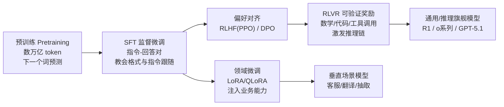

# 大模型-训练范式与微调实战

> [!abstract] 摘要
> 预训练产出"续写机器"，后训练（SFT → RLHF/DPO/RLVR）才把它变成"听话的助手"；而微调是个人与企业在消费级显卡上获得专属模型的主要手段。本笔记讲清全链路训练范式、LoRA/QLoRA 原理与参数选择、数据集构造、LLaMA-Factory 与 unsloth 两条实操路线（含真实命令）与显存估算。学完你能：独立完成一次 QLoRA 微调并知道每个参数为什么这么设。

主线定位：[[AI学习路径]] 阶段 3（原理）与阶段 5（精通）的核心实操；原理速查见 [[大模型基础核心要点]] 第五节；应用侧"改行为还是补知识"的取舍见 [[LLM应用开发-RAG与Agent]]。

## 一、概念与原理

### 1.1 全链路：预训练 → SFT → RLHF/DPO → RLVR



| 阶段 | 数据形式 | 目标 | 谁在做 |
| --- | --- | --- | --- |
| 预训练 | 海量网页/代码/书籍，next-token prediction | 注入世界知识与语言能力 | 实验室，千万美元级 |
| SFT | 人工编写/蒸馏的 instruction 对话对 | 教会"按指令回答"的格式 | 实验室 + 开源社区 |
| RLHF | 人类对两个回答的偏好排序 | 训练奖励模型，PPO 优化策略 | 实验室 |
| DPO | 同样的偏好对 (chosen/rejected) | 跳过奖励模型，闭式损失直接优化 | 开源微调首选 |
| RLVR | 答案可验证的任务（数学/代码） | 大规模 RL 激发长思维链 | DeepSeek-R1 路线 |
| 领域微调 | 业务指令数据 | 改变行为/风格/能力，注入领域知识 | 个人与企业 |

关键区分：**微调管行为，RAG 管知识**——让模型"按公司口径说话"用微调，让模型"知道公司文档内容"用 RAG，二者常组合。

### 1.2 LoRA 原理：低秩增量代替全参数更新

全参微调 7B 模型需要记录全部参数的梯度与优化器状态（AdamW 约需权重 3-4 倍显存）。LoRA 的思路：冻结原权重 $W$，为每个目标层学一个低秩增量：

$$
W' = W + \Delta W = W + \frac{\alpha}{r}BA,\quad B\in\mathbb{R}^{d\times r},\ A\in\mathbb{R}^{r\times d},\ r \ll d
$$

- 可训练参数从 $d\times d$ 降到 $2\times d\times r$（7B 模型 r=16 时仅占 0.1%~1%）；
- 推理时 $\Delta W$ 可**合并回原权重**，零额外延迟；
- $\alpha$ 是缩放因子，实际更新幅度按 $\alpha/r$ 缩放。

### 1.3 QLoRA：4-bit 基座 + LoRA 适配器

QLoRA（2023）把基座权重量化到 4-bit 冻结，只训练 BF16 的 LoRA 适配器，显存约降 4 倍（单卡微调 65B 成为可能），三大组件：

| 组件 | 作用 |
| --- | --- |
| NF4（4-bit NormalFloat） | 按权重正态分布的分位点设计的量化类型，精度优于 Int4/FP4 |
| 双重量化 | 对量化常数本身再量化（FP32→FP8），再省约 0.37 bit/参数 |
| 分页优化器 | 显存吃紧时优化器状态自动换页到 CPU 内存 |

Raschka 数百次实验的结论：**QLoRA（4-bit）与 LoRA（16-bit）的微调质量基本相当**，显存受限时放心用 QLoRA。

### 1.4 参数选择经验表

| 参数 | 经验值 | 说明 |
| --- | --- | --- |
| `lora_rank` (r) | 8/16 起步；任务差异大、数据多时 32/64 | 任务越难 r 越大；基座越强 r 可越小 |
| `lora_alpha` | 常取 r 的 1~2 倍（如 r=16, α=32） | 决定实际缩放 α/r |
| `lora_dropout` | 0~0.1 | 数据少易过拟合时加 |
| `target_modules` | 至少 q/k/v/o_proj；效果要求高加 gate/up/down_proj | 加更多目标 = 参数更多 = 更强但更贵 |
| 学习率 | LoRA/QLoRA 用 1e-4 ~ 2e-4（比全参高约 10 倍） | 影响效果最大的单一超参 |
| epoch | 1~3 | 指令数据多轮训练极易过拟合 |
| `max_seq_length` | 按数据分布的 P95，不要无脑 4096 | 显存与训练时间都与其成正比 |

## 二、核心语法 / API 详解

### 2.1 数据集构造：instruction 与 chat template 两种格式

模型如何"知道"系统提示、user/assistant 的边界？靠 chat template（Jinja2 模板拼成带特殊 token 的串）。两种主流数据形态：

```jsonc
// 形态一：instruction 格式（Alpaca 风格，LLaMA-Factory 的 identity/alpaca 数据即此形）
{
  "instruction": "把下面的话改写成客服语气：文件丢了。",
  "input": "",
  "output": "非常抱歉给您带来不便！请提供账号信息，我马上为您排查文件恢复方案。"
}

// 形态二：messages 格式（ShareGPT/OpenAI 风格，多轮对话通用）
{
  "messages": [
    {"role": "system", "content": "你是公司 IT 客服，语气礼貌简洁。"},
    {"role": "user", "content": "VPN 连不上了怎么办？"},
    {"role": "assistant", "content": "请先检查……如仍无法连接，请提供工单号。"}
  ]
}
```

- 数据量经验：几百条能改风格/格式，数千条~数万条注入领域能力；**质量远大于数量**，10 条脏数据的伤害超过 100 条好数据；
- 构造技巧：从真实业务日志抽取 → 人工改写或用强模型蒸馏（注意许可）→ 清洗去重 → 校验 chat template 渲染结果；
- LLaMA-Factory 用 `dataset_info.json` 注册数据集（指定 `columns` 字段映射），unsloth 直接把 messages 列交给 `SFTTrainer` 自动套模板。

### 2.2 LLaMA-Factory CLI（推荐给"想快速出结果"的人）

安装与环境：Python 3.10+，`pip install -e ".[torch,metrics]"`（克隆仓库后）；NVIDIA 显卡需装对应 CUDA 版 torch。

```bash
# ① QLoRA 微调 Qwen：一条命令（在 LLaMA-Factory 目录下）
llamafactory-cli train \
  --model_name_or_path Qwen/Qwen2.5-7B-Instruct \
  --stage sft \
  --finetuning_type lora \
  --quantization_bit 4 \                # 开启 QLoRA：基座 4-bit
  --lora_rank 16 --lora_alpha 32 --lora_dropout 0.05 \
  --lora_target all \                   # 所有线性层都挂适配器
  --template qwen \                     # 必须与模型匹配的对话模板
  --dataset my_service_qa \             # dataset_info.json 里注册过的名字
  --cutoff_len 2048 \
  --learning_rate 1e-4 --num_train_epochs 2 \
  --per_device_train_batch_size 2 --gradient_accumulation_steps 8 \
  --output_dir saves/qwen7b-service-qlora

# ② 对话试效果（加载同款 adapter）
llamafactory-cli chat --model_name_or_path Qwen/Qwen2.5-7B-Instruct \
  --adapter_name_or_path saves/qwen7b-service-qlora --template qwen

# ③ 合并导出（合并后可量化/部署）
llamafactory-cli export --model_name_or_path Qwen/Qwen2.5-7B-Instruct \
  --adapter_name_or_path saves/qwen7b-service-qlora \
  --export_dir models/qwen7b-service-merged
```

官方 README 中对 Qwen3-4B 的 LoRA 三部曲即 `train → chat → export` 三个 `llamafactory-cli` 命令，yaml 示例见其 `examples/train_lora/` 目录。

### 2.3 unsloth（推荐给"想省显存省时间"的人）

unsloth 用手写 Triton 内核加速 2~3 倍、再省 30%~70% 显存，与 TRL 的 `SFTTrainer` 无缝衔接：

```python
# pip install unsloth （Python 3.10+，CUDA 12.x 显卡）
from unsloth import FastLanguageModel
from trl import SFTTrainer, SFTConfig

# ① 加载 4-bit 量化模型
model, tokenizer = FastLanguageModel.from_pretrained(
    model_name="unsloth/Qwen2.5-7B-Instruct",
    max_seq_length=2048,
    load_in_4bit=True,                       # QLoRA
)

# ② 挂 LoRA 适配器
model = FastLanguageModel.get_peft_model(
    model,
    r=16, lora_alpha=32, lora_dropout=0,
    target_modules=["q_proj", "k_proj", "v_proj", "o_proj",
                    "gate_proj", "up_proj", "down_proj"],
    use_gradient_checkpointing="unsloth",    # 省显存的关键开关
)

# ③ 训练（dataset 为 {"messages": [...]} 列表，模板自动套用）
trainer = SFTTrainer(
    model=model, tokenizer=tokenizer, train_dataset=dataset,
    args=SFTConfig(max_seq_length=2048,
                   per_device_train_batch_size=2,
                   gradient_accumulation_steps=8,
                   learning_rate=1e-4, num_train_epochs=2,),
)
trainer.train()

# ④ 保存：仅适配器 / 合并 16bit / 合并 GGUF 量化（本地 Ollama 用）
model.save_pretrained("qwen7b-lora")
model.save_pretrained_merged("qwen7b-merged", tokenizer)
model.save_pretrained_gguf("qwen7b-gguf", tokenizer, quantization_method="q4_k_m")
```

## 三、实战案例

**场景**：把 Qwen2.5-7B 微调成"公司 IT 客服机器人"——固定口吻、只答 IT 工单相关问题。

**运行环境**：Python 3.10+；显存需求见下表（7B QLoRA + LoRA 全模块 + seq 2048，约 10~12GB，一张 RTX 3090/4090 或 24G 卡轻松跑）。

| 配置 | 全参微调 | LoRA (BF16 基座) | QLoRA (4-bit 基座) |
| --- | --- | --- | --- |
| 7B 模型显存 | ~70-80 GB（多卡） | ~20-24 GB | ~8-12 GB |
| 14B 模型显存 | ~140 GB+ | ~40 GB | ~14-18 GB |
| 32B 模型显存 | 不可行（单卡） | ~70 GB | ~24-30 GB |

估算逻辑（速查）：**权重**（参数量 × 字节数：FP16=2B、INT4≈0.5B）+ **LoRA 参数与梯度**（很小）+ **优化器状态**（全参才需要，AdamW 约 2×权重）+ **激活值**（batch × seq × 隐层 × 层数，梯度检查点可大幅压缩）。

流程（接 2.3 的 unsloth 代码）：

1. 准备 `dataset`：从 IT 工单整理 500 条 `messages` 三轮对话（system 固定口径、user 是常见问题、assistant 按公司 SOP 回答）；
2. 用 2.3 代码训练 2 epoch，观察 loss 曲线——正常从 ~2 降到 1 以下并趋平；
3. `save_pretrained_merged` 合并导出，`vllm serve` 或 `ollama run` 部署；
4. 评测：留 50 条未参与训练的工单问题做验证集，对比微调前后回答（口径一致性、拒答率），并跑一次通用 benchmark（如 CEval 子集）确认没"变笨"。

## 四、动手练习

1. **显存估算（纸笔）**：估算 QLoRA 微调 Qwen2.5-14B（14B 参数、40 层）在 seq=2048、batch=1 下的显存下限。
   提示：权重 14B×0.5 字节 + LoRA 适配器（r=16 挂 7 类投影，约 0.1% 参数）+ 激活（梯度检查点后近似随层数线性、随 seq² 部分很小）。
2. **构造一个迷你数据集**：写脚本把 20 条"问题→标准答案"的 CSV 转成 LLaMA-Factory 的 instruction 格式 JSON，并在本地渲染 chat template 检查特殊 token。
   提示：`tokenizer.apply_chat_template(messages, tokenize=False)` 可直接查看拼好的最终串。
3. **跑通一次 QLoRA**：用 unsloth 微调 Qwen2.5-1.5B（8GB 显存甚至 CPU+16G 内存可试），任务：让模型永远用 JSON 格式回答（`{"intent": ..., "reply": ...}`）。训练 200 条合成数据。
4. **对比 rank 的影响**：同一份数据分别用 r=8 与 r=128 训练，比较验证集 loss 与生成质量，写 3 句结论。
5. **综合：诊断一次"越训越差"**：给出一个训 4 epoch 后通用能力明显下降、领域问题反而开始复读训练集的现象，列出你的排查步骤与修复方案。
   提示：从 epoch 数、学习率、数据重复度、数据格式与 chat template 是否匹配、cutoff_len 截断四个方向查。

> [!success]- 练习 5 参考答案要点
> 这是典型的**过拟合 + 灾难性遗忘**叠加：(1) epoch 过多→降到 1-2 epoch 或加早停；(2) 学习率偏高→1e-4 起步，loss 快速下穿时减半；(3) 数据量太少且重复→扩充或加 dropout/权重衰减；(4) 格式与 template 不匹配导致模型学的是"补全"而非"对话"→核对 apply_chat_template；(5) 长文本被 cutoff 截断产生碎片答案→加大 cutoff_len 或过滤超长样本；修复后必须用同一验证集 + 通用评测集双指标复测。

## 五、常见坑与 FAQ

> [!warning] 灾难性遗忘
> 小数据、大学习率、多 epoch 会让模型"只会新任务、忘掉一切"。对策：LoRA 低 rank 本身就是正则；混合 10%~30% 通用指令数据一起训（数据配比）；训完必跑通用评测集；必要时只微调部分投影层（如只挂 q_proj/v_proj）。

> [!warning] chat template 错配是静默大坑
> 用 chatml 数据配 llama 模板、或训练/推理两侧模板不一致，模型学到的边界 token 全错——表现为"回答带角色名""复读 system"。核对方法：训练前打印一条 `tokenizer.apply_chat_template(..., tokenize=False)` 的结果肉眼确认；LLaMA-Factory 的 `--template` 必须与基座匹配。

> [!warning] 别用全参微调的学习率
> LoRA/QLoRA 的学习率约是全参的 10 倍（1e-4~2e-4）。照抄全参的 2e-5 会"训不动"（loss 几乎不降）；反之用 1e-3 会立刻崩坏。

> [!tip] FAQ：微调能解决幻觉吗？
> 不能直接解决。幻觉主因是"模型不知道事实"，靠 RAG 补知识或调整提示；微调能改变的是行为（格式、口吻、拒答策略、任务技能）。用微调硬灌事实知识既低效又易遗忘，且知识更新要重训。

> [!tip] FAQ：DPO 数据怎么造？
> 同一 prompt 生成多个回答，人工或强模型打分选 chosen/rejected 组成偏好对；数据量 1k~10k 即可见效。开源生态一般"先 SFT 再 DPO"两阶段；也有只做 DPO 的轻量路线。工具上 LLaMA-Factory 支持 `--stage dpo` 一键切换。

## 六、自检清单

- [ ] 能画出预训练→SFT→对齐的全链路图并说出每阶段的数据形式
- [ ] 能写出 LoRA 的 $W'=W+\frac{\alpha}{r}BA$ 并解释 r 与 α 的作用
- [ ] 能说出 QLoRA 三大组件（NF4/双重量化/分页优化器）
- [ ] 能为一个任务选 r、α、学习率并说出理由
- [ ] 写过 instruction 或 messages 格式数据并核对过 chat template 渲染
- [ ] 用 LLaMA-Factory 或 unsloth 完成过一次 train→chat→export 闭环
- [ ] 知道 7B/14B/32B 在 QLoRA 下的显存数量级
- [ ] 能说出灾难性遗忘的 3 种对策

## 七、关联笔记与参考

**库内关联**：[[大模型基础核心要点]]（对齐范式速查） · [[AI学习路径]]（阶段 5 定位） · [[LLM应用开发-RAG与Agent]]（微调 vs RAG 的取舍） · [[大模型-Transformer与注意力机制]]（被微调的结构本身）

**参考资料**：

1. [LoRA: Low-Rank Adaptation of Large Language Models (arXiv:2106.09685)](https://arxiv.org/abs/2106.09685) —— LoRA 原论文
2. [QLoRA: Efficient Finetuning of Quantized LLMs (arXiv:2305.14314)](https://arxiv.org/abs/2305.14314) —— QLoRA 原论文（NF4/双重量化）
3. [LLaMA-Factory 官方仓库（中文 README 与 examples）](https://github.com/hiyouga/LlamaFactory/blob/main/README_zh.md) —— CLI 命令官方来源
4. [Unsloth 官方文档](https://docs.unsloth.ai/) / [中文指南](https://unsloth.ai/docs/zh) —— 微调加速框架
5. [Make LLM Fine-tuning 2x faster with Unsloth and TRL - Hugging Face Blog](https://huggingface.co/blog/unsloth-trl) —— FastLanguageModel + SFTTrainer 标准流程
6. [Practical Tips for Finetuning LLMs Using LoRA - Sebastian Raschka](https://magazine.sebastianraschka.com/p/practical-tips-for-finetuning-llms) —— 数百次实验的参数经验
7. [Direct Preference Optimization (arXiv:2305.18290)](https://arxiv.org/abs/2305.18290) —— DPO 论文
8. [DeepSeek-R1 (arXiv:2501.12948)](https://arxiv.org/abs/2501.12948) —— RLVR 路线代表
9. [Hugging Face PEFT 官方文档](https://huggingface.co/docs/peft) —— LoRA/QLoRA 库级实现
