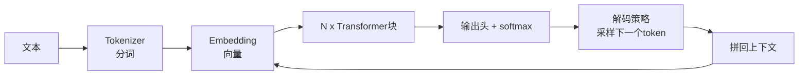

# 大模型基础核心要点

> [!info] 概述
> 本笔记沉淀大语言模型（LLM）的原理核心要点：Transformer 与注意力机制、tokenizer/embedding、预训练范式、SFT/RLHF/DPO 对齐、解码策略、上下文窗口与推理优化。目标是用一份笔记回答"LLM 是怎么训出来的、又是怎么高效跑起来的"。学习路线入口见 [[AI学习路径]]，应用开发实战见 [[LLM应用开发-RAG与Agent]]，NLP 前置知识见 [[自然语言处理-BERT模型详解]]，深度学习基础见 [[深度学习-PyTorch入门]]。

## 一、知识体系总览

| 模块 | 回答的问题 | 关键词 |
| --- | --- | --- |
| Transformer | 模型结构是什么 | Self-Attention、多头、FFN、RoPE、RMSNorm |
| Tokenizer/Embedding | 文本如何进模型 | BPE、词表、token embedding、位置编码 |
| 预训练 | 模型能力从哪来 | 下一个词预测、Scaling Laws、MoE |
| 对齐 | 模型如何"听话" | SFT、RLHF/PPO、DPO、GRPO/RLVR |
| 解码 | 一个字如何生成 | temperature、top-p、贪心/采样 |
| 推理优化 | 如何跑得快又便宜 | KV Cache、量化、投机解码、vLLM |



## 二、Transformer 结构与注意力机制

### 2.1 整体结构

现代 LLM 采用 **decoder-only Transformer**（GPT/Qwen/DeepSeek/Llama 皆然），堆叠 N 个相同模块，每个模块包含：

1. **多头自注意力（Multi-Head Self-Attention）**：token 之间交换信息，是上下文理解的核心。
2. **前馈网络（FFN）**：逐 token 的两层 MLP，用 SwiGLU 激活（Llama/Qwen/DeepSeek 均采用），承担大部分参数量与"知识存储"。
3. **残差连接 + 归一化**：现代模型用 Pre-LN/RMSNorm（而非原始 Post-LN/LayerNorm），训练更稳定。

原始论文为《Attention Is All You Need》（2017，见参考资料[1]）；BERT 属于 encoder-only 双向结构，详见 [[自然语言处理-BERT模型详解]]。

### 2.2 注意力的数学形式

每个 token 生成 Query（想找什么）、Key（我是谁）、Value（我的内容）三个向量：

$$
\text{Attention}(Q,K,V) = \text{softmax}\!\left(\frac{QK^\top}{\sqrt{d_k}}\right)V
$$

- $\frac{1}{\sqrt{d_k}}$ 缩放防止内积过大导致 softmax 饱和；
- 因果掩码（causal mask）保证每个 token 只能"看见"它之前的 token；
- 多头（multi-head）把 $d_{model}$ 切成多组 $d_k$ 并行算注意力，再拼接投影。

### 2.3 注意力计算伪代码

```python
import torch, math

def scaled_dot_product_attention(Q, K, V, mask=None):
    """Q,K,V: (batch, heads, seq_len, d_k)"""
    d_k = Q.size(-1)
    # 1. 相似度打分：每个 query 与所有 key 做点积并缩放
    scores = Q @ K.transpose(-2, -1) / math.sqrt(d_k)
    # 2. 因果掩码：屏蔽未来位置（decoder-only 必需）
    if mask is not None:
        scores = scores.masked_fill(mask == 0, float("-inf"))
    # 3. softmax 归一化成注意力权重（每行和为 1）
    attn = torch.softmax(scores, dim=-1)
    # 4. 对 value 加权求和
    return attn @ V, attn
```

### 2.4 注意力机制演进（2025-2026 主流）

| 变体 | 思路 | 代表模型/技术 |
| --- | --- | --- |
| MHA | 标准多头注意力 | 原始 Transformer、GPT-2 |
| MQA/GQA | 多个 Q 头共享 1 组/分组 KV，压缩 KV Cache | Llama 3（GQA） |
| MLA | KV 投影到低维潜空间，显存大幅下降 | DeepSeek-V2/V3 系列 |
| 稀疏注意力（DSA 等） | 只对部分 token 做精细注意力 | DeepSeek-V3.2 |
| FlashAttention | GPU 分块计算+显存IO优化，不改数学结果 | 主流训练/推理标配 |

> [!tip] 面试/工程高频点
> "为什么注意力要除以 $\sqrt{d_k}$"和"GQA 为什么省显存"是 2025 年以来大模型岗位面试出现率最高的两个原理题；工程侧则必问 KV Cache（见第七节）。

## 三、Tokenizer 与 Embedding

- **Tokenizer**：把文本切成 token id。主流为 **Byte-level BPE**（GPT/tiktoken、Qwen）与 SentencePiece 系列；英文约 0.75 词/token，中文通常 1 个汉字≈0.6~1 个 token。词表大小常见 3 万~25 万。
- **Token Embedding**：查表把 token id 映射为 $d_{model}$ 维向量（如 4096 维）。
- **位置编码**：让注意力感知顺序。主流为 **RoPE（旋转位置编码）**——把位置信息以旋转角度注入 Q/K，具备相对位置性质且易于外推；长上下文扩展常用 YaRN/NTK-RoPE 等插值方法。
- 大模型范式下 embedding 层与输出头常**权重共享**（tie embeddings），省参数。

## 四、预训练范式

1. **自监督目标**：decoder-only 模型做"下一个词预测"（next-token prediction），在数万亿 token 语料上以交叉熵损失训练；一次训练通常分预训练（大量低成本数据）→ 继续预训练/中期训练（数学、代码、长文本等高质量数据）。
2. **Scaling Laws**：损失随参数量、数据量、算力幂律下降。Kaplan 等（2020）给出"大力出奇迹"的外推规律；**Chinchilla**（2022）修正为"参数与数据应等比例增长"（约 20 token/参数）。当前趋势是"推理时算力（test-time compute）"成为新的可扩展维度。
3. **MoE（混合专家）**：把 FFN 拆成多个专家，每 token 只激活少数专家（如 DeepSeek-V3 总参 671B、激活 37B；Qwen3-235B-A22B、Kimi K2 总参 1T/激活 32B），在同等算力下获得更大容量，代价是显存占用与负载均衡复杂度。
4. **数据质量 > 数据数量**：去重、清洗、配比（代码/数学/多语言）决定模型上限；2025 年起普遍加入合成数据。

## 五、后训练对齐：SFT → RLHF → DPO

预训练只是"续写机器"，对齐才让它成为助手：

| 阶段 | 方法 | 做什么 | 关键点 |
| --- | --- | --- | --- |
| 1. SFT | 监督微调 | 用人工编写的指令-回答对做微调 | 教会格式与指令跟随；数据质量决定上限 |
| 2. RLHF | PPO 等强化学习 | 训练奖励模型（RM）拟合人类偏好，再用 PPO 优化策略 | 三阶段流程复杂、训练不稳、易奖励劫持 |
| 3. DPO | 直接偏好优化 | 跳过 RM，用成对偏好数据的闭式损失直接优化 | 实现简单、稳定，开源社区微调首选 |
| 4. RLVR/GRPO | 可验证奖励 RL | 以"答案可验证"（数学/代码）为奖励做大规模 RL，激发推理链 | DeepSeek-R1 的核心路线（见参考资料[4]） |

> [!note] 术语速记
> SFT = Supervised Fine-Tuning；RLHF = Reinforcement Learning from Human Feedback；DPO = Direct Preference Optimization（论文 arXiv:2305.18290）；GRPO = Group Relative Policy Optimization（DeepSeek 提出，去掉价值模型、按组内相对优势计算奖励）；RLVR = RL with Verifiable Rewards。

## 六、解码策略与采样参数

生成每个 token 时，模型输出的是全词表上的概率分布，解码策略决定如何从中取词：

| 参数 | 作用 | 经验值 |
| --- | --- | --- |
| `temperature` | 分布平滑度：越小越确定，越大越多样 | 通用 0.7~1.0；推理模型官方常推荐 0.6（如 DeepSeek-R1）；抽取/分类 0~0.3 |
| `top_p`（核采样） | 只在累积概率前 p 的候选中采样 | 0.9~0.95；与 temperature 二选一调，不要同时大调 |
| `top_k` | 只保留概率最高的 k 个候选 | 20~100，或设 0 关闭 |
| `repetition_penalty` | 惩罚已出现 token，抑制复读 | 1.0~1.2 |
| `max_tokens` / `stop` | 限制长度 / 停止条件 | 按场景设置 |

API 调用示例（OpenAI 兼容协议，适用于 GPT/Claude 网关/DeepSeek/Qwen/vLLM 等几乎所有主流端点）：

```python
from openai import OpenAI

client = OpenAI(base_url="https://api.deepseek.com/v1", api_key="YOUR_KEY")

resp = client.chat.completions.create(
    model="deepseek-chat",
    messages=[
        {"role": "system", "content": "你是一名严谨的中文技术助手。"},
        {"role": "user", "content": "用 3 句话解释 KV Cache 为什么能加速推理。"},
    ],
    temperature=0.7,
    top_p=0.9,
    max_tokens=512,
)
print(resp.choices[0].message.content)
```

## 七、上下文窗口与推理优化

### 7.1 上下文窗口

上下文长度 = 模型一次能处理的 token 上限（系统提示+历史对话+文档+输出总和）。2025-2026 主流旗舰已从 4K→128K→200K/1M 量级演进，但**长上下文 ≠ 全程高质量**：注意"Lost in the Middle"现象（对中间位置信息利用率下降），关键信息尽量前置/后置。

### 7.2 KV Cache：自回归生成的核心优化

- **原理**：生成第 t 个 token 时，前面 token 的 K/V 与历史完全相同，缓存起来避免重算——用显存换时间。
- **代价**：显存 ≈ `2 × 层数 × KV头数 × head_dim × 精度字节数 × 上下文长度 × batch`，长上下文/大批量时成为瓶颈。
- **工程化**：vLLM 的 **PagedAttention** 把 KV Cache 分页管理（类似操作系统虚拟内存），显存利用率大幅提升，是 2023 年以来推理引擎的奠基技术。
- **压缩方向**：GQA/MLA（结构性压缩）、KV 量化（FP8/INT4）、token 淘汰（H2O 等选择性保留）。

### 7.3 量化（Quantization）

用更低精度存储权重/激活以省显存提速度：

| 方案 | 精度 | 场景 |
| --- | --- | --- |
| FP16/BF16 | 16 位 | 训练与标准推理基线 |
| FP8 | 8 位浮点 | 数据中心推理（H 系列 GPU），旗舰 API 默认 |
| INT8（GPTQ/SmoothQuant） | 8 位整数 | 单卡 30B 级模型 |
| INT4（AWQ/GGUF Q4） | 4 位 | 消费级显卡本地跑 7B~14B（Ollama/llama.cpp 常用） |

### 7.4 投机解码（Speculative Decoding）

用一个小的"草稿模型"快速猜 k 个 token，再用大模型**一次前向并行验证**：全部接受则一步生成 k 个 token，否则从第一个被拒绝处回退。数学上保证与原模型分布一致，典型加速 2~3 倍。EAGLE、Medusa 等变体进一步降低草稿成本。

### 7.5 其他工程手段

- **Continuous Batching**：请求级动态调度，完成的请求立即退出、新请求插入，GPU 利用率远高于静态 batching；
- **Prefill/Decode 分离**（PD 分离）：两类计算特性不同，分开部署各自优化；
- **推理引擎**：生产首选 vLLM / SGLang（均支持 OpenAI 兼容 API、量化与投机解码）。

## 八、主流模型对比（截至 2025-11 官方口径，2026 年更新见第十节）

| 模型 | 厂商 | 发布时间 | 开源 | 上下文 | 特点 |
| --- | --- | --- | --- | --- | --- |
| GPT-5.1（Instant/Thinking） | OpenAI | 2025-11 | 否 | 400K（API） | 自适应推理，按难度分配思考时间 |
| Claude Opus 4.5 | Anthropic | 2025-11-24 | 否 | 200K | SWE-bench Verified 80.9%，编码/Agent 强 |
| Gemini 3 Pro | Google | 2025-11-18 | 否 | 1M | 原生多模态、长上下文与推理 SOTA |
| DeepSeek-V3.2 / R1 | DeepSeek | 2025-12 / 2025-01 | 是（MIT） | 128K | 思考+工具调用融合；R1 开创开源推理模型 |
| Qwen3 系列 | 阿里 | 2025 | 是 | 128K~256K | 全尺寸 MoE/Dense 谱系，Qwen3-Coder 编码强 |
| GLM-4.6 | 智谱 | 2025 | 是 | 200K | Agent/编码能力突出，国产开源第一梯队 |
| Kimi K2 | 月之暗面 | 2025-07 | 是 | 256K | 1T 参数 MoE（激活 32B），开源旗舰 |
| Llama 4 | Meta | 2025-04 | 是 | 最高 10M（Scout 宣传值） | MoE + 超长上下文，美国开源代表 |

## 九、核心要点速查

| 概念 | 一句话记忆 |
| --- | --- |
| Self-Attention | 所有 token 互相关注：$\text{softmax}(QK^\top/\sqrt{d_k})V$ |
| RoPE | 用旋转角注入位置信息，长上下文外推的主流方案 |
| BPE | 字节级子词切分，中文 1 字 ≈ 0.6~1 token |
| 预训练 | 下一个词预测 + 海量数据，能力来源 |
| Chinchilla | 参数与 token 等比例扩，约 20 token/参数 |
| MoE | 大总参小激活，单位算力容量更高 |
| SFT | 教格式与指令跟随 |
| RLHF/DPO | 前者奖励模型+PPO，后者直接用偏好对优化 |
| RLVR | 用可验证奖励（数学/代码）激发推理链，R1 路线 |
| KV Cache | 缓存历史 K/V 免重算，自回归生成的时间来源 |
| PagedAttention | KV Cache 分页管理，vLLM 的核心 |
| 量化 | FP8/INT8/INT4 换显存与速度 |
| 投机解码 | 小模型起草+大模型并行验证，分布不变地提速 |

## 十、常见坑与最佳实践

> [!warning] 常见坑
> 1. **混淆"参数量"与"激活量"**：MoE 模型（如 DeepSeek-V3 671B/A37B）部署显存按总参数算，算力成本按激活算，两者都别忽略。
> 2. **temperature 与 top_p 同时大调**：两个参数都控制随机性，叠加容易产生乱码；官方有推荐组合时优先跟随（如推理模型常用 temperature=0.6）。
> 3. **把上下文窗口当免费午餐**：塞满 1M token 的请求既贵又可能触发"中间信息丢失"，长文本应配合 RAG 或摘要压缩。
> 4. **量化后不复测**：INT4 对通用对话影响小，但对代码/数学微调后的模型可能明显掉点，量化前后必须跑同一评测集对比。
> 5. **用训练态思路做推理态估算**：训练 FLOPs 与推理延迟的计算模型不同，推理瓶颈通常是显存带宽而非算力。

> [!tip] 最佳实践
> 1. **学原理按"一条数据流"走**：从 tokenizer → embedding → attention → FFN → 输出头 → 解码采样，亲手用 PyTorch 写一遍（nanoGPT 路线），胜过看十篇解读。
> 2. **优先用 OpenAI 兼容协议**：换模型只改 `base_url` 与 `model` 名，代码不动。
> 3. **推理模型用法不同**：R1/o 系列自带思维链，提示词里不要塞"请一步步思考"类指令，且给足 `max_tokens` 否则思维链被截断。
> 4. **自托管首选成熟引擎**：vLLM/SGLang + 官方量化权重，避免自己魔改；部署前用固定评测集（含中文场景）验证。

## 十一、2025-2026 最新动态（信息截至 2026-11-18）

| 时间点 | 动态 |
| --- | --- |
| 2025-01 | DeepSeek-R1 发布并开源（MIT），验证 RLVR 路线：纯强化学习可激发长思维链推理 |
| 2025-04 | Llama 4（Scout/Maverick）发布，MoE 与千万级上下文成为新宣传点 |
| 2025-11 | 三周内 GPT-5.1（11-12）、Gemini 3 Pro（11-18）、Claude Opus 4.5（11-24）密集发布；自适应推理与 Agentic 能力成为旗舰标配 |
| 2025-12 | DeepSeek-V3.2 上线：思考能力直接集成进工具调用；V3.2-Speciale 在 IMO/CMO/ICPC World Finals/IOI 2025 达金牌水平 |
| 2026 年 | MCP 成为行业事实标准（2026-07-28 新版规范）；DeepSeek-V4 Pro GA（2026-08）、V4.1-Flash（2026-09/10）发布；稀疏注意力、KV 低精度缓存、PD 分离架构在推理引擎中普及 |

## 十二、参考资料

1. [Attention Is All You Need（arXiv:1706.03762）](https://arxiv.org/abs/1706.03762)——Transformer 原始论文
2. [Direct Preference Optimization（arXiv:2305.18290）](https://arxiv.org/abs/2305.18290)——DPO 论文
3. [DeepSeek-R1: Incentivizing Reasoning Capability in LLMs via RL（arXiv:2501.12948）](https://arxiv.org/abs/2501.12948)——R1 技术报告
4. [FlashAttention（arXiv:2205.14135）](https://arxiv.org/abs/2205.14135)——IO 感知的精确注意力加速
5. [Efficient Memory Management for LLM Serving with PagedAttention（arXiv:2309.06180）](https://arxiv.org/abs/2309.06180)——vLLM 论文
6. [大模型推理优化 RoadMap（持续更新）- 知乎](https://zhuanlan.zhihu.com/p/2056050797784438492)（KV Cache 压缩与投机解码综述）
7. [phonism/LLMNotes - GitHub](https://github.com/phonism/LLMNotes)（Transformer/RoPE/MLA/RLHF 学习笔记）
8. [DeepSeek API 新闻：V3.2 发布](https://api-docs.deepseek.com/news/news251201)（2025-12-01）
9. [Claude Opus 4.5 发布公告 - Anthropic](https://www.anthropic.com/news/claude-opus-4-5)（2025-11-24）
